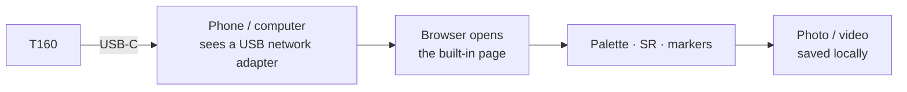

# Introduction

Sipeed T160 is a pocket thermal camera that plugs straight into the USB-C port of a phone or computer. It has a 160 × 120 thermal resolution.
**No app and no driver are needed.** The device shows up as a USB network adapter. Open its built-in web page in a browser to see the live thermal image, read temperatures, and take photos or videos.
It suits board-level hot-spot hunting, home and HVAC checks, and makers who want thermal data in their own projects.

## Key Features

1. **No app, no driver**: the device serves its own web page. Open it in any browser on your phone or computer.
2. **Live temperature markers**: the image shows the hottest (H), coldest (L) and center (C) temperatures.
3. **AI super resolution in the browser**: a neural network running in your browser upscales the 160 × 120 image to 480 × 360 (3×) in real time, with sharper edges than plain interpolation. Drag the slider to compare before and after.
4. **14 color palettes**: White Hot, Black Hot, Ironbow, Rainbow and more.
5. **Photos and videos saved to your device**: you save exactly what you see, including palette, super resolution and temperature markers. Nothing is stored on the camera.
6. **Open data interface**: an HTTP API delivers every frame together with its temperature data, ready for your own programs.

> A **palette** maps invisible temperature differences to colors. In Ironbow, brighter means hotter. **Super resolution** upscales a low-resolution image and restores detail.

## How It Works

In short: the T160 captures thermal images and temperatures. Your browser handles palettes, super resolution, photos and videos.

Because image processing runs in the browser, palettes and super resolution improve with web page updates. Most improvements need no firmware upgrade.

## Specifications

At a glance: 160 × 120 thermal imaging, direct USB-C plug-in, 3× AI super resolution in the browser.

| Item | Specification |
| :--- | :--- |
| Thermal resolution | 160 × 120 |
| Browser super resolution | 480 × 360 (3×, can be turned off) |
| Frame rate | TBD |
| Temperature range | TBD |
| Accuracy | TBD |
| Field of view (FOV) | TBD |
| Processor | RP2350 |
| Connector | USB Type-C male |
| Connection | USB network adapter (USB NCM), driver-free |
| Supported systems | Windows, Linux, Android, iOS (TBD) |
| Palettes | 14 |
| Photo / video | Saved by the browser to your phone or computer |
| Dimensions | About 45 × 29 × 8 mm without the lens bump, about 14.6 mm thick with it (TBD) |
| Weight | TBD |

## Use Cases

- **Electronics repair and design**: find overheating parts, shorts and overloaded power components on a board.
- **Home and HVAC**: spot heat leaks around walls and windows, trace floor-heating pipes, check air-conditioner outlets.
- **Equipment checks**: look for hot power strips, distribution boxes and motors.
- **Makers and education**: read temperature data over HTTP for monitoring or alarm projects.

Need higher resolution, a built-in screen or standard UVC camera output? See the [T256s](../T256s/Intro.md).

## Links

- Store: coming soon
- Support: support@sipeed.com
- Community (Discord): [discord.gg/V4sAZ9XWpN](https://discord.gg/V4sAZ9XWpN)
- X / Twitter: [@SipeedLab](https://x.com/SipeedLab)
- Sipeed GitHub: https://github.com/sipeed

## Next Step

The Quick Start page is in progress. It will walk you from plugging in the device to your first thermal image.
