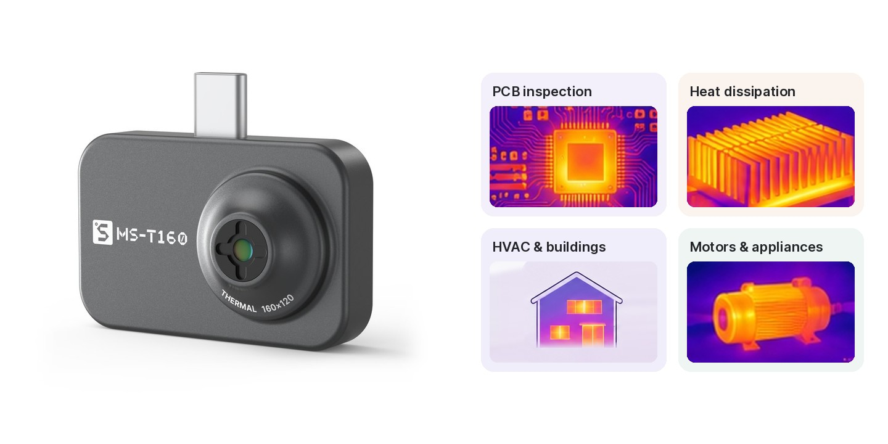
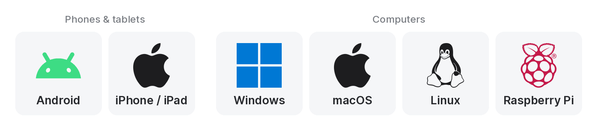
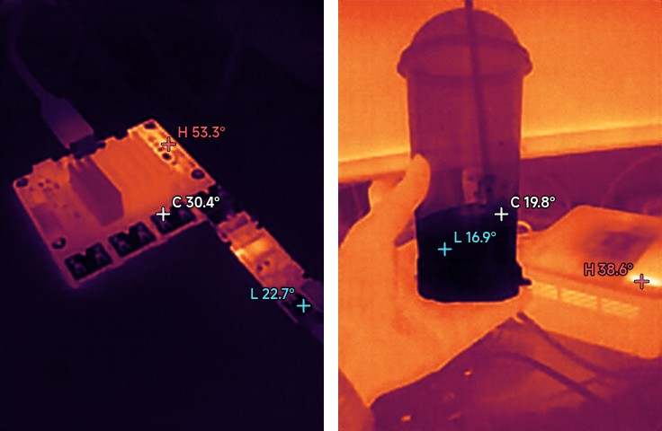
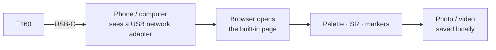
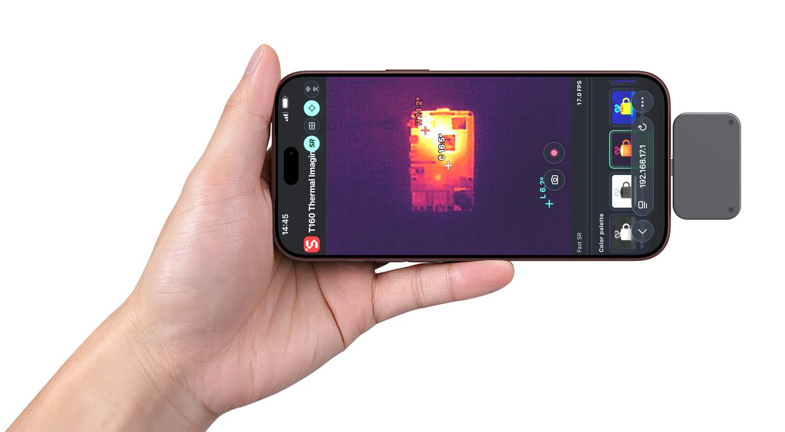
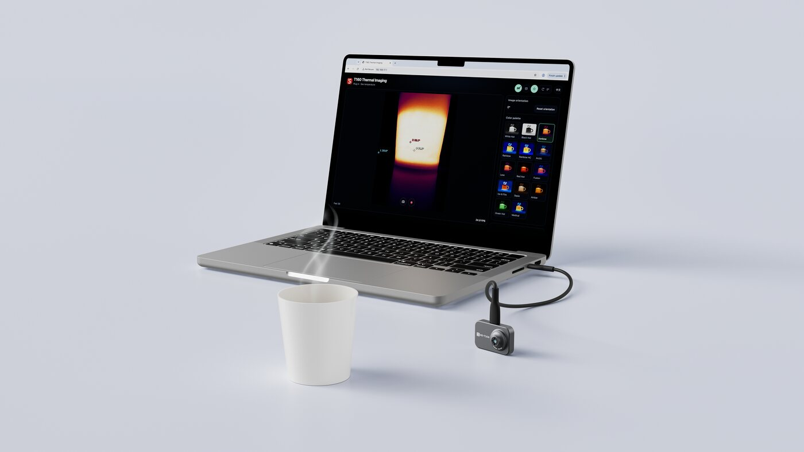
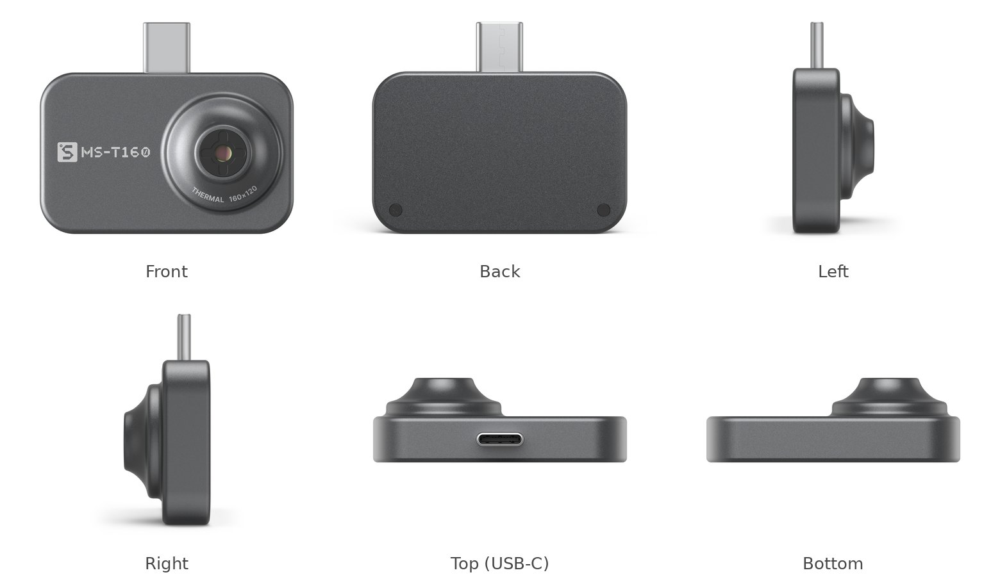
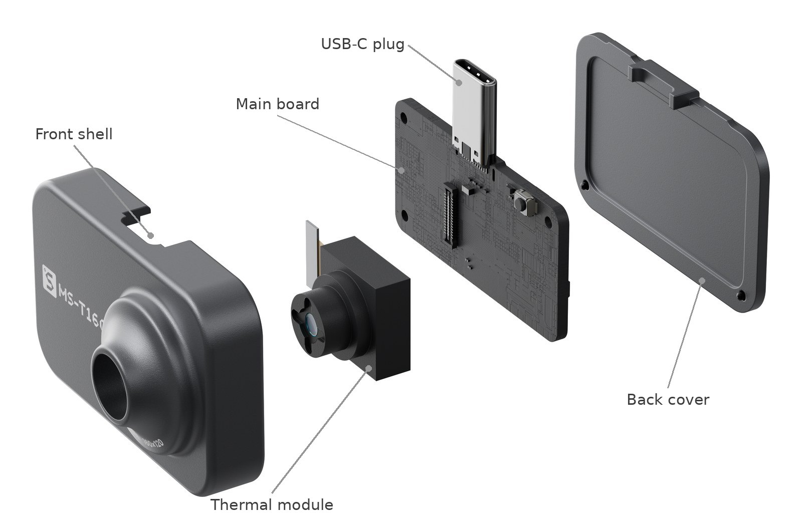
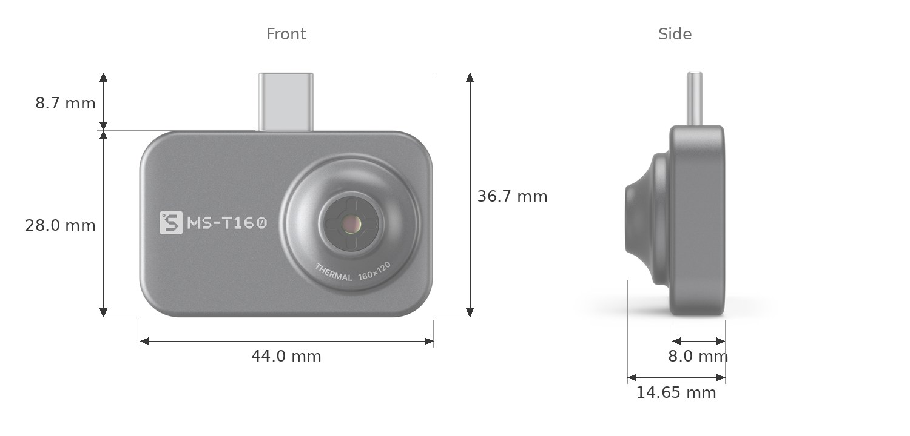

# Introduction

Sipeed MS-T160 is a pocket thermal camera that plugs straight into the USB-C port of a phone or computer. It has a 160 × 120 thermal resolution.
**No app and no driver are needed.** The device shows up as a USB network adapter. Open its built-in web page in a browser to see the live thermal image, read temperatures, and take photos or videos.
It suits board-level hot-spot hunting, home and HVAC checks, and makers who want thermal data in their own projects.

## Works Everywhere, Right in the Browser

The T160's interface is a web page built into the device. Anything with a USB-C port and a browser can use it: Android phones and tablets, iPhones, iPads, and Windows, macOS or Linux computers. The interface and features are the same everywhere. Devices with only USB-A ports, such as a Raspberry Pi, work through a USB-A to USB-C adapter.

Compared with thermal camera add-ons that need an app, this means:

- **No app to find**: nothing to download from an app store, and no limits from store regions or system versions.
- **No driver, no account**: plug in and go, on any phone or computer.
- **One camera, many places**: check something on your phone in the field, then plug into your desk computer and keep going with the same page.
- **The browser does the work**: super resolution, palettes, photos and video run in the browser, so the device stays simple and low power.

## Key Features

1. **No app, no driver, every platform**: the device serves its own web page. Open it in a browser on an Android or Apple phone or tablet, or on any computer.
2. **Live temperature markers**: the image shows the hottest (H), coldest (L) and center (C) temperatures.
3. **AI super resolution in the browser**: a neural network running in your browser upscales the 160 × 120 image to 480 × 360 (3×) in real time. Drag a divider to compare before and after. The model is stored on the device, so no internet is needed.
4. **14 color palettes**: White Hot, Black Hot, Ironbow, Rainbow and more.
5. **Photos and videos saved to your device**: you save exactly what you see, including palette, super resolution and markers. Nothing is stored on the camera.
6. **Open data interface**: an HTTP API delivers every frame together with its temperature data, ready for your own programs or AI tools.

> A **palette** maps invisible temperature differences to colors. In Ironbow, brighter means hotter. **Super resolution** upscales a low-resolution image and restores detail.

## Real Captures

Both photos were taken from the T160 web page: a running circuit board on the left and an iced drink in hand on the right.

## How It Works

In short: the T160 captures thermal images and temperatures. Your browser handles palettes, super resolution, photos and videos.

Because image processing runs in the browser, palettes and super resolution keep improving with web page updates.

*The T160 plugs directly into a phone or computer. The laptop scene uses a USB-C extension cable, which is not included.*

## Specifications

At a glance: 160 × 120 thermal imaging, 25 fps, 0 to 120 °C, direct USB-C plug-in, 3× AI super resolution in the browser.

| Item | Specification |
| :--- | :--- |
| Thermal resolution | 160 × 120 |
| Browser super resolution | 480 × 360 (3×, can be turned off) |
| Frame rate | 25 fps |
| Temperature range | 0 to 120 °C |
| Accuracy | ±2 °C |
| Thermal sensitivity (NETD) | 50 mK |
| Field of view (FOV) | 34° × 26° |
| Processor | RP2350 |
| Connector | USB Type-C male, plugs in directly |
| Connection | USB network adapter (NCM), driver-free |
| Supported systems | Android, iOS, iPadOS, Windows, macOS, Linux including Raspberry Pi (iPhone and iPad need a USB-C port) |
| Power | About 0.5 W (5 V, 100 mA) |
| Recommended ambient temperature | 10 to 30 °C |
| Dimensions | 44 × 28 × 8 mm (body), see the drawing below |
| Weight | 21 g |
| Palettes | 14 |
| Photo / video | Saved by the browser to your phone or computer |

> **NETD** (noise equivalent temperature difference) is the smallest temperature difference the camera can resolve; lower is better. A 34° × 26° field of view covers about 61 × 46 cm at 1 m.

## Appearance and Connector

The T160 has a single connector: the USB-C plug on top. Plug it straight into a phone or computer. There is no cable, battery or button. The lens and lens ring are on the front, the back cover on the back.

## Internal Structure

The T160 has four parts: front shell, thermal module, main board and back cover. The USB-C plug is soldered to the main board. The enclosure is sealed; there is no need to open it.

## Dimensions

The body is 44 × 28 × 8 mm. It is 14.65 mm thick including the lens bump. The USB-C plug sticks out 8.7 mm, for a total height of 36.7 mm.

## Use Cases

- **Electronics repair and design**: find overheating parts, shorts and overloaded power components on a board.
- **Home and HVAC**: spot heat leaks around walls and windows, trace floor-heating pipes, check air-conditioner outlets.
- **Equipment checks**: look for hot power strips, distribution boxes and motors.
- **Makers and education**: read temperature data over HTTP for monitoring or alarm projects, or hand it to an AI tool.

## MS-T160 or MS-T256S

| | MS-T160 | MS-T256S |
| :--- | :--- | :--- |
| Thermal resolution | 160 × 120 | 256 × 192 |
| AI super resolution | In the browser, 480 × 360 output | On the device, 640 × 480 output |
| Screen | None, view in a phone or computer browser | 1.69-inch touchscreen, works without a computer |
| Connection | USB network adapter with a built-in web page | UVC camera, plus an HTTP API |
| Best for | Thermal imaging on a phone at the lowest cost | Higher resolution, a built-in screen or camera output |

See the [MS-T256S documentation](../T256s/Intro.md) for details.

## Links

- Store: coming soon
- Support: support@sipeed.com
- Community (Discord): [discord.gg/V4sAZ9XWpN](https://discord.gg/V4sAZ9XWpN)
- X / Twitter: [@SipeedLab](https://x.com/SipeedLab)
- Sipeed GitHub: https://github.com/sipeed

## Next Step

Start with the [Quick Start](./Quick_Start.md). Plugging in, opening the page and reading your first temperature take only a few minutes.
