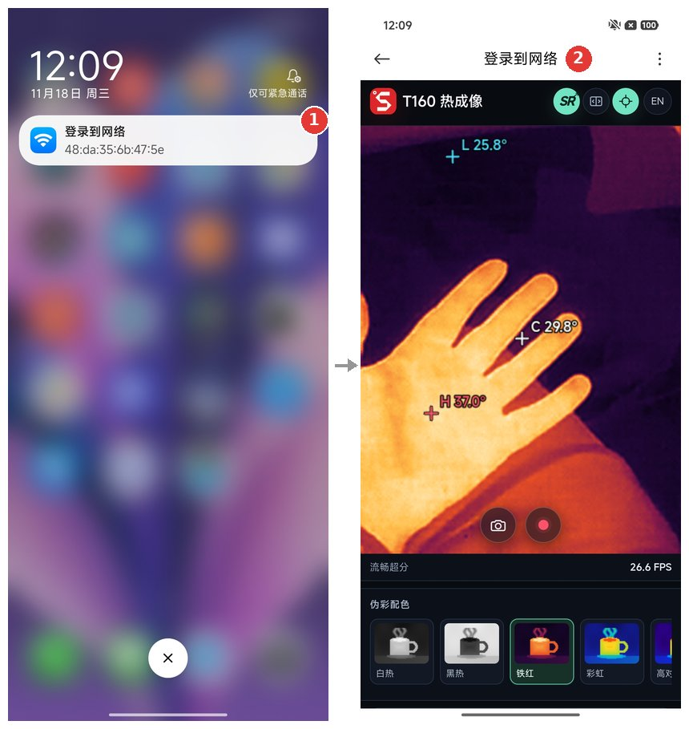
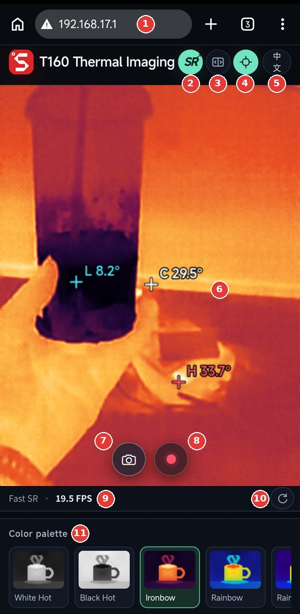
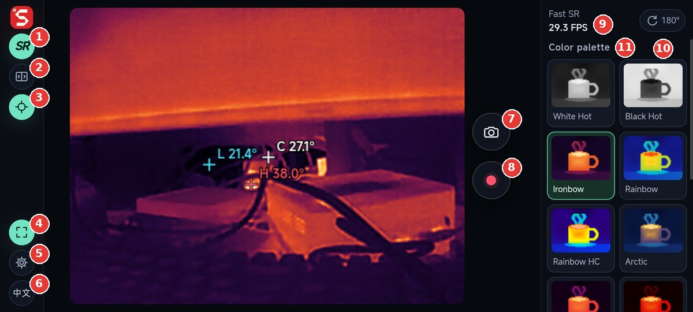
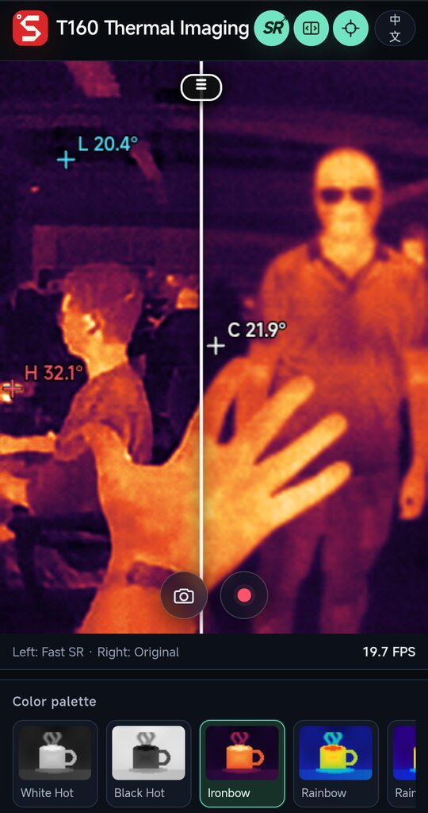
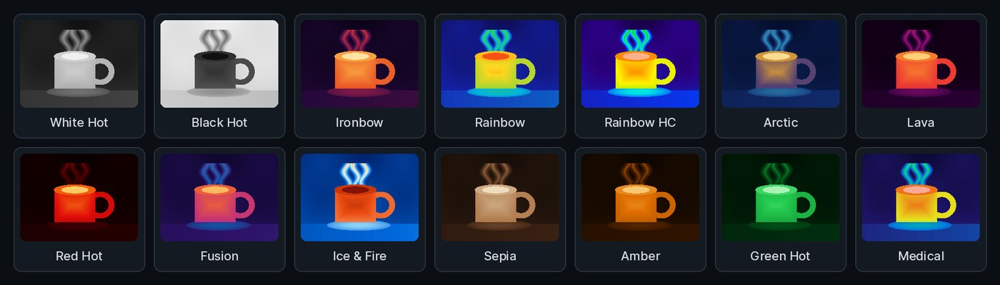

# Quick Start

Using the T160 takes three steps: plug it in, open the web page in a browser, and read the temperature. No app or driver is needed.
This page walks through those steps, then explains each feature on the page.

## What You Need

- An MS-T160.
- A phone, tablet or computer with a USB-C port: an Android phone or tablet, an iPhone, an iPad, or a Windows, macOS or Linux computer. iPhones and iPads must have a USB-C port (iPhone 15 and later); Lightning models are not supported.
- A browser. Chrome 114 or Firefox 146 and later give the fastest super resolution. Other browsers show the image and temperatures just fine.

> The T160 plugs straight into a USB-C port. It needs no cable or battery, and no extension cable is included.

## Plug In the T160

Plug the T160 directly into the USB-C port of your phone or computer.

After a few seconds, the T160 appears as a new network:

- **Phone**: you usually see a notice such as "Sign in to network" or "No internet access". This is normal. The T160 is a local network that only connects to your phone, so it never has internet.
- **Computer**: a new wired network adapter appears and gets a `192.168.17.x` address automatically.

> If nothing happens, see the Connection section of the [FAQ](./FAQ.md).

## Open the Web Page

### Android phones

**A "Sign in to network" notification appears**: some Android phones show it after you plug in the T160 (① below). Tap it and the T160 page opens (② below).

**No notification appears**: Android ranks a USB network adapter below Wi-Fi and mobile data, so the browser sends its requests over Wi-Fi or mobile data and cannot reach the T160. Do this instead:

1. Turn on **airplane mode**. If Wi-Fi stays on in airplane mode, turn Wi-Fi off too.
2. Open a browser and enter `192.168.17.1` in the address bar.
3. Within a few seconds you should see the **T160 Thermal Imaging** page with a live thermal image.

> Airplane mode does not affect the T160, which talks over USB. Remember to turn airplane mode off when you are done.

### iPhone, iPad and computers

1. Open a browser.
2. Enter `192.168.17.1` in the address bar.
3. Within a few seconds you should see the **T160 Thermal Imaging** page with a live thermal image.

> The browser may label the page "Not secure" because the T160 uses a local HTTP connection. This does not affect anything. If the page does not open, see the [FAQ](./FAQ.md).

## Know the Page

The page switches between a portrait and a landscape layout to match the screen. The buttons do the same things in both; only their positions change.

### Portrait Layout

This is the page on a phone held upright. The numbers in the screenshot match the table below.

| No. | Name | What it does |
| :---: | :--- | :--- |
| 1 | Address bar | Shows the device address, `192.168.17.1` by default |
| 2 | SR | Turns browser super resolution on or off, see [Super resolution and comparison](#Super-Resolution-and-Comparison) |
| 3 | Compare | Splits the image to compare super resolution with the original; needs SR on |
| 4 | Markers | Shows or hides the H, L and C markers |
| 5 | Language | Switches between English and Chinese |
| 6 | Temperature markers | H is the hottest point, L the coldest, C the center |
| 7 | Photo | Saves the current image as a photo |
| 8 | Record | Starts recording; tap again to stop and save |
| 9 | Status bar | Current image mode and actual frame rate |
| 10 | Rotate | Rotates the image 90° clockwise per tap, see [Fix the Image Orientation](#Fix-the-Image-Orientation) |
| 11 | Color palette | Swipe to pick a palette |

At the bottom of the page, the **Device settings & firmware** panel handles firmware updates and multi-device setup. See [Advanced Use and Development](./Advanced.md).

### Landscape Layout

When you turn the phone sideways, the page switches to a landscape layout and the image turns upright on its own. The top bar moves to the left, the photo and record buttons sit to the right of the image, and the status bar and palette are on the far right, where the palette scrolls vertically. Wide desktop browser windows use the same layout.

| No. | Name | What it does |
| :---: | :--- | :--- |
| 1 to 3 | SR, Compare, Markers | Same as the top bar in portrait |
| 4 | Full screen | Hides the browser address bar for a larger image; tap again to exit |
| 5 | Settings | Slides out the **Device settings & firmware** panel; tap again or tap the image to close it |
| 6 | Language | Switches between English and Chinese |
| 7, 8 | Photo, Record | Same as in portrait |
| 9 | Status bar | Current image mode and actual frame rate |
| 10 | Rotate | Adjusts the orientation by hand; the button shows the manual angle |
| 11 | Color palette | Scroll up and down to pick a palette |

On a phone in landscape, a hint asks you to tap the image for full screen the first time. Safari on iPhone does not support web full screen, so the button is hidden there.

## Read the Temperature

The image shows three markers by default:

- **H** (red): the hottest point and its temperature.
- **L** (blue): the coldest point and its temperature.
- **C** (white): the temperature of a small area at the center (5 × 5 pixels). To measure an object, aim the T160 so the object sits in the center.

Tap the Markers button (4 in the screenshot) to hide them, and tap again to bring them back.

The T160 measures 0 to 120 °C with ±2 °C accuracy. It works best at room temperatures of 10 to 30 °C. Shiny metal reads low; see the [FAQ](./FAQ.md) for why.

## Super Resolution and Comparison

Super resolution upscales the 160 × 120 image to 480 × 360 in your browser in real time, with sharper edges and detail. The model is stored on the T160, so no internet is needed.

- Tap **SR** to turn super resolution on or off. The status bar shows the current mode.
- In Chrome 114, Firefox 146 and later, the page uses the fastest mode, **Fast SR**, and turns it on by default.
- In other browsers, the page first measures the speed. It turns super resolution on when it is fast enough; otherwise it leaves it off, and you can still turn it on with the SR button.

To see the difference, turn on super resolution, then tap **Compare**. A vertical line splits the image: super resolution on the left, the original on the right. Drag the handle in the middle of the line to move it.

> Super resolution only improves what you see. Temperatures always come from the T160's original measurements.

## Change the Palette

Swipe the color palette row below the image and tap one to switch. The legend below shows all 14 palettes, using the same icons as the palette row on the page:

A palette changes only the colors you see and save, not the temperature data. In the default Ironbow, brighter means hotter. White Hot is good for seeing outlines.

## Fix the Image Orientation

- **Auto-follow**: when you turn a phone or tablet, the image turns upright on its own.
- **Manual rotate**: if the orientation is still wrong, for example because the T160 is plugged in the other way round, tap the rotate button at the right of the status bar (10 in the screenshot). Each tap rotates the image 90° clockwise, and the button shows the manual angle.
- The browser remembers the manual angle. On another phone or browser, set it again.

## Take Photos and Videos

- **Photo**: tap the camera button to save the current image as a 360 × 480 PNG. It includes the palette, super resolution and markers you see.
- **Video**: tap the red dot to start recording; the button shows the elapsed time. Tap again to stop and save. The browser picks the format, usually MP4 and sometimes WebM.

The browser saves photos and videos straight to your phone or computer, with file names starting with `T160_`. On Android they usually land in Downloads; on a computer, in the browser's download folder. The T160 itself stores nothing.

Here is a video recorded from the T160 web page:

<video src="../../../zh/ThermalCam/T160/assets/Screenshots/record-example.mp4" autoplay loop muted playsinline width="360"></video>

> Colors in photos and videos only show what is warmer or cooler. For actual values, read the temperature markers.

## Next Steps

- To update the firmware, connect several devices or read data over HTTP, see [Advanced Use and Development](./Advanced.md).
- To let an AI tool read the T160, see [AI Integration](./AI_Control.md).
- If something goes wrong, see the [FAQ](./FAQ.md).
