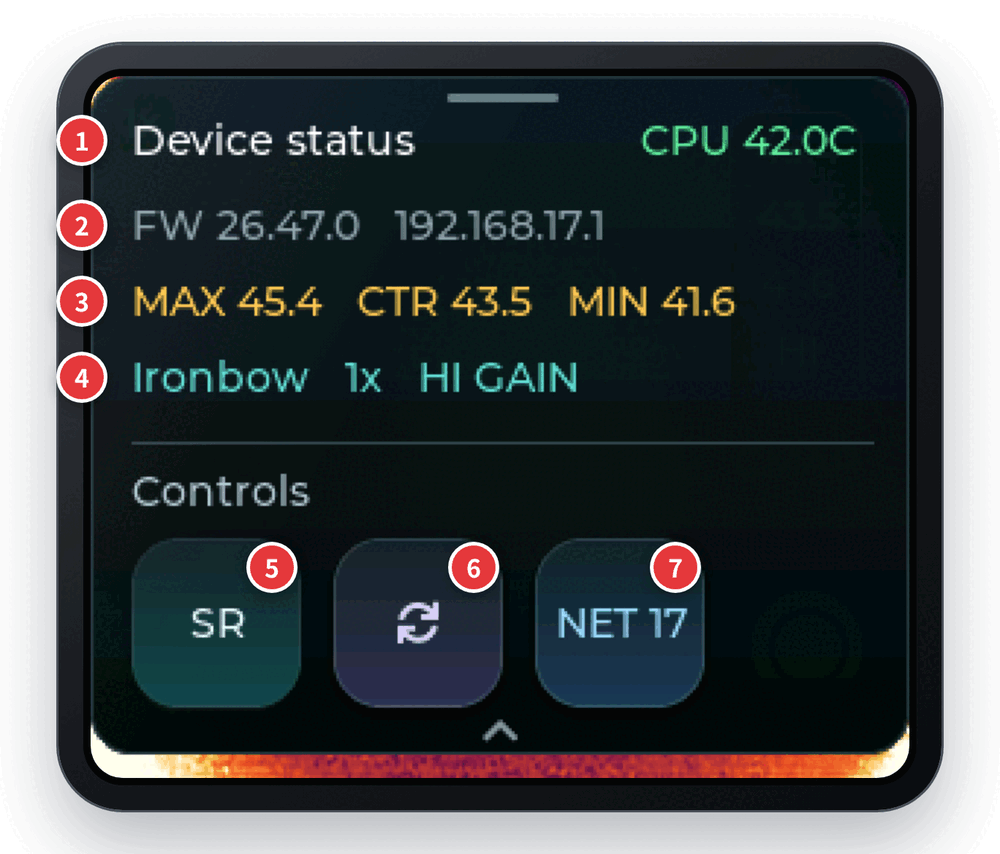
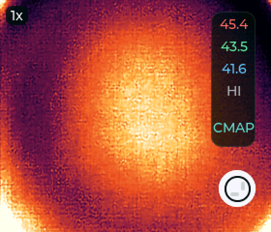
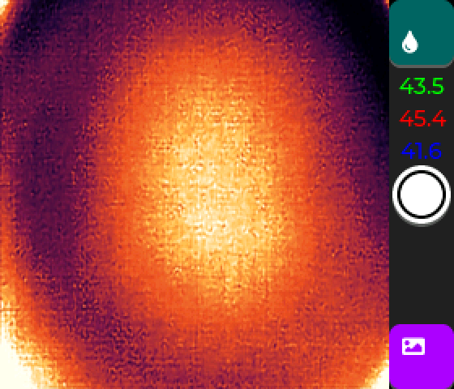
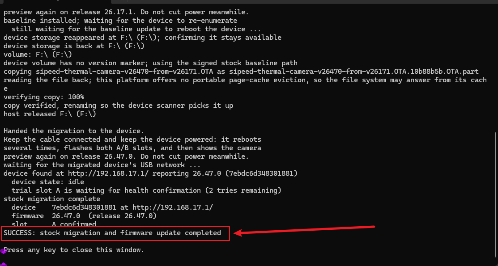
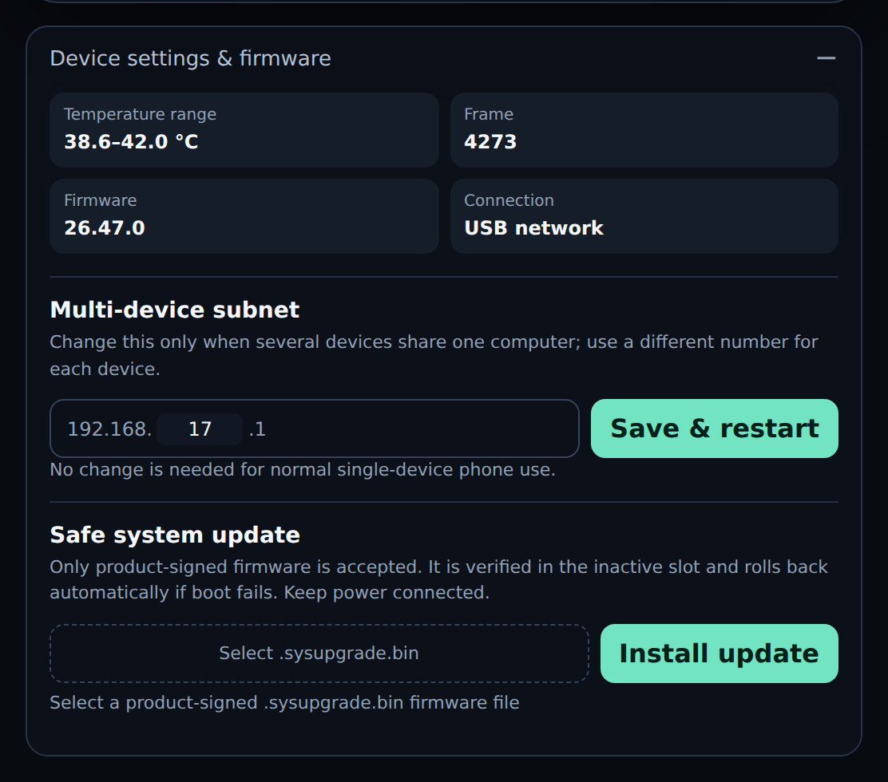
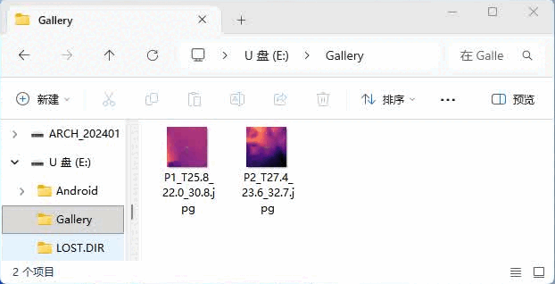

# Advanced Use & Development

This page has three parts:

- **Device settings**: the status panel, checking and updating the firmware, and using several cameras on one computer.
- **Data and files**: the UVC output formats, reading raw temperatures from Y16, and photos on the USB drive.
- **Development**: reading T256S data over the HTTP API, with AI tools or over UVC.

## Device Settings

### Status Panel

Pull down from the top edge of the screen to open the status panel. The first pull shows quick controls (Controls); keep pulling to see the full device status. Swipe up to close it step by step.



| No. | Item | Description |
| :---: | :--- | :--- |
| 1 | Device status and CPU temperature | The CPU temperature is green below 65 °C, yellow from 65 to 80 °C, and red at 80 °C and above |
| 2 | Firmware version and device address | For example `FW 26.47.0   192.168.17.1` |
| 3 | Temperatures | Hottest (MAX), center (CTR) and coldest (MIN) |
| 4 | Image status | Full name of the current palette, zoom level and gain (`HI GAIN` or `LO GAIN`) |
| 5 | SR | Turns on-screen super resolution on or off; the button is highlighted when it is on. It affects only the screen, not the camera stream or the web page |
| 6 | Rotate interface | Tap once to see `TAP AGAIN`, then tap again to turn the buttons and text 180°. The thermal image itself does not rotate |
| 7 | NET | Changes the subnet of the USB network adapter; see [Use Several Cameras on One Computer](#Use-Several-Cameras-on-One-Computer) |

When you hold the T256S upside down, for example plugged into the bottom of a phone, the on-screen text is upside down. Rotate the interface to fix it.

This animation shows how to open the status panel from the top edge:



### Check the Firmware Version

- **Versions after 26.17.1**: open the status panel; the version follows `FW` (item 2 above). You can also expand "Device settings & firmware" at the bottom of the web page and look at "Firmware".
- **26.17.1 and earlier**: long-press the capture button on the screen. The screen shows device information, and the `version=` line is the firmware version.



Include the version number when you report a problem.

### Update the Firmware

Check the current version first, then choose the update method:

| Current version | Method |
| :--- | :--- |
| 26.17.1 and earlier | [Run the update tool](#Run-the-Update-Tool) on a computer, which goes straight to 26.47.0 |
| After 26.17.1 | [Update in the browser](#Update-in-the-Browser) |

#### Run the Update Tool

Cameras on 26.17.1 or earlier need the update tool once. It converts the camera to the new dual-system layout and installs 26.47.0. All later updates can then be done in the browser.

> ⚠️ This update rebuilds the internal storage. **All photos on the camera are erased and cannot be recovered.** Copy the photos you need from the `Gallery` folder of the USB drive first.

1. Download `T256S-v26470-stock-migration.zip` from the [Sipeed download site](https://dl.sipeed.com/shareURL/ThermalCam/T256s/firmware) and extract it.
2. Connect the T256S to the computer with a data cable and check that its USB drive appears.
3. Run the tool for your system:
   - **Windows 10/11 (64-bit)**: open the `Windows` folder and double-click `t256s-migrate.cmd`. If SmartScreen appears, click "More info", then "Run anyway".
   - **macOS (Apple silicon)**: Finder may refuse to run a downloaded program, so open Terminal, go to the extracted `macOS-arm64` folder and run `./t256s-migrate.command`.
   - **Linux (x86-64)**: in the extracted folder, run `./Linux/t256s-migrate auto --release-dir ./release`.
4. Wait for the tool to finish. The camera restarts several times and the screen may go black; that is normal. At the end, the camera checks itself for about a minute. Do not unplug the cable or cut the power.
5. `SUCCESS` in the window means the update is complete. The last lines show the new firmware version:

   

6. [Check the firmware version](#Check-the-Firmware-Version) to confirm it is now 26.47.0.

Notes:

- If the camera runs a version older than 26.17.1, the tool first brings it to 26.17.1, waits for it to restart and continues on its own.
- If the update stops halfway, the camera starts from the version it had before. Reconnect it, keep it powered and run the same tool again.
- If the tool says the camera may still be converting, do not restart the camera. Wait a few minutes and check the version again.
- If the tool cannot find the camera, see the [FAQ](./FAQ.html#The-Update-Tool-Cannot-Find-the-Camera).

> ⚠️ This update has no power-loss protection. Use a stable power source and cable throughout. If the camera no longer starts after a power cut, contact support@sipeed.com for repair. Do not open the camera.

#### Update in the Browser

Cameras on versions after 26.17.1 update from the web page, using a file that ends in `.sysupgrade.bin`.

1. Download the new `.sysupgrade.bin` file from the [Sipeed download site](https://dl.sipeed.com/shareURL/ThermalCam/T256s/firmware). Do not extract or rename it.
2. Open `http://192.168.17.1` in a browser and expand "Device settings & firmware" at the bottom of the page.
3. Under "Safe system update", select the file and click **Install update**.
4. The page shows the upload progress. After "Firmware accepted. The device will reboot." appears, the camera restarts by itself.
5. When it is back, check the version under "Firmware".



The browser update writes the new firmware to a spare system slot and verifies it first. If the new system fails to start, the camera rolls back to the previous version, so this method is safer than the update tool. Still, keep the camera powered and connected during the upload and installation.

> If this section is titled "USB migration required", the camera still uses the old single-slot system and cannot update in the browser. [Run the update tool](#Run-the-Update-Tool) instead.

### Use Several Cameras on One Computer

Every T256S uses `192.168.17.1` by default. Only when you plug two or more into one computer do they need different subnets; otherwise their web pages and HTTP APIs conflict. A single camera on a phone needs no change. The UVC camera and the USB drive are not affected by the subnet.

**On the web page:**

1. Plug in only one T256S, open its web page and expand "Device settings & firmware" at the bottom.
2. Under "Multi-device subnet", enter a number from 1 to 254, for example `18`. Click **Save & restart** and confirm the dialog.
3. The page shows "Saved. The device is restarting its network on the new address…" and moves to `http://192.168.18.1/` a few seconds later.
4. Plug in the next T256S and repeat with a different number.

**On the camera screen:**

1. Open the status panel and tap **NET 17** (the number is the current subnet). When `TAP AGAIN` appears, tap once more.
2. In the **USB NETWORK** window, scroll to the new subnet. The window previews the new address, such as `192.168.18.1`.
3. Tap **APPLY** to confirm; the screen shows the new address. Tap **CANCEL** to leave it unchanged. If you pick the current subnet, `NO CHANGE` appears.

> Note the new address. If you forget it, open the status panel: the current address follows the `FW` version. To go back to the default address, set the subnet to `17`.

## Data and Files

### UVC Output Formats

The T256S UVC camera offers three formats. Most camera apps pick MJPEG automatically. For raw temperatures, choose Y16 at 192 × 256.

| Format | Resolution | Content | Use it for |
| :--- | :--- | :--- | :--- |
| MJPEG | 480&nbsp;×&nbsp;640 | Super-resolution color image in the device palette | Preview, recording, streaming, meetings |
| Y16 | 192&nbsp;×&nbsp;256 | Raw temperature data for every pixel, convertible to °C | Temperature analysis, development |
| Y16 | 480&nbsp;×&nbsp;640 | Super-resolution grayscale image, **not temperatures** | Vision processing that needs a high-resolution grayscale image |

All three are portrait (width × height). MJPEG colors only show relative heat and cannot be converted back to temperatures. For temperatures, use Y16 at 192 × 256 or the [HTTP API](./API.md).

> Only one program at a time can open the UVC camera. If an app shows a black image or cannot open the camera, close other programs that may be using it.

### Read Temperatures from Y16

In the 192 × 256 Y16 format, each pixel is a 16-bit unsigned integer. Convert it with:

```text
temperature (°C) = pixel value / 64 - 273.15
```

For example, a pixel value of 19200 means 19200 / 64 - 273.15 = 26.85 °C.

For your own code, the HTTP API's `/frame.temp16` is the better choice: it carries the same data plus a frame number, timestamp and checksum, without any camera driver work. See the [HTTP API](./API.md). If you must use UVC, here is a Linux example: grab one Y16 frame with `v4l2-ctl`, then convert it in Python.

```bash
# Find the device of Thermal Camera (UVC), for example /dev/video0
v4l2-ctl --list-devices
# Grab one 192 x 256 Y16 frame into frame.raw
v4l2-ctl -d /dev/video0 \
  --set-fmt-video=width=192,height=256,pixelformat="Y16 " \
  --stream-mmap --stream-skip=3 --stream-count=1 \
  --stream-to=frame.raw
```

```python
import numpy as np

# Portrait frame: 256 rows of 192 pixels
raw = np.fromfile("frame.raw", dtype="<u2").reshape(256, 192)
celsius = raw / 64.0 - 273.15

print("Center: %.2f C" % celsius[128, 96])
print("Max: %.2f C" % celsius.max())
print("Min: %.2f C" % celsius.min())
```

Readings drift right after power-on. Wait about 2 minutes, until the camera reaches thermal equilibrium, for better results.

### Photos and the USB Drive

On a computer, the T256S shows up as a USB drive of about 36 MB. Photos taken on the screen are in its `Gallery` folder:



- Photos are 480 × 640 JPEGs in the palette used when they were taken, without the on-screen temperature overlays.
- File names follow `P<number>_T<center>_<min>_<max>.jpg`. For example, `P2_T27.4_23.6_32.7.jpg` is photo 2, with 27.4 °C at the center, 23.6 °C minimum and 32.7 °C maximum. Sort or filter by name to find unusual readings quickly.

> ⚠️ While the computer is using the USB drive, eject it on the computer before you take or delete photos on the screen. Otherwise the two sides may show different files. The update tool erases all photos, so copy them first.

## Development

There are three ways to get data out of the T256S:

| Method | What you get | Use it for |
| :--- | :--- | :--- |
| [HTTP&nbsp;API](./API.md) | Center, hottest and coldest temperatures, color images and per-pixel temperatures, with metadata and checksums on every frame | Your own programs, temperature logging, system integration |
| [AI&nbsp;tools](./AI_Control.md) | A language model reads temperatures and images and draws conclusions | Inspection analysis, questions and answers |
| [UVC](#UVC-Output-Formats) | MJPEG color image and Y16 raw temperatures | Existing video software, OpenCV and other vision pipelines |

The web page and the HTTP API require firmware 26.40.0 or later. The UVC camera works on every version.

## Usage Notes

- **Warm-up**: wait about 2 minutes after power-on so the camera reaches thermal equilibrium and readings settle.
- **Emissivity**: the T256S calculates temperatures with an emissivity of 0.95, which suits skin, plastic, circuit boards, walls and most other non-metal surfaces. Shiny metal reflects strongly and reads much too low. Put a small piece of black electrical tape on the spot, let it reach the object's temperature and measure the tape.
- **Shutter calibration**: an occasional short pause with a faint click is the thermal module calibrating with its shutter (NUC). This is normal.
- **Power**: use a stable 5 V source and a good cable. Without enough power, the camera may keep restarting or flicker.
- **Heat**: the body gets warm in use and the aluminum housing spreads the heat. This is normal. Use the camera with some airflow and do not leave it in a closed, hot space for long periods.
- **Environment**: avoid high humidity and strong electromagnetic interference. Long periods in hot surroundings affect accuracy.

## Next Steps

- Read temperatures and images from your own code: see the [HTTP API](./API.md).
- Let an AI tool read temperatures and draw conclusions: see [AI Integration](./AI_Control.md).
- Something not working: see the [FAQ](./FAQ.md).
