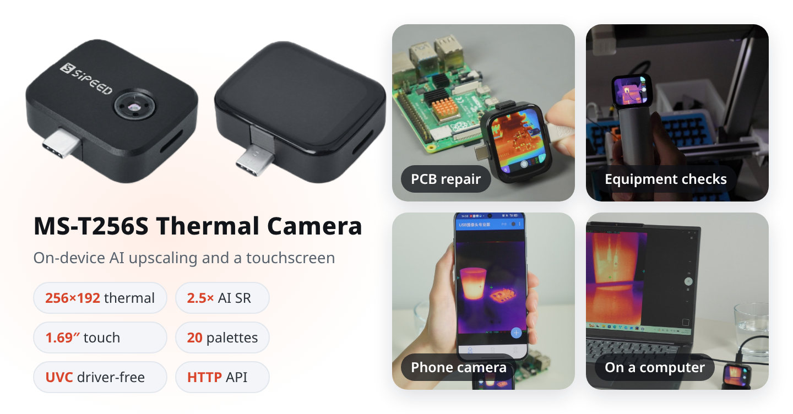
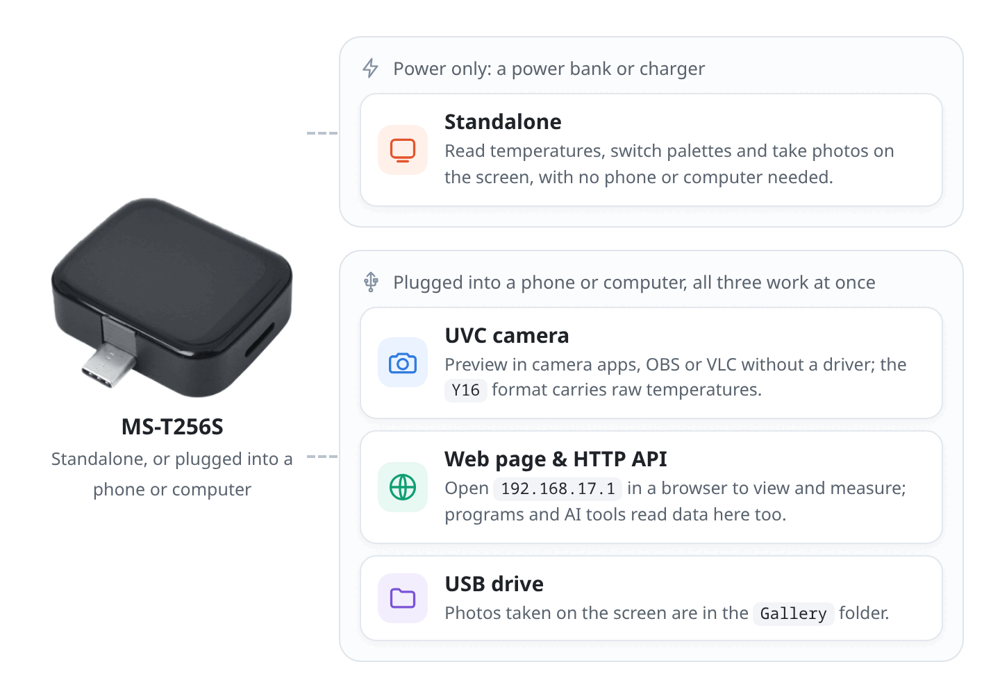
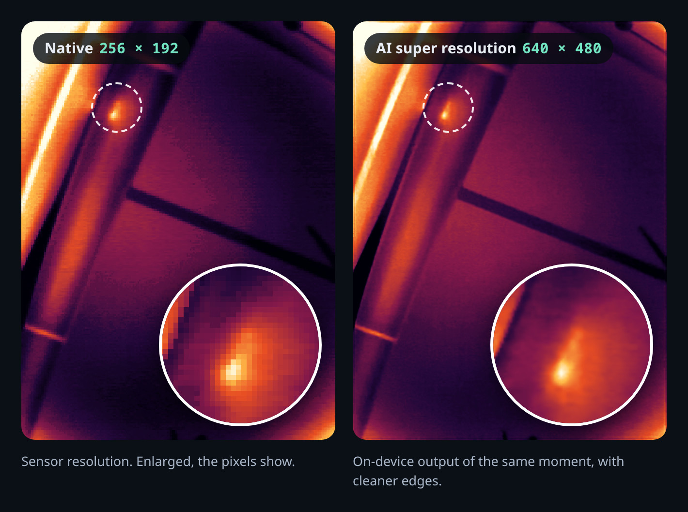
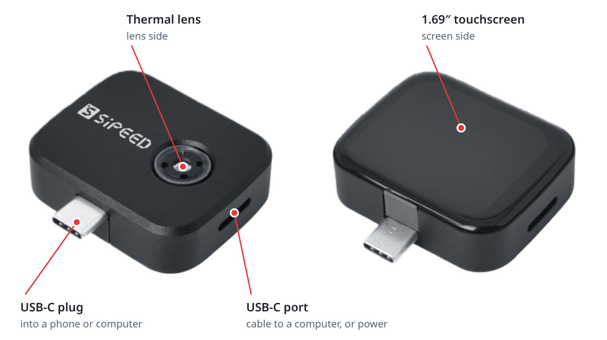

# Introduction

The Sipeed MS-T256S is a pocket thermal camera with its own touchscreen. It captures 256 × 192 thermal images, and an NPU inside upscales them to 640 × 480 in real time.
Power it from a power bank and it works on its own: read temperatures, change palettes and take photos on the screen. Plug it into a phone or computer and it also becomes a driver-free UVC camera with a built-in web page and an HTTP API.
Use it for PCB repair, equipment checks and HVAC inspection, or to feed thermal data into your own software and AI tools.

## Works Alone or Plugged In

The T256S has no battery and takes power over USB-C. With power only, it is a standalone thermal camera. Plugged into a phone or computer, the screen keeps working and three more things appear:

- **UVC camera**: the host sees an ordinary webcam. Camera apps, OBS and VLC show the super-resolution color image without any driver. The Y16 format also delivers the raw temperature of every pixel.
- **Web page and HTTP API**: a USB network adapter appears at the same time. Open `192.168.17.1` in a browser to see the live image, measure several points and record photos or video. Programs and AI tools read temperatures from the same address. Requires firmware 26.40.0 or later.
- **USB drive**: photos taken on the screen are stored on the device. On a computer they show up in the `Gallery` folder of a USB drive, ready to copy.

> iPhones do not support UVC cameras, but iPhones with USB-C can open the web page in Safari. See [Quick Start](./Quick_Start.html#Connect-to-a-Phone-or-Computer) for each platform.

## Key Features

1. **On-device AI super resolution**: the NPU upscales the 256 × 192 image 2.5× to 640 × 480 in real time, so edges and small hot spots are easier to see. The screen, the camera stream and the web page all show the upscaled image by default. Temperatures always come from the raw data.
2. **Built-in touchscreen**: a 1.69-inch touchscreen. Double-tap to zoom, swipe to change palettes, tap to take a photo. Add a power bank and carry it around.
3. **Driver-free UVC camera**: MJPEG delivers the color image to camera, meeting and streaming apps. Y16 delivers raw temperatures for your own code.
4. **Web page and HTTP API**: open it in any browser for a super-resolution comparison, up to 12 live measurement points, photos and video. Read temperatures and images with `curl`, or hand them to an AI tool.
5. **20 color palettes**: White Hot, Black Hot, Ironbow, Rainbow and more, selectable on the screen and on the web page.
6. **Automatic range switching**: high gain (-15 to 150 °C) by default for accuracy, switching to low gain (50 to 500 °C) when large hot areas appear.
7. **Aluminum body**: CNC-machined 6061 aluminum alloy, sturdy and good at shedding heat.

> Terms: a **palette** maps invisible temperature differences to colors; in Ironbow, brighter means hotter. **Super resolution** upscales a low-resolution image and restores detail. **UVC** is the standard for USB cameras; compliant cameras need no driver. **Y16** is a raw image format with 16 bits per pixel; the T256S uses it for temperature data.

## Sample Images

The image below shows the native and super-resolution outputs of the T256S from the same moment, in the Ironbow palette. The circles at the bottom right magnify the area inside the dashed rings. The native image shows visible pixel blocks; the super-resolution image has smoother edges and a sharper outline around the small hot spot.

Super resolution runs on the device, so a computer, phone or Raspberry Pi all receive the same upscaled image without spending their own processing power.

## Specifications

In short: 256 × 192 thermal imaging at 25 Hz, 2.5× on-device AI super resolution to 640 × 480, -15 to 500 °C in two automatic ranges, and a 1.69-inch touchscreen.

| Item | Specification |
| :--- | :--- |
| Thermal resolution | 256 × 192 (long-wave infrared) |
| AI super-resolution output | 640 × 480 (2.5×, on-device NPU, real time) |
| Frame rate | 25 Hz |
| Temperature range | High gain -15 to 150 °C; low gain 50 to 500 °C; switches automatically |
| Accuracy | ±2 °C or ±2% of reading |
| Thermal sensitivity (NETD) | < 50 mK @ 25 °C |
| Field of view (FOV) | 56° × 42° |
| Screen | 1.69-inch 240 × 280 capacitive touchscreen |
| Palettes | 20 |
| Connectors | USB-C plug + USB-C receptacle |
| USB functions | UVC camera (MJPEG, Y16), USB network adapter (web page and HTTP API), USB drive |
| Photo storage | Built in, about 36 MB, accessible as a USB drive on a computer |
| Web page and HTTP API | Firmware 26.40.0 or later |
| Power | USB 5 V, no battery |
| Size | 42 × 32 × 13 mm |
| Housing | 6061 aluminum alloy, CNC-machined |

> Terms: **NETD** (noise-equivalent temperature difference) is the smallest temperature difference the camera can resolve; lower is better. The **field of view** is how much the lens sees: at 1 m, 56° × 42° covers about 106 × 77 cm, or about 4 mm per pixel.

## Exterior and Connectors

The thermal lens is on the front and the 1.69-inch touchscreen is on the back. There are two USB-C connectors:

- **USB-C plug**: plugs straight into the USB-C port of a phone or computer, no cable needed.
- **USB-C receptacle**: connect a USB-C cable to a computer, or power the camera from a power bank or charger.

There is no battery and no physical button. The camera starts as soon as it gets power, and everything is controlled on the touchscreen.

With a macro lens, you can inspect small parts on a circuit board, such as 0402 resistors, from about 5 cm away. See [Quick Start](./Quick_Start.html#Macro-Lens) for mounting and use.

## Applications

- **Electronics repair and development**: find overheating parts, shorts and overloaded power components on a board. Add the macro lens for tiny packages.
- **Equipment checks**: hold it on a power bank and check motors, distribution boxes and power strips for overheating.
- **HVAC and buildings**: find heat leaks around walls and windows, trace floor-heating pipes, spot insulation gaps and check air-conditioner outlets.
- **Development and AI**: read temperatures over Y16 or HTTP for monitoring, alarms and logging, or let an AI tool analyze them.

## MS-T256S or MS-T160

| | MS-T256S | MS-T160 |
| :--- | :--- | :--- |
| Thermal resolution | 256 × 192 | 160 × 120 |
| AI super resolution | On the device, 640 × 480 output | In the browser, 480 × 360 output |
| Temperature range | -15 to 150 °C / 50 to 500 °C, automatic | 0 to 120 °C |
| Screen | 1.69-inch touchscreen, works without a computer | None; view it in a phone or computer browser |
| Connection | UVC camera, plus a web page and HTTP API | USB network adapter + built-in web page |
| Best for | Higher resolution, a built-in screen or a webcam-style output | Viewing thermal images on a phone at the lowest cost |

See the [MS-T160 documentation](../T160/Introduction.md) for details.

## Links

- Buy: [AliExpress](https://www.aliexpress.com/item/1005012028703380.html)
- Firmware downloads: [Sipeed download site](https://dl.sipeed.com/shareURL/ThermalCam/T256s/firmware)
- Support email: support@sipeed.com
- Community (Discord): [discord.gg/V4sAZ9XWpN](https://discord.gg/V4sAZ9XWpN)
- X / Twitter: [@SipeedLab](https://x.com/SipeedLab)
- Sipeed GitHub: https://github.com/sipeed

## Next Steps

Once you have a T256S, start with [Quick Start](./Quick_Start.md): power it up to see the image, then learn to read temperatures, change palettes, take photos and connect a phone or computer.
