# Quick Start

The T256S works out of the box: give it power and the screen shows a live thermal image with temperatures.
This page first covers standalone use: the screen, reading temperatures, palettes and photos. Then it covers phones and computers: the web page, the UVC camera and the USB drive.

> This page describes firmware 26.47.0. If your screen shows a column of buttons on the right and looks different from the screenshots below, the camera runs older firmware. Update it first, following [Advanced Use & Development](./Advanced.html#Update-the-Firmware).

## What You Need

- An MS-T256S.
- A USB-C power source: a power bank, a phone charger or a computer USB port. The T256S has no battery.
- To view the image on a larger screen or read data, a phone, tablet or computer. For a computer, also a USB-C cable that carries data.

## Power On

Power the T256S in either way:

- **USB-C receptacle**: connect a cable to a power bank, charger or computer.
- **USB-C plug**: plug the camera straight into the USB-C port of a phone or computer. Some Android phones need **OTG** turned on in Settings first.

The screen lights up with a boot logo. After about 10 seconds, the live thermal image appears.

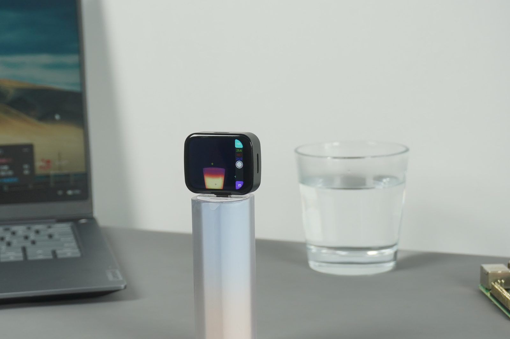

> Without enough power, the camera may keep restarting or flicker. Use a stable 5 V source and a good cable. See the [FAQ](./FAQ.html#The-Screen-Keeps-Restarting-or-Flickering).

## Know the Screen

The live thermal image fills the screen, with a few overlays. The red numbers match the table below:

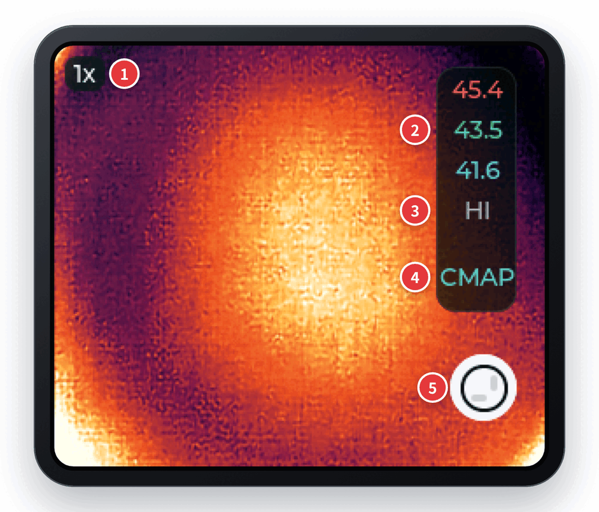

| No. | Item | Description |
| :---: | :--- | :--- |
| 1 | Zoom | Current zoom, `1x` or `2x` |
| 2 | Temperatures | From top to bottom: hottest point (red), center (green), coldest point (blue), in °C |
| 3 | Gain | `HI` for high gain, `LO` for low gain; see [Read the Temperature](#Read-the-Temperature) |
| 4 | Palette | Short name of the current palette; some palettes show `CMAP`. The full name is on the status panel |
| 5 | Capture | Tap to save a photo |

### Gestures

There are no extra buttons. Everyday actions use gestures. The red numbers match the table below:

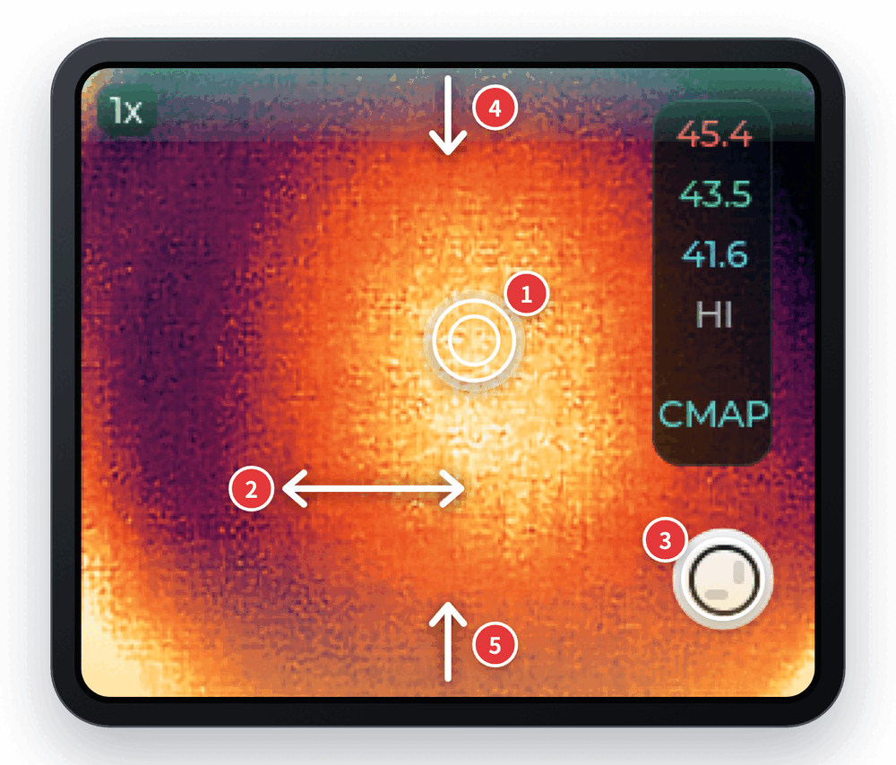

| No. | Gesture | Action |
| :---: | :--- | :--- |
| 1 | Double-tap the image | Switch between 1x and 2x; 2x enlarges the center of the image |
| 2 | Swipe left or right on the image | Next or previous palette |
| 3 | Tap the capture button | Save a photo; the image flashes white and `SAVED` appears |
| 4 | Pull down from the top edge | Open the status panel. The first pull shows quick controls; keep pulling for full status. Swipe up to close it step by step |
| 5 | Swipe up from the bottom edge | Open the gallery |

> Start the top and bottom gestures right at the screen edge; a swipe that starts in the middle changes the palette instead. Close the status panel before you swipe up for the gallery.

The status panel can turn on-screen super resolution on or off, rotate the interface 180° and change the network subnet. It also shows the firmware version and device address. See [Status Panel](./Advanced.html#Status-Panel).

## Read the Temperature

The three numbers on the right update in real time:

- **Hottest** (red) and **coldest** (blue): the hottest and coldest points in the whole image.
- **Center** (green): the temperature at the center of the image. To measure an object, aim the center at it.

The T256S has two measurement ranges and switches between them automatically. The screen shows the current one:

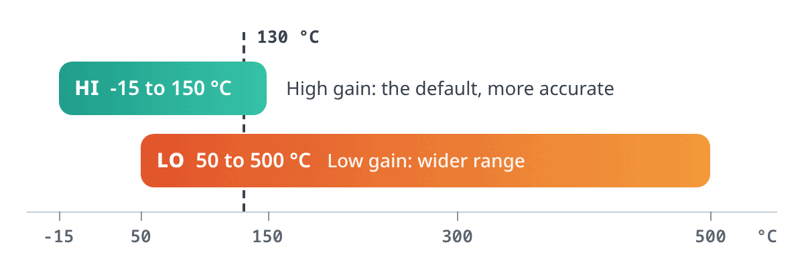

- **HI (high gain)**: the default, -15 to 150 °C, with better accuracy. People, circuit boards and rooms all fall in this range.
- **LO (low gain)**: 50 to 500 °C for hotter scenes. The camera switches to LO when more than a tenth of the image is above 130 °C, and back to HI once almost the whole image is below 110 °C.

Accuracy is ±2 °C or ±2% of the reading. Readings drift a little right after power-on; wait about 2 minutes for the best results. Shiny metal reads much too low. See the [FAQ](./FAQ.html#Temperatures-Look-Wrong) for why and what to do.

## Change the Palette

Swipe left or right on the image to change the palette. There are 20, and the camera starts with Ironbow at every power-on. The chart below shows the same scene in all 20 palettes, numbered in switching order:

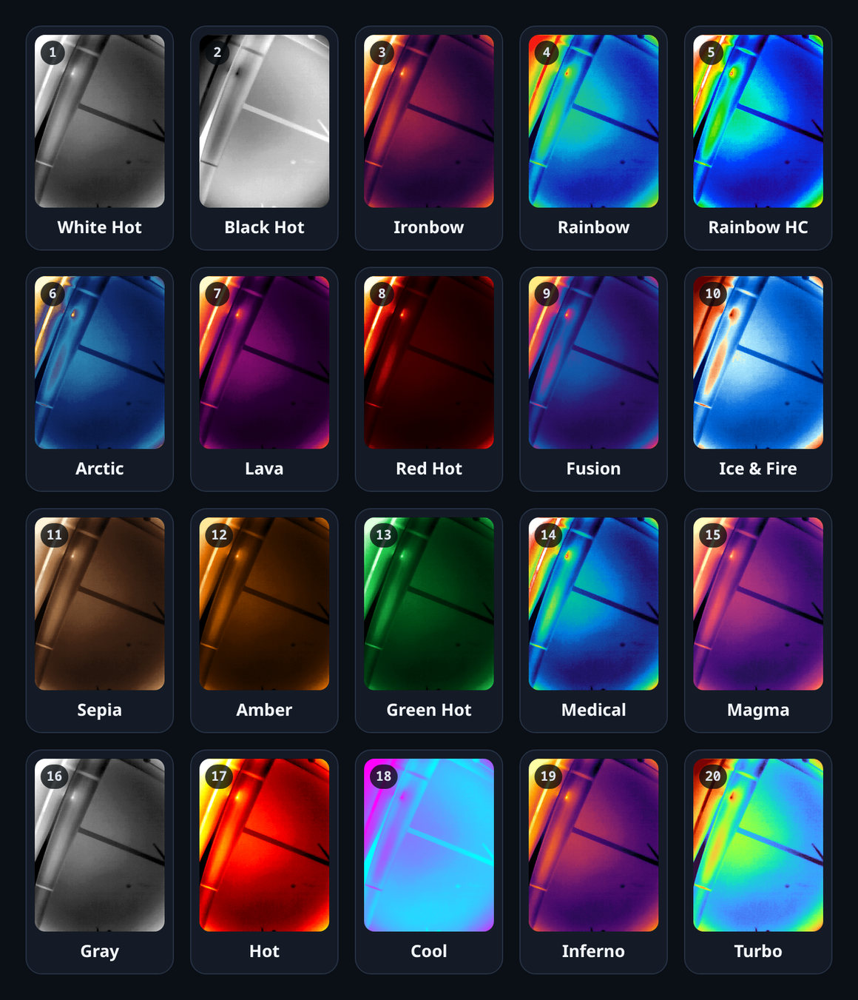

Palettes change only the colors, never the temperature readings. Some common choices:

- **Ironbow**: brighter is hotter, with clear contrast. Good for most scenes.
- **White Hot, Black Hot**: grayscale, good for outlines and detail.
- **Rainbow, Rainbow HC**: many color steps, good for small temperature differences.

The screen, the UVC camera and the web page share one palette setting. Change it on the screen or on the web page, and the other images follow.

## Take and View Photos

- **Take a photo**: tap the capture button. The image flashes white and `SAVED` appears. Photos are 480 × 640 JPEGs in the current palette, without the temperature overlays.
- **View photos**: swipe up from the bottom edge to open the gallery and swipe sideways to browse. The screen shows which photo you are on and how many there are. Swipe down to return to the live image. With no photos yet, `GALLERY EMPTY` appears.
- **Delete a photo**: long-press it in the gallery. When `HOLD AGAIN TO DELETE` appears, long-press again. Deleted photos cannot be recovered.

File names record the temperatures. For example, `P1_T25.8_22.0_30.8.jpg` is photo 1, with 25.8 °C at the center, 22.0 °C minimum and 30.8 °C maximum. Plug the T256S into a computer to copy the photos from its USB drive; see [Copy Photos](#Copy-Photos).

> ⚠️ When the T256S is plugged into a computer that is using its USB drive, eject the drive on the computer before you take or delete photos on the screen. Otherwise the two sides may show different files. Do not cut the power while a photo is being saved or deleted.

## Connect to a Phone or Computer

Plug the T256S into a phone or computer, directly or with a cable. The screen keeps working, and three more things appear:

| Function | What it is for | How to open it |
| :--- | :--- | :--- |
| Web page | View, compare super resolution, measure several points, take photos and video in a browser | Open `192.168.17.1` in a browser |
| UVC camera | Use the image in camera apps, OBS or meeting software | Select the T256S in the app's camera list |
| USB drive | Copy the photos taken on the screen | Open the new drive on the computer |

All three work at the same time. To just see the image on a bigger screen, the web page is the easiest: there is nothing to install.

### Open the Web Page

> The web page requires firmware 26.40.0 or later. See [Check the Firmware Version](./Advanced.html#Check-the-Firmware-Version).

1. Plug the T256S into the phone or computer and wait a few seconds for the new network to appear:
   - **Phone**: it may say the network has no internet access. That is expected: the T256S is a local network that only connects to your phone.
   - **Computer**: a new wired network adapter appears and gets a `192.168.17.x` address automatically.
2. Open a browser and enter `192.168.17.1`. Some Android phones show a sign-in notification for the network; tapping it opens the same page (the address shows as `ir.sipeed.com`).
3. Within a few seconds you should see the **T256S Thermal Imaging** page with a live image. The status bar shows the actual frame rate on the right.

> If the address does not open on an Android phone, turn on airplane mode (and turn Wi-Fi off if it stays on), then try again. See the [FAQ](./FAQ.html#The-Browser-Cannot-Open-192.168.17.1) for the reason. iPhones do not open the page automatically; type the address in Safari. Only iPhones with USB-C are supported.

This is the web page on a phone. The red numbers match the table below:

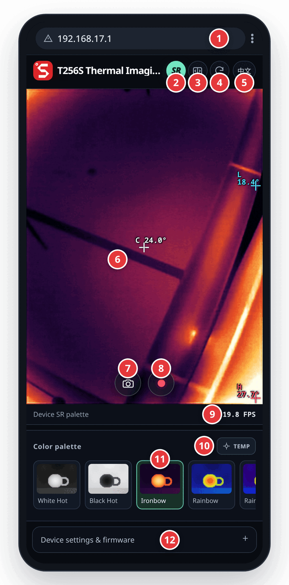

| No. | Item | Action |
| :---: | :--- | :--- |
| 1 | Address bar | Device address, `192.168.17.1` by default |
| 2 | Super resolution (SR) | Switch between the device's super-resolution image and the native image |
| 3 | Compare | Show super resolution and native side by side; see [Compare Super Resolution](#Compare-Super-Resolution) |
| 4 | Rotate | Rotate the image 180° |
| 5 | Language | Switch between English and Chinese |
| 6 | Temperature labels | H for the hottest point, L for the coldest, C for the center |
| 7 | Capture | Save the current image as a PNG file |
| 8 | Record | Start recording; tap again to stop and save |
| 9 | Status bar | Current view mode on the left, actual frame rate on the right |
| 10 | Multi-point (TEMP) | Enter multi-point measurement; see [Multi-Point Measurement](#Multi-Point-Measurement) |
| 11 | Color palette | Swipe to pick a palette; the camera screen follows |
| 12 | Device settings & firmware | Expand to see the firmware version, change the subnet or update the firmware. Tapping the page title also opens it |

### Compare Super Resolution

Tap **Compare** at the top. A vertical line splits the image: the device's super-resolution image is on the left and the native image is on the right. Drag the line to compare. Tap Compare again to exit.

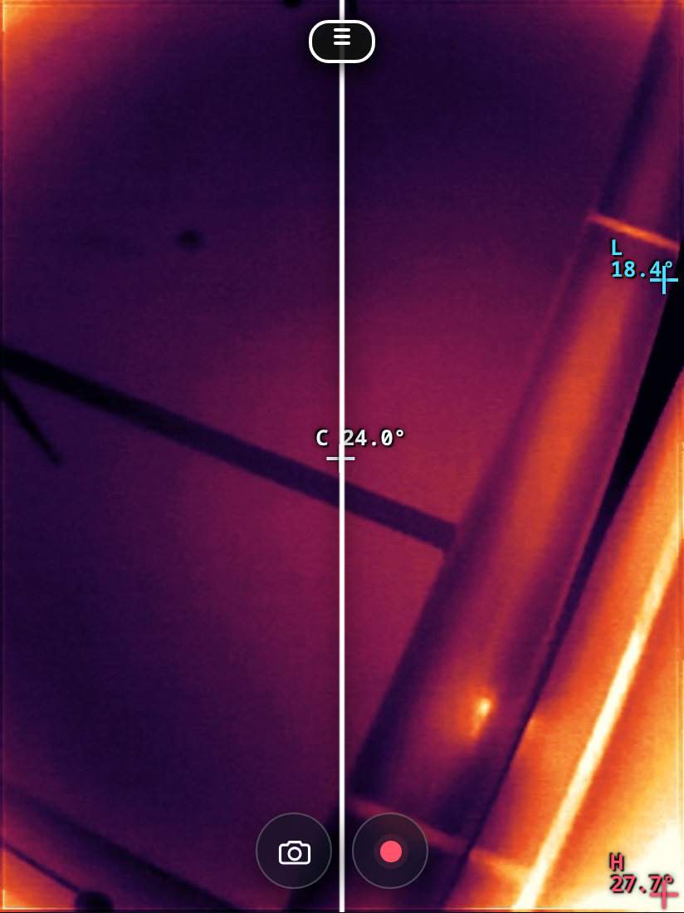

### Multi-Point Measurement

Tap **TEMP** next to the palette strip to enter multi-point measurement. The page then reads the raw temperature of every pixel. Tap anywhere on the image to add a point (M1, M2 and so on), up to 12, each updating live. Remove single points in the list below, or tap **Clear** to remove all of them. Tap TEMP again to exit.

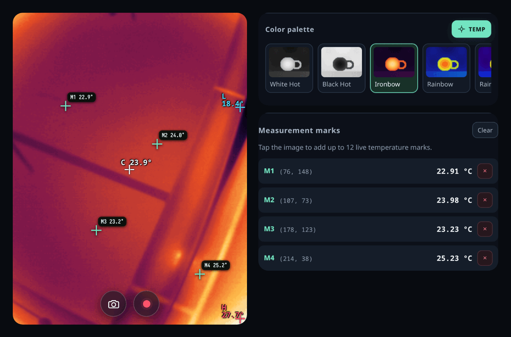

This mode shows the native 256 × 192 image, and the coordinates in the list refer to it.

### Photos and Video in the Browser

- **Capture**: tap the camera button to save the current image as a PNG file. The name starts with `thermal-` followed by the time it was saved.
- **Record**: tap the red dot to start; the status bar shows "Recording". Tap again to stop and save `thermal-record.mp4`, or `.webm` in some browsers.

The browser saves both to the downloads folder of the phone or computer. They contain the image itself, with the palette and super resolution, but **not** the H, L and C labels. For temperature values, read them on the page or use the [HTTP API](./API.md).

### Use It as a UVC Camera

The T256S is a standard UVC camera. Computers, Android phones and iPads recognize it without a driver. In camera lists it usually appears as **UVC Camera** or **Thermal Camera (UVC)**. The stream is the 480 × 640 portrait super-resolution image in the device's current palette.

#### Windows

Use the built-in Camera app, or OBS Studio, VLC, PotPlayer and similar apps, and select the T256S in the camera list.

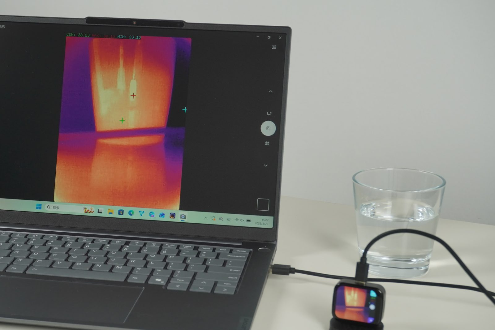

#### macOS

Open Photo Booth and choose **UVC Camera** from the Camera menu:

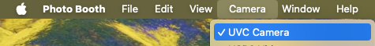

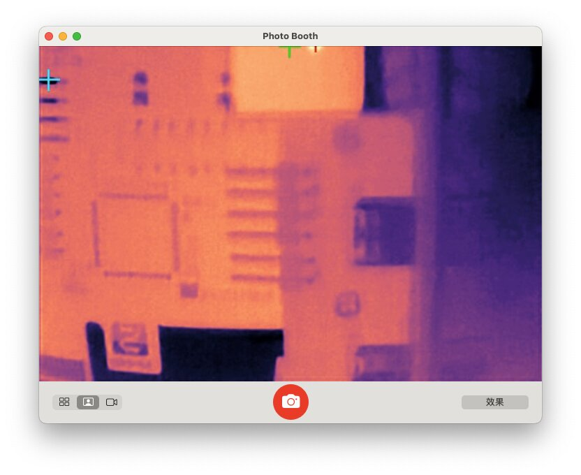

#### Linux and Raspberry Pi

The T256S appears as `/dev/video*`. Open it with `guvcview`, `cheese`, `ffplay` or similar tools:

```bash
# Find the device of Thermal Camera (UVC), for example /dev/video0
v4l2-ctl --list-devices
# Show the image (replace video0 with the device found above)
ffplay -f v4l2 -input_format mjpeg /dev/video0
```

If you get a permission error, run the command with `sudo` or add your user to the `video` group.

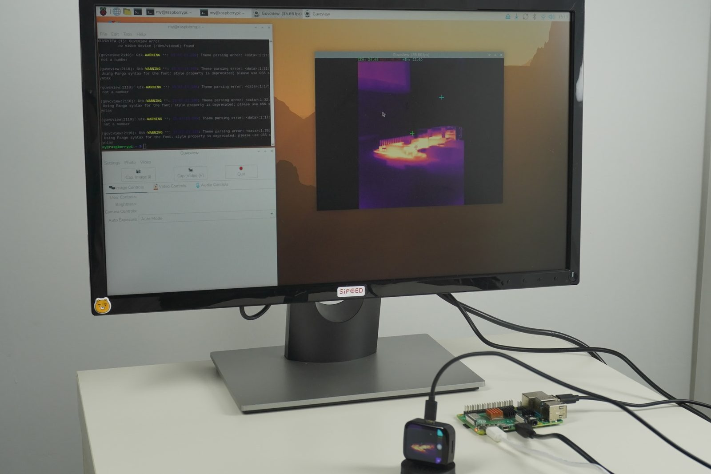

#### Android

1. Install a camera app that supports UVC, such as one of the "USB Camera" apps.
2. Plug the T256S into the phone and allow USB access when the app asks. The image appears.
3. With the T256S plugged into the bottom of the phone, the image is upside down relative to the phone. Rotate it 180° in the app, or turn on both horizontal and vertical mirroring.

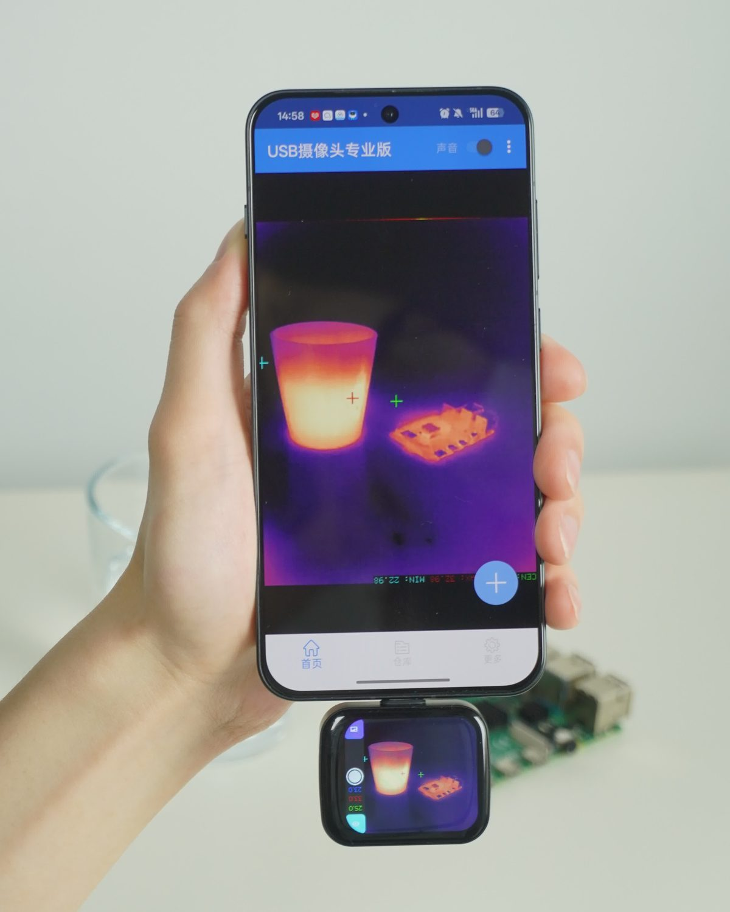

#### iPad and iPhone

- **iPad**: iPads with USB-C can show the image in a camera app that supports UVC, such as [CamX - USB Camera](https://apps.apple.com/app/camx-usb-camera/id6453639083). If the image is rotated, rotate it in the app.
- **iPhone**: UVC cameras are not supported. iPhones with USB-C can use the web page instead; see [Open the Web Page](#Open-the-Web-Page).

### Copy Photos

On a computer, a USB drive of about 36 MB appears. Photos taken on the screen are in its `Gallery` folder; copy them like any other files.

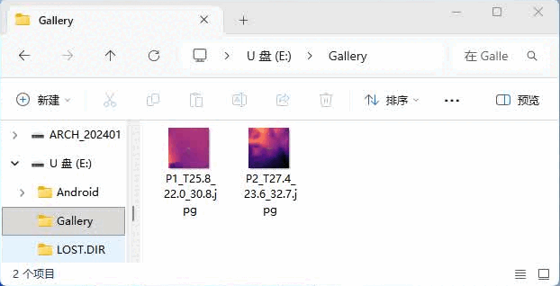

## Macro Lens

To see small parts on a circuit board clearly, mount the macro lens in front of the thermal lens:

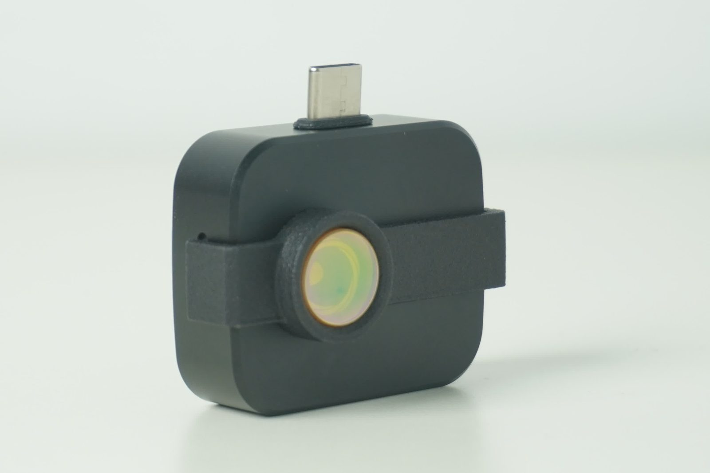

- **Working distance about 5 cm**: hold the T256S about 5 cm from the target and move it slightly back and forth until the image is sharpest. The depth of field is very shallow, so take your time.
- You can see the heat of 0402 surface-mount parts.
- At macro range, small temperature differences look larger, and a breeze or the warmth of your hand affects the image. Work indoors without drafts.
- Readings are less accurate with the macro lens. Remove it when you need accurate numbers.
- Mount and remove it gently. Do not press hard on or scratch the thermal lens.

## Next Steps

- Check and update the firmware, use several cameras on one computer, or read raw temperatures over UVC: see [Advanced Use & Development](./Advanced.md).
- Read temperatures and images from your own code: see the [HTTP API](./API.md).
- Let an AI tool read temperatures and draw conclusions: see [AI Integration](./AI_Control.md).
- Something not working: see the [FAQ](./FAQ.md).
