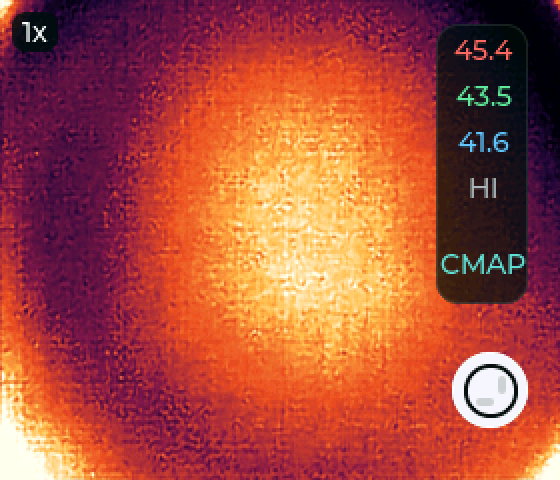
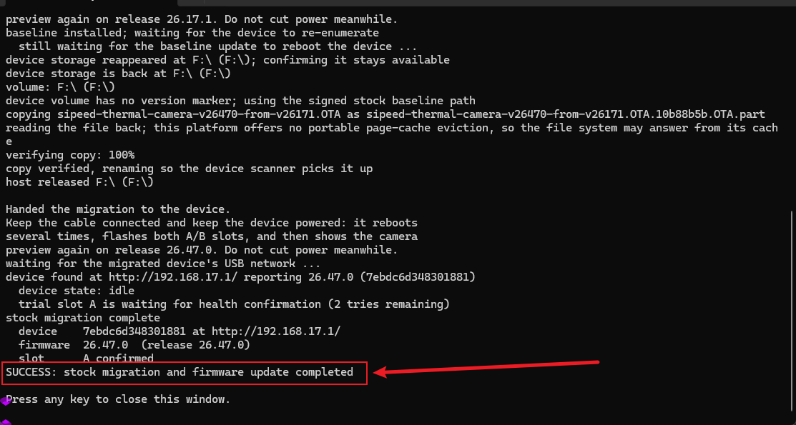
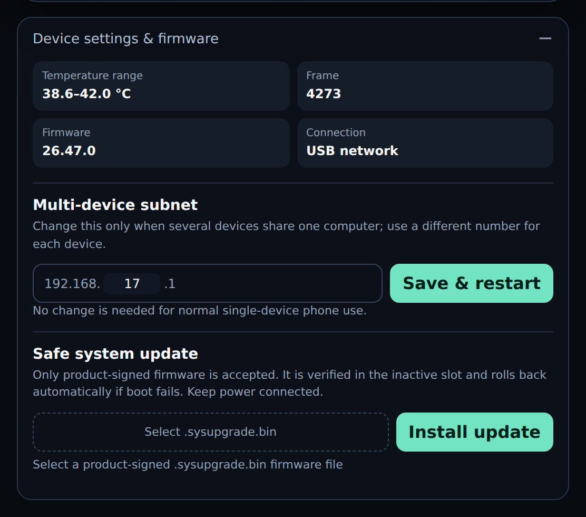

## Introduction

T256s offers two update methods. Pick one based on the current version:

+ Upgrade script: for systems on 26.17.1 or earlier. It migrates the device to the new dual-slot layout and updates it to 26.47.0;
+ Web update: for systems after 26.17.1; upload the firmware on the device web page.

## Check the Current Version

How you check the version depends on the system version.

### 26.17.1 or Earlier

Hold the capture button; the screen shows the current version information, and the `version=` line is the firmware version:

### After 26.17.1

Swipe down from the top edge of the screen to open the status panel, which shows a line starting with `FW`, for example `FW 26.47.0   192.168.17.1`. You can also expand "Device settings & firmware" at the bottom of the device web page and read the "Firmware" entry.

Use this table to pick the method:

| Current version | What to do |
| --- | --- |
| 26.17.1 or earlier | Run the upgrade script; it updates the device to 26.47.0 |
| After 26.17.1 | Update on the web page |

## Method 1: Run the Upgrade Script (26.17.1 or Earlier)

Systems on 26.17.1 or earlier need the upgrade script first. The script checks the device state, migrates the device to the new dual-slot layout and updates it to 26.47.0.

1. Open the [Sipeed download site](https://dl.sipeed.com/shareURL/ThermalCam/T256s/firmware) and download `T256S-v26470-stock-migration.zip`.
2. Extract the package.
3. Run the updater as described inside the package: double-click the `.cmd` file on Windows, the `.command` file on macOS, or run the executable on Linux.
4. Keep the camera connected over USB while it runs. Do not unplug the cable or cut power.
5. The script performs the upgrade itself. The device reboots several times and the screen stays black for a while; this is normal, just wait for the script to finish.
6. When the window prints `SUCCESS`, the upgrade is complete. The last few lines show the device ID and the new firmware version:

7. Confirm the version with the method in the previous section (the device in the screenshot reports 26.47.0).

> The upgrade rebuilds the device internal storage, so photos stored on the device are lost. Export the photos you need to a computer or phone first.

> If the script fails, run it again as prompted. If it reports that the device may already be converting, do not reboot; wait a few minutes and check again.

## Method 2: Web Update (After 26.17.1)

Web update needs a system after 26.17.1. Viewing the live image or calling the HTTP API from the web page needs 26.40.0 or later; see [Quick Start](QS.html).

1. Connect the camera with a USB cable and open `http://192.168.17.1` in a browser.
2. Open the system update entry on the device web page. The entry is in "Device settings & firmware" at the bottom of the page; on 26.40.0 the section is called "Safe system update", and the name can differ slightly on other versions.

3. Choose the downloaded firmware package and click "Install update" or the matching upload button.
4. The page shows upload and verification progress, then the device reboots. If the new system fails to start, the device rolls back to the previous system automatically.
5. After the reboot, check the "Firmware" entry to confirm the version.

> The web page only accepts official firmware packages. Do not upload files from other sources and do not rename the firmware.

> Keep power and the USB connection during upload and installation. Do not unplug until the device has rebooted into the system.

## FAQ

### The version is not shown

On 26.17.1 or earlier, hold the capture button. After 26.17.1, swipe down from the top edge of the screen to open the status panel. If the screen is dark, check that the device is powered on; if nothing happens, try another cable or charger to rule out a power problem.

### There is no update entry on the web page

Check the following:

+ The device web page is reachable and displays correctly;
+ The settings area at the bottom of the page is expanded;
+ The current version supports web update. Systems on 26.17.1 or earlier need the upgrade script first.

### The web page rejects the firmware

Check the following:

+ The package came from the download site and matches the model and version;
+ The download is complete; try downloading it again;
+ The file name has not been changed. The page checks both the name and the content.

### The upgrade script fails

Check the following:

+ The camera is connected over USB and the device disk is visible on the computer;
+ The program for your system was launched as described in the package;
+ Programs that may hold the device disk are closed, then try again;
+ If the script reports that the device may already be converting, do not reboot; wait a few minutes and check the version again.

### The screen stays black after updating

The device reboots during the update, and a black screen for a while is normal. Wait for the boot screen. If the screen stays black for a long time, keep the device powered and wait. If it still does not boot, contact support.

### Power was lost during the update

Restore power immediately and wait for the device to recover. Web updates have a rollback path; the script-based upgrade is not power-fail safe, and losing power can leave the device unable to boot. If that happens, contact support instead of opening the device.

### Can I update on the web page on 26.17.1 or earlier

No. Systems on 26.17.1 or earlier need the upgrade script to reach 26.47.0 first, and only then can they update on the web page.

## Notes

+ Keep the device powered throughout the update, using a stable USB port or power source;
+ Do not unplug the cable, force a reboot or shut down the computer during the update;
+ Use only the matching firmware from the download site; do not rename or repackage it, and do not extract the `.sysupgrade.bin` used for web update;
+ The upgrade rebuilds device storage, so export the photos you need first;
+ Confirm the version after updating before doing anything else.

## Next Steps

+ After updating to 26.47.0, you can view the picture and temperatures in a browser; see [Quick Start](QS.html);
+ To read temperatures from a program, see [HTTP API](API.html).
