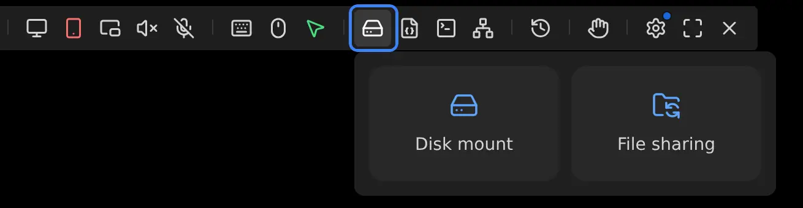
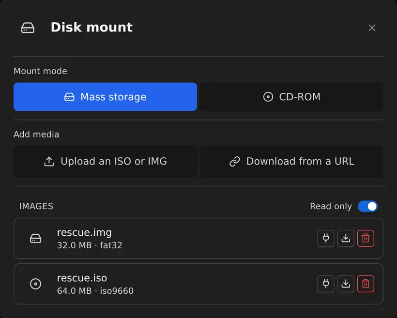
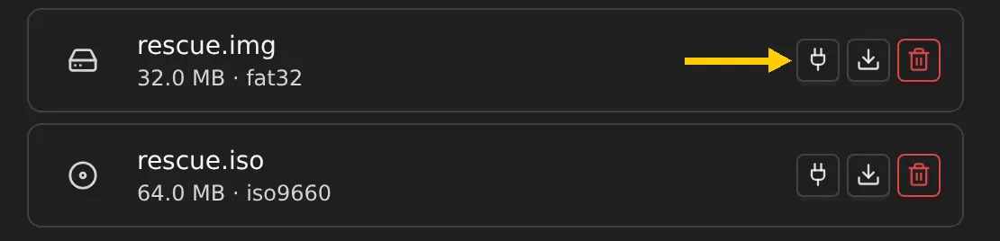
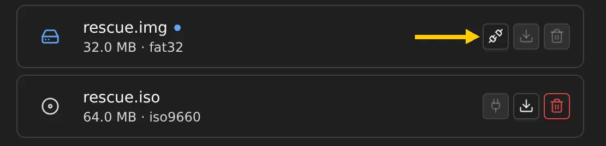
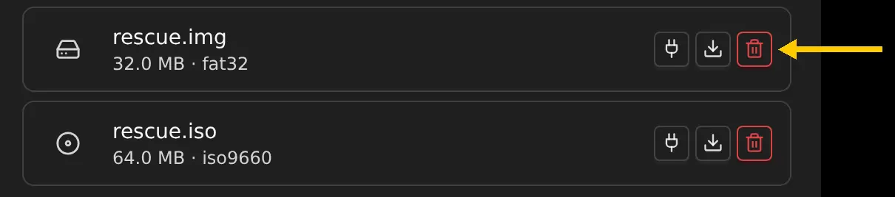
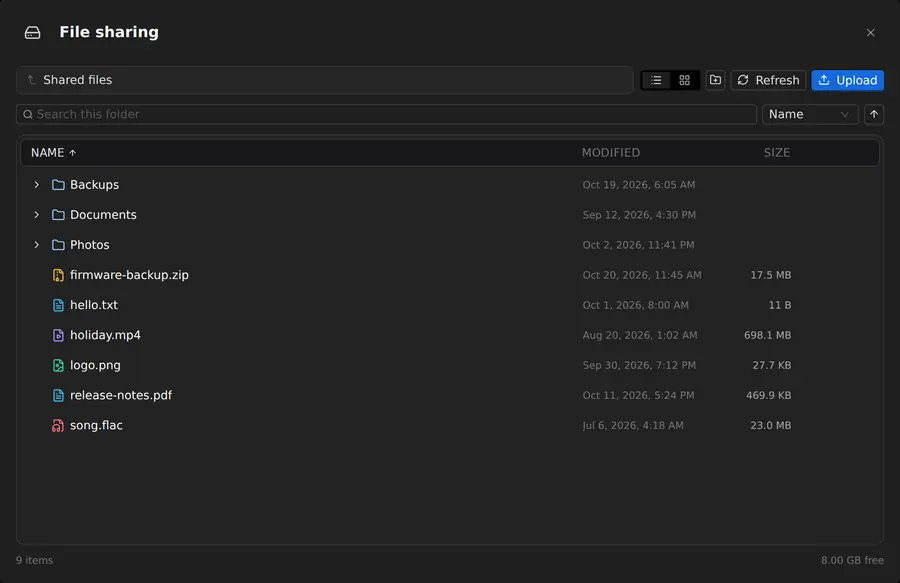

## Introduction

NanoKVM captures the target machine video through its HDMI input, and emulates a keyboard, mouse, virtual U-disk, and virtual network adapter through the USB-C (PC-USB) port. The virtual U-disk has two uses, and both start from `Images & File sharing` in the floating toolbar:

+ `Disk mount` hands an ISO or IMG file to the target machine, which sees an optical drive or a hard disk. Use it to install an operating system, boot a rescue environment, or repair a system.
+ `File sharing` hands the NanoKVM data partition to the target machine, which sees a removable disk. Use it to move files in either direction.

Click the hard drive icon in the floating toolbar at the top of the web console to open these two options:



## How It Works

Both features share the same USB storage device. NanoKVM hands the data partition on the device to the target machine, and that partition both stores image files and serves as the shared volume, so only one medium is available to the target machine at a time.

```text
Control device (browser)
|
| upload ISO / IMG, manage files on the shared volume
v
NanoKVM
|
| Disk mount: image file (ISO / IMG)
| File sharing: the whole data partition
|
| over USB mass storage, one medium at a time
v
Target machine
```

The two features differ in what they present:

+ `Disk mount` uses the image file on the data partition directly. Nothing is copied and no extra space is used.
+ `File sharing` uses the whole data partition. It needs no initialization, and its capacity is the size of the partition.
+ While the shared volume is attached to the target machine, local storage becomes read-only and the web page can only browse and download.
+ Mounting an image first ejects the shared volume; eject the current medium before switching to the other feature.

The target machine only sees the disk or optical drive that NanoKVM provides, not the NanoKVM system files.

> `File sharing` hands the whole data partition to the target machine, so every file in it is visible to the connected computer. Do not keep passwords, keys, or other sensitive files there.

## Preparation

Before using either feature, confirm that:

+ NanoKVM is connected to the target machine: HDMI to the display output, USB-C (PC-USB) to a USB port on the machine;
+ `Virtual Disk` under `Settings > Device` is enabled. It is on by default;
+ HID-Only mode is off. HID-Only makes the USB port emulate a keyboard and mouse only, and disables both features;
+ no upload or download is running.

## Disk Mount

### Add an Image

Open `Disk mount` from `Images & File sharing`, then choose one of the options under `Add media`:

+ `Upload ISO / IMG`: drag an image file into the window, or click to choose a file and upload it from the control device;
+ `Download from URL`: enter the image URL and NanoKVM downloads it directly. A download can be paused, resumed, or cancelled;
+ `SCP`: upload the image to the `/data` directory on NanoKVM;
+ put the image on the shared volume through `File sharing`; the image then appears under `Images`;
+ connect NanoKVM to your computer: while `Virtual Disk` is on, the computer sees it as a removable disk, so you can copy the image straight onto it.

Both upload methods accept an optional SHA-256 checksum. When you provide one, only a file whose checksum matches is added to the list.

Images are listed under `Images` with their size and file system type.



### Choose a Mount Mode

The mount mode decides what kind of device the target machine sees:

| Mount mode | Target machine sees | Access | Supported images |
| --- | --- | --- | --- |
| `Mass storage` | A hard disk | Read-only by default; writable after turning off `Read only` | ISO, IMG |
| `CD-ROM` | An optical drive | Always read-only | ISO, UDF |

The mode applies to the next mount. While an image is attached, eject it before switching modes.

### Mount an Image

1. Click the mount button next to the image.
2. Check the target machine for the new disk or optical drive.



To boot from the medium, reboot the target machine, open the boot menu during POST (`F11`, `F12`, and `ESC` are common), then choose the NanoKVM disk or optical drive.

### Eject an Image

1. Eject the disk or optical drive safely from the target machine first.
2. Return to the web page and click the eject button next to the image.



If the target machine is still using the medium, the web page offers a forced eject. A forced eject re-enumerates the USB device, can lose data that has not been written back, and briefly disconnects the keyboard, mouse, and virtual network adapter. Avoid it when a safe eject is possible.

### Delete an Image

Images you no longer need can be deleted with the delete button. Deleted files are not moved to a recycle bin.



The delete button is unavailable while the image is attached to the target machine.

## File Sharing

The flow is: put files on the shared volume from the web page, hand the volume to the target machine, then take the files from the removable disk. The shared volume is the data partition on the device, and the local side is read-only while the target machine holds it, so turn `Virtual Disk` off before uploading.

### Upload Files

While the shared volume is attached to the target machine, the web page can only browse and download. Take the volume back before uploading:

1. Turn off `Virtual Disk` under `Settings > Device`.
2. Open the `File sharing` window, click `Upload`, or drag files into the window.
3. When the upload finishes, the files appear in the current directory.

Creating a folder and deleting files also require `Virtual Disk` to be off. The new-folder and delete buttons are greyed out while the volume is attached to the target machine.



### Hand the Volume to the Target Machine

1. Make sure the files have finished uploading.
2. Turn on `Virtual Disk` under `Settings > Device`.
3. The removable disk appears on the target machine; open it and copy the files.
4. Turn `Virtual Disk` off when you are done. The files stay on the data partition.

If an image is still mounted, eject it under `Disk mount` first. Toggling `Virtual Disk` re-enumerates the USB device, so the keyboard and mouse on the target machine drop for a moment.

## FAQ

### The target machine does not show a new disk

Check that:

+ the USB-C cable is connected to the target machine;
+ `Virtual Disk` under `Settings > Device` is enabled;
+ HID-Only mode is off;
+ when booting from the medium, USB boot is allowed in the BIOS/UEFI.

### The mount button is greyed out

Check that:

+ no image is already attached; eject the current image first;
+ no upload or download is running; wait for the transfer to finish;
+ in CD-ROM mode, whether the selected image is an ISO/UDF file.

### The Add media buttons are greyed out

The shared volume is attached to the target machine, so local storage is read-only. Turn off `Virtual Disk` under `Settings > Device`, then upload the image.

### Files cannot be uploaded from the web page

The shared volume is attached to the target machine and the web page can only browse and download. Turn off `Virtual Disk` to upload, create, and delete files again.

### Uploaded files do not appear on the target machine

Check that the upload finished, then check that `Virtual Disk` under `Settings > Device` is on. While the switch is off, the shared volume stays on NanoKVM and the target machine cannot see it.

### Files written by the target machine are missing from the web page

Click refresh. The target machine may not have written the data back to the disk yet, so wait a few seconds and refresh again.

### How large is the shared volume

The shared volume is the data partition on the device, so its capacity is the size of the device storage. The `File sharing` window shows the free space at the bottom.

### Can disk mount and file sharing be used at the same time?

No. Both features share the same USB storage device, so only one medium is available to the target machine at a time.
