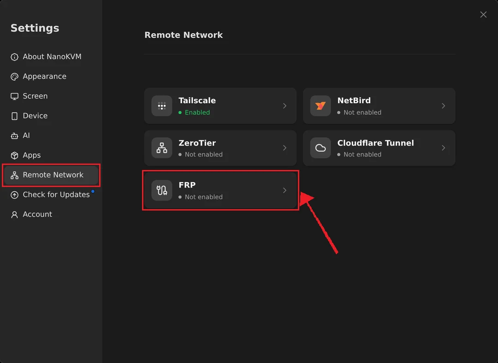
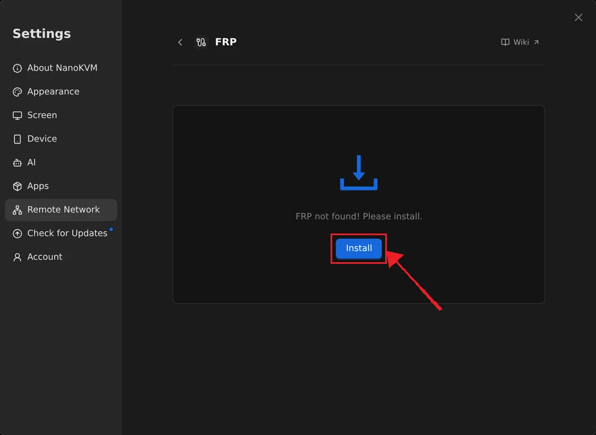
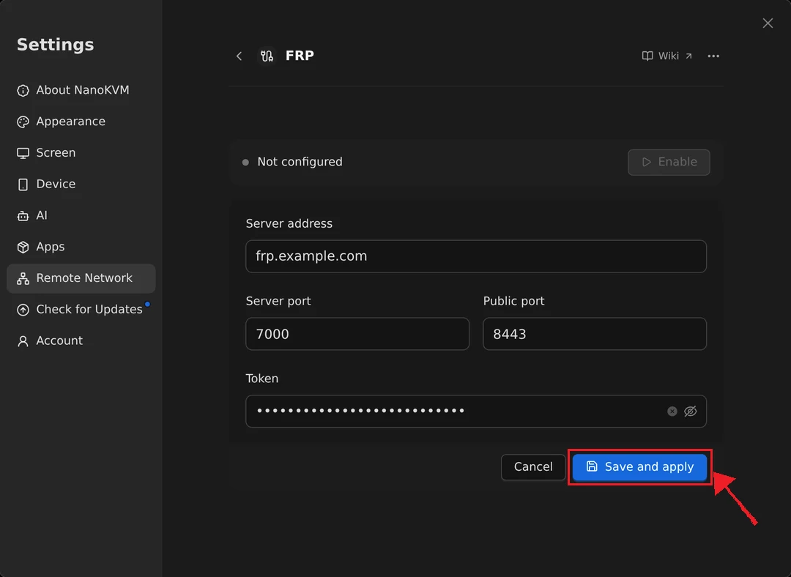
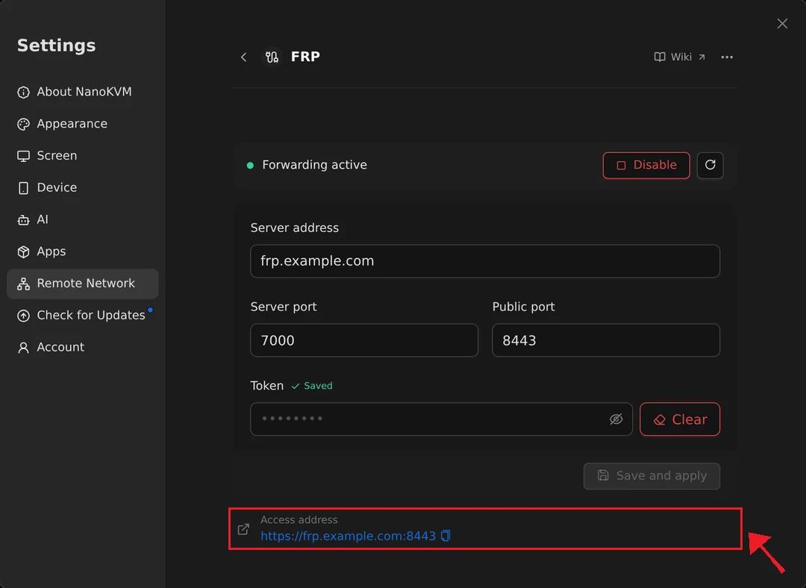

## What frp does

frp is an intranet penetration tool. It forwards a NanoKVM Go without a public IP address to a server that has one. Once configured, you open the server address from anywhere and control NanoKVM Go just as you would on the local network.

frp has two parts:

- `frps`: the server, running on your own public server;
- `frpc`: the client, running on NanoKVM Go.

```text
Remote PC or phone
       |
       | Open https://frp.example.com:8443
       v
Public server (frps) <----- frpc connects out ----- NanoKVM Go
```

NanoKVM Go ships with the FRP client built in. Installing it, entering the server details, and enabling or disabling the tunnel all happen in the web interface. You do not need SSH access, and you do not download anything by hand. **Only `frps` on the public server has to be installed manually**, as described below.

> The public server is a Linux cloud server that you provide. NanoKVM Go only runs the client and connects out to it, so the local network needs no port forwarding.

> Exposing NanoKVM Go to the Internet increases the risk of scanning, password guessing, and attacks. Set a strong password for NanoKVM Go first, and give frps a random token. The basic example forwards the HTTPS service built into NanoKVM Go, but the device certificate is normally self-signed, so browsers may warn that it is not trusted. With a domain you can serve a trusted certificate, as described in "Serve a domain with HTTPS (optional)" below. If you would rather not expose public ports, use a virtual network instead: [Tailscale](tailscale.html), [ZeroTier](zerotier.html), or [NetBird](netbird.html).

## Before you start

Prepare the following:

- a Linux server with a public IPv4 address;
- a NanoKVM Go with Internet access and the latest application version (`FRP` appears in `Settings` > `Remote Network` on current builds);
- GitHub access from NanoKVM Go, because the client installer downloads its package from GitHub;
- permission to modify the cloud security group and the server firewall;
- an frp token that is hard to guess.

This document uses the following example values:

| Item | Example | Notes |
| --- | --- | --- |
| Public server address | `frp.example.com` (example IP: `203.0.113.10`) | Entered in NanoKVM Go |
| frps port | `7000` | Used by the client to reach the server |
| Public port | `8443` | Used by the browser to reach NanoKVM Go |
| Token | `replace_with_a_strong_token` | Must match on both sides |

`203.0.113.10` and `frp.example.com` are documentation examples and cannot be used as-is. If you have no domain, enter your server's public IP in NanoKVM Go instead. Replace every address, port, and token in this document with your own values.

## Install frps on the public server

### Download frp

Check the CPU architecture of the server:

```bash
uname -m
```

Open [frp Releases](https://github.com/fatedier/frp/releases) and pick the Linux package that matches the server. The client inside NanoKVM Go is frp `0.71.0`, so **install the same version on the public server**; mismatched versions may fail to connect.

Common architecture mappings:

| `uname -m` output | frp package architecture |
| --- | --- |
| `x86_64` | `linux_amd64` |
| `aarch64`, `arm64` | `linux_arm64` |
| `armv7l` | `linux_arm_hf` |
| Older ARM devices such as ARMv5 | `linux_arm` |
| `riscv64` | `linux_riscv64` |

You can download 0.71.0 directly from the release page:

- [frp 0.71.0 release](https://github.com/fatedier/frp/releases/tag/v0.71.0)
- [Linux AMD64 package](https://github.com/fatedier/frp/releases/download/v0.71.0/frp_0.71.0_linux_amd64.tar.gz)
- [Linux ARM64 package](https://github.com/fatedier/frp/releases/download/v0.71.0/frp_0.71.0_linux_arm64.tar.gz)
- [Linux ARMv7 hard-float package](https://github.com/fatedier/frp/releases/download/v0.71.0/frp_0.71.0_linux_arm_hf.tar.gz)
- [Linux RISC-V 64 package](https://github.com/fatedier/frp/releases/download/v0.71.0/frp_0.71.0_linux_riscv64.tar.gz)

Most cloud servers are `x86_64`. If `uname -m` prints `x86_64`, download and install with:

```bash
wget https://github.com/fatedier/frp/releases/download/v0.71.0/frp_0.71.0_linux_amd64.tar.gz
tar -xzf frp_0.71.0_linux_amd64.tar.gz
cd frp_0.71.0_linux_amd64
sudo install -m 755 frps /usr/local/bin/frps
```

`sudo install -m 755 frps /usr/local/bin/frps` copies `frps` to `/usr/local/bin/frps` with mode `755`: everyone can execute it, and only the owner can modify it.

For other architectures, download the matching package from the table and replace the archive name and extraction directory in the commands above.

Confirm that `frps` runs:

```bash
/usr/local/bin/frps --version
```

### Create the frps configuration

Create the configuration directory:

```bash
sudo mkdir -p /etc/frp
```

Create `/etc/frp/frps.toml`:

```toml
bindPort = 7000

auth.method = "token"
auth.token = "replace_with_a_strong_token"
```

Only two settings are involved:

- `bindPort`: the port `frps` listens on, which the client connects to;
- `auth.token`: the token used to authenticate clients. It must match what you enter in NanoKVM Go.

> The NanoKVM Go client always uses a TCP proxy that maps the device's local HTTPS service to a public port, so the server does **not** need `vhostHTTPPort` or `vhostHTTPSPort`.

Replace `auth.token` with a strong random value. Generate one on the public server:

```bash
openssl rand -hex 32
```

The token only authenticates the client. It is not the NanoKVM Go login password, and it is not the HTTPS certificate used by the browser.

### Start frps

Start it in the foreground first so you can read the logs:

```bash
sudo /usr/local/bin/frps -c /etc/frp/frps.toml
```

If nothing is reported, press `Ctrl+C` to stop the test. Running in the foreground works on every Linux distribution, but frps stops when the terminal closes, so long-term use needs a service.

#### Check the init system

Print the program that PID 1 refers to:

```bash
ps -p 1 -o comm=
```

Choose the startup method from the output:

| Output example | Startup method |
| --- | --- |
| `systemd` | systemd |
| Anything else, such as `init` | The distribution's own init system; see the SysV init section below |

> Whether systemd is available depends on PID 1 being `systemd`. The presence of the `systemctl` command does not mean the system booted with systemd.

#### With systemd

Use these commands only when `ps -p 1 -o comm=` prints `systemd`.

Create `/etc/systemd/system/frps.service`:

```ini
[Unit]
Description=frp server
After=network-online.target
Wants=network-online.target

[Service]
Type=simple
ExecStart=/usr/local/bin/frps -c /etc/frp/frps.toml
Restart=on-failure
RestartSec=5s

[Install]
WantedBy=multi-user.target
```

Reload, enable, and start the service:

```bash
sudo systemctl daemon-reload
sudo systemctl enable --now frps
sudo systemctl status frps
```

`active (running)` means frps is up. Follow the logs with:

```bash
sudo journalctl -u frps -f
```

#### With SysV init

If the system uses SysV init and `start-stop-daemon` is available, create `/etc/init.d/frps`:

```sh
#!/bin/sh

DAEMON=/usr/local/bin/frps
CONFIG=/etc/frp/frps.toml
PIDFILE=/var/run/frps.pid

case "$1" in
    start)
        if [ -f "$PIDFILE" ] && kill -0 "$(cat "$PIDFILE")" 2>/dev/null; then
            echo "frps is already running"
            exit 0
        fi
        echo "Starting frps"
        start-stop-daemon --start --background --make-pidfile \
            --pidfile "$PIDFILE" --exec "$DAEMON" -- -c "$CONFIG"
        ;;
    stop)
        echo "Stopping frps"
        start-stop-daemon --stop --pidfile "$PIDFILE" --retry TERM/5/KILL/5
        rm -f "$PIDFILE"
        ;;
    restart)
        "$0" stop
        "$0" start
        ;;
    status)
        if [ -f "$PIDFILE" ] && kill -0 "$(cat "$PIDFILE")" 2>/dev/null; then
            echo "frps is running"
        else
            echo "frps is not running"
            exit 1
        fi
        ;;
    *)
        echo "Usage: $0 {start|stop|restart|status}"
        exit 1
        ;;
esac
```

Make it executable:

```bash
sudo chmod +x /etc/init.d/frps
```

On Debian, Ubuntu, and other SysV init systems that use `update-rc.d`, enable and start the service:

```bash
sudo update-rc.d frps defaults
sudo service frps start
sudo service frps status
```

If `update-rc.d` is not available, use the SysV init commands provided by your distribution.

#### When systemd is unavailable

If you see:

```text
System has not been booted with systemd as init system (PID 1). Can't operate.
Failed to connect to bus: Host is down
```

the system did not boot with systemd, and `systemctl` cannot be used. Test frps in the foreground first:

```bash
sudo /usr/local/bin/frps -c /etc/frp/frps.toml
```

For long-term use, add a service configuration for the init system the distribution actually uses.

### Open ports on the public server

Open these ports in the cloud security group and the system firewall:

- `7000/tcp`: the frpc on NanoKVM Go connects to frps;
- `8443/tcp`: remote browsers reach NanoKVM Go (the example public port; you can choose another one).

Firewall tooling differs between distributions. Check what is installed first:

```bash
command -v ufw
command -v firewall-cmd
```

Pick the matching section below. Do not run commands for a tool that is not installed.

#### UFW

If `command -v ufw` prints a path, run:

```bash
sudo ufw allow 7000/tcp
sudo ufw allow 8443/tcp
sudo ufw status
```

If the shell reports `ufw: command not found`, UFW is not installed. UFW is not required to run frps; check for firewalld, another firewall, or the cloud security group instead.

#### firewalld

If `command -v firewall-cmd` prints a path, run:

```bash
sudo firewall-cmd --permanent --add-port=7000/tcp
sudo firewall-cmd --permanent --add-port=8443/tcp
sudo firewall-cmd --reload
sudo firewall-cmd --list-ports
```

#### Cloud security group

Alibaba Cloud, Huawei Cloud, Tencent Cloud, AWS, and similar providers keep a security group that is separate from the Linux firewall. Even when no UFW or firewalld is installed, add inbound rules in the cloud console:

| Protocol | Port | Source |
| --- | --- | --- |
| TCP | `7000` | The public IP of the network NanoKVM Go is on; use any source temporarily when it changes |
| TCP | `8443` | The public IPs that need access to NanoKVM Go; use any source temporarily when they change |

After testing, narrow the sources to the addresses you actually use instead of leaving them open to the Internet.

Confirm that frps is listening on `7000`:

```bash
sudo ss -lntp | grep ':7000'
```

> `8443` only appears after the client on NanoKVM Go connects and registers its forwarding rule. Once it has, `sudo ss -lntp | grep ':8443'` shows frps listening on that port.

## Configure FRP in the NanoKVM Go web interface

Everything below happens in the browser, with no SSH session. Log in to the NanoKVM Go web interface and open `Settings` > `Remote Network`.

### Open the FRP settings

1. Log in to the NanoKVM Go web interface and click the settings icon in the top toolbar;
2. Select `Remote Network` in the left panel;
3. Click the `FRP` card.



### Install the FRP client

On first use the page reports `FRP not found! Please install.`

1. Click `Install`;
2. Wait for the installation to finish. The package comes from GitHub, so the time depends on the device's network.



When it completes, the server form appears and the status reads `Not configured`. If installation fails, confirm that the device can reach GitHub and has enough free storage, then retry.

### Fill in the server details

Fill the form as follows, then click `Save and apply`:

| Field | Value | Notes |
| --- | --- | --- |
| Server address | `frp.example.com` or the public IP | Domain or IP only: no `https://` and no port |
| Server port | `7000` | Must equal `bindPort` in `frps.toml` |
| Public port | `8443` | Port used from the Internet; must differ from the server port |
| Token | `replace_with_a_strong_token` | Must equal `auth.token` in `frps.toml` |



Common mistakes:

- the server address is the **public server**, not NanoKVM Go itself;
- the public port is what you open from the Internet, so allow it on the public server and keep it free of other services;
- if `frps.toml` sets `auth.token` (recommended), the token must match exactly.

If two-factor authentication is enabled and FRP is included in its protection scope, installing, saving, and starting or stopping all ask for a verification code.

### Enable forwarding

After saving, the status changes to `Disabled`. Click `Enable` to connect:

1. Click `Enable`;
2. The status briefly shows `Connecting`;
3. On success it changes to `Forwarding active`.

Once enabled, the client runs as a system service and starts automatically when NanoKVM Go reboots. Click `Disable` to disconnect, or the restart button next to the status to reconnect.

### Copy the access address

When the tunnel is up, the page shows an `Access address`, for example:

```text
https://frp.example.com:8443
```

Use the copy button next to it. This is the address you open from the Internet.



Status meanings:

| Status | Meaning | What to do |
| --- | --- | --- |
| `Not installed` | The client is missing | Click `Install` |
| `Not configured` | Installed, but no server details saved | Fill in and save the form |
| `Disabled` | Configuration saved, client not running | Click `Enable` |
| `Connecting` | Started, connecting to frps | Wait; this normally takes seconds |
| `Forwarding active` | Connected and the proxy is running | Access it from the Internet |
| `Connection error` | Connection or proxy startup failed | See [FAQ](#FAQ) |

## Reach NanoKVM Go from the Internet

To confirm the traffic really goes through the public server, switch your computer or phone to another network, such as a mobile hotspot, then:

1. Open `https://frp.example.com:8443`, the access address shown on the page;
2. Log in with the NanoKVM Go account and password;
3. Test video, keyboard, mouse, and power control;
4. Refresh the page and confirm that video and control still work.

TCP forwarding passes HTTPS and WebSocket traffic through unchanged, so no extra WebSocket configuration is needed. On the first visit the browser may warn about the certificate, because the device uses a self-signed one; continue once you have confirmed it is your own device.

If the page loads but video never connects, open `Settings` > `Screen` > `Video mode` and switch to `H.264 Direct` or `H.265 Direct`.

## Serve a domain with HTTPS (optional)

When the access address uses the server IP and port directly, browsers warn about the certificate. With a domain, point it at the frps server and put Nginx or Caddy in front to serve a trusted HTTPS certificate, so the port is no longer needed in the URL.

With Nginx listening on `443`, forward requests to the `8443` port that frp exposes on the server:

```nginx
server {
    listen 443 ssl;
    server_name kvm.example.com;

    ssl_certificate /path/to/fullchain.pem;
    ssl_certificate_key /path/to/privkey.pem;

    location / {
        proxy_pass https://127.0.0.1:8443;
        proxy_http_version 1.1;
        proxy_ssl_verify off;
        proxy_set_header Host $host;
        proxy_set_header X-Real-IP $remote_addr;
        proxy_set_header X-Forwarded-For $proxy_add_x_forwarded_for;
        proxy_set_header X-Forwarded-Proto $scheme;
        proxy_set_header Upgrade $http_upgrade;
        proxy_set_header Connection "upgrade";
        proxy_read_timeout 3600s;
    }
}
```

In short:

1. Point the domain's A record at the frps server's public IP;
2. Install Nginx or Caddy on the server;
3. Obtain a TLS certificate for the domain;
4. Reverse proxy HTTPS to `https://127.0.0.1:8443` (the public port configured in the page);
5. Allow `443/tcp` in the security group and firewall;
6. Once `https://kvm.example.com` works, close public inbound traffic to `8443/tcp`.

> `proxy_pass` uses `https://` because NanoKVM Go serves HTTPS itself, and `proxy_ssl_verify off` skips verification of the device's self-signed certificate.

## Change settings, disable, and uninstall

### Change the server details

Edit `Server address`, `Server port`, or `Public port` in the FRP page, then click `Save and apply`. If the tunnel is enabled, the client restarts with the new configuration. When the new values do not work, the page reports the error and tries to restore the previous configuration.

Tokens are never shown after saving. Enter a new one in the Token field and save to replace it. `Clear` stops the service and deletes the saved token while keeping the other settings.

### Disable

Click `Disable` at the top right of the FRP page. The client stops and no longer starts on boot, and the configuration is kept. Click `Enable` to bring it back.

> Disabling immediately drops any session that is connected over FRP.

### Uninstall

Open the `⋯` (More) menu at the top right of the FRP page and choose `Uninstall FRP`. The client program and its boot service are removed.

Uninstalling does **not** delete the saved configuration; reinstalling restores the previous settings. To clear the configuration as well, contact support.

`frps` on the public server is removed by hand. Stop and delete the service, then delete the program and configuration:

```bash
sudo systemctl disable --now frps
sudo rm -f /etc/systemd/system/frps.service
sudo systemctl daemon-reload
sudo rm -f /usr/local/bin/frps
sudo rm -f /etc/frp/frps.toml
```

With SysV init, use:

```bash
sudo service frps stop
sudo update-rc.d -f frps remove
sudo rm -f /etc/init.d/frps
```

Finally remove the `7000/tcp` and `8443/tcp` rules from the security group and firewall.

## FAQ

### There is no FRP card under `Settings` > `Remote Network`

Make sure the NanoKVM Go application is up to date, then reopen `Settings` > `Remote Network`.

### Installation fails

The package comes from GitHub. Confirm that the device can reach GitHub and has enough free storage, then retry.

### The status stays on `Connecting` or shows `Connection error`

Check, in order:

- `Server address` holds only a domain or IP, with no `https://` and no port;
- `Server port` matches `bindPort` in `frps.toml`;
- frps is running and `7000/tcp` is open in the cloud security group and the system firewall;
- the tokens on both sides are identical;
- both the public server and NanoKVM Go can reach the Internet.

The client retries automatically, so saving the corrected configuration usually restores the tunnel. You can also read the frps log on the public server: run `sudo journalctl -u frps -n 50` with systemd, or run frps in the foreground on other init systems to watch its output.

### The status says `Forwarding active`, but the page does not load

Check:

- the public port is open in the cloud security group and the system firewall;
- nothing else uses that port (`sudo ss -lntp | grep ':8443'` on the public server);
- the browser uses `https://`, not `http://`;
- you opened the public server address, not a local one.

### The page loads but video never connects

Switch to `H.264 Direct` or `H.265 Direct` under `Settings` > `Screen` > `Video mode` and retry. WebRTC video needs its own peer-to-peer connection, which usually cannot be established through port forwarding.

### FRP does not come back after rebooting NanoKVM Go

FRP only starts on boot while it is enabled. Open `Settings` > `Remote Network` > `FRP` and check that the status is not `Disabled`; if it is, click `Enable`.

### I forgot the token

Saved tokens are never displayed; the page only shows `Saved`. Read `auth.token` from `frps.toml` on the public server and enter it again, or replace the token on both sides with a new random value.

### Why must the public port differ from the server port

The public port is an extra port that frps listens on. It conflicts with the frps port itself, so the page rejects equal values. For example, with server port `7000`, use `8443` or another free port as the public port.

### Does FRP affect local access

No. FRP only adds a path in from the Internet; the device keeps its original address on the local network.

## Security recommendations

- Set a strong, unique password for NanoKVM Go and enable two-factor authentication;
- use a random token, never the example value in this document;
- do not expose the frps dashboard publicly (the configuration above does not enable it);
- open only the ports you need and restrict sources with the firewall where possible;
- with a domain, serve a trusted HTTPS reverse proxy and then close direct access to the public port;
- keep NanoKVM Go, frp, and the public server updated;
- when you no longer need the tunnel, disable or uninstall FRP in the page and close the public ports.

## Next steps

- To skip running your own server, see [Tailscale](tailscale.html), [ZeroTier](zerotier.html), [NetBird](netbird.html), or [Sipeed Remote Network](sipeed_remote_network.html);
- With a Cloudflare account and a domain, consider [Cloudflare Tunnel](cloudflare_tunnel.html);
- To keep the local address fixed, see [Static IP](static_ip.html);
- For anything else, see the [NanoKVM Go FAQ](../faq.html).

## References

- [frp documentation](https://gofrp.org/)
- [frp GitHub repository](https://github.com/fatedier/frp)
- [frp Releases](https://github.com/fatedier/frp/releases)
