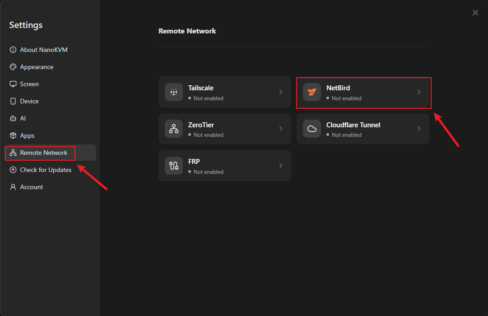
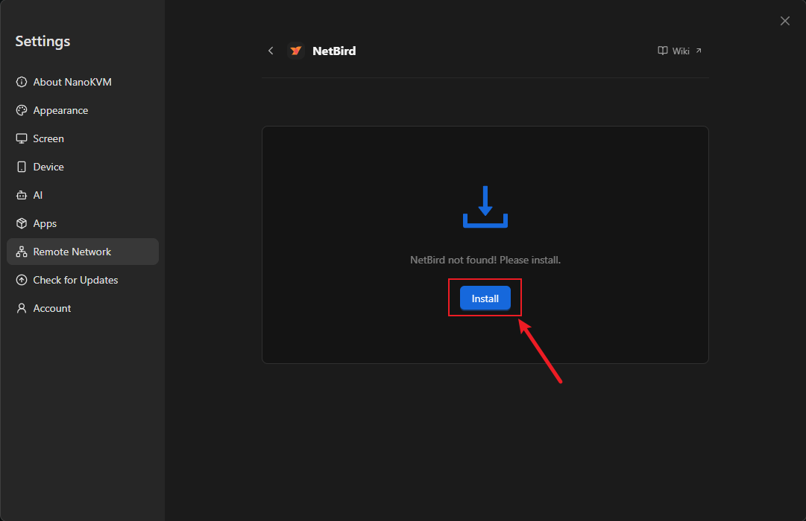
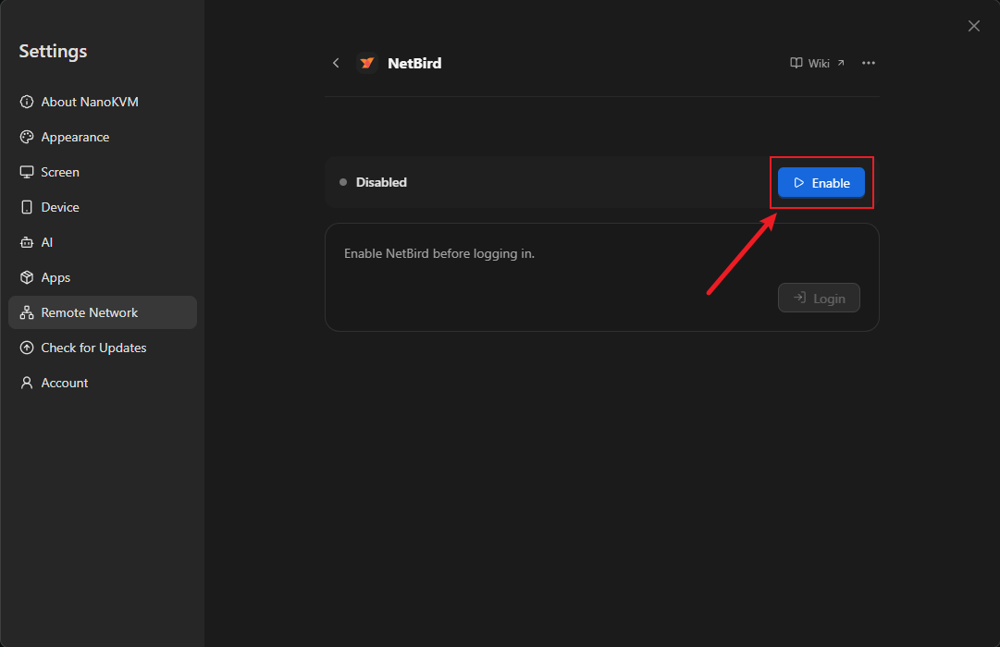
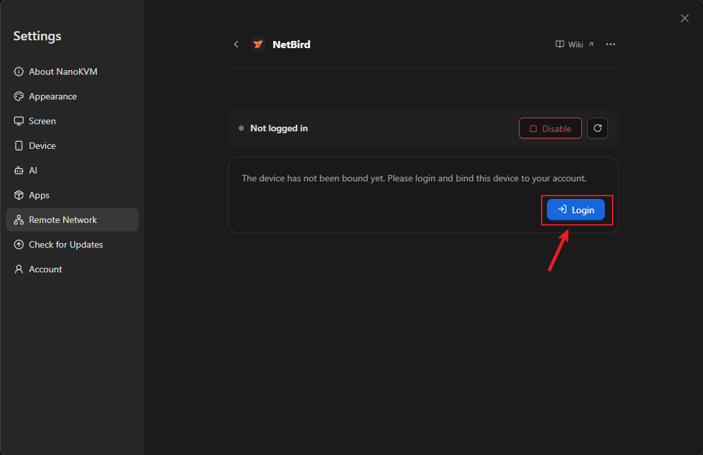
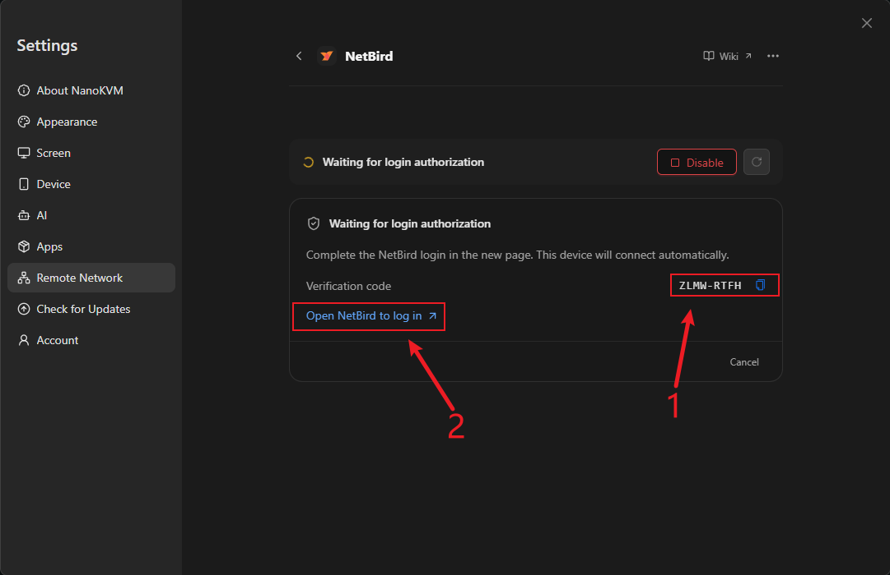
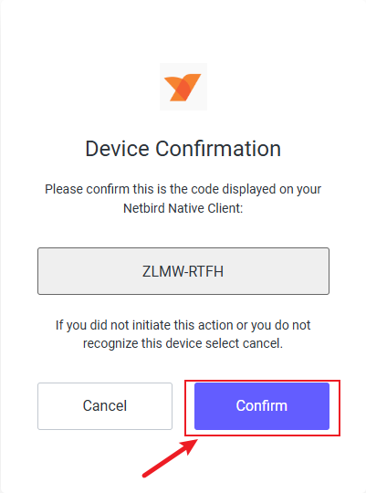
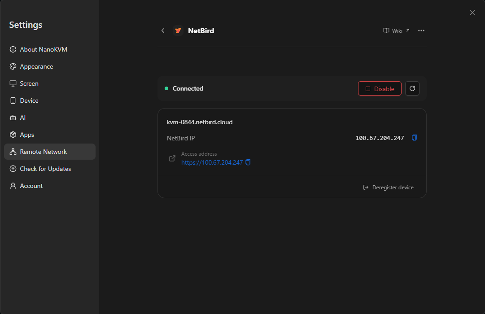
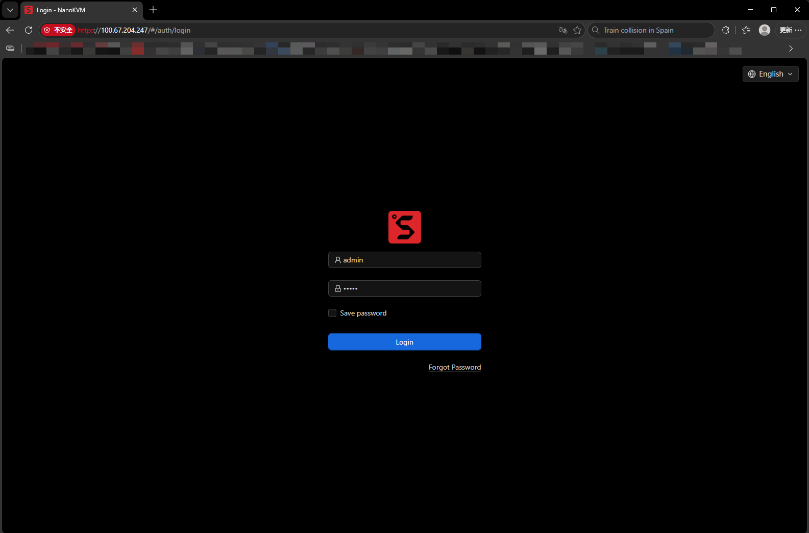

# NetBird

## Introduction to NetBird

NetBird is an open-source, WireGuard-based mesh networking tool. It joins NanoKVM Go, your computer, and your phone to the same virtual network, so you can reach NanoKVM Go from outside even without a public IP address or router port forwarding.

NanoKVM Go integrates the NetBird client. You can install, enable, and log in entirely from the web console, without enabling SSH or downloading anything manually.

After joining, NanoKVM Go gets a NetBird IP in the `100.x.x.x` range. Install the NetBird client on the access device, sign in with the same account, and open that address in a browser.

```text
NanoKVM Go -- NetBird virtual network -- remote computer or phone
```

> The NetBird integration adds only NanoKVM Go itself to the virtual network. It does not bring other devices or subnets from the local network into the virtual network.

## Compared with other remote network options

NetBird belongs to the same category as [Tailscale](tailscale.html) and [Sipeed Remote Network](sipeed_remote_network.html): both ends are connected through a virtual network, with no public server required. The differences are the control server and the account system:

| Option | Control server | Account required | Client on the access device |
| --- | --- | --- | --- |
| NetBird | NetBird Cloud | NetBird account | NetBird |
| Tailscale | Tailscale | Tailscale account | Tailscale |
| Sipeed Remote Network | Sipeed | No | Tailscale |

[frp](frp.html) and [Cloudflare Tunnel](cloudflare_tunnel.html) are tunneling solutions that require a public server or a domain. [Static IP](static_ip.html) only fixes the LAN address and cannot provide external access. If you do not have a public server, start with a mesh option such as NetBird.

> The built-in NetBird integration currently connects to NetBird Cloud only (management server `api.netbird.io`). A self-hosted NetBird management server cannot be configured.

## Prerequisites

Before you start, make sure that:

- NanoKVM Go is connected to the internet;
- The NanoKVM Go web console is reachable on the local network;
- The NanoKVM Go system and app are updated to the latest version;
- NanoKVM Go can reach GitHub, because the NetBird package is downloaded during installation;
- The computer or phone you use for remote access can install the NetBird client;
- The browser you use for login can reach `app.netbird.io`;
- You have a NetBird account. The free plan covers up to 5 users and 100 machines, which is enough for personal use. See the [NetBird pricing page](https://netbird.io/pricing) for the current limits.

> If NetBird is not listed under `Settings` > `Remote Network`, update the NanoKVM Go app first.

## Create and sign in to a NetBird account

Skip this section if you already have a NetBird account.

1. Open the [NetBird console](https://app.netbird.io/) and click `Get Started`;
2. Sign up and sign in with Google, GitHub, email, or another supported provider.


3. Follow the onboarding steps to reach the console;
4. Open `Peers` in the left navigation and confirm that the device list is visible.


NanoKVM Go is not in the list yet. It joins automatically during the login step below.

## Install and enable NetBird on NanoKVM Go

### Open the NetBird settings

1. Sign in to the NanoKVM Go web console and click the settings icon in the top toolbar;
2. Select `Remote Network` on the left, then click the `NetBird` card.



The NetBird page shows `NetBird not found! Please install.`

### Install the NetBird client

1. Click `Install`;
2. Wait for the installation to finish. The page shows `Installing`. The package is downloaded from GitHub, so the time depends on the device's network.



When installation finishes, the status changes to `Disabled`. If installation fails, make sure the device can reach GitHub and try again.

### Enable NetBird

1. Click `Enable`;
2. Wait for the status to change from `Disabled` to `Not logged in`.



`Not logged in` means the client is running but is not bound to a NetBird account yet.

> If the page reports `The TUN device is unavailable.`, the virtual network adapter is not available. Make sure the system and app are up to date. If the error remains, contact support.

## Log in and bind the device

1. Click `Login` in the `Not logged in` card.



2. The page enters `Waiting for login authorization` and shows a `Verification code` and an `Open NetBird to log in` link.



3. Click `Open NetBird to log in`. Your browser opens the NetBird authorization page;
4. Sign in with the NetBird account from the previous section. If the page asks for a verification code, enter the code shown on the NanoKVM Go page, then approve the authorization.



5. Return to the NanoKVM Go page and wait for the status to change to `Connected`. The page shows the device name, `NetBird IP`, and `Access address`.



`NetBird IP` is the device address on the virtual network. `Access address` is the full URL, for example `https://100.x.x.x`.

> NanoKVM Go waits 10 minutes for the login authorization. If it expires, the page reports that the authorization expired. Click `Login` again to get a new verification code.

### Confirm that the device is online

Open the `Peers` page in the NetBird console and find the NanoKVM Go device. A green dot before the device name means the device is online.


The device name is usually the NetBird domain name of NanoKVM Go. Use `NetBird IP` to confirm which entry is yours.

## Install the NetBird client on the access device

Install the NetBird client on the computer or phone that will access NanoKVM Go:

| Platform | Installation |
| --- | --- |
| Windows | Follow the [NetBird Windows guide](https://docs.netbird.io/get-started/install/windows) |
| macOS | Follow the [NetBird macOS guide](https://docs.netbird.io/get-started/install/macos) |
| Linux | Follow the [NetBird Linux guide](https://docs.netbird.io/get-started/install/linux) |
| Android | Install from [Google Play](https://play.google.com/store/apps/details?id=io.netbird.client) |
| iOS / iPadOS | Install from the [App Store](https://apps.apple.com/app/id6469329339) |

After installation:

1. Start the NetBird client and click `Connect`. On mobile, turn on the connection switch;
2. Sign in with the same NetBird account used by NanoKVM Go;
3. On mobile, allow the client to create a VPN connection on first use;
4. Confirm that the client is connected.


> If the access device uses a different account, that account must first be invited to the same NetBird network and allowed by an access policy.

## Access NanoKVM Go from outside

To make sure you are testing an external connection, disconnect the access device from its current Wi-Fi and use a phone hotspot or mobile data instead.

1. Confirm that the NetBird client on the access device is connected. In the example below, the access device `DESKTOP-RV17CIT` connects to `kvm-0844`, so both devices need a green dot before their names.


2. Enter the `Access address` shown on the NanoKVM Go page in the browser address bar, for example `https://100.x.x.x`;
3. If the browser warns about an untrusted certificate, follow the browser prompt to continue (in Chrome or Edge, expand `Advanced`). NanoKVM Go uses a self-signed certificate, so the warning is expected;
4. Open the NanoKVM Go login page and sign in;
5. Test the remote screen, keyboard and mouse control, and power control.



> If the page does not open, check that the client on the access device is connected, both devices are in the same NetBird network, and NanoKVM Go is online on the `Peers` page (both green dots are visible).

## Daily use and security

- Set a strong password for NanoKVM Go and keep the device's own login enabled;
- Enable MFA for your NetBird account;
- The default NetBird policy allows all devices in the network to reach each other. For multi-user setups, restrict access to the required devices and ports in `Access Control`;
- Do not open additional NanoKVM Go ports on the router for NetBird;
- Review the `Peers` list regularly and remove devices you no longer use;
- Click `Disable` when you do not need remote access. Before retiring or transferring the device, click `Deregister device` to remove it from the NetBird network;
- Keep the NanoKVM Go app and the NetBird client on the access device up to date.

## FAQ

### NetBird is missing from the settings page

Check that the NanoKVM Go app is up to date, then reopen `Settings` > `Remote Network`.

### Installation failed

The package is downloaded from GitHub, so failures are usually caused by network or storage problems. Make sure the device can reach GitHub and has enough free space, then retry.

### The page reports that another NetBird installation was detected

A NetBird client installed from a package or install script already exists on the device. Uninstall it first, including the `netbird` service and binary, then retry from the page.

### The page reports that the TUN device is unavailable

NetBird requires the `/dev/net/tun` virtual network device. Make sure the system and app are up to date. If the error remains, contact support.

### Login authorization expired

NanoKVM Go waits 10 minutes for authorization. If it expires, click `Login` again to get a new verification code.

### The status is Connected but the browser cannot open the page

Check each of the following: the client on the access device is connected; both devices use the same NetBird account; NanoKVM Go is online on the `Peers` page; an access policy allows the two devices to communicate. If needed, ping the NanoKVM Go `NetBird IP` from the access device.

### Can I reach other devices on the NanoKVM Go LAN through NetBird?

No. The built-in integration adds only NanoKVM Go itself to the virtual network. Subnet routes and DNS are not enabled.

### Can I connect to a self-hosted NetBird server?

Not at the moment. The NanoKVM Go NetBird integration always uses NetBird Cloud.

### Do I need to log in again after uninstalling NetBird?

Uninstalling stops and removes the client but keeps the device identity and configuration. After reinstalling and enabling it, you can usually continue without logging in again. If the page shows `Not logged in`, log in again.

## Next steps

- To use a Tailscale network, or to avoid creating a NetBird account, see [Tailscale](tailscale.html) and [Sipeed Remote Network](sipeed_remote_network.html);
- If you have a public server or your own domain, see [frp](frp.html) and [Cloudflare Tunnel](cloudflare_tunnel.html);
- To keep a fixed LAN address, see [Static IP](static_ip.html);
- For other issues, see the [NanoKVM Go FAQ](../faq.html).
