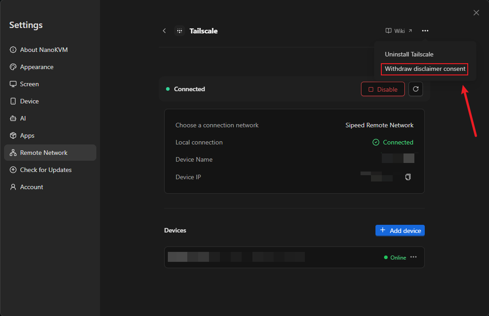

# Sipeed Remote Network Disclaimer

Last updated: 2026-10-29

## Terms

> On a NanoKVM Go or NanoKVM Go+ device, tapping **✓** is equivalent to “Agree and enable” below; tapping **✕** means you do not agree. This page only displays the notice; consent is recorded on the device.

Enabling Sipeed Remote Network sends requests to Sipeed servers and provides connection information such as the device identifier, device name, and virtual network IP address. This information is used for device registration, authentication, connection coordination, and network management.

Remote access depends on network conditions, device configuration, and service availability. Connections may be delayed, interrupted, or temporarily unavailable. Assess the risks of using this service and keep an alternative way to access your device when needed.

Use this service only with devices and networks you own or are authorized to access. Keep login credentials and pairing codes secure, and grant access to others with care.

By clicking “Agree and enable”, you confirm that you have read and understood this notice and consent to the communication and information processing described above for providing remote connections. Your consent is saved on this device, so you do not need to confirm it each time you enable the service.

## Withdrawing consent

You can withdraw consent from the top-right menu on the connected page. Withdrawal exits Sipeed Remote Network and requests deletion of the associated cloud network and its user. Once deleted, other devices in that network can no longer use it for remote access. Enabling the service again requires renewed consent.

