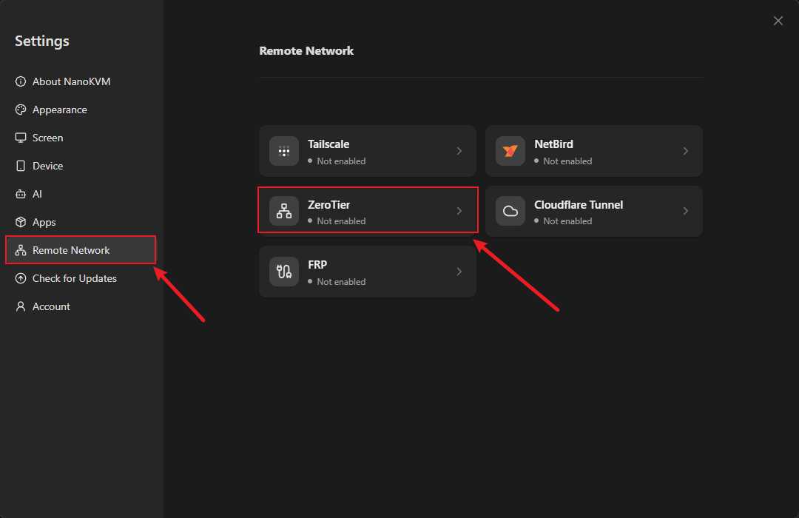
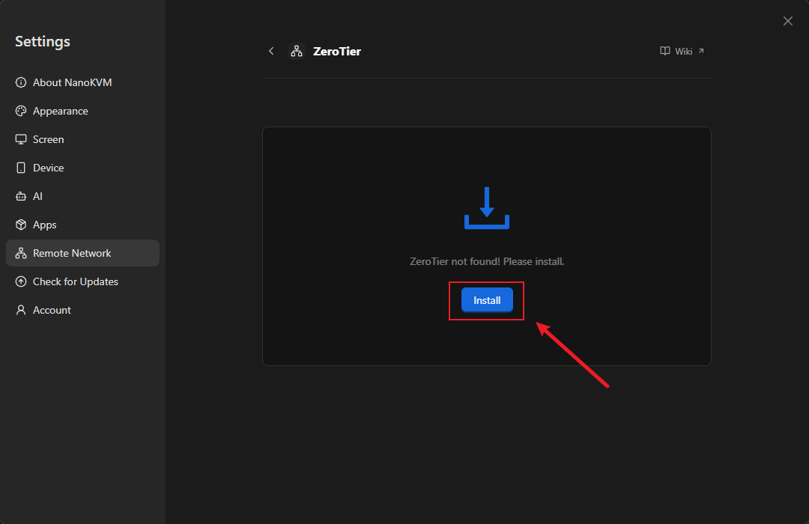
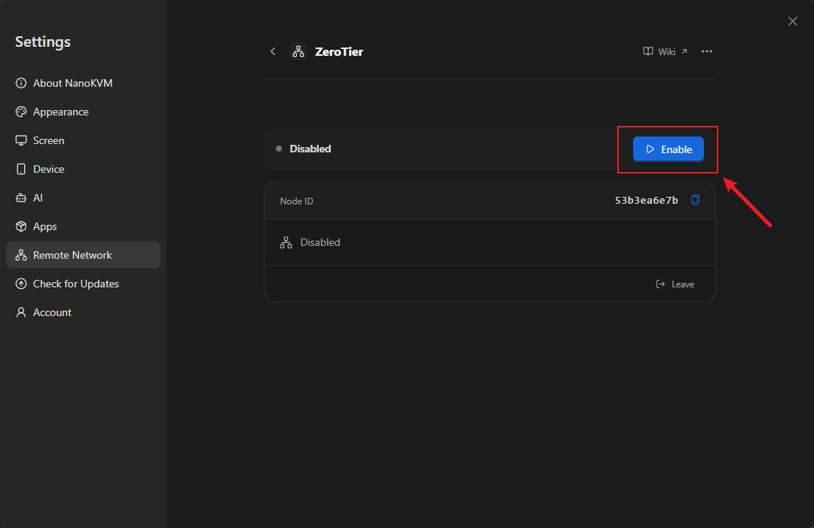
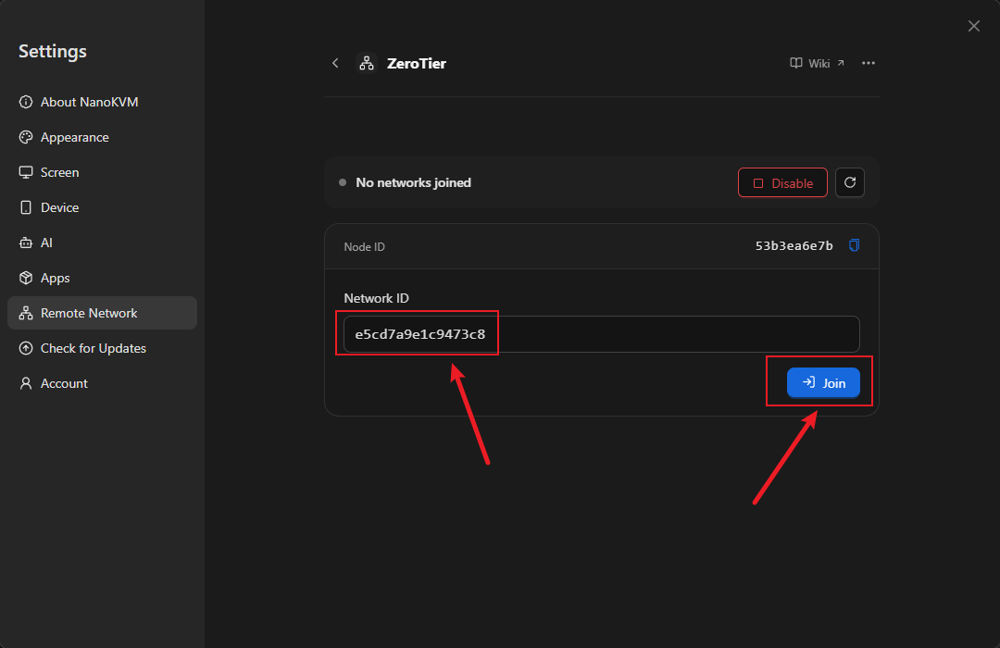
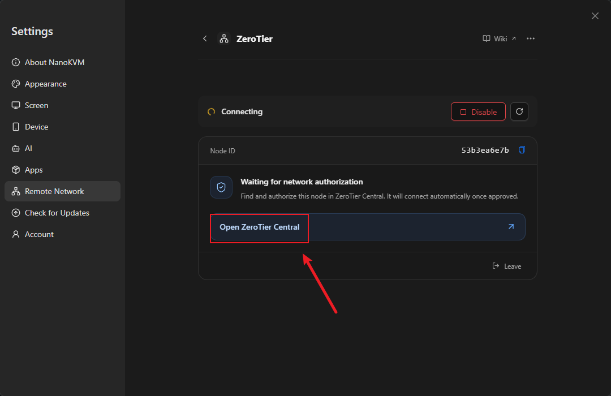
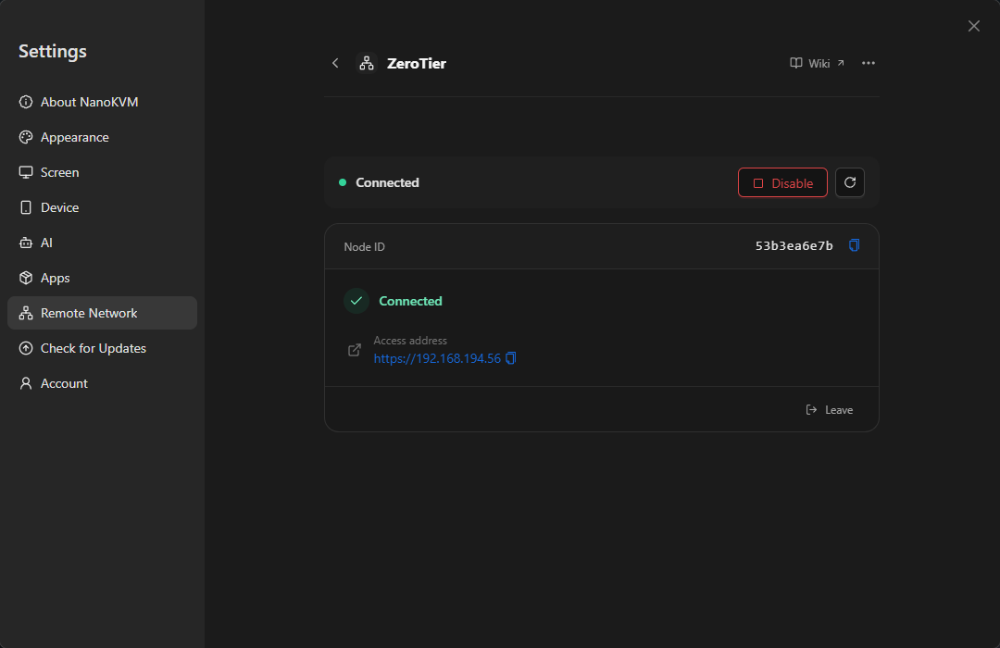

# ZeroTier

## Introduction to ZeroTier

ZeroTier is a virtual networking tool. It joins NanoKVM Go, your computer, and your phone to the same virtual network, so you can reach NanoKVM Go from outside even without a public IP address or router port forwarding.

NanoKVM Go integrates the ZeroTier client. You can install it, enable it, and join a network entirely from the web console, without enabling SSH or downloading anything manually.

After joining, NanoKVM Go gets a virtual IP assigned by ZeroTier. Install the ZeroTier client on the access device, join the same network, and open that address in a browser.

```text
NanoKVM Go -- ZeroTier virtual network -- remote computer or phone
```

> The ZeroTier integration does not automatically share NanoKVM Go's local network with other members. Access to other devices on that LAN depends on the Managed Routes configured in the ZeroTier network.

## Compared with other remote network options

ZeroTier belongs to the same category as [Tailscale](tailscale.html), [NetBird](netbird.html), and [Sipeed Remote Network](sipeed_remote_network.html): a virtual network that does not require a public server. The main differences are how a device joins the network and how it is authorized:

| Option | Network identifier | Device authorization | Client on the access device |
| --- | --- | --- | --- |
| ZeroTier | 16-digit hexadecimal Network ID | Authorize the Node ID in ZeroTier Central | ZeroTier |
| NetBird | NetBird account | Sign in to the same account | NetBird |
| Tailscale | Tailscale account / Tailnet | Sign in to the same account | Tailscale |
| Sipeed Remote Network | Sipeed pairing code | 6-digit claim code + 3-digit verification | Tailscale |

ZeroTier does not require signing in to an account on NanoKVM Go, but you must create a network in ZeroTier Central and authorize the NanoKVM Go Node ID there.

[frp](frp.html) and [Cloudflare Tunnel](cloudflare_tunnel.html) are tunneling solutions that require a public server or a domain. [Static IP](static_ip.html) only fixes the LAN address and cannot provide external access.

> The page does not provide a configuration entry for a self-hosted ZeroTier controller or a custom Planet. Use a network hosted on ZeroTier Central.

## Prerequisites

Before you start, make sure that:

- NanoKVM Go is connected to the internet;
- The NanoKVM Go web console is reachable on the local network;
- The NanoKVM Go system and app are updated to the latest version;
- NanoKVM Go can reach `download.zerotier.com`, because the ZeroTier package is downloaded during installation;
- You have a ZeroTier account and have created a network in ZeroTier Central;
- You know the 16-digit hexadecimal Network ID to join;
- The computer or phone you use for remote access can install the ZeroTier client.

> If ZeroTier is not listed under `Settings` > `Remote Network`, update the NanoKVM Go app first.

## Create a ZeroTier network

Skip this section if you already have a usable ZeroTier network. Just note its Network ID.

1. Open [ZeroTier Central](https://my.zerotier.com/) and sign in;


2. Create a network (`Create A Network`);


3. Open the network settings and find `Network ID`, a 16-digit hexadecimal string;


4. Check `Access Control`: the default `Private` requires manual authorization, while `Public` allows devices to join automatically;
5. Note the Network ID. You will enter it on NanoKVM Go later.

> If the network is `Private`, you will need to authorize both NanoKVM Go and the access device under `Members`.

## Install and enable ZeroTier on NanoKVM Go

### Open the ZeroTier settings

1. Sign in to the NanoKVM Go web console and click the settings icon in the top toolbar;
2. Select `Remote Network` on the left, then click the `ZeroTier` card.



The ZeroTier page shows `ZeroTier not found! Please install.`

### Install the ZeroTier client

1. Click `Install`;
2. Wait for the installation to finish. The page shows `Installing`. The package is downloaded from ZeroTier's official site, so the time depends on the device's network.



When installation finishes, the status changes to `Disabled`. If installation fails, make sure the device can reach `download.zerotier.com` and try again.

### Enable ZeroTier

1. Click `Enable`;
2. Wait for the status to change from `Disabled` to `No networks joined`.



`No networks joined` means the client is running but has not joined any ZeroTier network yet.

> If the page reports `The TUN device is unavailable.`, the virtual network adapter is not available. Make sure the system and app are up to date. If the error remains, contact support.

## Join a network and authorize the device

1. Enter the 16-digit hexadecimal Network ID in `Network ID`, for example `0123456789abcdef`, then click `Join`;



2. The page enters `Waiting for network authorization` and shows the local `Node ID` (a 10-digit hexadecimal string);
3. Click `Open ZeroTier Central`, find this Node ID in the network's `Members` list, and authorize it;
4. Return to the NanoKVM Go page and wait for the status to change to `Connected`;
5. The page shows an `Access address`, for example `https://10.x.x.x` or `https://192.168.x.x`, depending on the address assigned by ZeroTier.






> If the status is `Not authorized or authorization revoked`, check the node's authorization in ZeroTier Central. If the page reports `Network not found`, verify the Network ID.

## Install the ZeroTier client on the access device

Install the ZeroTier client on the computer or phone that will access NanoKVM Go:

| Platform | Installation |
| --- | --- |
| Windows | Download and install from the [ZeroTier download page](https://www.zerotier.com/download/) |
| macOS | Download and install from the [ZeroTier download page](https://www.zerotier.com/download/) |
| Linux | Follow the instructions on the [ZeroTier download page](https://www.zerotier.com/download/) |
| Android | Install from [Google Play](https://play.google.com/store/apps/details?id=com.zerotier.one) |
| iOS / iPadOS | Install from the [App Store](https://apps.apple.com/app/zerotier/id1450921335) |

After installation:

1. Start the ZeroTier client and use `Join Network` to join the same Network ID as NanoKVM Go;


2. If the network is `Private`, authorize this access device under `Members` in ZeroTier Central;


3. Confirm that the client is connected.


> The access device and NanoKVM Go must join the same ZeroTier network and both be allowed by the network.

## Access NanoKVM Go from outside

To make sure you are testing an external connection, disconnect the access device from its current Wi-Fi and use a phone hotspot or mobile data instead.

1. Confirm that the ZeroTier client on the access device is connected;
2. Enter the `Access address` shown on the NanoKVM Go page in the browser address bar, for example `https://10.x.x.x`;
3. If the browser warns about an untrusted certificate, follow the browser prompt to continue. NanoKVM Go uses a self-signed certificate, so the warning is expected;
4. Open the NanoKVM Go login page and sign in;
5. Test the remote screen, keyboard and mouse control, and power control.

> If the page does not open, check that the access device has joined the same network and been authorized, the NanoKVM Go page shows `Connected`, and the access address is still the currently assigned address.

## Manage joined networks

- Joined networks are listed in the ZeroTier card, with their status and access addresses;
- Click `Leave` to leave a network. Sessions using that network will disconnect;
- Uninstalling ZeroTier stops and removes the client but keeps the node identity and network memberships, so you can continue after reinstalling.

## Daily use and security

- Set a strong password for NanoKVM Go and keep the device's own login enabled;
- Enable MFA for your ZeroTier account;
- Use a `Private` network and authorize only nodes you trust;
- Review the `Members` list in ZeroTier Central regularly and remove nodes you no longer use;
- Do not open additional NanoKVM Go ports on the router for ZeroTier;
- Click `Disable` when you do not need remote access, or revoke authorization in Central;
- Keep the NanoKVM Go app and the ZeroTier client on the access device up to date.

## FAQ

### ZeroTier is missing from the settings page

Check that the NanoKVM Go app is up to date, then reopen `Settings` > `Remote Network`.

### Installation failed

The package is downloaded from `download.zerotier.com`, so failures are usually caused by network or storage problems. Make sure the device can reach that site and has enough free space, then retry.

### ZeroTier is already installed on the device and the page installation fails

The built-in installer does not overwrite an existing ZeroTier installation. Uninstall the ZeroTier client installed from a package or another method, then retry from the page.

### The page reports that the TUN device is unavailable

ZeroTier requires the `/dev/net/tun` virtual network device. Make sure the system and app are up to date. If the error remains, contact support.

### The page reports an invalid Network ID

The Network ID must be 16 hexadecimal characters and cannot be all zeros. Copy it again from the network settings in ZeroTier Central.

### The page stays on “Waiting for network authorization”

The node has not been allowed by the network yet. Open `Members` in ZeroTier Central, find the `Node ID` shown on the page, and authorize it. If the network is `Private`, authorize the access device separately.

### The page reports “Network not found”

Check that the Network ID is correct and that the network belongs to the ZeroTier account you are signed in to.

### The page stays on “Waiting for an assigned address”

ZeroTier has not assigned an address to the device yet. Check the network's IPv4 auto-assignment settings, or wait for the network to deliver its configuration.

### The status is Connected but the browser cannot open the page

Check that the access device and NanoKVM Go are in the same network, both are authorized, the NanoKVM Go page shows `Connected`, and the access address matches the current assignment. If needed, ping the address from the access device.

### Can I reach other devices on the NanoKVM Go LAN through ZeroTier?

Not automatically. NanoKVM Go only adds itself to the virtual network and does not automatically share its local LAN. If the network has Managed Routes, access depends on the routes and authorization.

### Can I connect to a self-hosted ZeroTier controller?

The page does not provide a configuration entry for a self-hosted controller or a custom Planet. Use a network hosted on ZeroTier Central.

### Do I need to rejoin the network after uninstalling ZeroTier?

Uninstalling stops and removes the client but keeps the node identity and network memberships. After reinstalling and enabling it, the existing network usually continues to work. If the page shows an unexpected state, join the network again.

## Next steps

- To use a Tailscale network, or to avoid creating a ZeroTier account, see [Tailscale](tailscale.html) and [Sipeed Remote Network](sipeed_remote_network.html);
- If you have a public server or your own domain, see [frp](frp.html) and [Cloudflare Tunnel](cloudflare_tunnel.html);
- To keep a fixed LAN address, see [Static IP](static_ip.html);
- For other issues, see the [NanoKVM Go FAQ](../faq.html).
