*NanoKVM Go is usually shipped with an image already flashed. If the device boots normally, you can skip this step at first.*

## Preparation

Before flashing, prepare the following items:

- NanoKVM Go;
- a SIM eject pin or another tool that can press and hold the flashing-mode button;
- a USB data cable;
- a computer running Windows, macOS, or Linux;
- the NanoKVM Go image file;
- the flashing tool for your operating system:
  - Windows: balenaEtcher 2.1.6 or ImageUSB;
  - macOS: balenaEtcher 2.1.6;
  - Linux: balenaEtcher 2.1.6.

## Download the Image

Download the latest NanoKVM Go image from GitHub.

Image download link: [NanoKVM-Go Releases](https://github.com/sipeed/NanoKVM-Go/releases)

## Download the Flashing Tool

balenaEtcher runs on Windows, macOS, and Linux, so prefer it; ImageUSB runs on Windows only and is the fallback there.

### balenaEtcher 2.1.6 (Windows / macOS / Linux)

Stay on balenaEtcher 2.1.6:

Download link: [balenaEtcher v2.1.6](https://github.com/balena-io/etcher/releases/tag/v2.1.6)

In the `Assets` section of that release, pick the installer for your operating system:

- Windows: `balenaEtcher-2.1.6.Setup.exe`;
- macOS: `balenaEtcher-2.1.6-arm64.dmg` (Apple silicon) or `balenaEtcher-2.1.6-x64.dmg` (Intel);
- Linux: `balena-etcher_2.1.6_amd64.deb` (Debian / Ubuntu) or `balena-etcher-2.1.6-1.x86_64.rpm` (Fedora / RHEL).

The official download page lists installers by operating system and architecture but does not let you choose a version, so use the release link above to get 2.1.6.

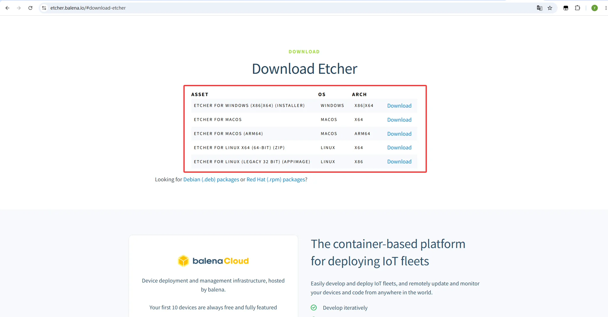

### ImageUSB (Windows)

ImageUSB runs on Windows only. Download the zip from the official site, unzip it, and run `imageUSB.exe`; no installation is required.

Download link: [ImageUSB](https://www.osforensics.com/tools/write-usb-images.html)

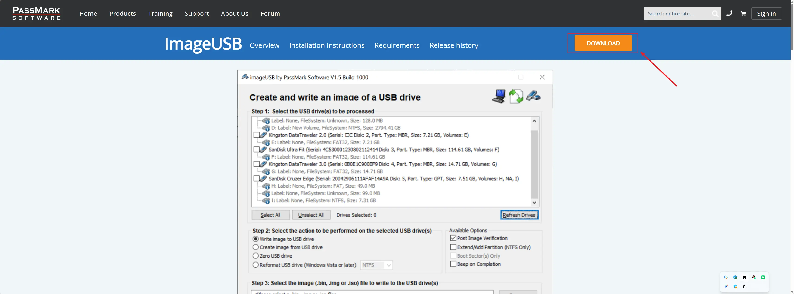

## Enter Flashing Mode

1. Disconnect the USB cable from NanoKVM Go to power off the device.

2. Insert the SIM eject pin through the opening and press and hold the flashing-mode button on NanoKVM Go.

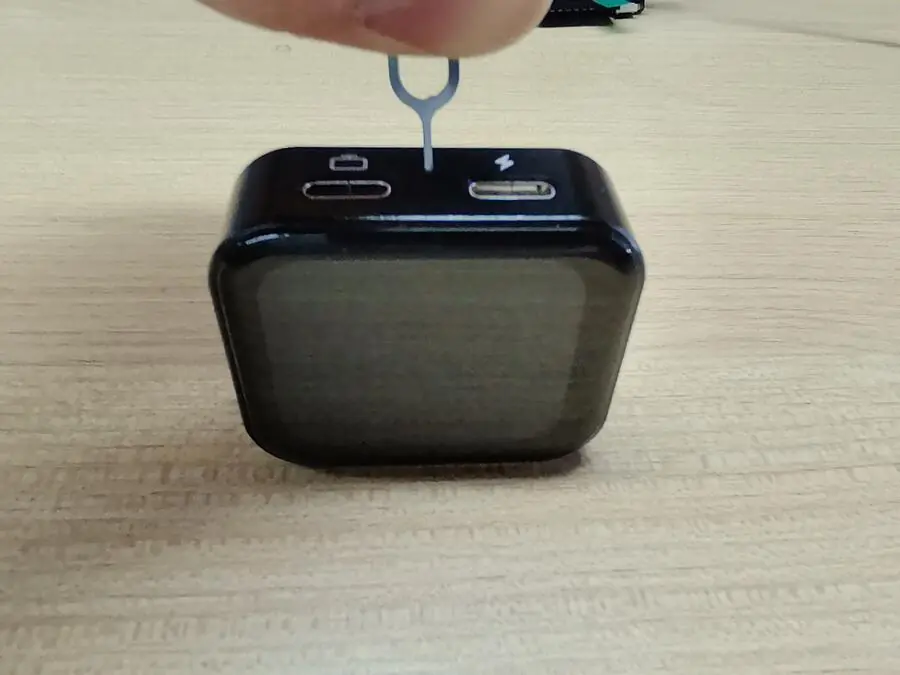

3. Keep holding the flashing-mode button, insert the USB data cable connected to the computer into the NanoKVM Go data port (Data Port).

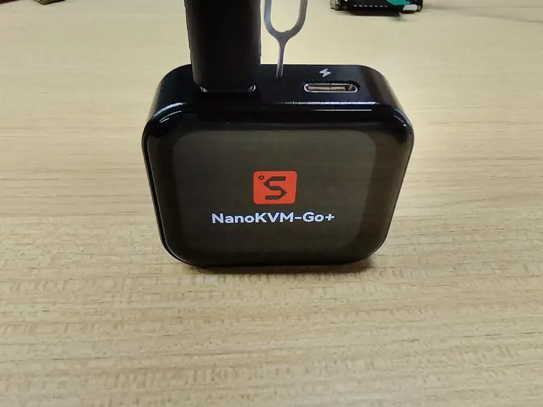

## Flash the Image with balenaEtcher (Windows / macOS / Linux)

1. In balenaEtcher, click `Flash from file` and select the downloaded NanoKVM Go image.

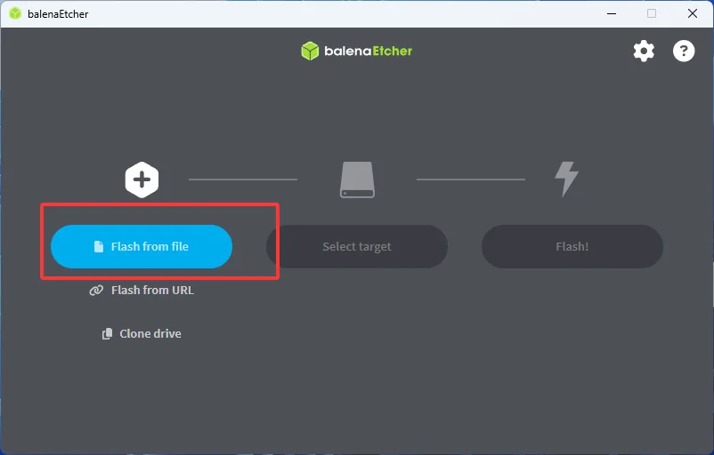

2. When the `Missing partition table` warning appears, click `Continue`.

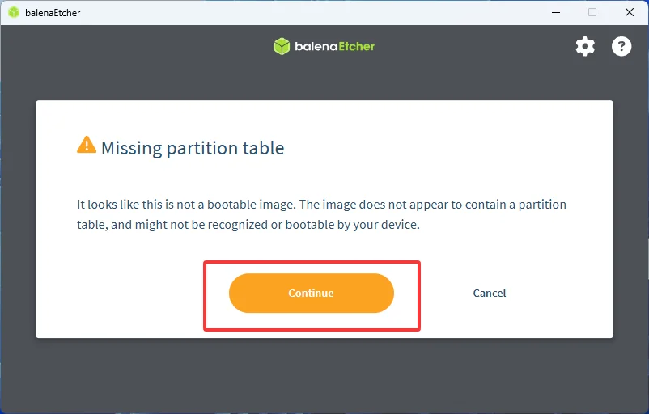

3. Click `Select target`.

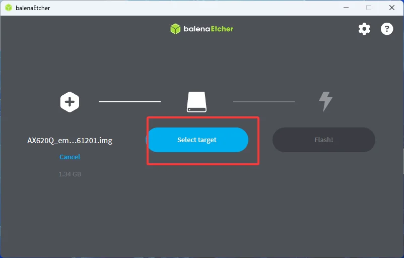

4. Select the drive that corresponds to NanoKVM Go (listed as `Compute Module`) and click `Select 1`.

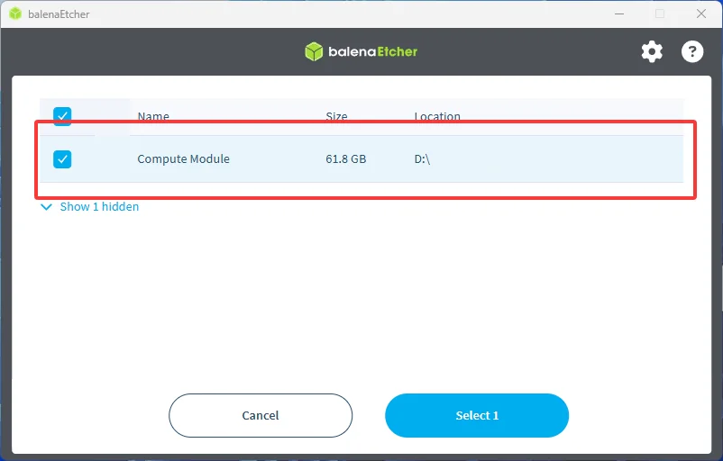

5. Click `Flash!` and wait for the flashing to finish.

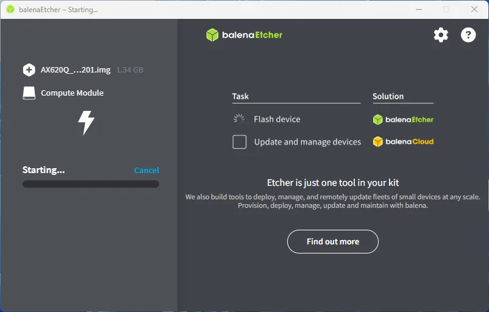

6. balenaEtcher reports `Flash Completed!` once the image has been written.

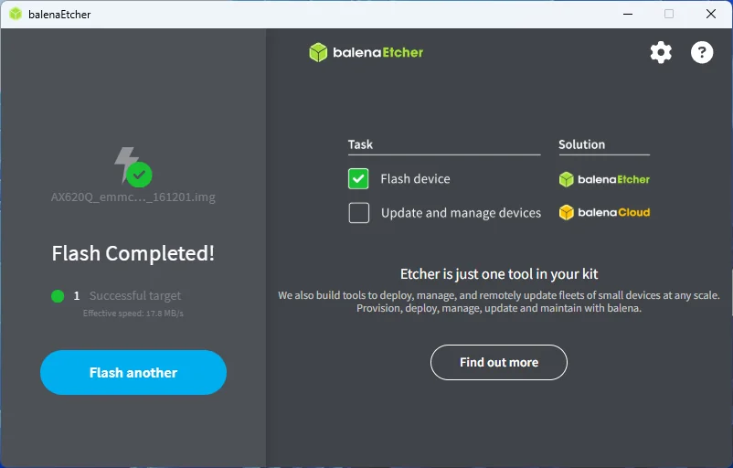

## Flash the Image with ImageUSB (Windows)

1. Open ImageUSB and click `Refresh Drives`. The NanoKVM Go device (`Linux File-Stor Gadget`) should appear in the list.

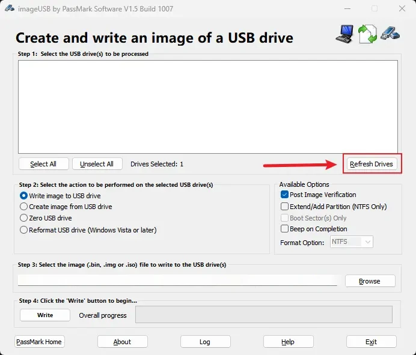

2. In `Step 1`, select the USB drive that corresponds to NanoKVM Go.

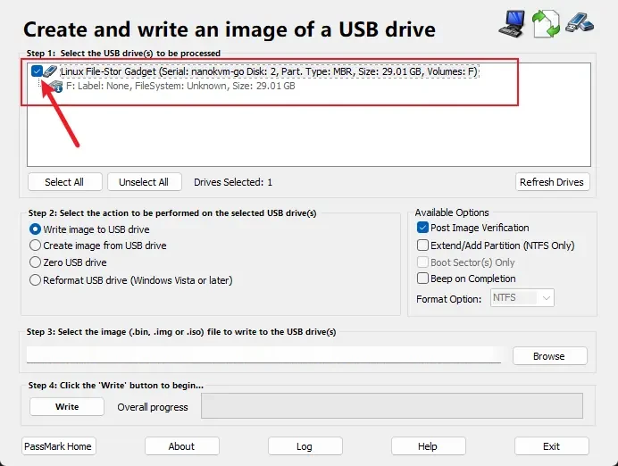

3. In `Step 2`, select `Write image to USB drive`.

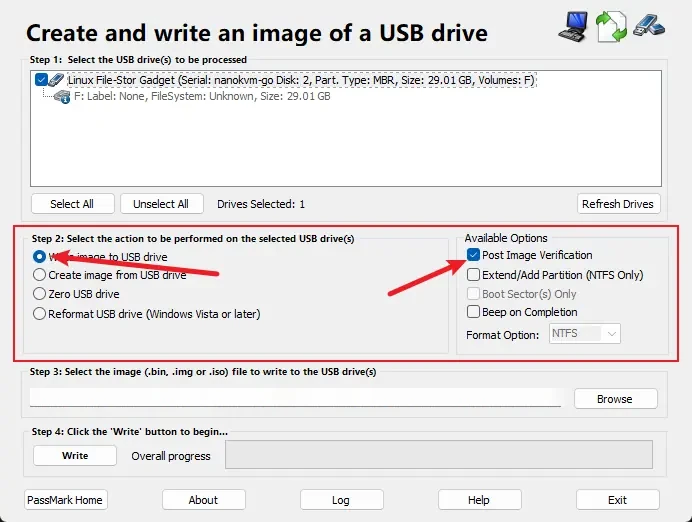

4. In `Step 3`, click `Browse` and select the downloaded NanoKVM Go image file.

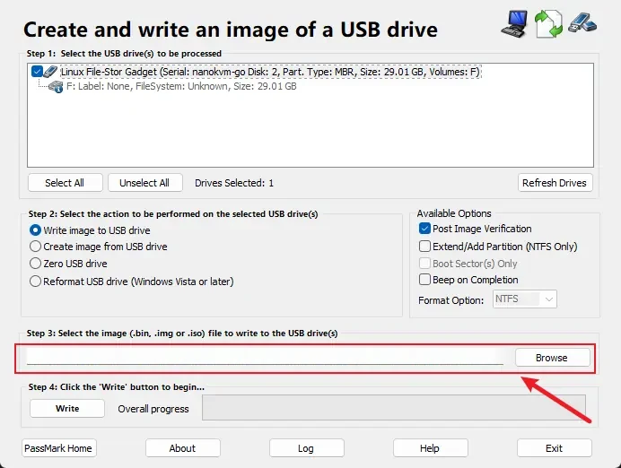

5. In `Step 4`, click `Write` to start flashing.

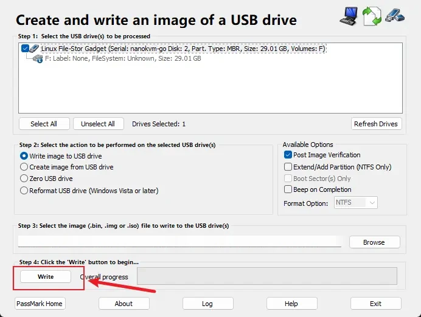

6. Click `Yes` in the confirmation dialog to confirm the write.

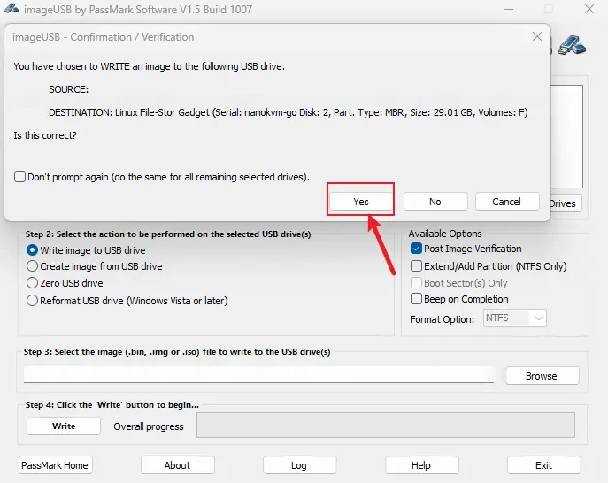

7. Wait for flashing to complete.

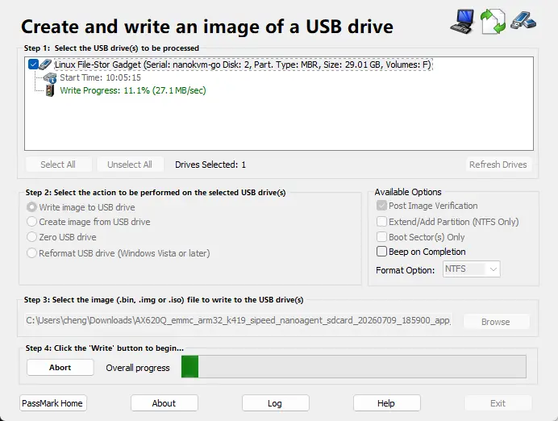

8. `Imaging Completed!` appears once the image has been written.

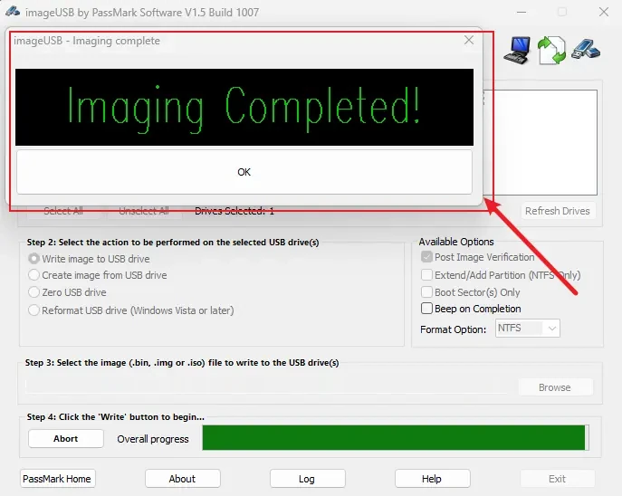

After flashing is complete, safely eject the USB device, disconnect the USB cable, reconnect NanoKVM Go, and wait for the system to boot.

> Do not disconnect USB or close the flashing tool during flashing. Otherwise, the image may fail to write correctly.
