## Unboxing

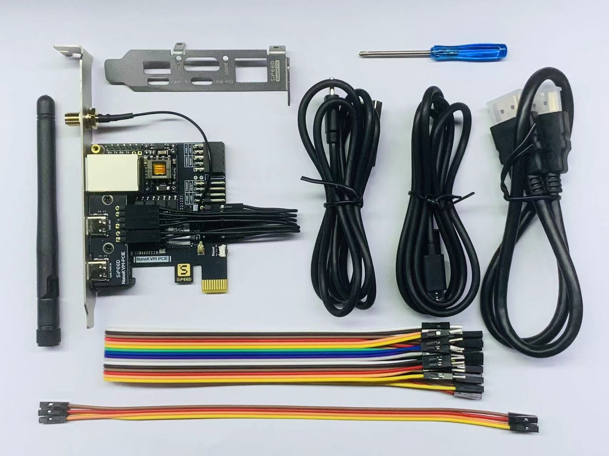

The NanoKVM-PCIe package includes the main unit, a half-height PCIe bracket, two USB-A to C cables, one HDMI cable, one antenna, a 16-pin male to female ribbon cable, a 4-pin female to female ribbon cable, and a small screwdriver. The main unit features Dupont jumpers (2+4P) and an SMA antenna socket.

Note: The image above shows the NanoKVM-PCIe version with WiFi and PoE. The version without WiFi will have one less antenna and will be missing the SMA antenna socket on the bracket.

## Interface Introduction

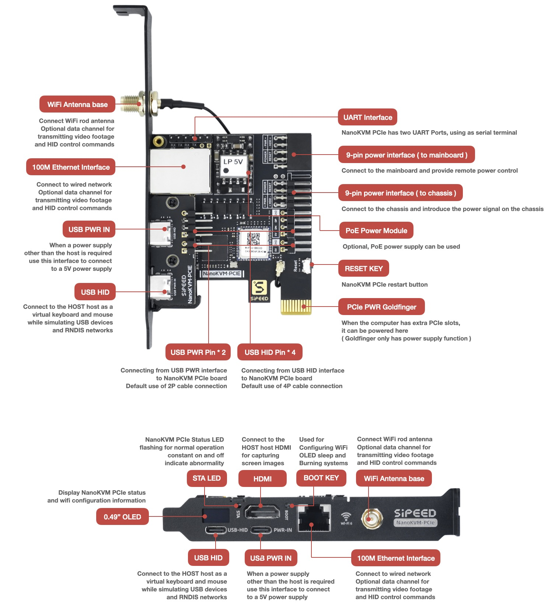

The two USB-C ports on the old version of the beta hardware are reversed. Please refer to the diagram, and follow the labels on the backplate once you receive it.

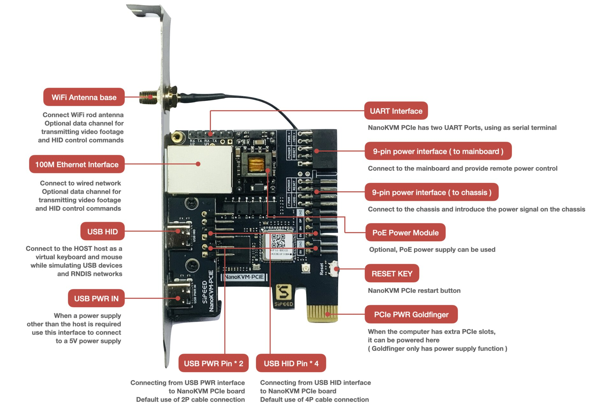

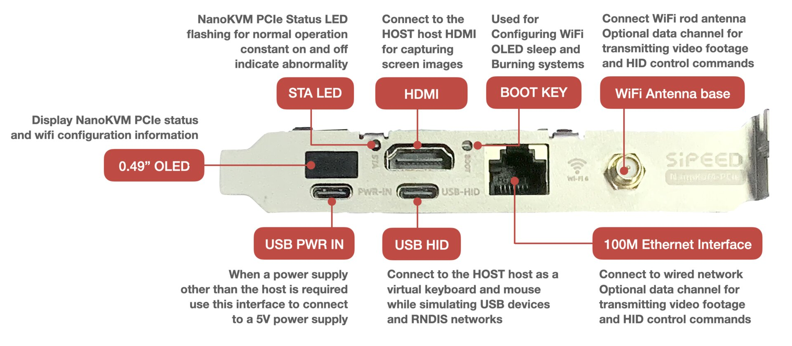

## Power Supply

+ NanoKVM-PCIe offers multiple power supply options: USB HID direct power, USB PWR IN auxiliary power, power from the PCIe slot, and PoE power (optional). You can choose any one of these options. Having multiple power sources will not interfere with the operation of the NanoKVM-PCIe, but at least one power supply must be used.

Note: If you need USB HID direct power, you must enable the "Always Power USB" setting in the BIOS, otherwise, it will affect the remote power-on functionality.

Note: The USB-PWR-IN CC interface of the NanoKVM-PCIe has a 5.1K pull-down resistor, allowing it to be powered by a standard PD charger. Some low-quality PD chargers may pose a risk of damaging the NanoKVM-PCIe.

## Assembly

Power off the host and unplug its power cable, then set the host output to 1920×1080. The HDMI input of NanoKVM-PCIe supports up to 1080P@60 only, so a 2K/4K output will most likely leave the web page black.

> ❗ After inserting the card into the PCIe slot, press the button on the bracket: it must press down and spring back normally, otherwise the NanoKVM may fail to start or behave abnormally.

### Wiring

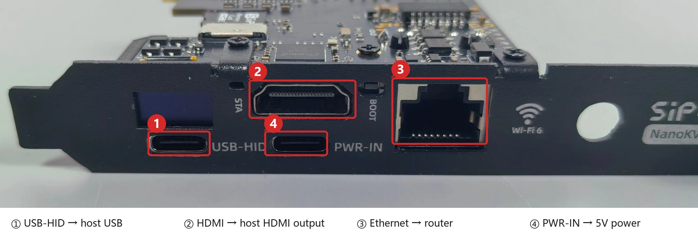

1. Use the included USB C to A data cable to connect the Type-C marked `USB-HID` on the bracket to a USB-A port on the host.

2. Use the included HDMI cable to connect the HDMI port on the bracket to the HDMI output of the host.

3. Use an Ethernet cable to connect the Ethernet port on the bracket to the router/switch. If you have the WiFi version, you can skip this step and configure the network as described in WiFi Configuration below.

4. To power the NanoKVM-PCIe separately, connect a 5V supply to the Type-C marked `PWR-IN` on the bracket; skip this step if powering from the PCIe slot or the host USB port is enough.

> Note: On some batches `USB-HID` and `PWR-IN` are swapped left to right; go by the labels printed on the bracket.

5. ATX power control (only needed if you want remote power on/off)

Remote power control works by emulating the case power button: it shorts the switch and reads the LED state, then shows it on the web page.

+ **Mainboard side (right box)**: unplug the 9-pin cable that connects the case power button to the motherboard, and use the included cable to plug it into the position in the right red box on the NanoKVM-PCIe. One pin of the 9-pin header is missing, so align the key; if it will not go in, it is reversed — do not force it.
+ **Chassis side (left box)**: plug the cables that come from the case power button into the left-hand connector (red box), so the case power button keeps working. `POWER SW` and `RESET SW` have no polarity; `POWER LED±` and `HDD LED±` do, so match + to + and − to −. Reversed LEDs simply do not light and will not cause damage.

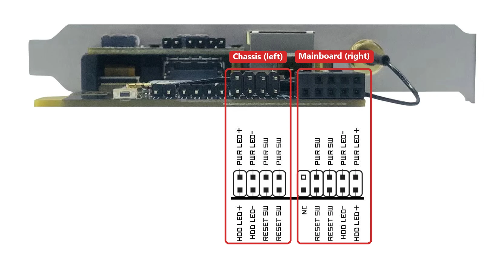

Connecting only the mainboard side still allows remote power on/off; only the case power button stops working.

Notes:
+ The left connector is shown empty only for demonstration; these harnesses ship pre-connected and do not need to be unplugged;
+ NanoKVM-PCIe does not monitor HDD status.

Note: Some early users of the NanoKVM-PCIe with a full-height PCIe bracket may encounter issues related to the installation being too long. Please use longer screws to secure it (be careful not to overtighten) or purchase washers with specifications of outer diameter 7mm, inner diameter 4.2mm, height 3mm. If you still encounter difficulties with the installation, please contact Taobao/AliExpress customer service or email support@sipeed.com for support.

## WiFi Configuration

+ This step is only applicable to the NanoKVM-PCIe version with WiFi; other versions will display "--" in the WiFi icon position.

+ If you are unable to connect an Ethernet cable, NanoKVM-PCIe provides an AP configuration function. Connect your phone to the AP created by NanoKVM -> enter the web configuration.
  The specific steps are as follows:
  1. Power on the device and wait for the main UI to appear. The current WiFi status will not be lit, indicating no WiFi IP.
    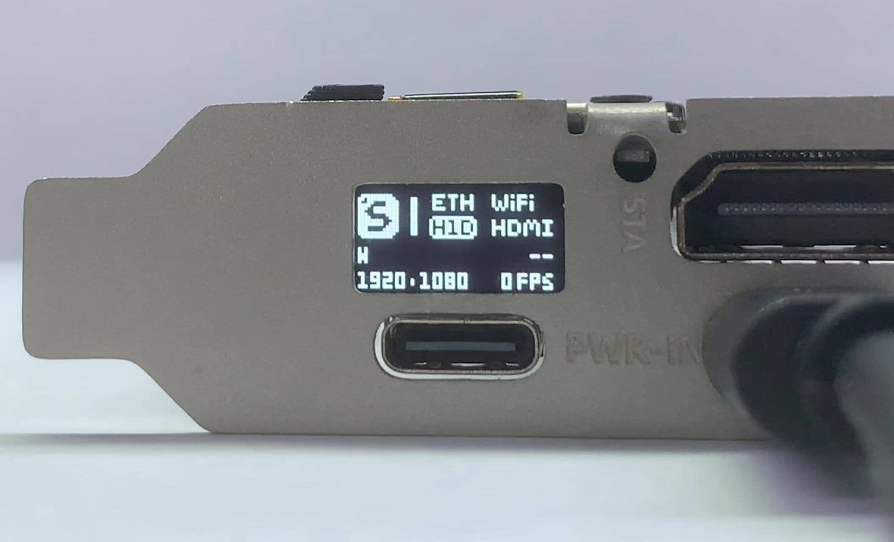
  2. Use the included small screwdriver to press and hold the BOOT button in the PCIe panel for more than 2 seconds.
    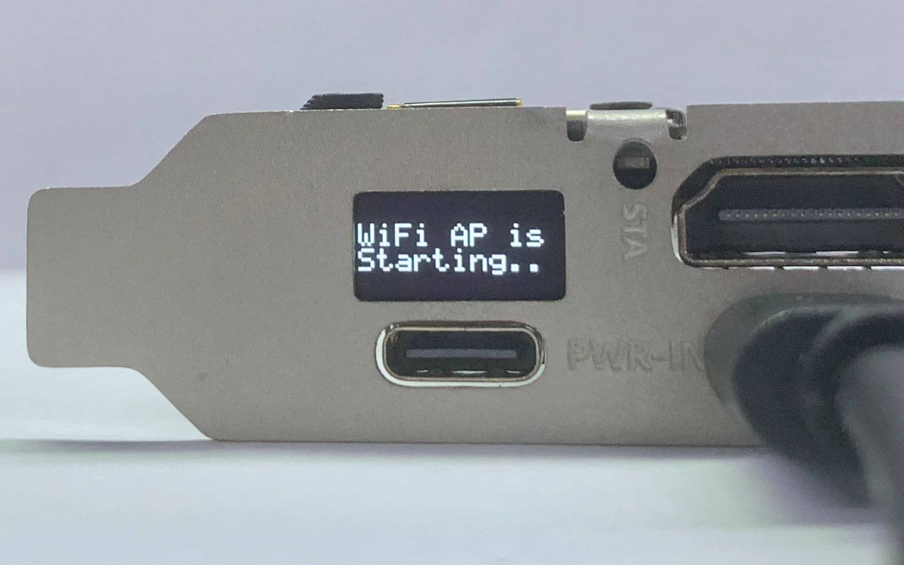
  3. Wait for the WiFi AP QR code to appear, then scan the code to connect to the AP.
    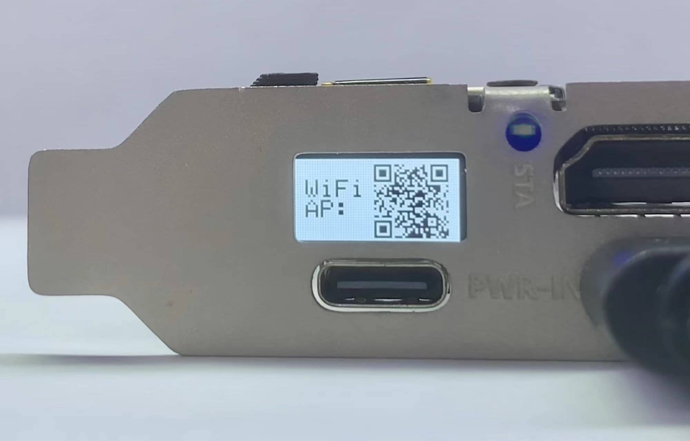
    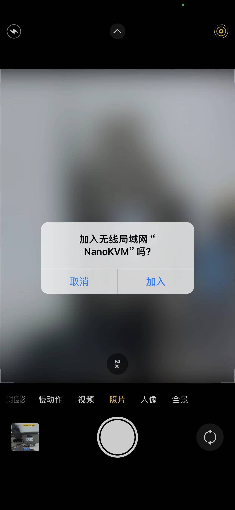
  4. Once your phone is successfully connected, a web QR code will appear on the OLED display. Scan the code to automatically redirect to the configuration page.
    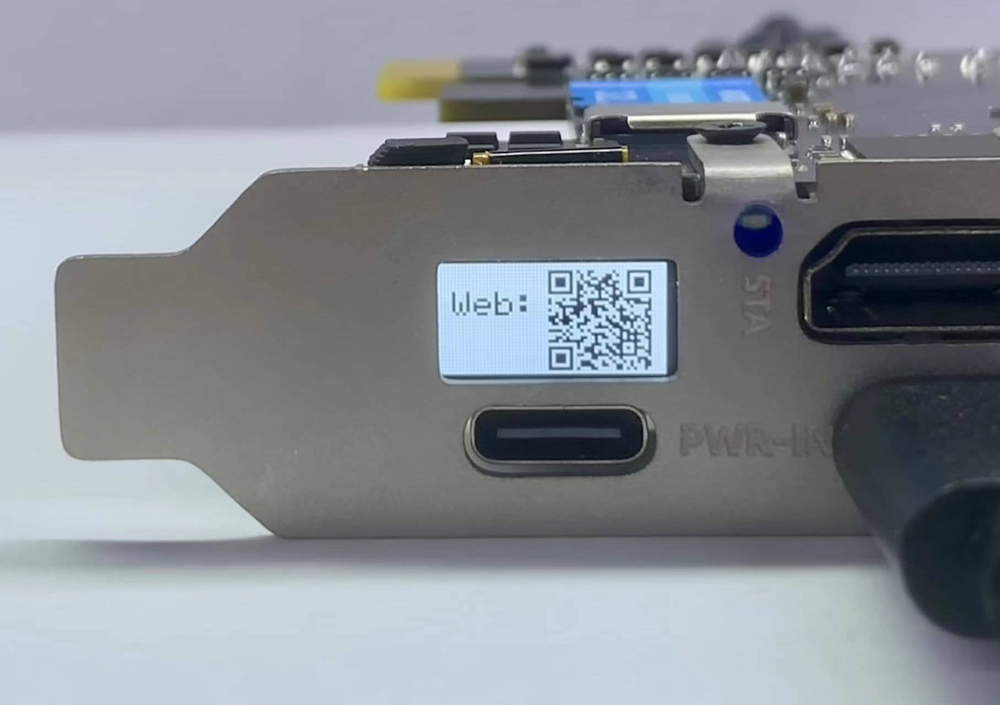
    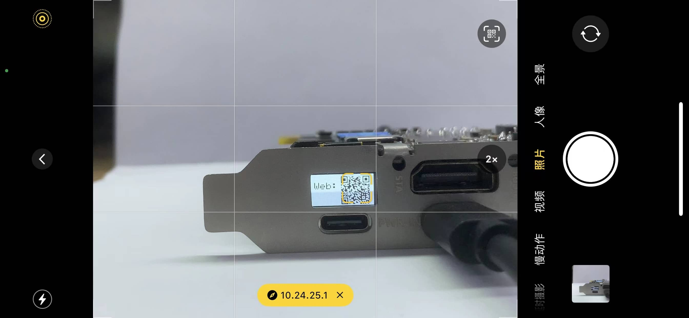
  5. Enter the WiFi account (SSID) and password for the NanoKVM-PCIe, then click OK to complete the configuration.
    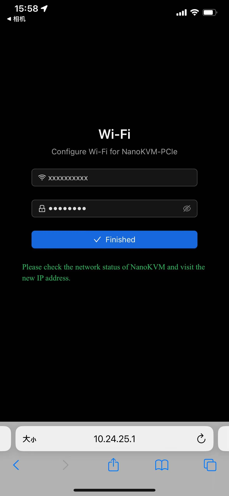
    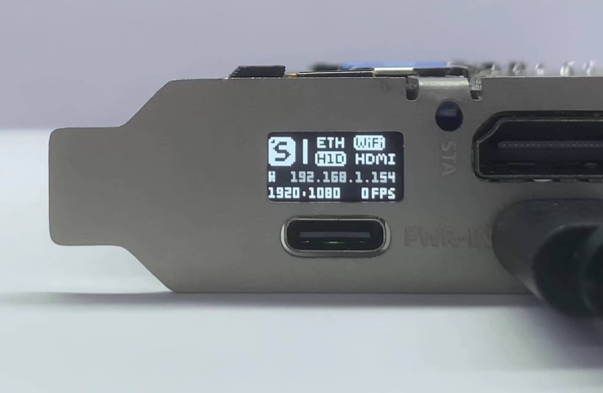
  
  Note:
  + If you cannot connect to the AP via the QR code, you can short-press the BOOT button. The OLED will display the AP SSID and password, which can be used to connect through your phone's system settings.
  + If you cannot open the webpage via the QR code, you can short-press the BOOT button, and the OLED will display the WiFi configuration address. Enter this address in your phone's browser to configure.
    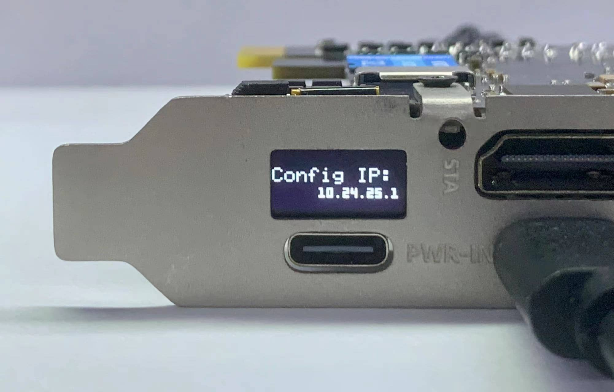
  + If you cannot open the configuration webpage, please turn off mobile data and try again.
  + If the WiFi account or password is set incorrectly, the OLED will return to step 3. Please reconnect to the AP for configuration.
  + Long pressing the BOOT button will exit the WiFi configuration interface.
  + For security reasons, a random AP password will be generated each time you configure WiFi. It is recommended to follow the above steps to complete the configuration.

## Updates

### Update Application

New applications often bring more features or fix important bugs. It is recommended to update NanoKVM applications to the latest version. For detailed instructions, please refer to [Updating Application](https://wiki.sipeed.com/hardware/zh/kvm/NanoKVM/system/updating.html).

The update records for version 2.1.1 and subsequent versions can be found here: [Application Update Log](https://github.com/sipeed/NanoKVM/blob/main/CHANGELOG.md).

## Basic Operations

### How to Obtain an IP Address

The PCIe version of NanoKVM comes with an OLED display, which will show the IP address after connecting to the network.

For the WiFi version of NanoKVM-PCIe, the IP addresses obtained via ETH and WiFi will alternate on the display. The IP address with an 'E' prefix is the ETH IP, while the one with a 'W' prefix is the IP obtained via WiFi.

### Viewing Remote Desktop

Enter the obtained IP directly in your browser to access the login page. The default username and password are both admin. After logging in, it is recommended to change your password and [update](https://wiki.sipeed.com/hardware/zh/kvm/NanoKVM/system/updating.html) to the latest applications.

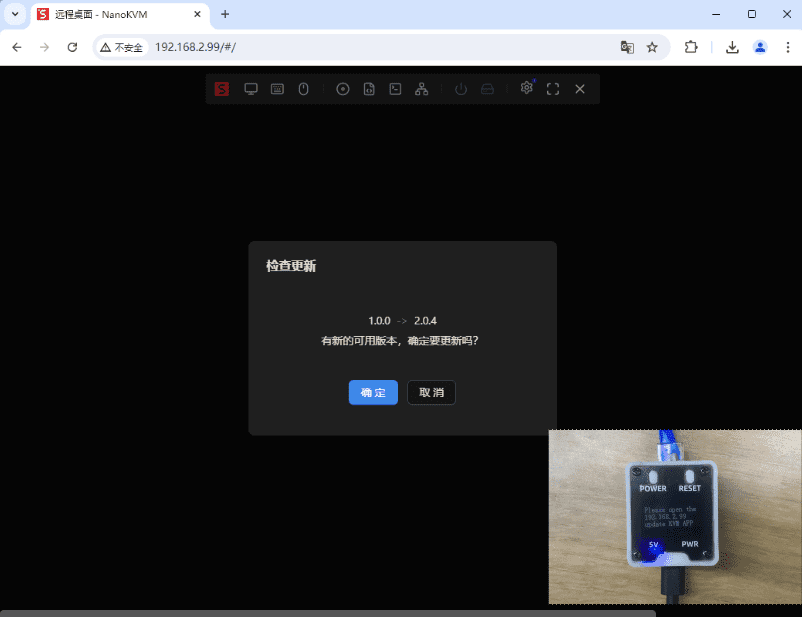

**Note:** It is recommended to use the Chrome browser, as other browsers may experience compatibility issues such as inability to display the screen or operate the keyboard and mouse.

**Note:** In some versions, there may be issues accessing the web interface or crashes after login. Please disconnect the HDMI interface, power cycle the device, update to the latest application, and then reconnect the HDMI.

### ATX Power Control

If the power control interface is connected, you can remotely control the computer's power on from the web page.

+ The web interface provides power status indicators and functions for the power and reset buttons, but it cannot monitor the HDD activity light status.

