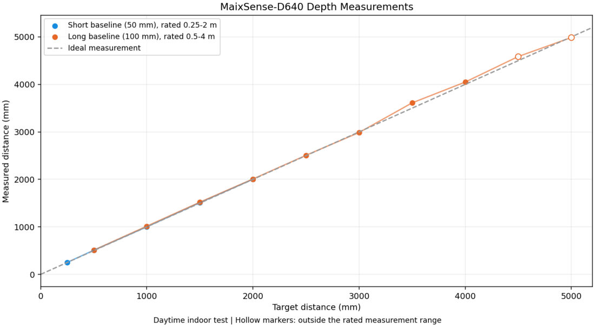

These measurements were recorded under the conditions below. Model or firmware updates and environmental changes can affect results. The figures are not an accuracy guarantee for every scene.

## Test conditions

- Environment: indoors during daytime.
- Lens: 70° diagonal field of view, 57° horizontal and 43° vertical.
- Imaging: two monochrome global-shutter cameras.
- Target: a matte white flat board, avoiding specular reflections.
- Method: place the board at a known distance and average the depth in the central image region.

## Measurement curves

The closer a curve is to the dashed reference line, the closer the measured distance is to the target distance. Relative errors for each point are listed below.

## Short baseline, 50 mm

Measurement range: **0.25–2.0 m**.

| Target distance (mm) | Measured distance (mm) | Relative error |
| :---: | :---: | :---: |
| 250 | 252 | 0.80% |
| 500 | 508 | 1.60% |
| 1000 | 1000.5 | 0.05% |
| 1500 | 1510 | 0.67% |
| 2000 | 2002.6 | 0.13% |

The mean absolute relative error across these five in-range test points is approximately **0.65%**.

## Long baseline, 100 mm

Measurement range: **0.5–4.0 m**. Out-of-range measurements are included for reference near the range limit.

| Target distance (mm) | Measured distance (mm) | Relative error |
| :---: | :---: | :---: |
| 500 | 509 | 1.80% |
| 1000 | 1015 | 1.50% |
| 1500 | 1520 | 1.33% |
| 2000 | 2008 | 0.40% |
| 2500 | 2507 | 0.28% |
| 3000 | 2987 | -0.43% |
| 3500 | 3611 | 3.17% |
| 4000 | 4049 | 1.23% |
| 4500 | 4587 | 1.93% |
| 5000 | 4987 | -0.26% |

The mean absolute relative error across the eight in-range test points is approximately **1.27%**. The 4.5 m and 5.0 m points are outside the specified range and are excluded from this average.

## Interpret the results

Relative error = (measured distance − target distance) ÷ target distance × 100%.

Positive values mean the camera measured farther than the target. Negative values mean it measured closer. The mean absolute relative error averages the absolute error percentages so positive and negative errors do not cancel each other. Only in-range points are included.

These results apply to the daytime indoor test with a matte white board. Lighting, material, texture, and distance affect the result. Actual relative error may vary within approximately ±5%.

## Next steps

- Connect the camera: [Quick Start](./quick-start.md).
- Adjust the display, exposure, and filtering: [Desktop App Guide](./gui.md).
- Compare versions and specifications: [Introduction](./maixsense-d640.md).
