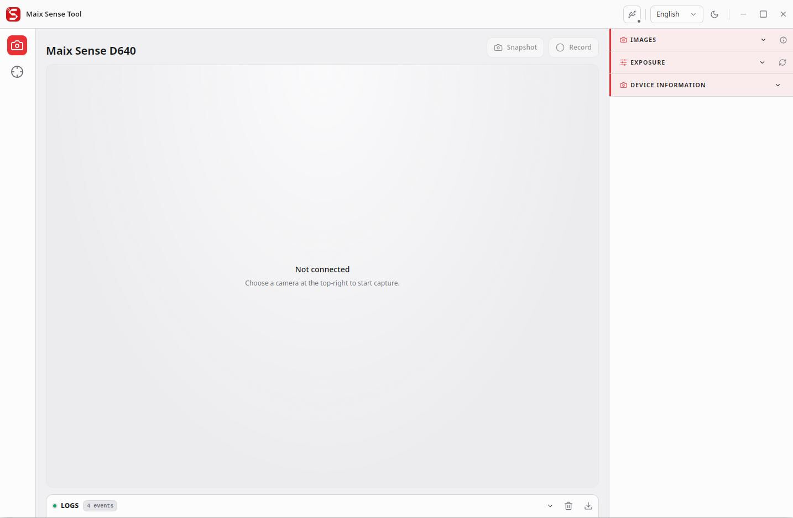
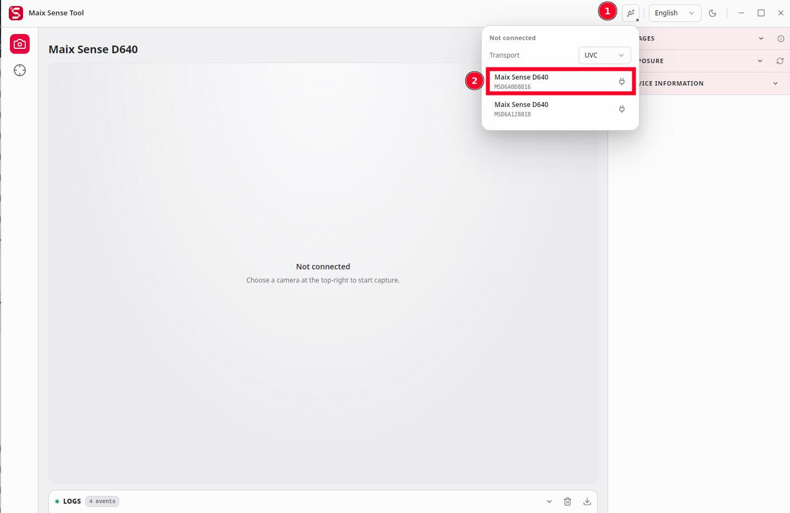
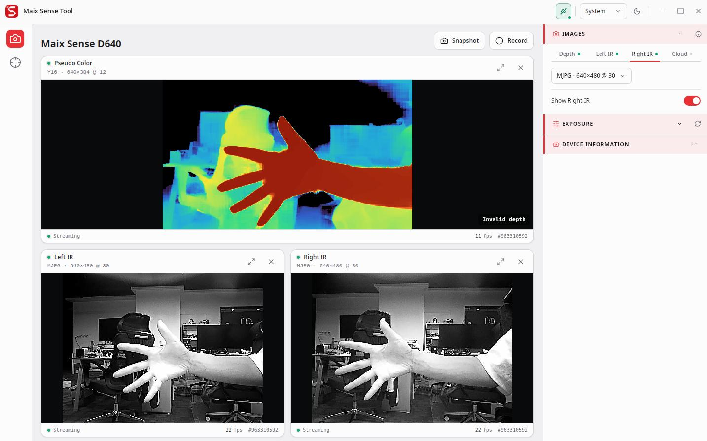
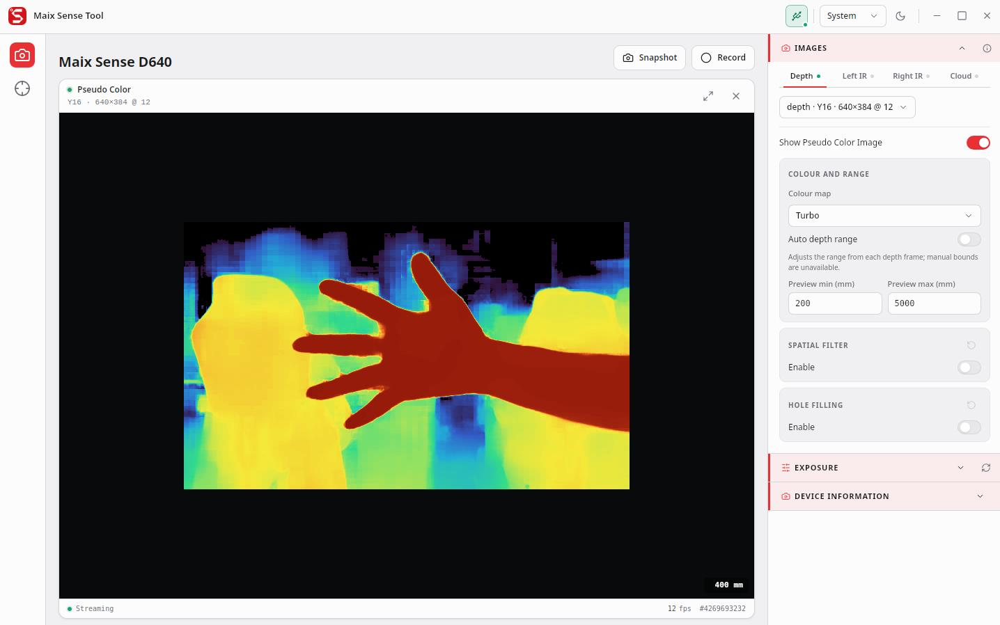
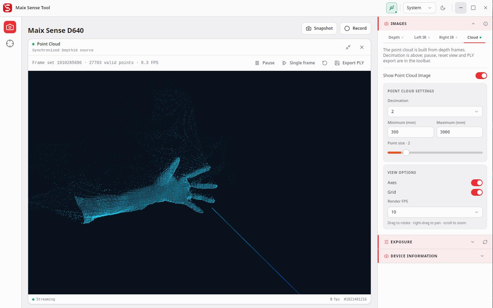
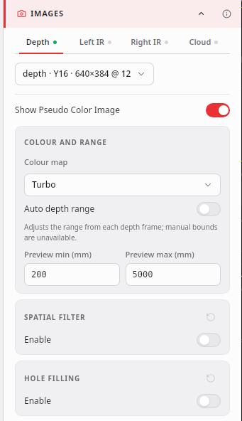
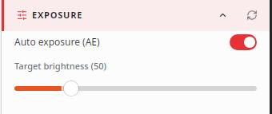
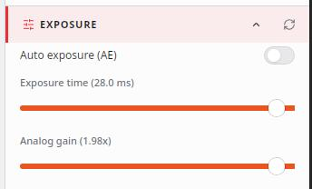
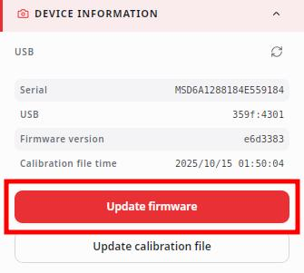
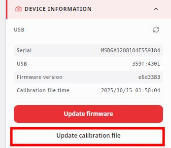

**MaixSense Tool** is the desktop app for MaixSense D640. View depth and stereo images, click to measure distance, explore point clouds, and save synchronized images for analysis.

## Download and install

Latest MaixSense Tool downloads (x86-64)

[Windows](https://cdn.sipeed.com/maixsense/d640/latest/maixsense_d640_gui_windows_x86_64.exe)
[Linux AppImage](https://cdn.sipeed.com/maixsense/d640/latest/maixsense_d640_gui_linux_x86_64.AppImage)
[Linux deb](https://cdn.sipeed.com/maixsense/d640/latest/maixsense_d640_gui_linux_x86_64.deb)
[Linux rpm](https://cdn.sipeed.com/maixsense/d640/latest/maixsense_d640_gui_linux_x86_64.rpm)

MaixSense Tool opens to the main window shown below:

## Connect the camera

1. Connect the camera with a USB data cable. Wait for the front infrared light to indicate startup.
2. Open MaixSense Tool. Click the connection icon at the top-right, select **UVC**, and choose your **MaixSense D640**.

On Linux, first configure [device access permissions](./quick-start.html#linux-access). If the camera is missing, see the [FAQ](./faq.md). Supported features on each OS depend on the app release.

## Choose the views

Open **Images** on the right. Select **Depth**, **Left IR**, or **Right IR**, and turn on the corresponding view switch. You can display all three together.

- Depth is shown in pseudocolor, with color representing distance.
- Left and right infrared are grayscale images. To adjust them manually, turn off auto exposure under **Exposure**, then change exposure time and gain.

## Measure distance

1. Under **Depth**, enable **Show Pseudo Color Image** for raw depth.
2. Click a valid point in the image. Read the distance in millimetres at the bottom-right. Click elsewhere to replace the reading.

Device-generated pseudocolor video has no original depth values and cannot be used for this measurement.

## View and export a point cloud

A point cloud represents surfaces as 3D points. The app generates it from depth and the camera's built-in calibration.

1. Under **Point Cloud**, enable **Show Point Cloud Image**.
2. Use the **Export PLY** icon on the view and select where to save the file.

Drag with the left mouse button to rotate, drag with the right button to pan, and scroll to zoom.

PLY coordinates are in metres: X points right, Y down, and Z forward. The app needs valid camera calibration and a complete synchronized depth frame. If unavailable, check the on-screen message and [FAQ](./faq.md).

## Save snapshots and recordings

### Save a synchronized snapshot

1. Click **Snapshot** at the top of the main window.
2. Select an output folder and confirm.
3. Wait for saving to finish. The files come from the same captured frame set.

In raw depth mode:

| File | Contents |
| :--- | :--- |
| `depth_color.png` | Pseudocolor image for viewing |
| `depth.png`, `depth.pgm` | 16-bit depth values in millimetres |
| `left_ir.jpg`, `right_ir.jpg` | Left and right infrared images |
| `metadata.json` | Capture information |

Device pseudocolor mode saves preview images and capture information only. It does not include metric depth and cannot be used for distance measurement.

### Record data

1. Click **Record**, choose an output location, and confirm. The app shows elapsed time and the number of written frame sets.
2. Click **Stop recording** and wait for saving to finish. The completed file has the `.mcap` extension.

MCAP stores captured sensor data rather than an ordinary video. An unfinished recording may leave a `.mcap.part` file. See the [FAQ](./faq.md).

## Adjust the depth display

Under **Depth**, enable **Show Pseudo Color Image** to access the display settings.

### Colors and display range

1. Under **Colour and range**, choose Turbo, Viridis, or Magma in **Colour map**.
2. Enable **Auto depth range** to adjust the colors to the current depth image.
3. For a fixed range, disable it and set **Preview min (mm)** and **Preview max (mm)**. The minimum must be less than the maximum.

These settings change the display, not the camera's measurement range.

### Smoothing and hole filling

1. Enable **Spatial filter** to reduce differences between neighboring depth pixels. Adjust **Preview spatial delta (mm)** as needed.
2. Enable **Hole filling** to fill some invalid regions. Adjust **Hole-fill radius (px)** and **Hole-fill max delta (mm)**.
3. Watch edges and fine detail. Use the reset icon to restore a setting or turn the filter off to compare the original view.

Filtering can make the view smoother and more complete, but does not guarantee greater measurement accuracy. Start with the defaults and avoid excessive smoothing.

## Exposure

### Auto exposure

With auto exposure enabled, adjust target brightness to change the desired image brightness.

### Manual exposure

Turn off auto exposure to adjust exposure time and gain manually. Excessive gain increases image noise and can affect depth measurement.

## Update firmware

Before updating, download the [latest firmware package](https://cdn.sipeed.com/maixsense/d640/latest/maixsense_d640_firmware.tar.gz).

1. Open **Device Information → Update firmware**.
2. Select the firmware package and confirm.
3. Keep power and USB connected during the update. Wait for completion and for the device to reconnect.

The firmware package does not include per-camera calibration. If the camera has no USB update interface, follow the package instructions or provide the app version and device information to technical support.

## Update calibration

Calibration is specific to each camera and normally needs no changes. Only proceed with a calibration package supplied for the connected device.

1. Open **Device Information → Update calibration file**.
2. Select the calibration archive and confirm.
3. Keep power and USB connected while uploading. Wait for completion and for the device to reconnect.

## Next steps

- Understand measurement conditions and errors: [Measurement Accuracy](./accuracy.md).
- Process depth and point clouds in code: [SDK Guide](./sdk.md).
- Resolve connection or image problems: [FAQ](./faq.md).
