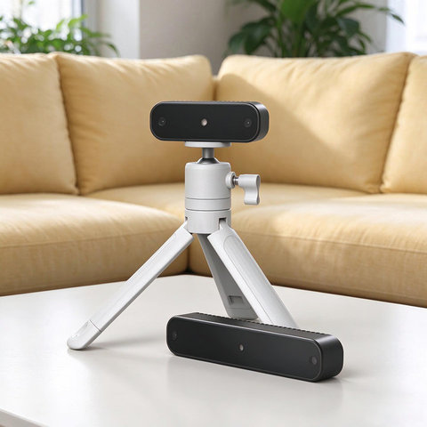
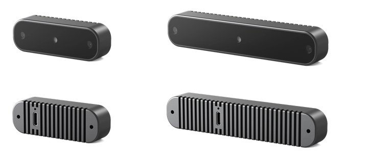
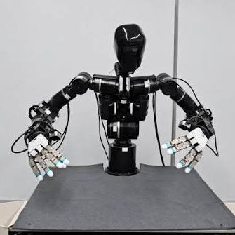
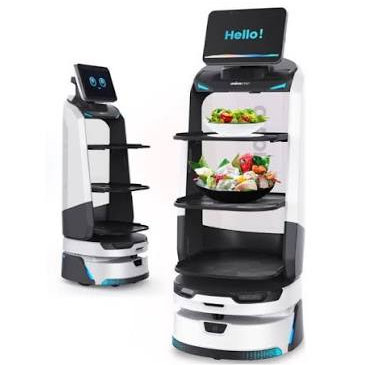
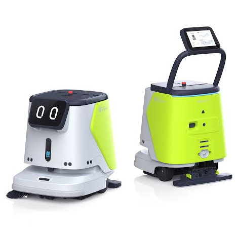
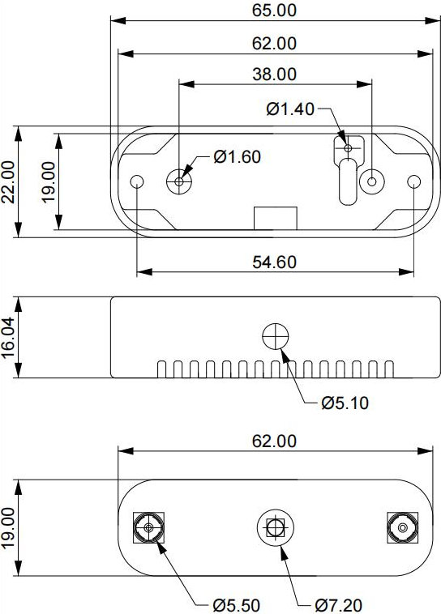
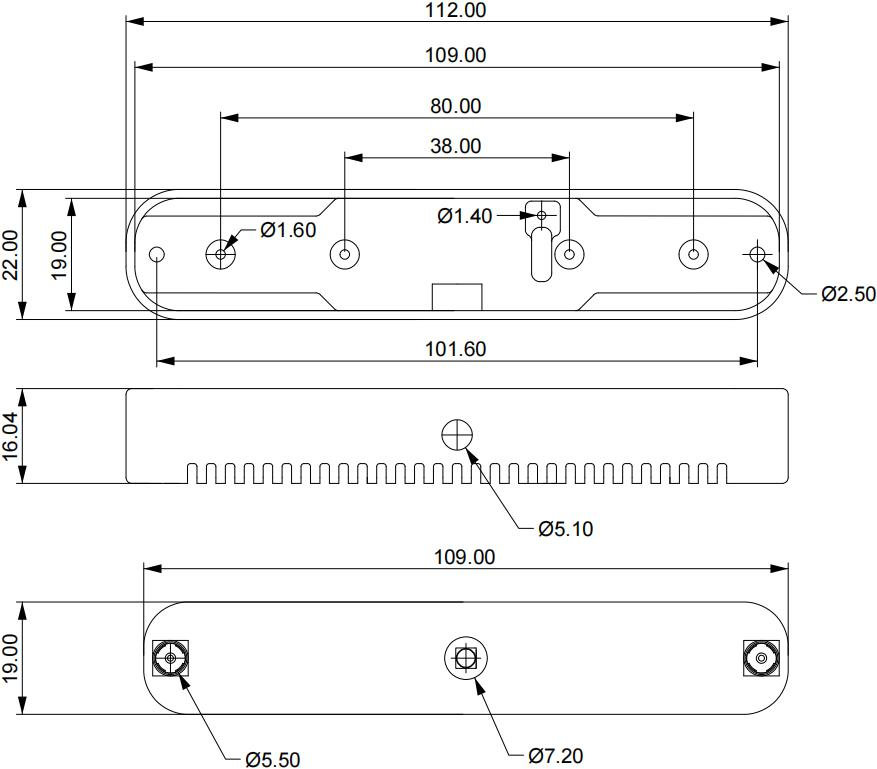
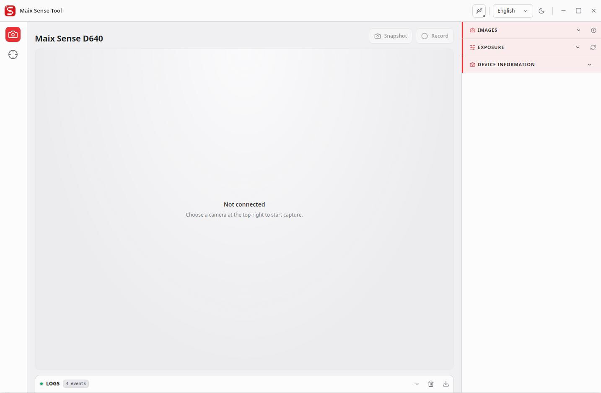
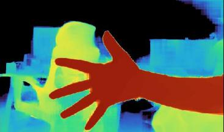

**MaixSense D640** is a stereo depth camera module from Sipeed. Two global-shutter cameras capture images, and the module calculates depth internally. It sends depth and stereo images over USB for spatial sensing, desktop distance measurement, and robot vision.

## Key features

- **On-device depth processing:** Receive depth and stereo images over UVC without calculating stereo depth on the computer.
- **Two baseline options:** Choose 50 mm for close-range work or 100 mm for longer distances.
- **Global-shutter stereo capture:** Capture matching depth and left/right grayscale images as synchronized frame sets.
- **Image and point cloud viewing:** Preview video in a browser, or use the desktop app for distance measurement, 3D viewing, and PLY export.
- **Tools for development:** Save synchronized snapshots, record depth data in MCAP, and integrate the camera through the C/C++ SDK or ROS2 driver.

## Choose a hardware version

The baseline is the distance between the two cameras. Choose it to match your working distance:

| Version | Measurement range | Typical use |
| :--- | :--- | :--- |
| Short baseline, 50 mm | 0.25–2.0 m | Robot wrist mounting, close-range sensing, desktop measurement |
| Long baseline, 100 mm | 0.5–4.0 m | Robot head mounting and medium-range sensing on cleaning, lawn-mowing, or service robots |

Example applications:

<table width="100%">
<tr>
<td width="25%"></td>
<td width="25%"></td>
<td width="25%"></td>
<td width="25%"></td>
</tr>
</table>

## Specifications

| Item | Specification |
| :--- | :--- |
| Processor | Dual-core processor with integrated 2.4 TOPS NPU |
| Image sensors | Two global-shutter sensors, 640 × 480 pixels each |
| Optical filter | Dual-band 650 nm / 850 nm bandpass filter |
| Depth resolution | 640 × 384 pixels |
| Depth frame rate | 12 fps |
| Infrared frame rate | 30 fps |
| Baseline | Short: 50 mm. Long: 100 mm |
| Measurement range | Short: 0.25–2.0 m. Long: 0.5–4.0 m |
| Field of view | 57° horizontal × 43° vertical, 70° diagonal |
| Data interface | USB 2.0, USB Type-C connector |
| Power | 5 V DC, supply capable of at least 0.5 A |
| Dimensions | Short: 65 × 22 × 16.04 mm Long: 112 × 22 × 16.04 mm |
| Weight | Short: 35 g Long: 60 g |

**Short baseline:**

**Long baseline:**

## Software and guides

Start with [Quick Start](./quick-start.md) to connect the camera. Use MaixSense Tool to view images, measure distances, or record depth data. Open the [D640 online preview](https://maixsense.sipeed.com/d640) to view one video stream in a browser. Use the SDK for programming.

| Tool | What it does |
| :--- | :--- |
| Online preview | View and record a pseudocolor or infrared video stream. See [Quick Start](./quick-start.md) |
| MaixSense Tool | Desktop viewing, distance measurement, point clouds, snapshots, MCAP recording, and device updates. See [Desktop App Guide](./gui.md) for Windows, Linux, and macOS availability |
| SDK | C/C++ capture, synchronized frame sets, filtering, and point clouds. See [SDK Guide](./sdk.md) |
| ROS2 | View images and point clouds, save data, and record sensor messages. See [ROS2 Guide](./ros2.md) |
| Agent | Capture images, save files, and check results through a conversation. See [Agent Guide](./ai_agent.md) |

## Image outputs

Use raw depth for measurement and point clouds. Use the device's pseudocolor stream for a convenient view of relative distance.

| Output | Format | Resolution | Frame rate | Use |
| :--- | :--- | :--- | :--- | :--- |
| Raw depth | Z16/Y16 | 640 × 384 | 12 fps | Millimetre distance values for measurement and point clouds |
| Pseudocolor preview | MJPEG | 640 × 384 | 12 fps | Color represents distance. This stream cannot provide metric depth |
| Left infrared | MJPEG | 640 × 480 | 30 fps | Left camera grayscale image |
| Right infrared | MJPEG | 640 × 480 | 30 fps | Right camera grayscale image |

Raw 16-bit depth often looks dark when displayed directly as grayscale. This is expected: the pixel values represent millimetres rather than normal image brightness.

The camera's raw depth and device-generated pseudocolor streams cannot be enabled together. The desktop app and ROS2 can instead colorize raw depth on the computer while retaining the original depth values.

## Next steps

- Connect the camera: [Quick Start](./quick-start.md).
- View images and measure distances: [Desktop App Guide](./gui.md).
- Integrate it into your program: [SDK Guide](./sdk.md).
