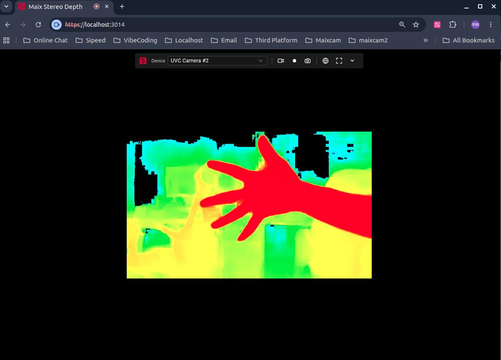
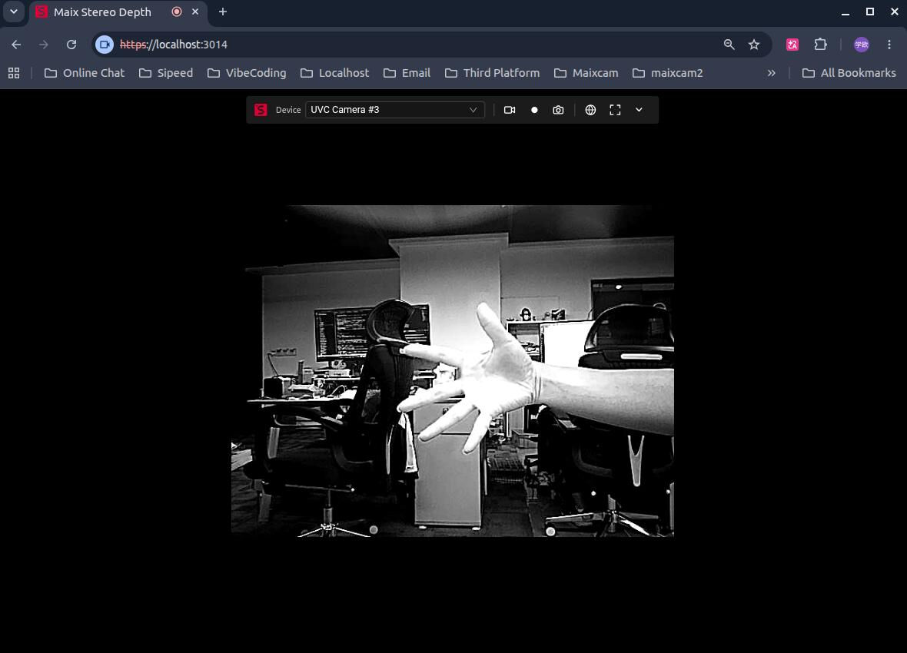

## What you need

Prepare the camera, a USB 2.0 Type-C data cable, and a computer with a browser.

## Connect the camera

1. Connect the camera to the computer with the USB cable.
2. Wait for the camera to start. The infrared light on the front indicates that it has started.

<a id="linux-access"></a>

## Linux access permissions

On Linux, complete this section before first use. Windows and macOS users can continue to the preview section. These rules apply to browser preview, the desktop app, SDK, and ROS2, so you only need to configure them once.

### Add device access rules

```bash
# Allow the desktop session and video group to access the USB and video interfaces
sudo tee /etc/udev/rules.d/99-maixsense-d640.rules >/dev/null <<'RULES'
SUBSYSTEM=="usb", ATTR{idVendor}=="359f", ATTR{idProduct}=="4301", GROUP="video", MODE="0660", TAG+="uaccess"
SUBSYSTEM=="video4linux", ATTRS{idVendor}=="359f", ATTRS{idProduct}=="4301", GROUP="video", MODE="0660", TAG+="uaccess"
RULES
# Reload and apply the rules
sudo udevadm control --reload-rules
sudo udevadm trigger
```

Unplug and reconnect the camera afterward.

### Check your user group

For terminal or SSH use, check whether your current session belongs to the `video` group:

```bash
# List the current session's groups
id -nG
```

If `video` is missing:

```bash
# Add your account to the video group
sudo usermod -aG video "$USER"
```

Log out and log back in. For SSH, disconnect and reconnect. Run `id -nG` again and confirm that it includes `video`.

### Verify access

```bash
# Confirm that the current session includes the video group
id -nG
# List video device ownership and permissions, including any built-in webcams
find /dev -maxdepth 1 -name 'video*' -exec ls -l {} +
```

The camera's video devices should allow read/write access for the `video` group. The usual permissions are `crw-rw----`, sometimes followed by `+` for an access control list. A device name alone does not prove that your session has access.

If there are no video devices, check the data cable, USB connection, and camera startup. Reopen the capture tool after fixing access. A browser will still ask for camera permission separately.

## Open the online preview

The online preview shows pseudocolor depth video or grayscale infrared video without installing a desktop app. For millimetre measurements, point clouds, or synchronized capture, use [MaixSense Tool](./gui.md) or the [SDK](./sdk.md).

1. Open the [online preview](https://maixsense.sipeed.com/d640).
2. Allow camera access when the browser asks.
3. Use the device selector at the top to choose a UVC Camera video input. Confirm that the image updates.



One camera may expose several video inputs. Numbers such as `#1` and `#2` distinguish inputs, but do not consistently identify pseudocolor, left IR, or right IR. Switch between inputs to check. The browser opens one stream at a time.

## View and save

- **Pseudocolor:** Colors represent a fixed 200–5000 mm display range. This does not mean valid measurements are available throughout that range. The video is for preview, not distance measurement.
- **Infrared:** Select an infrared input to view one grayscale stream.
- **Rotate and zoom:** Use the video menu to rotate the view from 0° to 360° or zoom from 1× to 2×. Use the fullscreen icon for a larger view.
- **Save an image:** Click the snapshot icon to save the displayed picture.
- **Record video:** Record the displayed view as a silent WebM video. Switching devices ends the current recording.



> The browser preview does not read raw 16-bit depth values and does not provide pixel measurements, point clouds, or synchronized three-stream capture. A WebM video cannot replace raw depth data or a synchronized MCAP recording.

## Next steps

- Measure distances, view point clouds, and record depth: [Desktop App Guide](./gui.md).
- Read data from your own program: [SDK Guide](./sdk.md).
- Troubleshoot connections or images: [FAQ](./faq.md).
