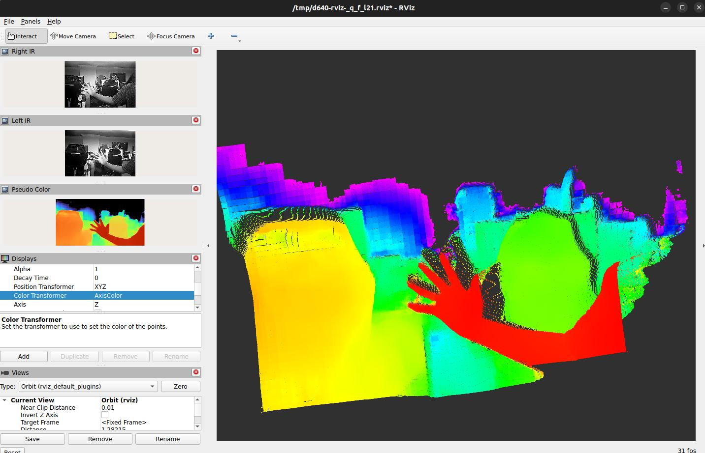

ROS2 connects sensors, robot bases, arms, and algorithms. Common uses include:

- **Obstacle avoidance:** Use depth or point clouds to detect obstacles and inform slowing, stopping, or planning around them.
- **Navigation and inspection:** Combine maps and localization to reach a destination or follow an inspection route.
- **Mapping:** Combine camera observations with robot motion to build a map.
- **Robot arms:** Use spatial information to assist object localization and collision-aware planning.

This page covers connecting the camera, viewing images and point clouds, saving data, and recording. Navigation, mapping, and arm applications require their own robot software configuration.

For first use, [prepare the environment](#Prepare-the-environment), [connect the camera](#Connect-the-camera), and follow the [first-use steps](#First-use). Afterward, daily use only requires loading the environment and starting the viewer.

## Prepare the environment

### Choose a ROS 2 distribution

Run the following command and check `VERSION_ID` for your Ubuntu version, such as `22.04`.

```bash
cat /etc/os-release
```

Choose the ROS 2 distribution for your Ubuntu version.

| Ubuntu | ROS 2 distribution | Official installation guide |
| --- | --- | --- |
| 22.04 (Jammy) | Humble | [Humble](https://docs.ros.org/en/humble/Installation/Ubuntu-Install-Debs.html) |
| 24.04 (Noble) | Jazzy | [Jazzy](https://docs.ros.org/en/jazzy/Installation/Ubuntu-Install-Debs.html) |

### Check UTF-8 support

```bash
locale
```

Any UTF-8 locale works, including `zh_CN.UTF-8`. If your system has no UTF-8 locale, run the following commands and check the locale again.

```bash
sudo apt update
sudo apt install locales
sudo locale-gen en_US en_US.UTF-8
sudo update-locale LC_ALL=en_US.UTF-8 LANG=en_US.UTF-8
export LANG=en_US.UTF-8
export LC_ALL=en_US.UTF-8
locale
```

### Add the official ROS2 repository

If the official ROS 2 repository is missing, first enable Ubuntu’s Universe repository.

```bash
sudo apt update
sudo apt install software-properties-common curl python3
sudo add-apt-repository universe
```

Select your distribution and run the commands to install the official ROS 2 repository configuration package. If the download fails, check your connection and retry.

<style>
.ros-tabs { display: flex; flex-wrap: wrap; margin: 1em 0; }
.ros-tabs > input { position: absolute; opacity: 0; width: 1px; height: 1px; }
.ros-tabs > label { padding: .55em 1.3em; cursor: pointer; border-bottom: 2px solid transparent; }
.ros-tabs > input:checked + label { color: #d33; border-bottom-color: currentColor; font-weight: bold; }
.ros-tabs > input:focus-visible + label { outline: 2px solid currentColor; outline-offset: -2px; }
.ros-tabs > .ros-tab-panel { display: none; width: 100%; min-width: 0; }
.ros-tabs > .ros-tab-panel pre { margin-top: 0; }
.ros-tabs > input.ros-tab-first:checked ~ .ros-panel-first,
.ros-tabs > input.ros-tab-second:checked ~ .ros-panel-second { display: block; }
</style>

<div class="ros-tabs" role="group" aria-label="Choose the ROS 2 distribution for your Ubuntu version">
<input class="ros-tab-first" type="radio" name="ros-repo" id="ros-repo-first" checked><label for="ros-repo-first">Humble</label>
<input class="ros-tab-second" type="radio" name="ros-repo" id="ros-repo-second"><label for="ros-repo-second">Jazzy</label>
<div class="ros-tab-panel ros-panel-first"><pre><code class="language-bash"># Find the latest release of the official ROS 2 repository configuration package
ROS_APT_SOURCE_VERSION=&quot;$(curl -fsSL https://api.github.com/repos/ros-infrastructure/ros-apt-source/releases/latest | python3 -c &#x27;import json, sys; print(json.load(sys.stdin)[&quot;tag_name&quot;])&#x27;)&quot; &amp;&amp;
  curl -fL --retry 3 -o /tmp/ros2-apt-source.deb \
    &quot;https://github.com/ros-infrastructure/ros-apt-source/releases/download/${ROS_APT_SOURCE_VERSION}/ros2-apt-source_${ROS_APT_SOURCE_VERSION}.jammy_all.deb&quot; &amp;&amp;
  sudo dpkg -i /tmp/ros2-apt-source.deb</code></pre></div>
<div class="ros-tab-panel ros-panel-second"><pre><code class="language-bash"># Find the latest release of the official ROS 2 repository configuration package
ROS_APT_SOURCE_VERSION=&quot;$(curl -fsSL https://api.github.com/repos/ros-infrastructure/ros-apt-source/releases/latest | python3 -c &#x27;import json, sys; print(json.load(sys.stdin)[&quot;tag_name&quot;])&#x27;)&quot; &amp;&amp;
  curl -fL --retry 3 -o /tmp/ros2-apt-source.deb \
    &quot;https://github.com/ros-infrastructure/ros-apt-source/releases/download/${ROS_APT_SOURCE_VERSION}/ros2-apt-source_${ROS_APT_SOURCE_VERSION}.noble_all.deb&quot; &amp;&amp;
  sudo dpkg -i /tmp/ros2-apt-source.deb</code></pre></div>
</div>

### Install ROS2 and dependencies

Refresh the package lists, then install ROS 2 Desktop for your distribution. Desktop includes RViz.

```bash
sudo apt update
```

<div class="ros-tabs" role="group" aria-label="Choose the ROS 2 distribution for your Ubuntu version">
<input class="ros-tab-first" type="radio" name="ros-install" id="ros-install-first" checked><label for="ros-install-first">Humble</label>
<input class="ros-tab-second" type="radio" name="ros-install" id="ros-install-second"><label for="ros-install-second">Jazzy</label>
<div class="ros-tab-panel ros-panel-first"><pre><code class="language-bash">sudo apt install ros-humble-desktop</code></pre></div>
<div class="ros-tab-panel ros-panel-second"><pre><code class="language-bash">sudo apt install ros-jazzy-desktop</code></pre></div>
</div>

Install the SDK build and runtime dependencies. Both distributions use the same packages.

```bash
sudo apt install ros-dev-tools \
  build-essential cmake ninja-build pkg-config \
  libopencv-dev zlib1g-dev python3-colcon-common-extensions \
  python3-catkin-pkg python3-yaml python3-rosdep
```

### Load and check ROS2

Check which shell your terminal is running.

```bash
ps -p $$ -o comm=
```

Select Bash or Zsh to match the output, then run only the line for your Ubuntu version.

<div class="ros-tabs" role="group" aria-label="Choose the current terminal shell">
<input class="ros-tab-first" type="radio" name="ros-base-shell" id="ros-base-shell-bash" checked><label for="ros-base-shell-bash">Bash</label>
<input class="ros-tab-second" type="radio" name="ros-base-shell" id="ros-base-shell-zsh"><label for="ros-base-shell-zsh">Zsh</label>
<div class="ros-tab-panel ros-panel-first"><pre><code class="language-bash"># Ubuntu 22.04
source /opt/ros/humble/setup.bash
# Ubuntu 24.04
source /opt/ros/jazzy/setup.bash</code></pre></div>
<div class="ros-tab-panel ros-panel-second"><pre><code class="language-zsh"># Ubuntu 22.04
source /opt/ros/humble/setup.zsh
# Ubuntu 24.04
source /opt/ros/jazzy/setup.zsh</code></pre></div>
</div>

Verify the environment after loading it.

```bash
# Expect humble on Ubuntu 22.04 or jazzy on Ubuntu 24.04
echo "$ROS_DISTRO"
# Check that ros2 is available
ros2 --help
```

If `ros2` is unavailable, check the output of the `source` command for errors. Load the environment in each new terminal or configure your shell to load it automatically as shown below.

### Obtain the SDK and install its ROS dependencies

Download and extract the [latest SDK source package](https://cdn.sipeed.com/maixsense/d640/latest/maixsense_d640_sdk_source.tar.gz). Check for `scripts/setup-ros2.sh` and the `ros2` directory, then run the following commands.

```bash
# Enter the SDK root; adjust the path to match the extracted directory
cd maixsense_d640_sdk
./scripts/setup-ros2.sh --help
# Initialize rosdep once
sudo rosdep init
# Update the dependency index
rosdep update
# Install the ROS dependencies declared by the SDK
rosdep install --from-paths ros2 --ignore-src -r -y --rosdistro "$ROS_DISTRO"
```

For Jazzy or another distribution, check that the script’s help lists `--rosdistro`. If the option is missing, get a newer SDK that supports distribution selection.

Once the dependencies are installed, connect the camera. The same dependencies cover building, viewing, and recording.

## Connect the camera

Connect the camera over USB. On Linux, configure [access permissions](./quick-start.html#Linux-access-permissions).

## First use

### Build the camera tools

After preparing the environment, run the following command from the SDK root.

```bash
./scripts/setup-ros2.sh
```

The script builds and installs the D640 SDK and ROS 2 driver. It uses the active ROS 2 distribution or selects one for your Ubuntu version (Humble for 22.04 and Jazzy for 24.04). To select another installed distribution, add `--rosdistro <distribution>` in a clean terminal.

The default installation directory is `~/.local/maixsense-d640-ros2/<distribution>/`, for example `humble/` or `jazzy/`. Use `--prefix` to set a custom directory. Build on first installation, after updating the source, or when switching distributions. For daily use, load the corresponding environment file.

### Load the camera environment

In each new terminal, select Bash or Zsh and run only the line for your distribution. With an older SDK or a custom directory, use the path printed after the build.

<div class="ros-tabs" role="group" aria-label="Choose the current terminal shell">
<input class="ros-tab-first" type="radio" name="ros-device-shell" id="ros-device-shell-bash" checked><label for="ros-device-shell-bash">Bash</label>
<input class="ros-tab-second" type="radio" name="ros-device-shell" id="ros-device-shell-zsh"><label for="ros-device-shell-zsh">Zsh</label>
<div class="ros-tab-panel ros-panel-first"><pre><code class="language-bash"># Humble
source &quot;$HOME/.local/maixsense-d640-ros2/humble/env.bash&quot;
# Jazzy
source &quot;$HOME/.local/maixsense-d640-ros2/jazzy/env.bash&quot;</code></pre></div>
<div class="ros-tab-panel ros-panel-second"><pre><code class="language-zsh"># Humble
source &quot;$HOME/.local/maixsense-d640-ros2/humble/env.zsh&quot;
# Jazzy
source &quot;$HOME/.local/maixsense-d640-ros2/jazzy/env.zsh&quot;</code></pre></div>
</div>

To load the D640 environment automatically in new terminals, add the matching `source` command to `~/.bashrc` for Bash or `~/.zshrc` for Zsh.

### Check readiness

```bash
# Check the environment and USB identity without starting capture
ros2 run maixsense_d640_driver maixsense_d640 doctor
```

### View images and point clouds

On an Ubuntu computer with a graphical desktop, run the following command.

```bash
# Start capture and a configured RViz viewer
ros2 run maixsense_d640_driver maixsense_d640 view
```

The first start may take some time. Wait for `ready` and confirm that images and the cloud keep updating. If it stays at `waiting for camera`, check USB and [Linux access](./quick-start.html#Linux-access-permissions).



Pseudocolor represents distance rather than the object's real color. The cloud shows the object's 3D shape. With the pointer over the 3D area:

- Drag with the left button to rotate.
- Drag with the middle button to pan.
- Scroll to zoom.

The cloud is colored by forward depth. Its color range adjusts automatically, so a color is not a fixed distance label. If points are white, expand **Depth PointCloud**, set **Color Transformer** to **AxisColor**, choose **Z** for **Axis**, and disable **Use Fixed Frame**.

Press **Ctrl+C** in the launch terminal to stop. Run one capture program per camera. Stop it before switching modes.

## Daily use

### Choose what to view

Load the environment, then choose one command:

```bash
# Depth and point cloud
ros2 run maixsense_d640_driver maixsense_d640 view

# Left and right infrared only
ros2 run maixsense_d640_driver maixsense_d640 view --preset ir

# Device pseudocolor only; this mode does not output depth or a point cloud
ros2 run maixsense_d640_driver maixsense_d640 view --preset pseudo
```

<a id="add-rviz-displays"></a>

### Add a view in RViz

1. Under **Displays**, click **Add → By topic**.
2. Expand a topic, select the display type below, and click **OK**.
3. Enable the display and confirm that data updates.

A topic is a named channel carrying data. Default names are:

| Content | Topic | Display type |
| :--- | :--- | :--- |
| Depth pseudocolor | `/stereo/pseudo_color/image_raw` | Image |
| Raw depth | `/stereo/depth/image_raw` | Image |
| Left infrared | `/stereo/left/image_raw` | Image |
| Right infrared | `/stereo/right/image_raw` | Image |
| Point cloud | `/stereo/points2` | PointCloud2 |

### Choose a camera

`msd-enumerate` is an SDK query tool installed by the setup script. It is available after loading the environment. For multiple connected cameras:

```bash
# Find the complete value after serial= in the device listing
msd-enumerate
# Replace YOUR_SERIAL with that actual serial
ros2 run maixsense_d640_driver maixsense_d640 view --serial YOUR_SERIAL
```

### Check running status

Keep capture running. In another terminal with the environment loaded, use the command below to check the connection status and serial number. Confirm that the serial number matches your camera. Check the image feed to verify that frames are arriving.

```bash
ros2 run maixsense_d640_driver maixsense_d640 status
```

### Save images and point clouds

1. Start the default view and confirm that images and the cloud update.
2. In another prepared terminal:

   ```bash
   # Save on the computer running the camera driver
   mkdir -p "$HOME/d640-captures"
   ros2 param set /stereo/camera save_directory "$HOME/d640-captures"
   # Save the most recently cached images and point cloud
   ros2 run maixsense_d640_driver maixsense_d640 save --kind both
   ```

3. Check the returned paths and files. Default depth capture saves raw depth and enabled infrared images, not an RViz screenshot or the host-generated pseudocolor image.

Use `--kind images` for images only or `--kind cloud` for a cloud only.

### Record data

Start view or start first and confirm that the camera is producing data. Recording stores ROS messages, not an MP4 video.

1. Keep capture running and use another prepared terminal:

   ```bash
   # Use a new folder name for each recording
   ros2 run maixsense_d640_driver maixsense_d640 record --output ./d640-bag
   ```

2. Press **Ctrl+C** in the recording terminal to finish recording. Capture continues.
3. Inspect the result:

   ```bash
   # Check topics, duration, and message counts
   ros2 bag info ./d640-bag
   ```

4. Confirm that the required topics have nonzero message counts.
5. Before replay, stop live capture to prevent live and recorded data from sharing the same topics. Then run:

   ```bash
   ros2 bag play ./d640-bag
   ```

Replay does not open a viewer. Run `rviz2` in another prepared terminal and [add the recorded topics](#add-rviz-displays). The default point cloud **Global Options → Fixed Frame** is `depth_optical_frame`. If a display stays empty, set the topic's **Reliability Policy** to **Best Effort**. Do not run view during replay, because it starts the real camera again.

### Capture without a viewer

For SSH or capture without a graphical window:

```bash
ros2 run maixsense_d640_driver maixsense_d640 start
```

Query, save, and record from another prepared terminal. Press **Ctrl+C** in the capture terminal to stop.

## Next steps

- Write a processing program: [SDK Guide](./sdk.md) and the SDK's `ros2/README.zh-CN.md` reference (Chinese).
- Fix connection or access problems: [Quick Start](./quick-start.md).
