# Introduction

MaixSense is the Sipeed imaging-sensor line. Each product turns something the eye cannot see into a picture: how far things are, how hot a surface is, where a sound comes from, or what lies inside an object.
Most products work as soon as you plug them into USB, and they expose open data interfaces for your own projects.

## Product Overview

| Imaging | What you see | Models | Status |
| :--- | :--- | :--- | :--- |
| ToF depth | Distance to the object at every pixel | [MS-A010](./maixsense-a010/maixsense-a010.md), [MS-A075V](./maixsense-a075v/maixsense-a075v.md) | On sale |
| Stereo depth | Distance to the object at every pixel | [MS-D640](../../zh/maixsense/maixsense-d640/maixsense-d640.md) | Coming soon |
| Thermal | Surface temperature | [MS-T256S](../ThermalCam/T256s/Intro.md), [MS-T160](../ThermalCam/T160/Introduction.md) | MS-T256S on sale, MS-T160 coming soon |
| Acoustic | Where a sound comes from | — | In development |
| X-ray | Internal structure | [NanoXray](https://sipeed.com/nanoxray) | In definition, feedback welcome |

Acoustic and X-ray imaging are new directions under development. Documentation will follow when the products launch.

## ToF Depth Cameras

A ToF (time of flight) camera emits infrared light and measures how long it takes to bounce back. That gives the distance at every pixel directly, even in the dark.

- **MS-A010**: a BL702 plus OPNOUS 100×100 ToF module. Very low cost, with a built-in LCD for live preview.
- **MS-A075V**: an RGB plus ToF 3D camera module. Plug-and-play on Linux without drivers.

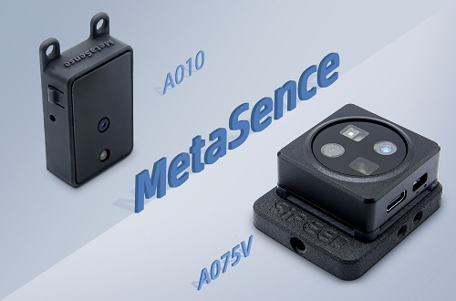

Purchase: [AliExpress](https://www.aliexpress.com/item/1005004984020473.html)

|                                                  | 
MS-A010
          | 
MS-A075V
          |
| :----------------------------------------------- | :-------------------------------------------------------- | :--------------------------------------------------------- |
|                                                  | 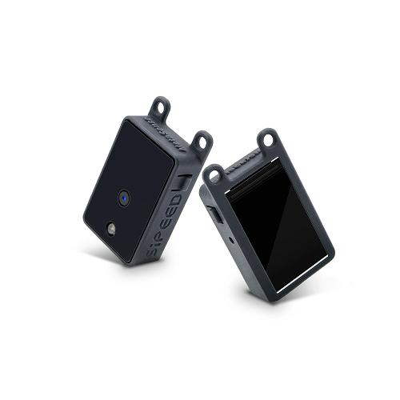     | 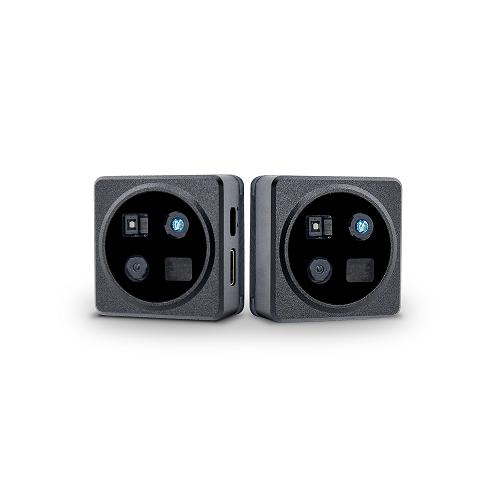          |
| Interface                                        | UART 1.25mm connector \*1 USB2.0 Type-C  connector \*1 | UART 1.25mm connector \*1  USB2.0 Type-C  connector \*1 |
| Resolution                                       | TOF: 100x100@30fps                                        | RGB: 1600x1200@30fps TOF: 320x240@60fps                 |
| FOV                                              | RGB: No TOF: 70°(H) * 60°(V)                           | RGB: 120° TOF: 55°(H)*72°(H)                            |
| 
TOF pixel size
 |                                                           | 15um                                                       |
| Laser transmitter                                | 940nm VCSEL                                               | 940nm,3W                                                   |
| Distance                                         | 0.2-2.5m                                                  | 0.15-1.5m                                                  |
| Accuracy                                         | &lt;=1%/cm                                                | &lt;=1%/cm                                                 |

### Case:Real shot of far, middle and near objects

High-precision mapping of the difference in the distance between items, the point cloud map can intuitively feel a more realistic visualization.

<html>
  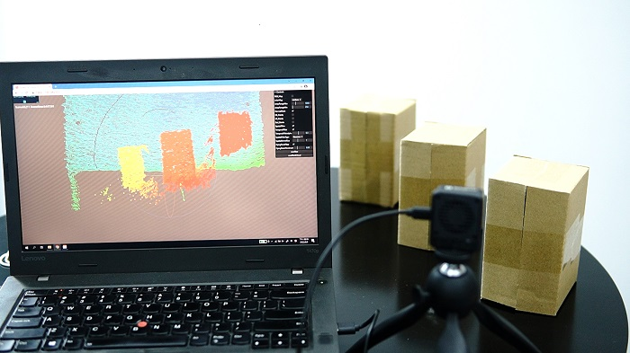
  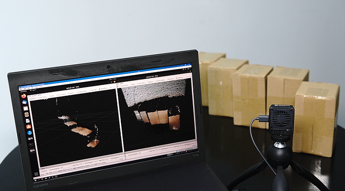
</html>

### Case:statistics traffic

It can monitor the flow of people in real time and make statistics with high precision and large resolution.

<html>
  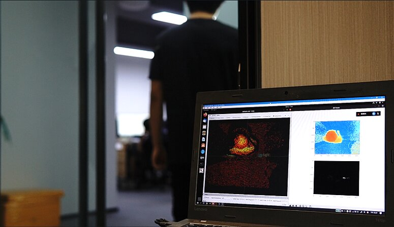
  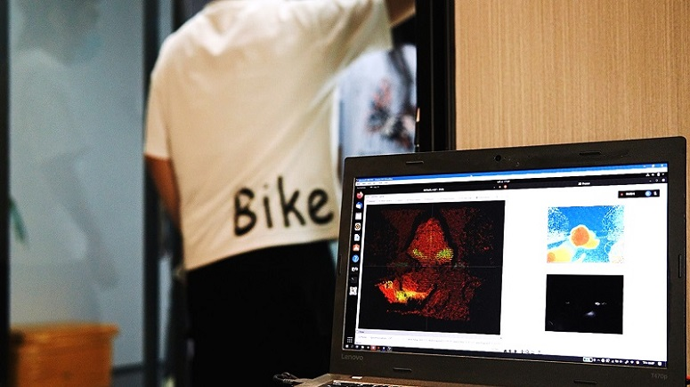
</html>

### Case:obstacle avoidance car

It can be mounted on a robot car to move and determine whether there are obstacles on the screen.The module comes with an LCD screen to accurately display the distance and respond to avoid obstacles.

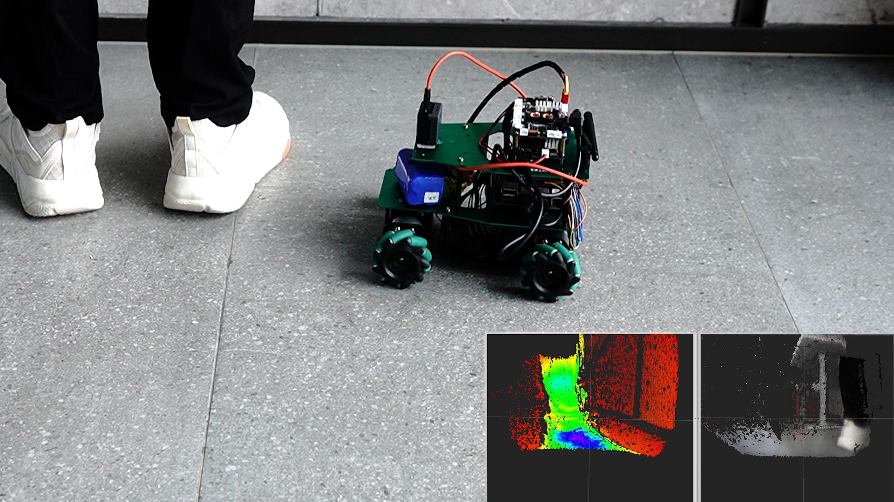

### Case:Keyboard lights follow gesture changes

Realize super cool keyboard light follow,track the position of the hand in real time,and then map the keyboard light according to the position of the hand.

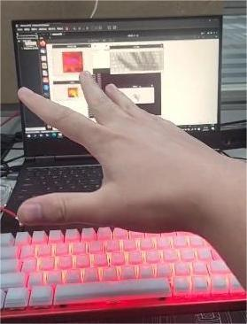

### Case:Volume measurement

After obtaining the camera internal parameters through the SDK, a preliminary point cloud is calculated, and the total volume is accumulated to achieve the effect of volume measurement.

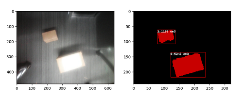

### Case:Access to MCU

MS-A010 has strong compatibility and is based on serial protocol. It can be connected to single-chip development boards such as K210 bit or linux development boards such as Raspberry Pi for secondary development.

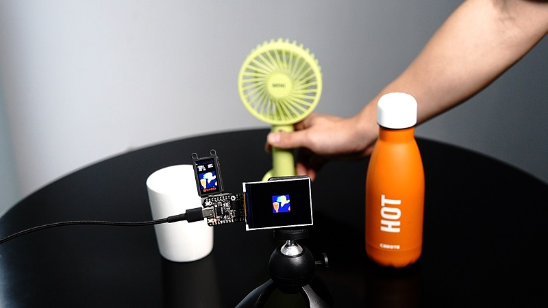

### Case: Support ROS1 + ROS2

Dual support ROS system, open ROS1 + ROS2 access function package, can quickly obtain depth data and depth map.

<html>
  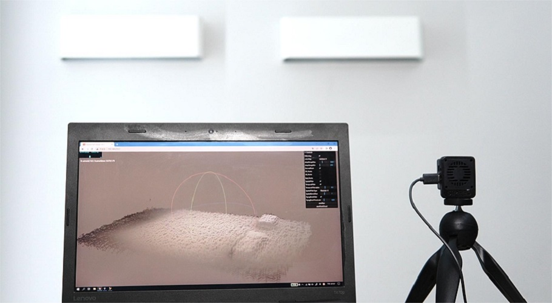
  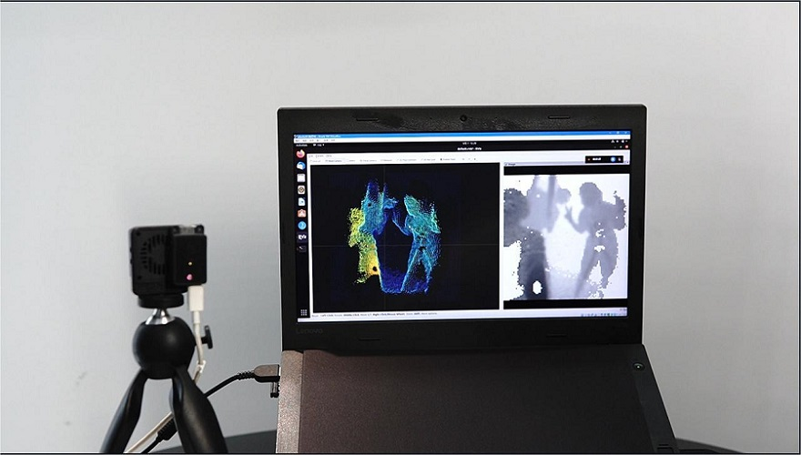
</html>

### Quick Look at ToF Technology

1. TOF: It is a method of distance measurement, which calculates the distance between the two by measuring the "time of flight" of signals such as ultrasonic/microwave/light between the transmitter and the reflector. It is the TOF sensor that can achieve TOF ranging. The most commonly used is infrared or laser ranging.
2. There is a difference in the distance between the objects. The module displays the cold and warm colors through the difference of the captured depth values. The cool and warm colors change with the mapping of the distance. 
<html>
  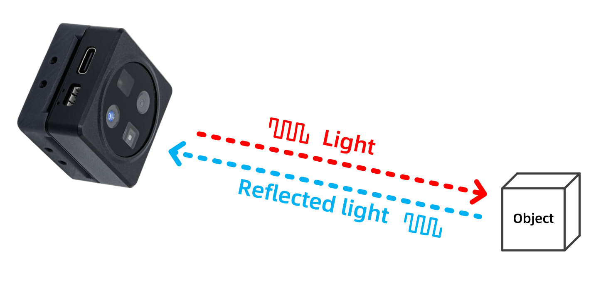
  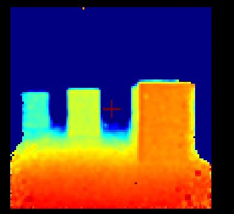
</html>

## Stereo Depth Camera

A stereo camera works like a pair of eyes. Two image sensors shoot at the same time, and the shift of each object between the two images gives its distance.

**MS-D640** is built on the Axera AX620Q with two global-shutter sensors. Its NPU outputs a 640×384 depth map at 12 fps. It uses standard UVC and needs no driver on Windows, Linux or macOS. It comes in two baselines:

| | Short baseline (about 50 mm) | Long baseline (about 100 mm) |
| :--- | :--- | :--- |
| Working range | 0.3 to 2.0 m | 0.5 to 3.0 m |
| Best for | Close-range precision, desktop use | Mid to long range, robot navigation |

See the [MS-D640 documentation](../../zh/maixsense/maixsense-d640/maixsense-d640.md) (Chinese for now).

## Thermal Cameras

Every object emits infrared radiation, and hotter objects emit more. A thermal camera images that radiation and converts it to a temperature for every pixel. Typical uses are finding hot spots on circuit boards, checking equipment and spotting heat leaks in buildings.

| | MS-T256S | MS-T160 |
| :--- | :--- | :--- |
| Look | 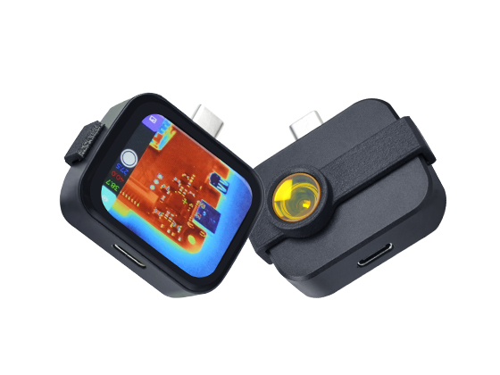 | 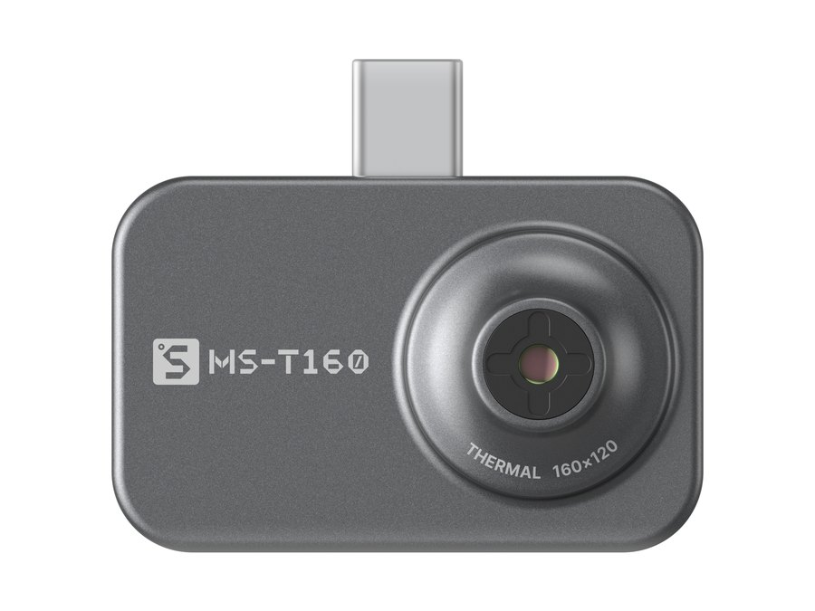 |
| Thermal resolution | 256 × 192 | 160 × 120 |
| AI super resolution | On the device, 640 × 480 output | In the browser, 480 × 360 output |
| Screen | 1.69-inch touchscreen, works without a computer | None, view in a phone or computer browser |
| Connection | Driver-free UVC camera, plus an HTTP API | USB network adapter with a built-in web page, driver-free |
| Docs | [MS-T256S documentation](../ThermalCam/T256s/Intro.md) | [MS-T160 documentation](../ThermalCam/T160/Introduction.md) |

## More

- ToF MS-A010: [documentation](./maixsense-a010/maixsense-a010.md)
- ToF MS-A075V: [documentation](./maixsense-a075v/maixsense-a075v.md)
- StereoCam MS-D640: [documentation](../../zh/maixsense/maixsense-d640/maixsense-d640.md) (Chinese for now)
- Thermal MS-T256S: [documentation](../ThermalCam/T256s/Intro.md)
- Thermal MS-T160: [documentation](../ThermalCam/T160/Introduction.md)
