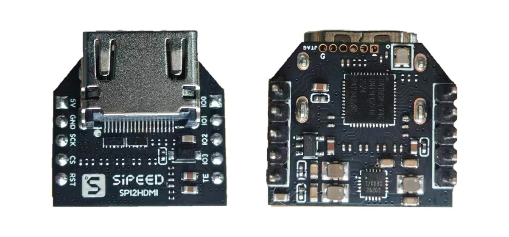
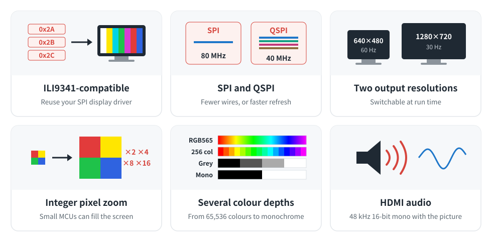
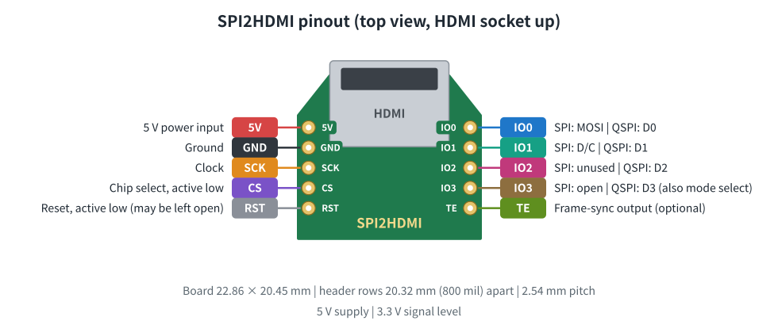
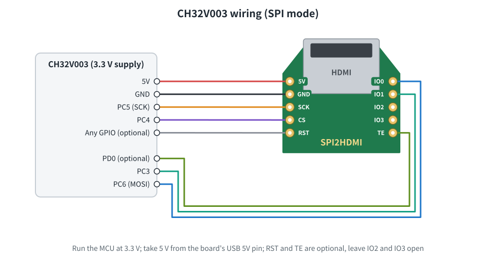
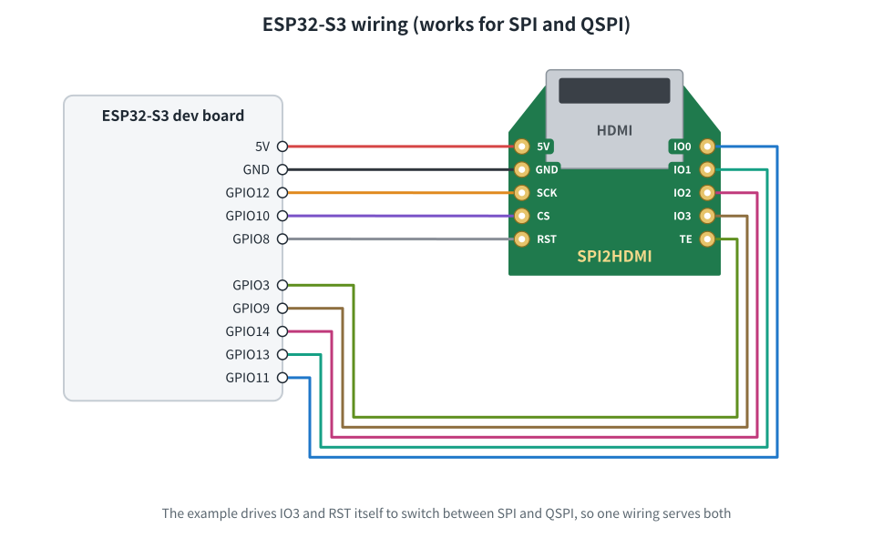
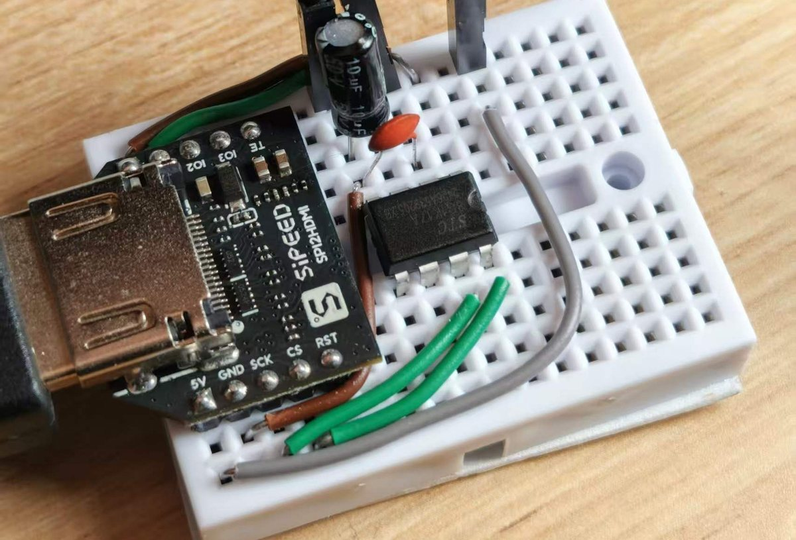
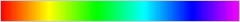
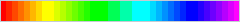

Tired of squeezing your project onto a tiny SPI screen? Want a big display, but an SPI screen is all your MCU knows how to drive?

**The Sipeed SPI2HDMI module puts any SPI-capable microcontroller on an HDMI monitor or TV.** It speaks the same commands as the ubiquitous ILI9341 SPI display, so you drive HDMI exactly the way you drive an SPI screen. Take the display driver you already have, change the resolution, and you are done: a stamp-sized module and a handful of wires bring even the smallest MCU to the big screen.

<div style="display:flex;flex-wrap:wrap;gap:8px;">
<video src="../../../zh/modules/spi2hdmi/assets/DCIM/demo-stc8.mp4" autoplay loop muted playsinline style="width:calc(50% - 4px);"></video>
<video src="../../../zh/modules/spi2hdmi/assets/DCIM/demo-arcade-dino.mp4" autoplay loop muted playsinline style="width:calc(50% - 4px);"></video>
<video src="../../../zh/modules/spi2hdmi/assets/DCIM/demo-esp32-nes.mp4" autoplay loop muted playsinline style="width:calc(50% - 4px);"></video>
<video src="../../../zh/modules/spi2hdmi/assets/DCIM/demo-esp32-lvgl.mp4" autoplay loop muted playsinline style="width:calc(50% - 4px);"></video>
</div>

> Top left: full-screen colour animation from an STC8G1K17A (8-pin 8051) | Top right: a dino game on a CH32V004
> Bottom left: an NES emulator on an ESP32-S3 | Bottom right: the LVGL benchmark on an ESP32-S3



## Features



## Specifications

| Item | Value |
|---|---|
| Power | 5 V, about 0.1 A |
| Signal level | 3.3 V |
| Host interface | SPI: mode 0, MSB first, up to 80 MHz; QSPI: up to 40 MHz |
| Video output | HDMI, 640×480@60 Hz or 1280×720@30 Hz |
| Framebuffer | 8 MB |
| Size | 22.86 × 20.45 mm, two 1×5 headers (2.54 mm pitch, rows 20.32 mm (800 mil) apart, breadboard friendly) |

## Pinout



In short: SPI mode needs six wires, **5V, GND, SCK, CS, IO0 and IO1**. Leave the rest open.

## Quick start

### Check the colour bars

Connect only 5V and GND, plug the HDMI cable into a monitor, and power up. The screen should show eight vertical colour bars (white, yellow, cyan, green, magenta, red, blue, black). If it does, the module, cable and monitor are fine.

### Wire it up

Small MCUs such as the CH32V003 use SPI mode:



On an ESP32-S3 you can connect all ten wires and use either SPI or QSPI:



An 8-pin 8051 works the same way: a few jumper wires on a breadboard and the big screen lights up. See the [`stc8` example](https://github.com/sipeed/SPI2HDMI_demo/tree/main/stc8) for the exact wiring:



### Flash an example

All examples are on GitHub: [sipeed/SPI2HDMI_demo](https://github.com/sipeed/SPI2HDMI_demo)

| Platform | Example | What you should see |
|---|---|---|
| STC8G1K17A (8-pin 8051) | [`stc8`](https://github.com/sipeed/SPI2HDMI_demo/tree/main/stc8) | A full-screen 640×480, 16-colour animation cycling through three scenes |
| CH32V003 / V004 | [`ch32/demo`](https://github.com/sipeed/SPI2HDMI_demo/tree/main/ch32) | Bad Apple, Conway's Life and fractals in a loop |
| CH32V004 | [`ch32/arcade`](https://github.com/sipeed/SPI2HDMI_demo/tree/main/ch32/arcade) | An eight-entry game menu (needs a monitor that accepts 720p30) |
| ESP32-S3 | [`esp32s3`](https://github.com/sipeed/SPI2HDMI_demo/tree/main/esp32s3) | Colour bars; serial commands switch mode, resolution and test pattern |
| ESP32-S3 | [`esp32s3/retro-go`](https://github.com/sipeed/SPI2HDMI_demo/tree/main/esp32s3#retro-go) | The retro-go emulator collection: NES, Game Boy, Doom and more, with picture and sound over HDMI (bring your own ROMs) |
| Other MCUs | [`common/spi2hdmi.h`](https://github.com/sipeed/SPI2HDMI_demo/blob/main/common/spi2hdmi.h) | A single-header driver: fill in three callbacks |

### Draw your own picture

Three steps, as with an ILI9341: pick a colour depth, set a window, write pixels.

```c
#include "spi2hdmi.h"

spi2hdmi_t lcd;
spi2hdmi_hal_t hal = { my_spi_write, my_set_dc, my_set_cs };   // your three low-level functions

s2h_init(&lcd, &hal);
s2h_set_format(&lcd, S2H_FMT_RGB565);
s2h_set_scale(&lcd, S2H_SCALE_2X);              // 2x zoom: the canvas becomes 320x240
s2h_fill565(&lcd, 0, 0, 319, 239, 0x001F);      // fill the screen with blue
```

If you already use TFT_eSPI, LVGL or a similar library, configure it for an ILI9341 and set the resolution to the current canvas size.

## SPI and QSPI modes

The module reads the level on IO3 **at the moment RST is released** to choose its mode, and keeps that mode until the next reset:

| IO3 when reset is released | Mode | Pin usage |
|---|---|---|
| Open or low | SPI | IO0 = MOSI, IO1 = D/C |
| High (hold for at least 1 ms) | QSPI | IO0–IO3 = D0–D3, no D/C line |

For SPI, simply leave IO3 unconnected. For QSPI, have the MCU drive IO3 high, pulse RST low, then hand IO3 back to the QSPI peripheral. The QSPI framing is the one used by SH8601 and AXS15231B panels; under ESP-IDF you can use the [`esp_lcd_spi2hdmi`](https://github.com/sipeed/SPI2HDMI_demo/tree/main/esp32s3) component from the demo repository.

> ⚠️ **About fast clocks**: 80 MHz SPI and 40 MHz QSPI are fast for jumper wires and breadboards. If the picture jitters, shows noise or tears apart, shorten the wires, keep a ground wire next to SCK, or start at 20–40 MHz.

## Resolution and zoom

Canvas size = output resolution ÷ zoom factor. A smaller canvas means fewer bytes per frame.

| Output mode | Zoom (parameter of `0x88`) | Canvas |
|---|---|---|
| 640×480@60 Hz | 1× / 2× / 4× / 8× / 16× (0–4) | 640×480 / 320×240 / 160×120 / 80×60 / 40×30 |
| 1280×720@30 Hz | 2× / 4× / 8× / 16× (0–3) | 640×360 / 320×180 / 160×90 / 80×45 |

Switching the output mode (`0x8B`) blanks the screen briefly; the framebuffer is kept. Some PC monitors do not accept 720p30, while TVs generally do.

## Commands

ILI9341-compatible commands:

| Command | Name | Parameters | Meaning |
|---|---|---|---|
| `0x2A` | CASET | x0, x1 (2 bytes each, high byte first) | Column window |
| `0x2B` | PASET | y0, y1 | Row window |
| `0x2C` | RAMWR | pixel data | Write from the window's top-left corner, wrapping automatically |
| `0x3C` | RAMWRC | pixel data | Continue where the last write stopped |
| `0x3A` | COLMOD | 1 byte | Colour depth, see below |
| `0x36` | MADCTL | 1 byte | Only the BGR bit is used; rotation is not supported |
| `0x20` / `0x21` | INVOFF / INVON | none | Colour inversion off / on |
| `0x28` / `0x29` | DISPOFF / DISPON | none | Blank the screen / show it again |
| `0x01` | SWRESET | none | Restore default settings without clearing the picture |

Other ILI9341 commands are safely ignored. Extension commands:

| Command | Parameters | Meaning |
|---|---|---|
| `0x88` | 1 byte | Zoom factor, see the previous section |
| `0x8B` | 0 or 1 | Output mode: 0 = 640×480@60, 1 = 1280×720@30 |
| `0x89` | R, G, B | Base colour of the grey and monochrome formats (the colour shown at full brightness); white by default |
| `0x8A` | 16 bytes (RGB332) | Palette for the 16-colour mode |
| `0x8E` | audio data | 48 kHz, 16-bit, mono, little-endian PCM, output over HDMI |

Colour depth (parameter of `0x3A`):

| Value | Format | Per pixel | Colours |
|---|---|---|---|
| `0x55` | RGB565 (default) | 2 bytes, high byte first |  |
| `0x32` | RGB332, 256 colours | 1 byte |  |
| `0x24` | 16-colour palette | half a byte |  |
| `0x14` | 4-bit grey, tintable | half a byte |  |
| `0x12` | 2-bit grey, tintable | a quarter byte |  |
| `0x11` | monochrome, tintable | one eighth of a byte |  |

The grey and monochrome formats can take a base colour through `0x89`: the picture then fades from black to that colour instead of to white. For example 4-bit grey tinted amber , or 2-bit grey tinted green , which suits retro-terminal and single-colour display styles.

For formats smaller than one byte per pixel, the window's start column and width must align to whole bytes (multiples of 8 in monochrome mode, for example).

## Performance and platform choice

The full-screen frame rate depends on the bytes per frame and the bus speed. The table gives the **upper limit calculated from the bus speed**; the time your MCU needs to prepare the data comes on top. The frame rate never exceeds the output refresh rate (60 or 30).

| Canvas and depth | Bytes per frame | SPI 24 MHz | SPI 40 MHz | SPI 80 MHz | QSPI 40 MHz |
|---|---:|---:|---:|---:|---:|
| 640×480 RGB565 | 614,400 | 4.9 | 8.1 | 16 | 32 |
| 640×480 RGB332 | 307,200 | 9.8 | 16 | 32 | 60 |
| 640×480 monochrome | 38,400 | 60 | 60 | 60 | 60 |
| 320×240 RGB565 | 153,600 | 19 | 32 | 60 | 60 |
| 320×240 RGB332 | 76,800 | 39 | 60 | 60 | 60 |
| 160×120 RGB565 | 38,400 | 60 | 60 | 60 | 60 |
| 640×360 RGB565 (720p) | 460,800 | 6.5 | 10 | 21 | 30 |
| 320×180 RGB565 (720p) | 115,200 | 26 | 30 | 30 | 30 |

Measured on an ESP32-S3 (640×480 RGB565, full screen): about 69 ms per frame over 80 MHz SPI and about 39 ms over 40 MHz QSPI. Updating only the part of the picture that changes is much faster.

Choosing a platform:

| Your MCU | Suggested use |
|---|---|
| Small MCUs (CH32V003 and similar, SPI around 20 MHz) | SPI mode; a 160×120 or smaller canvas, or monochrome / 16-colour formats at higher resolution; update only what changes |
| 32-bit MCUs with DMA (SPI at 40–80 MHz) | SPI mode; 320×240 RGB565 reaches 30–60 full frames per second, a good fit for LVGL interfaces |
| MCUs with QSPI (ESP32-S3 and similar) | QSPI mode; full-screen 640×480 RGB565, emulators, video playback |

## Reset and TE

- **RST**: active low, pulled up on the module, may be left unconnected. A reset restores the default settings and samples IO3 again; the framebuffer is not cleared.
- **TE**: frame-sync output, high during the blanking interval of every frame (about 1.4 ms at 640×480, about 1.3 ms at 720p). Starting a write on the rising edge of TE reduces tearing. Leave it open if you do not need it.

## FAQ

### The monitor shows no signal or stays black

Connect only power and HDMI and look for the colour bars. If there are none, check the 5 V supply and the HDMI cable, then try another monitor.

### The colour bars appear, but my MCU cannot draw anything

Check SCK, CS, IO0, IO1 and the common ground. Make sure SPI is in mode 0, MSB first, and that IO3 is not pulled high at power-up (a high level selects QSPI mode).

### The picture jitters, shows noise or is shifted

The clock is probably too fast or the wires too long. See the note [about fast clocks](#SPI-and-QSPI-modes) above.

### The monitor reports an unsupported mode after switching to 720p

Not every PC monitor accepts 1280×720@30 Hz. Use a TV or switch back to 640×480.

### Can I use a microcontroller with 5 V I/O?

The module's signal pins are 3.3 V logic, so a 5 V MCU needs level shifters on the signal lines. Most current microcontrollers use 3.3 V I/O and connect directly.

### Can I read back the framebuffer or a display ID?

No, the module only receives data. Rotation also has to be done on the MCU side.

## Links

- Example code: [github.com/sipeed/SPI2HDMI_demo](https://github.com/sipeed/SPI2HDMI_demo)
- Where to buy: coming soon
