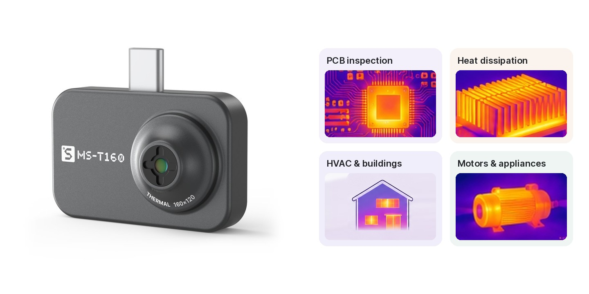
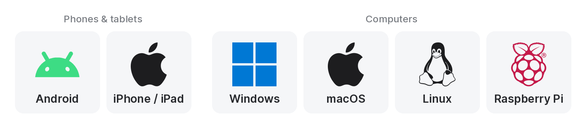
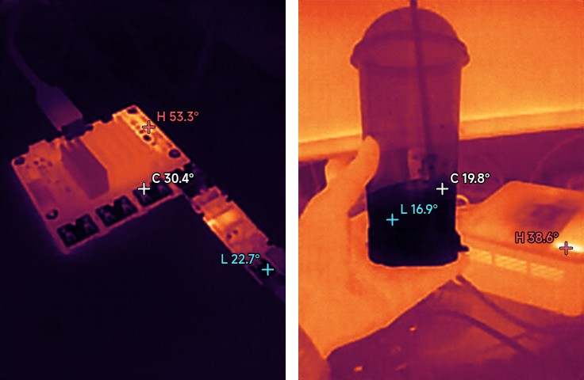
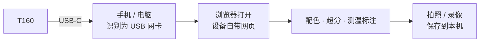
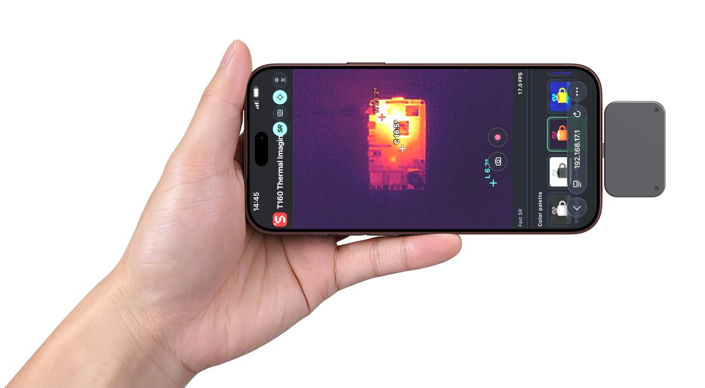
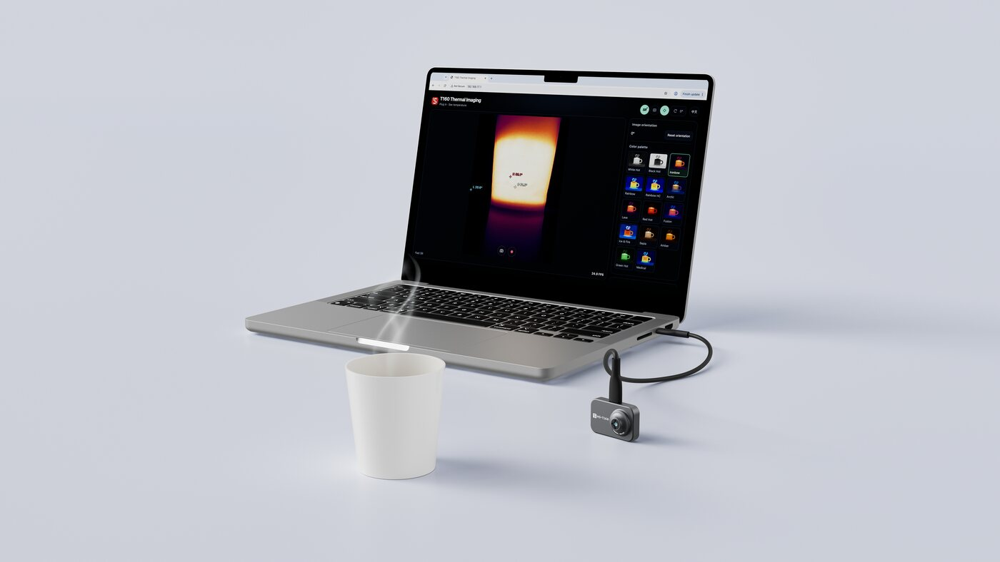
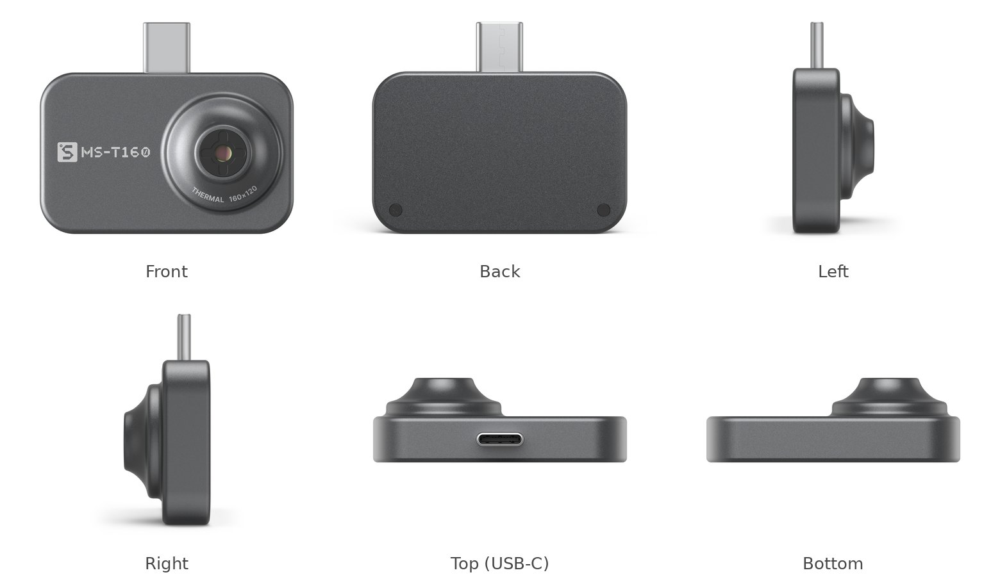
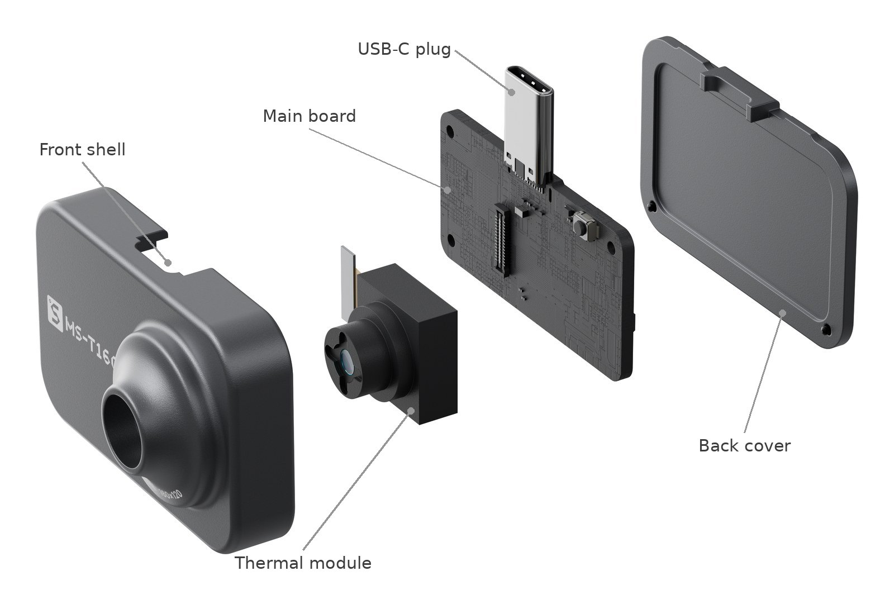
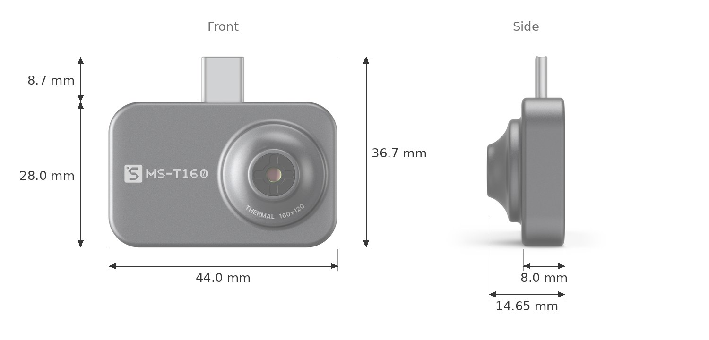

# 简介

Sipeed MS-T160 是一款直接插在手机或电脑 USB-C 口上使用的口袋热成像相机，热成像分辨率 160 × 120。
它**不需要安装 App，也不需要驱动**：插上后，设备会被识别成一块 USB 网卡，用浏览器打开设备自带的网页，就能看到实时热图、读温度、拍照和录像。
适合排查电路板发热、家居水电与暖通检查，也适合想把热成像接进自己项目的创客和开发者。

## 全平台通用，打开浏览器就能用

T160 的界面就是设备里自带的一个网页。只要有 USB-C 口和浏览器，安卓手机、iPhone、iPad、Windows、macOS 和 Linux 电脑都能直接使用，界面和功能完全一样。树莓派等只有 USB-A 口的设备，加一个 USB-A 转 USB-C 转接头也能用。

和需要安装 App 的热成像插件相比，这样做有几个好处：

- **不用找 App**：不用去应用商店下载，也不受地区上架、系统版本限制。
- **不用装驱动、不用注册账号**：插上就能用，换一台手机或电脑也一样。
- **一台设备，多处使用**：在现场用手机看，回到工位插电脑继续看，同一个网页。
- **浏览器负责处理**：超分、配色、拍照录像都在浏览器里完成，设备本身保持简单、省电。

## 核心特性

1. **免 App、免驱动、全平台**：网页由设备自己提供，安卓、苹果手机和平板，以及各种电脑，用浏览器打开即可。
2. **实时测温标注**：画面自动标出最高温（H）、最低温（L）和中心点（C）的温度。
3. **浏览器 AI 超分**：在手机或电脑浏览器里，用神经网络把 160 × 120 的画面实时放大到 480 × 360（3 倍），可以左右拖动对比超分前后的效果。超分模型存在设备里，不需要联网。
4. **14 种伪彩配色**：白热、黑热、铁红、彩虹等，随时切换。
5. **拍照录像直接存到本机**：保存的就是屏幕上看到的画面（含配色、超分和温度标注），设备本身不占存储。
6. **开放数据接口**：设备提供 HTTP 接口，每一帧图像都带有同一时刻的温度数据，方便接入自己的程序或 AI 工具。

> 名词解释：**伪彩**是把看不见的温度差异映射成颜色，比如铁红配色里越亮越热；**超分**（超分辨率）是用算法把低分辨率画面放大并补出细节。

## 实拍效果

下面两张是用 T160 网页直接拍下的照片：左边是工作中的电路板，右边是手里的一杯冰饮。

## 工作方式

简单说：T160 只负责采集热图和温度，配色、超分、拍照录像都在你的浏览器里完成。

因为画面处理放在浏览器里，配色和超分效果可以随网页更新不断改进。

*T160 可以直接插在手机或电脑上使用。电脑场景图中使用了 USB-C 延长线，需要另行准备，包装内不含。*

## 技术规格

一句话概括：160 × 120 热成像，25 fps，0 ~ 120 ℃，USB-C 直插，浏览器内 3 倍 AI 超分。

| 项目 | 规格 |
| :--- | :--- |
| 热成像分辨率 | 160 × 120 |
| 浏览器超分输出 | 480 × 360（3 倍，可开关） |
| 帧率 | 25 fps |
| 测温范围 | 0 ~ 120 ℃ |
| 测温精度 | ±2 ℃ |
| 温差灵敏度（NETD） | 50 mK |
| 视场角（FOV） | 34° × 26° |
| 主控 | RP2350 |
| 接口 | USB Type-C 公头，直插使用 |
| 连接方式 | USB 网卡（NCM 协议），免驱 |
| 支持系统 | Android、iOS、iPadOS、Windows、macOS、Linux（含树莓派）（iPhone 和 iPad 需为 USB-C 接口的机型） |
| 功耗 | 约 0.5 W（5 V，100 mA） |
| 推荐工作环境温度 | 10 ~ 30 ℃ |
| 尺寸 | 44 × 28 × 8 mm（机身），详见下方尺寸图 |
| 重量 | 21 g |
| 伪彩配色 | 14 种 |
| 拍照 / 录像 | 由浏览器保存到手机或电脑 |

> 名词解释：**NETD**（噪声等效温差）表示能分辨的最小温差，数值越小越灵敏；**视场角**是镜头能看到的范围，34° × 26° 在 1 米外大约能覆盖 61 × 46 cm 的区域。

## 外观与接口

T160 只有一个接口：顶部的 USB-C 公头，直接插进手机或电脑即可，不需要线缆，也没有电池和按键。正面是镜头和镜头环，背面是后盖。

## 内部结构

T160 由前壳、热成像模组、主板和后盖四部分组成，USB-C 插头直接焊在主板上。外壳是封闭的，不需要也不建议自行拆开。

## 尺寸

机身 44 × 28 × 8 mm；含镜头凸起的厚度为 14.65 mm；USB-C 插头伸出机身 8.7 mm，含插头总高 36.7 mm。

## 适用场景

- **电子维修与研发**：找到电路板上异常发热的元件、短路点和过载的电源器件。
- **家居与暖通检查**：查看墙面和门窗漏热、地暖管走向、空调出风温度。
- **设备巡检**：检查插排、配电箱、电机等是否过热。
- **创客与教学**：通过 HTTP 接口读取温度数据，做温度监测、报警之类的小项目，或者交给 AI 工具分析。

## 和 MS-T256S 怎么选

| | MS-T160 | MS-T256S |
| :--- | :--- | :--- |
| 热成像分辨率 | 160 × 120 | 256 × 192 |
| AI 超分 | 浏览器本地超分，输出 480 × 360 | 设备本地超分，输出 640 × 480 |
| 屏幕 | 无，用手机或电脑浏览器查看 | 1.69 英寸触摸屏，可脱离电脑单独使用 |
| 连接方式 | USB 网卡 + 设备自带网页 | UVC 摄像头，另提供 HTTP 接口 |
| 适合 | 想用最低成本在手机上看热图 | 需要更高分辨率、机身屏幕或摄像头输出 |

MS-T256S 的详细资料见 [MS-T256S 文档](../T256s/Intro.md)。

## 相关链接

- 购买：待上架
- 支持邮箱：support@sipeed.com
- 社区（Discord）：[discord.gg/V4sAZ9XWpN](https://discord.gg/V4sAZ9XWpN)
- X / Twitter：[@SipeedLab](https://x.com/SipeedLab)
- Sipeed GitHub：https://github.com/sipeed

## 下一步

拿到 T160 后，先看[快速上手](./Quick_Start.md)：从插上设备、打开网页，到读出第一个温度，几分钟就能完成。
