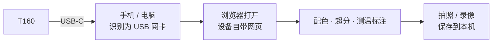

# 简介

Sipeed T160 是一款插在手机或电脑 USB-C 口上就能用的口袋热成像相机，热成像分辨率 160 × 120。
它**不需要安装 App，也不需要驱动**：插上后，设备会被识别成一块 USB 网卡，用浏览器打开设备自带的网页，就能看到实时热图、测温、拍照和录像。
适合排查电路板发热、家居水电与暖通检查，也适合想把热成像接进自己项目的创客和开发者。

## 核心特性

1. **免 App、免驱动**：网页由设备自己提供，手机和电脑用浏览器打开即可，不用去应用商店找 App，也不用装驱动。
2. **实时测温标注**：画面自动标出最高温（H）、最低温（L）和中心点（C）的温度。
3. **浏览器 AI 超分**：在你的手机或电脑浏览器里，用神经网络把 160 × 120 的画面实时放大到 480 × 360（3 倍），边缘和细节比普通插值放大更清楚；可以左右拖动对比超分前后的效果。
4. **14 种伪彩配色**：白热、黑热、铁红、彩虹等，随时切换。
5. **拍照录像直接存到本机**：保存的就是你在屏幕上看到的画面（含配色、超分和温度标注），直接存进手机相册或电脑，设备本身不占存储。
6. **开放数据接口**：设备提供 HTTP 接口，每一帧图像都带有同一时刻的温度数据，方便在自己的程序里读取。

> 名词解释：**伪彩**是把看不见的温度差异映射成颜色，比如铁红配色里越亮越热；**超分**（超分辨率）是用算法把低分辨率画面放大并补出细节。

## 工作方式

简单说：T160 只负责采集热图和温度，配色、超分、拍照录像都在你的浏览器里完成。

因为画面处理放在浏览器里，配色和超分效果可以随网页更新不断改进，不需要每次都升级设备固件。

## 技术规格

一句话概括：160 × 120 热成像，USB-C 直插，浏览器内 3 倍 AI 超分。

| 项目 | 规格 |
| :--- | :--- |
| 热成像分辨率 | 160 × 120 |
| 浏览器超分输出 | 480 × 360（3 倍，可开关） |
| 帧率 | 待确认 |
| 测温范围 | 待确认 |
| 测温精度 | 待确认 |
| 视场角（FOV） | 待确认 |
| 主控 | RP2350 |
| 接口 | USB Type-C 公头 |
| 连接方式 | USB 网卡（USB NCM），免驱 |
| 支持系统 | Windows、Linux、Android、iOS（待确认） |
| 伪彩配色 | 14 种 |
| 拍照 / 录像 | 由浏览器保存到手机或电脑 |
| 尺寸 | 约 45 × 29 × 8 mm（不含镜头凸起；含镜头约 14.6 mm）（待确认） |
| 重量 | 待确认 |

## 适用场景

- **电子维修与研发**：找到电路板上异常发热的元件、短路点和过载的电源器件。
- **家居与暖通检查**：查看墙面和门窗漏热、地暖管走向、空调出风温度。
- **设备巡检**：检查插排、配电箱、电机等是否过热。
- **创客与教学**：通过 HTTP 接口读取温度数据，做温度监测、报警之类的小项目。

如果你需要更高的分辨率、机身自带屏幕或标准 UVC 摄像头输出，可以看看 [T256s](../T256s/Intro.md)。

## 相关链接

- 购买：待上架
- 支持邮箱：support@sipeed.com
- 社区（Discord）：[discord.gg/V4sAZ9XWpN](https://discord.gg/V4sAZ9XWpN)
- X / Twitter：[@SipeedLab](https://x.com/SipeedLab)
- Sipeed GitHub：https://github.com/sipeed

## 下一步

快速上手页面正在编写中，届时会介绍从插入设备、打开网页到看到第一张热图的完整步骤。
