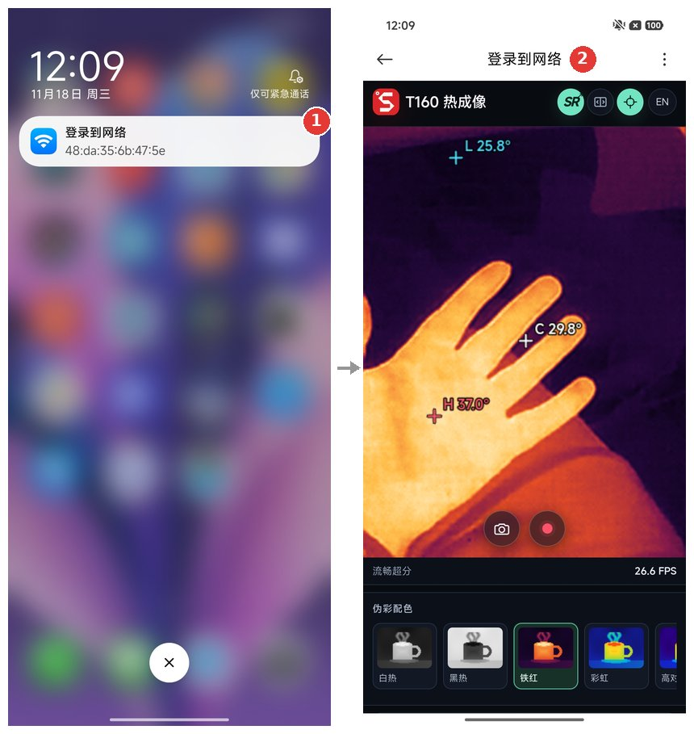
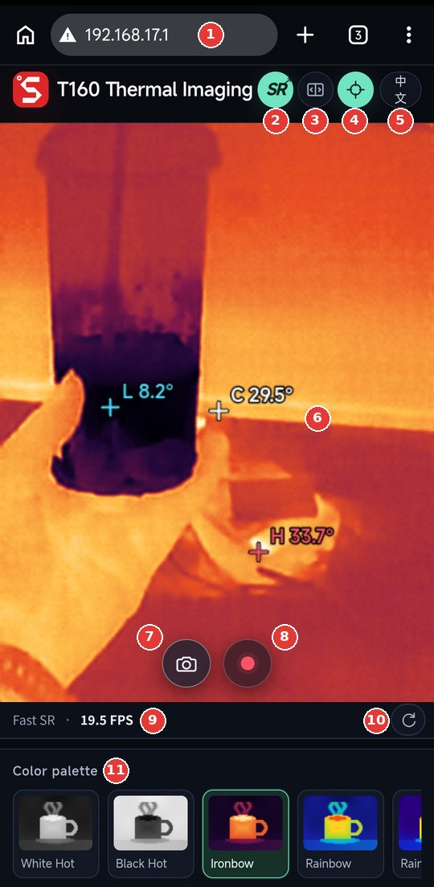
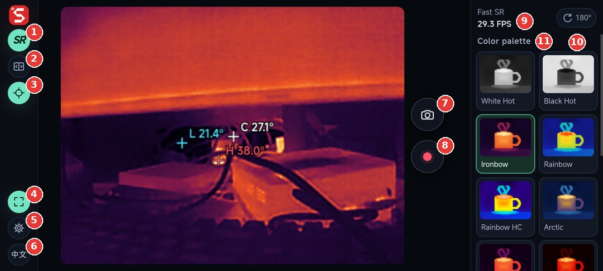
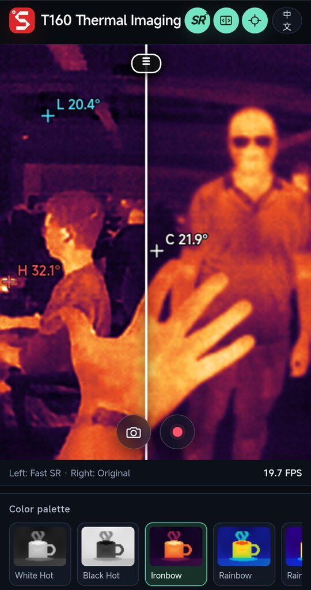
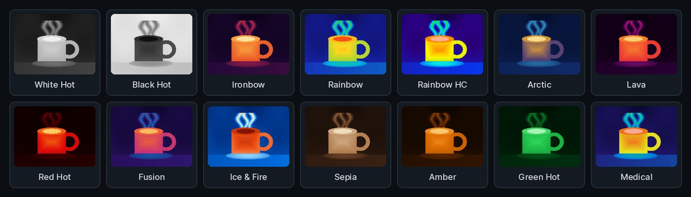

# 快速上手

使用 T160 只需要三步：插上设备、用浏览器打开网页、看温度。整个过程不用安装 App，也不用装驱动。
本页按顺序讲完这三步，再逐个介绍网页上的功能。

## 准备

- 一台 MS-T160。
- 一台带 USB-C 接口的手机、平板或电脑：安卓手机和平板、iPhone、iPad，或者 Windows、macOS、Linux 电脑都可以。iPhone 和 iPad 需要是 USB-C 接口的机型（iPhone 15 及之后），Lightning 接口的机型不支持。
- 一个浏览器。推荐使用 Chrome 114 或 Firefox 146 以上版本，超分速度最快；其他浏览器也能正常看画面和测温。

> T160 直接插在 USB-C 口上使用，不需要线缆和电池，包装内不含延长线。

## 插上 T160

把 T160 直接插进手机或电脑的 USB-C 口。

几秒钟后，手机或电脑会把 T160 识别成一块新的网络：

- **手机**：通常会出现"登录到网络"或"网络无法访问互联网"之类的提示，这是正常的。T160 是一个只连着你手机的本地网络，本来就不能上网。
- **电脑**：会多出一个有线网卡，并自动获得 `192.168.17.x` 的地址。

> 如果插上后没有任何反应，见[常见问题](./FAQ.md)中的"连接"部分。

## 打开网页

### 安卓手机

**弹出了"登录到网络"通知**：一些安卓手机插上 T160 后会弹出这个通知（下图 ①）。点开它，系统会直接打开 T160 的网页（下图 ②）。

**没有弹出通知**：安卓系统会把 USB 网卡排在 Wi-Fi 和移动数据之后，浏览器的请求会先走 Wi-Fi 或移动数据，所以直接输入地址可能打不开。请按下面的步骤操作：

1. 打开**飞行模式**。如果打开飞行模式后 Wi-Fi 仍然亮着，把 Wi-Fi 也关掉。
2. 打开浏览器，在地址栏输入 `192.168.17.1`，打开。
3. 几秒后应该能看到 **T160 Thermal Imaging** 页面和实时热图。

> 飞行模式不会影响 T160，它走的是 USB 线路。用完 T160 后记得关闭飞行模式。

### iPhone、iPad 和电脑

1. 打开浏览器。
2. 在地址栏输入 `192.168.17.1`，打开。
3. 几秒后应该能看到 **T160 Thermal Imaging** 页面和实时热图。

> 地址栏旁边可能会显示"不安全"，这是因为 T160 的网页用的是本地 HTTP 连接，不影响使用。如果打不开，见[常见问题](./FAQ.md)。

## 认识界面

网页会根据屏幕方向自动切换竖屏和横屏两种布局，按钮功能相同，只是位置不同。

### 竖屏界面

下图是手机竖屏时的网页界面，红色数字对应下表。

| 编号 | 名称 | 作用 |
| :---: | :--- | :--- |
| 1 | 地址栏 | 显示设备地址，默认是 `192.168.17.1` |
| 2 | 超分开关（SR） | 打开或关闭浏览器超分，见[超分与对比](#超分与对比) |
| 3 | 对比 | 左右分屏对比超分前后的画面，打开超分后才能用 |
| 4 | 温度标注 | 显示或隐藏画面上的 H、L、C 标注 |
| 5 | 语言 | 在中文和英文界面之间切换 |
| 6 | 温度标注 | H 为最高温，L 为最低温，C 为中心点温度 |
| 7 | 拍照 | 把当前画面保存成照片 |
| 8 | 录像 | 开始录像，再点一次停止并保存 |
| 9 | 状态栏 | 当前画面模式和实际帧率 |
| 10 | 旋转 | 每按一次画面顺时针转 90°，见[调整画面方向](#调整画面方向) |
| 11 | 伪彩配色 | 左右滑动选择配色 |

页面最下方还有一个"设备设置与固件更新"面板，用于固件更新和多设备设置，见[进阶使用与开发](./Advanced.md)。

### 横屏界面

手机横过来时，页面会自动换成横屏布局，画面也会自动转正：原来的顶栏移到左边，拍照录像按钮在画面右侧，状态栏和色板在最右边，色板可以上下滑动。电脑浏览器窗口较宽时也是这个布局。

| 编号 | 名称 | 作用 |
| :---: | :--- | :--- |
| 1 ~ 3 | 超分、对比、温度标注 | 和竖屏顶栏的按钮相同 |
| 4 | 全屏 | 隐藏浏览器地址栏，画面更大；再按一次退出 |
| 5 | 设置 | 从左侧滑出"设备设置与固件更新"面板，再按一次或点画面即可收起 |
| 6 | 语言 | 在中文和英文界面之间切换 |
| 7、8 | 拍照、录像 | 和竖屏相同 |
| 9 | 状态栏 | 当前画面模式和实际帧率 |
| 10 | 旋转 | 手动调整画面方向，按钮上会显示当前的手动角度 |
| 11 | 伪彩配色 | 上下滑动选择配色 |

手机横屏时，第一次会提示"轻触画面进入全屏"，点一下画面即可。iPhone 的 Safari 不支持网页全屏，不会显示全屏按钮。

## 读温度

网页打开后，画面上默认有三个温度标注：

- **H**（红色）：画面中的最高温度和位置。
- **L**（蓝色）：画面中的最低温度和位置。
- **C**（白色）：画面中心一小块区域（5 × 5 像素）的温度。想测某个物体，把 T160 对准它，让它落在画面中心即可。

点顶部的温度标注按钮（界面图中的 4）可以隐藏这些标注，再点一次恢复。

T160 的测温范围是 0 ~ 120 ℃，精度 ±2 ℃，推荐在 10 ~ 30 ℃ 的室温环境下使用。测量光亮的金属表面时读数会偏低，原因见[常见问题](./FAQ.md)。

## 超分与对比

超分会在浏览器里把 160 × 120 的原始画面实时放大到 480 × 360，边缘和细节更清楚。模型存放在 T160 里，不需要联网。

- 点 **SR** 按钮打开或关闭超分。状态栏左边会显示当前模式。
- 在 Chrome 114、Firefox 146 及以上版本的浏览器中，使用的是速度最快的 **Fast SR**（流畅超分），默认开启。
- 在其他浏览器中，网页会先测一下超分速度。速度足够时自动开启；太慢时会先关闭，点 SR 按钮仍可手动开启。

想直观看到超分的效果：先打开超分，再点**对比**按钮。画面会被一条竖线分成两半，左边是超分画面，右边是原始画面，按住竖线中间的把手可以左右拖动。

> 超分只改善显示效果。温度读数始终来自 T160 的原始测量数据，不受超分影响。

## 切换配色

在画面下方的伪彩配色栏里左右滑动，点一下即可切换。下图是 14 种配色的效果，图标就是网页配色栏里的同款：

图中英文名和中文界面的对应关系：

| 第一行（英文） | 中文 | 第二行（英文） | 中文 |
| :--- | :--- | :--- | :--- |
| White Hot | 白热 | Red Hot | 红热 |
| Black Hot | 黑热 | Fusion | 融合 |
| Ironbow | 铁红 | Ice & Fire | 冰火 |
| Rainbow | 彩虹 | Sepia | 褐色 |
| Rainbow HC | 高对比彩虹 | Amber | 琥珀 |
| Arctic | 北极 | Green Hot | 绿热 |
| Lava | 熔岩 | Medical | 医疗 |

配色只改变显示和拍照的颜色，不影响温度数据。默认的铁红配色里越亮越热；白热配色里越白越热，适合看轮廓。

## 调整画面方向

- **自动跟随**：手机或平板转动时，画面会自动转正，不需要手动操作。
- **手动旋转**：如果画面方向不对，比如 T160 插反了，点状态栏右侧的旋转按钮（界面图中的 10），每按一次顺时针转 90°。转过之后，按钮上会显示当前的手动角度。
- 浏览器会记住手动旋转的角度，下次打开不用再调。换一台手机或换一个浏览器，需要重新设置。

## 拍照和录像

- **拍照**：点相机按钮，当前画面会保存成一张 360 × 480 的 PNG 照片。照片里包含你看到的配色、超分效果和温度标注。
- **录像**：点红色圆点开始录像，按钮上会显示录制时长；再点一次停止并保存。视频格式由浏览器决定，一般是 MP4，部分浏览器为 WebM。

照片和录像都由浏览器直接保存到手机或电脑上，文件名以 `T160_` 开头。安卓手机上一般在"下载"文件夹里，电脑上在浏览器的下载目录里。T160 本身不存储任何文件。

下面是一段用 T160 网页录下的视频：

<video src="./assets/Screenshots/record-example.mp4" autoplay loop muted playsinline width="360"></video>

> 照片和视频里的颜色只表示相对冷热，不能直接换算成温度。需要具体数值时，以画面上的温度标注为准。

## 下一步

- 想更新固件、同时接多台设备，或者通过 HTTP 接口读取数据：见[进阶使用与开发](./Advanced.md)。
- 想让 AI 工具读取 T160 的温度：见[AI 接入](./AI_Control.md)。
- 遇到问题：见[常见问题](./FAQ.md)。
