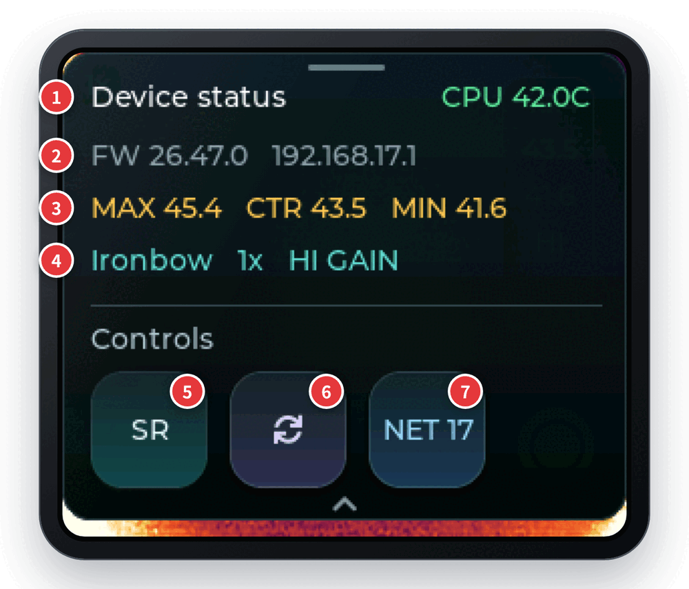
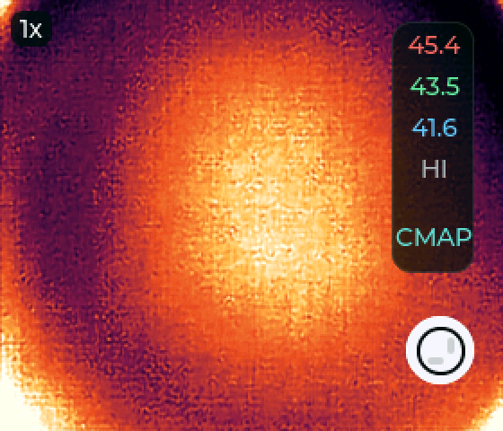
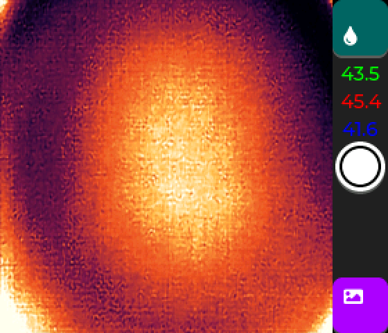
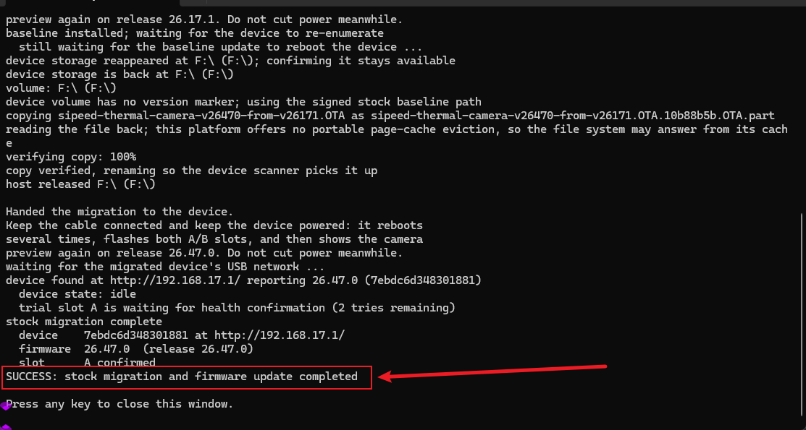
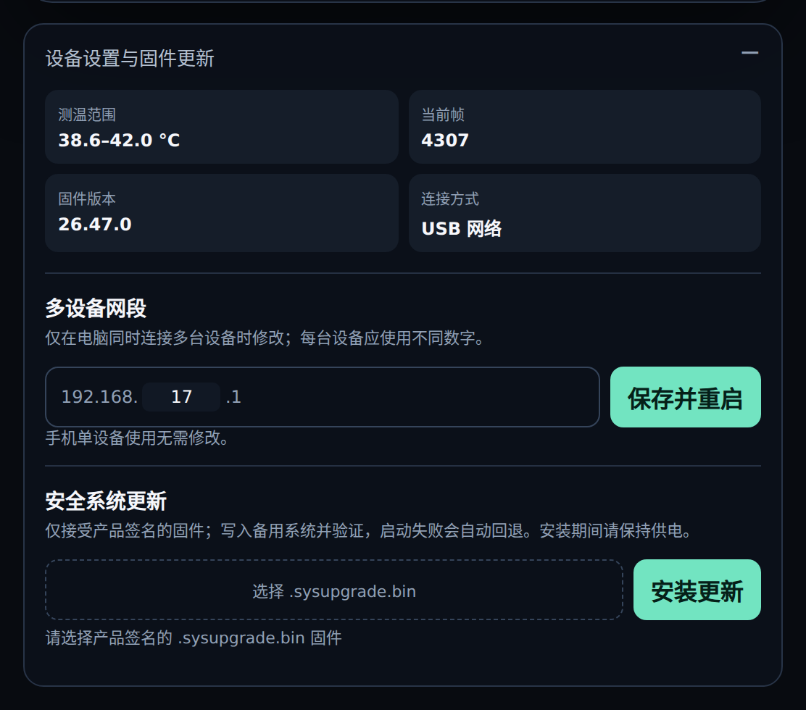
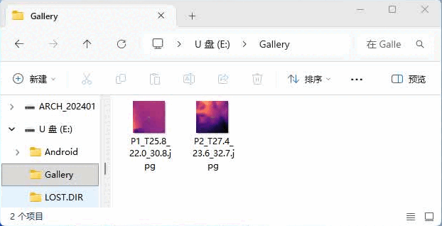

# 进阶使用与开发

本页分三部分：

- **设备设置**：状态面板、查看和更新固件、同时接多台设备。
- **数据与文件**：UVC 摄像头的几种输出格式、从 Y16 读取原始温度、照片与 U 盘。
- **二次开发**：用 HTTP 接口、AI 工具或 UVC 读取 T256S 的数据。

## 设备设置

### 状态面板

从屏幕顶边往下拉，打开状态面板。第一次下拉显示常用开关（Controls），继续下拉显示完整的设备状态；往上滑逐段收起。



| 编号 | 内容 | 说明 |
| :---: | :--- | :--- |
| 1 | 设备状态与 CPU 温度 | CPU 温度低于 65 ℃ 显示绿色，65 ~ 80 ℃ 显示黄色，80 ℃ 及以上显示红色 |
| 2 | 固件版本与设备地址 | 例如 `FW 26.47.0   192.168.17.1` |
| 3 | 温度 | 最高温（MAX）、中心温度（CTR）、最低温（MIN） |
| 4 | 画面状态 | 当前伪彩的完整名称、缩放倍数、增益档（`HI GAIN` 或 `LO GAIN`） |
| 5 | SR | 开关屏幕上的超分显示，按钮高亮表示已开启。只影响屏幕，摄像头和网页不受影响 |
| 6 | 旋转界面 | 点一下提示 `TAP AGAIN`，再点一次把按钮和文字旋转 180°；热成像画面本身不转 |
| 7 | NET | 修改 USB 网卡的网段，见[同时接多台设备](#同时接多台设备) |

T256S 倒过来拿时（例如插在手机底部），屏幕上的文字是倒着的，用旋转界面把它转正即可。

下面的动图演示了从顶边往下拉打开状态面板：



### 查看固件版本

- **26.17.1 之后的版本**：打开状态面板，`FW` 后面就是版本号（上图中的 2）。也可以在网页底部展开"设备设置与固件更新"，在"固件版本"一栏查看。
- **26.17.1 及之前的版本**：长按屏幕上的拍照按钮，屏幕会显示设备信息，其中 `version=` 一行就是版本号。



反馈问题时请附上版本号。

### 更新固件

先按上一节查看当前版本，再按下表选择升级方式：

| 当前版本 | 升级方式 |
| :--- | :--- |
| 26.17.1 及之前 | 在电脑上[运行升级工具](#运行升级工具)，一次升级到 26.47.0 |
| 26.17.1 之后 | [在网页上升级](#在网页上升级) |

#### 运行升级工具

26.17.1 及之前的设备需要在电脑上运行一次升级工具。工具会把设备转换成新的双系统布局，并升级到 26.47.0，之后的升级都可以在网页上完成。

> ⚠️ 这次升级会重建设备的内部存储，**设备里的照片会全部清除，无法恢复**。升级前先把 U 盘 `Gallery` 文件夹里需要的照片拷到电脑上。

1. 打开 [Sipeed 下载站](https://dl.sipeed.com/shareURL/ThermalCam/T256s/firmware)，下载 `T256S-v26470-stock-migration.zip` 并解压。
2. 用数据线把 T256S 连接到电脑，确认电脑上出现了 T256S 的 U 盘。
3. 按电脑的系统运行升级工具：
   - **Windows 10/11（64 位）**：打开 `Windows` 文件夹，双击 `t256s-migrate.cmd`。如果出现 SmartScreen 提示，点"更多信息"，再点"仍要运行"。
   - **macOS（Apple 芯片）**：Finder 可能不允许直接运行下载的程序，请打开"终端"，进入解压后的 `macOS-arm64` 文件夹，运行 `./t256s-migrate.command`。
   - **Linux（x86-64）**：在解压后的文件夹里运行 `./Linux/t256s-migrate auto --release-dir ./release`。
4. 等待工具自动完成。期间设备会重启多次，黑屏属于正常现象；最后设备会自检约 1 分钟。全程不要拔线，也不要断电。
5. 窗口显示 `SUCCESS` 表示升级完成，最后几行会给出升级后的固件版本：

   

6. 按[查看固件版本](#查看固件版本)确认版本已经变成 26.47.0。

几点说明：

- 设备的版本早于 26.17.1 时，工具会先把它升级到 26.17.1，等设备重启后自动继续，不需要手动操作。
- 升级中途停止时，设备会从升级前的版本启动。重新连接设备、保持供电，再运行一次同一个升级工具即可。
- 工具提示设备可能正在转换时，不要重启设备，等几分钟再检查版本。
- 工具找不到设备时，见[常见问题](./FAQ.html#升级工具找不到设备)。

> ⚠️ 这一步升级没有断电保护，请全程使用稳定的电源和数据线。中途断电导致无法开机时，请联系 support@sipeed.com 返修，不要自行拆机。

#### 在网页上升级

26.17.1 之后的设备直接在网页上升级，升级包是以 `.sysupgrade.bin` 结尾的文件。

1. 从 [Sipeed 下载站](https://dl.sipeed.com/shareURL/ThermalCam/T256s/firmware)下载新版本的 `.sysupgrade.bin` 文件，不要解压，也不要改名。
2. 用浏览器打开 `http://192.168.17.1`，在页面底部展开"设备设置与固件更新"。
3. 在"安全系统更新"一栏选择下载好的文件，点**安装更新**。
4. 页面显示上传进度，提示"固件已通过验证，设备将重新启动"后，设备会自动重启。
5. 重启完成后，在"固件版本"一栏确认版本号。



网页升级会先把新固件写进备用系统并校验，新系统启动失败时会自动回到升级前的版本，比运行升级工具更安全。即便如此，上传和安装期间也请保持供电和 USB 连接。

> 如果这一栏的标题是"需要 USB 迁移"，说明设备还是旧的单分区系统，网页升级不可用，请按[运行升级工具](#运行升级工具)升级。

### 同时接多台设备

每台 T256S 的默认地址都是 `192.168.17.1`。只有在一台电脑上同时插两台以上 T256S 时，才需要给它们分配不同的网段，否则网页和 HTTP 接口会互相冲突。手机上只插一台时不需要修改。UVC 摄像头和 U 盘不受网段影响。

**在网页上修改：**

1. 先只插一台 T256S，打开网页，在页面底部展开"设备设置与固件更新"。
2. 在"多设备网段"一栏填一个 1 ~ 254 之间的数字，例如 `18`，点**保存并重启**，并在弹窗里确认。
3. 页面提示"已保存，设备正在使用新地址重启网络"，几秒后会自动跳转到新地址 `http://192.168.18.1/`。
4. 换下一台 T256S，重复以上步骤，并使用不同的数字。

**在设备屏幕上修改：**

1. 打开状态面板，点 **NET 17**（数字是当前网段），屏幕提示 `TAP AGAIN` 时再点一次。
2. 在弹出的 **USB NETWORK** 窗口里滚动选择新的网段，窗口里会预览新地址，例如 `192.168.18.1`。
3. 点 **APPLY** 确认，屏幕会提示新地址；点 **CANCEL** 放弃。选择的网段和当前相同时，会提示 `NO CHANGE`。

> 请记住改过的地址。忘了也没关系：打开状态面板，`FW` 那一行后面就是当前地址。改回默认地址时，把网段改回 `17` 即可。

## 数据与文件

### UVC 输出格式

T256S 的 UVC 摄像头提供三种格式。大多数相机应用会自动选择 MJPEG；要读取原始温度，选择 192 × 256 的 Y16。

| 格式 | 分辨率 | 内容 | 适合 |
| :--- | :--- | :--- | :--- |
| MJPEG | 480&nbsp;×&nbsp;640 | 设备超分后的伪彩画面，伪彩跟随设备设置 | 预览、录像、直播、会议 |
| Y16 | 192&nbsp;×&nbsp;256 | 每个像素的原始温度数据，可以换算成 ℃ | 测温分析、二次开发 |
| Y16 | 480&nbsp;×&nbsp;640 | 超分后的灰度画面，**不是温度** | 需要高分辨率灰度图的视觉处理 |

三种格式都是竖幅画面（宽 × 高）。MJPEG 画面的颜色只表示相对冷热，不能换算回温度；需要温度时，用 192 × 256 的 Y16，或者用 [HTTP 接口](./API.md)。

> 同一时间只有一个程序能打开 UVC 摄像头。软件里画面黑屏或打不开时，先关掉其他可能占用摄像头的程序。

### 从 Y16 读取温度

192 × 256 的 Y16 格式里，每个像素是一个 16 位无符号整数，按下面的公式换算成温度：

```text
温度（℃）= 像素值 ÷ 64 − 273.15
```

例如像素值 19200 对应 19200 ÷ 64 − 273.15 = 26.85 ℃。

写程序时更推荐用 HTTP 接口的 `/frame.temp16`：数据格式相同，每帧还带有帧号、时间戳和校验，不需要处理摄像头驱动，见 [HTTP 接口](./API.md)。如果必须走 UVC，下面是 Linux 上的示例：先用 `v4l2-ctl` 抓一帧 Y16，再用 Python 换算。

```bash
# 找到 Thermal Camera (UVC) 对应的设备，例如 /dev/video0
v4l2-ctl --list-devices
# 抓一帧 192 × 256 的 Y16，保存为 frame.raw
v4l2-ctl -d /dev/video0 \
  --set-fmt-video=width=192,height=256,pixelformat="Y16 " \
  --stream-mmap --stream-skip=3 --stream-count=1 \
  --stream-to=frame.raw
```

```python
import numpy as np

# 竖幅画面：256 行，每行 192 个像素
raw = np.fromfile("frame.raw", dtype="<u2").reshape(256, 192)
celsius = raw / 64.0 - 273.15

print("中心：%.2f ℃" % celsius[128, 96])
print("最高：%.2f ℃" % celsius.max())
print("最低：%.2f ℃" % celsius.min())
```

刚开机时读数会有漂移，开机 2 分钟左右、设备达到热平衡后再读更准。

### 照片与 U 盘

T256S 插到电脑上后，会出现一个约 36 MB 的 U 盘。在屏幕上拍的照片都在 `Gallery` 文件夹里：



- 照片是 480 × 640 的 JPEG，带拍摄时的伪彩，不含屏幕上叠加的温度数字。
- 文件名格式为 `P<序号>_T<中心温度>_<最低温度>_<最高温度>.jpg`。例如 `P2_T27.4_23.6_32.7.jpg` 表示第 2 张，中心 27.4 ℃，最低 23.6 ℃，最高 32.7 ℃。按文件名就能快速筛出温度异常的照片。

> ⚠️ 电脑正在使用 U 盘时，先在电脑上安全弹出，再在屏幕上拍照或删照片，否则两边看到的文件可能不一致。运行升级工具会清空照片，升级前记得先拷出来。

## 二次开发

T256S 的数据有三个出口，按需要选择：

| 方式 | 能拿到什么 | 适合 |
| :--- | :--- | :--- |
| [HTTP&nbsp;接口](./API.md) | 中心、最高、最低温度，伪彩画面，每个像素的温度，每帧带元数据和校验 | 写程序、测温记录、接入自己的系统 |
| [AI&nbsp;接入](./AI_Control.md) | 让大模型读取温度、抓图并给出结论 | 巡检分析、问答 |
| [UVC](#UVC-输出格式) | MJPEG 伪彩画面、Y16 原始温度 | 现有的视频软件、OpenCV 等视觉流水线 |

网页和 HTTP 接口需要固件 26.40.0 或更高版本；UVC 摄像头所有版本都支持。

## 使用注意

- **预热**：开机后等 2 分钟左右，让设备达到热平衡，读数更稳定。
- **发射率**：T256S 按发射率 0.95 计算温度，适合皮肤、塑料、电路板、墙面等大多数非金属表面。光亮的金属表面反射强，读数会明显偏低，可以在被测位置贴一小块黑色电工胶带，等它和物体温度一致后测胶带。
- **挡片校准**：画面偶尔停顿一下并伴随轻微的"咔哒"声，是红外模组在做挡片校准（NUC），属于正常现象。
- **供电**：使用稳定的 5 V 电源和质量好的数据线，供电不足时设备可能反复重启或闪屏。
- **发热**：工作时机身会发热，铝合金外壳负责散热，属于正常现象。请在通风的环境下使用，不要长时间放在密闭的高温空间里。
- **环境**：避免在高湿和强电磁干扰的环境下使用；长时间在高温环境下工作会影响测温精度。

## 下一步

- 想用程序读取温度和画面：见 [HTTP 接口](./API.md)。
- 想让 AI 工具读取温度并给出结论：见 [AI 接入](./AI_Control.md)。
- 遇到问题：见[常见问题](./FAQ.md)。
