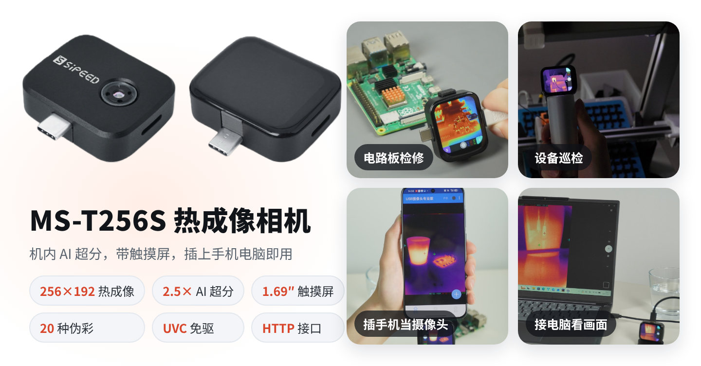
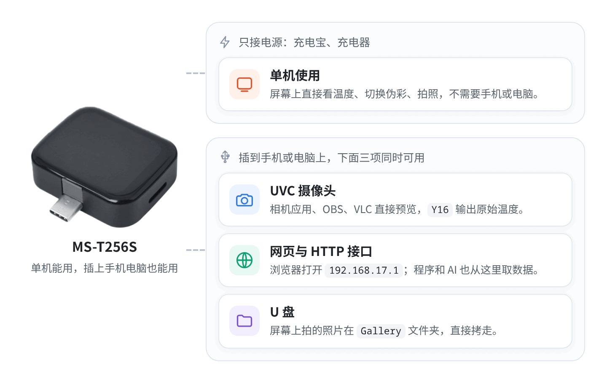
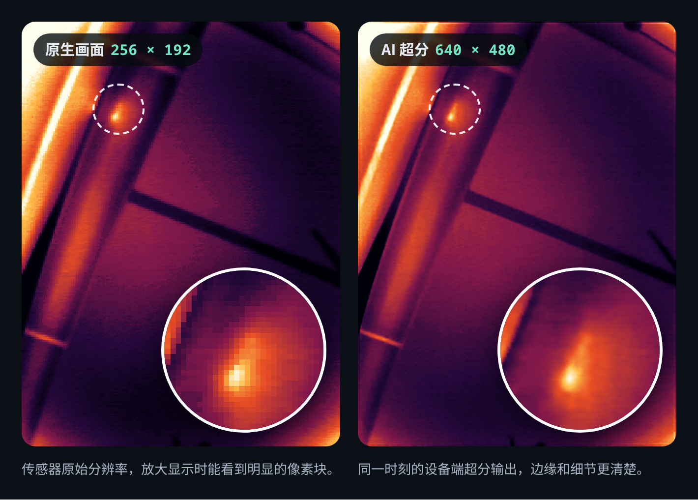
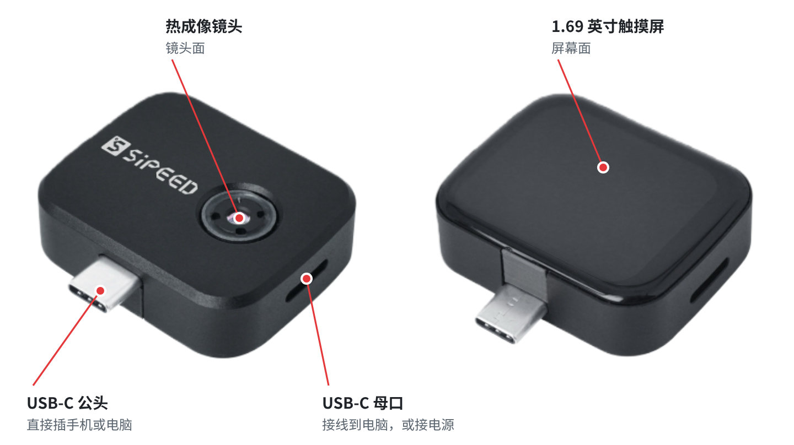

# 简介

Sipeed MS-T256S 是一台带触摸屏的口袋热成像相机，热成像分辨率 256 × 192，机身里的 NPU 会把画面实时超分到 640 × 480。
接上充电宝，它就是一台独立的热像仪，在屏幕上看温度、换伪彩、拍照；插到手机或电脑上，它又是一个免驱的 UVC 摄像头，同时提供网页和 HTTP 接口。
适合电路板维修、设备巡检和暖通检查，也适合想把热成像接进自己程序或 AI 工具的开发者。

## 单机能用，插上也能用

T256S 没有电池，通过 USB-C 取电。只接电源时，它是一台独立的热像仪；插到手机或电脑上时，屏幕照常工作，同时还多出三样东西：

- **UVC 摄像头**：系统把 T256S 识别成一个摄像头，相机应用、OBS、VLC 打开就是超分后的伪彩画面，不用装驱动。Y16 格式还能输出每个像素的原始温度。
- **网页与 HTTP 接口**：同时多出一块 USB 网卡。用浏览器打开 `192.168.17.1`，可以看实时画面、多点测温、拍照录像；程序和 AI 工具也从这里读取温度。需要固件 26.40.0 或更高版本。
- **U 盘**：在屏幕上拍的照片存在设备里，插到电脑上会出现一个 U 盘，照片在 `Gallery` 文件夹里，直接拷走即可。

> iPhone 不支持 UVC 摄像头，但 USB-C 接口的 iPhone 可以用 Safari 打开网页。各平台的具体用法见[快速上手](./Quick_Start.html#连接手机或电脑)。

## 核心特性

1. **设备端 AI 超分**：机身 NPU 把 256 × 192 的画面实时放大 2.5 倍到 640 × 480，边缘和小热点更清楚。屏幕、摄像头和网页默认显示的都是超分画面；温度读数始终来自原始数据，不受超分影响。
2. **自带触摸屏，单机可用**：1.69 英寸触摸屏，双击放大、左右滑动换伪彩、点一下拍照，接上充电宝就能拿着巡检。
3. **UVC 免驱摄像头**：MJPEG 格式输出伪彩画面，相机应用、会议和直播软件都能直接用；Y16 格式输出原始温度，方便二次开发。
4. **网页与 HTTP 接口**：浏览器即开即用，支持超分对比、最多 12 个点同时测温、拍照录像；用 `curl` 就能读温度、抓画面，也能交给 AI 工具分析。
5. **20 种伪彩**：白热、黑热、铁红、彩虹等，屏幕和网页上都能切换。
6. **两档测温自动切换**：默认用高增益档（-15 ~ 150 ℃）保证精度；画面里高温区域较多时，自动切到低增益档（50 ~ 500 ℃）扩大量程。
7. **铝合金机身**：6061 铝合金 CNC 加工，结构结实，散热好。

> 名词解释：**伪彩**是把看不见的温度差异映射成颜色，比如铁红配色里越亮越热；**超分**（超分辨率）是用算法把低分辨率画面放大并补出细节；**UVC** 是 USB 摄像头的通用标准，符合标准的摄像头不用装驱动；**Y16** 是每个像素 16 位的原始图像格式，T256S 用它输出温度数据。

## 实拍效果

下图是 T256S 同一时刻输出的原生画面和超分画面（铁红配色），右下角的圆圈是虚线圈内的局部放大。原生画面放大后能看到明显的像素块，超分画面的边缘更平滑，小热点的轮廓也更清楚。

超分在设备里完成，所以不管接在电脑、手机还是树莓派上，看到的都是同样的超分画面，不占用对方的算力。

## 技术规格

一句话概括：256 × 192 热成像，25 Hz，机内 2.5 倍 AI 超分到 640 × 480，-15 ~ 500 ℃ 两档自动切换，带 1.69 英寸触摸屏。

| 项目 | 规格 |
| :--- | :--- |
| 热成像分辨率 | 256 × 192（长波红外） |
| AI 超分输出 | 640 × 480（2.5 倍，机身 NPU 实时处理） |
| 帧率 | 25 Hz |
| 测温范围 | 高增益档 -15 ~ 150 ℃；低增益档 50 ~ 500 ℃；自动切换 |
| 测温精度 | ±2 ℃ 或读数的 ±2% |
| 温差灵敏度（NETD） | < 50 mK @ 25 ℃ |
| 视场角（FOV） | 56° × 42° |
| 屏幕 | 1.69 英寸 240 × 280 电容触摸屏 |
| 伪彩 | 20 种 |
| 接口 | USB-C 公头 + USB-C 母口 |
| USB 功能 | UVC 摄像头（MJPEG、Y16）、USB 网卡（网页与 HTTP 接口）、U 盘 |
| 照片存储 | 机身内置，约 36 MB，插电脑后以 U 盘形式访问 |
| 网页与 HTTP 接口 | 固件 26.40.0 及以上 |
| 供电 | USB 5 V，无内置电池 |
| 尺寸 | 42 × 32 × 13 mm |
| 外壳 | 6061 铝合金，CNC 加工 |

> 名词解释：**NETD**（噪声等效温差）表示能分辨的最小温差，数值越小越灵敏；**视场角**是镜头能看到的范围，56° × 42° 在 1 米外大约覆盖 106 × 77 cm 的区域，每个像素约对应 4 mm。

## 外观与接口

T256S 正面是热成像镜头，背面是 1.69 英寸触摸屏，机身上有两个 USB-C 接口：

- **USB-C 公头**：直接插进手机或电脑的 USB-C 口，不需要线。
- **USB-C 母口**：用 USB-C 数据线连接电脑，或者接充电宝、充电器单独供电。

机身没有电池，也没有实体按键，接上电就会开机，所有操作都在触摸屏上完成。

配合微距镜头，可以在约 5 cm 的距离观察电路板上的小元件，例如 0402 封装的贴片电阻。安装和使用方法见[快速上手](./Quick_Start.html#微距镜头)。

## 适用场景

- **电子维修与研发**：找出电路板上异常发热的元件、短路点和过载的电源器件；配合微距镜头可以看清小封装元件。
- **设备巡检**：接上充电宝拿在手里，检查电机、配电箱、插排等是否过热。
- **暖通与建筑**：查看墙面和门窗漏热、地暖管走向、保温层缺陷和空调出风温度。
- **开发与 AI 应用**：通过 Y16 或 HTTP 接口读取温度数据，做温度监测、报警和记录，或者交给 AI 工具分析。

## 和 MS-T160 怎么选

| | MS-T256S | MS-T160 |
| :--- | :--- | :--- |
| 热成像分辨率 | 256 × 192 | 160 × 120 |
| AI 超分 | 设备本地超分，输出 640 × 480 | 浏览器本地超分，输出 480 × 360 |
| 测温范围 | -15 ~ 150 ℃ / 50 ~ 500 ℃，自动切换 | 0 ~ 120 ℃ |
| 屏幕 | 1.69 英寸触摸屏，可脱离电脑单独使用 | 无，用手机或电脑浏览器查看 |
| 连接方式 | UVC 摄像头，另提供网页和 HTTP 接口 | USB 网卡 + 设备自带网页 |
| 适合 | 需要更高分辨率、机身屏幕或摄像头输出 | 想用最低成本在手机上看热图 |

MS-T160 的详细资料见 [MS-T160 文档](../T160/Introduction.md)。

## 相关链接

- 购买：[淘宝](https://item.taobao.com/item.htm?id=1042038028765)
- 固件下载：[Sipeed 下载站](https://dl.sipeed.com/shareURL/ThermalCam/T256s/firmware)
- 支持邮箱：support@sipeed.com
- 社区（Discord）：[discord.gg/V4sAZ9XWpN](https://discord.gg/V4sAZ9XWpN)
- X / Twitter：[@SipeedLab](https://x.com/SipeedLab)
- Sipeed GitHub：https://github.com/sipeed

## 下一步

拿到 T256S 后，先看[快速上手](./Quick_Start.md)：接上电源就能看到画面，再一步步学会读温度、换伪彩、拍照，以及连接手机和电脑。
