# 快速上手

T256S 拿到手就能用：接上电源，屏幕上马上出现热成像画面和温度。
本页先讲单机怎么用：认识屏幕、读温度、换伪彩、拍照；再讲插到手机或电脑上怎么用：浏览器网页、UVC 摄像头和 U 盘。

> 本页按固件 26.47.0 编写。如果你的屏幕右侧是一列竖排的按钮，和下面的截图不一样，说明设备还是旧版固件，建议先按[进阶使用与开发](./Advanced.html#更新固件)中的步骤升级。

## 准备

- 一台 MS-T256S。
- 一个 USB-C 电源：充电宝、手机充电器或电脑的 USB 口都可以。T256S 没有内置电池。
- 想在大屏上看画面或读取数据时，再准备一台手机、平板或电脑；接电脑时还需要一根能传数据的 USB-C 线。

## 开机

把 T256S 接上电源，任选一种方式：

- **USB-C 母口**：用数据线接充电宝、充电器或电脑。
- **USB-C 公头**：直接插在手机或电脑的 USB-C 口上。部分安卓手机需要先在设置里打开 **OTG**。

屏幕会立即点亮并显示开机画面，等 10 秒左右，就会进入实时热成像画面。

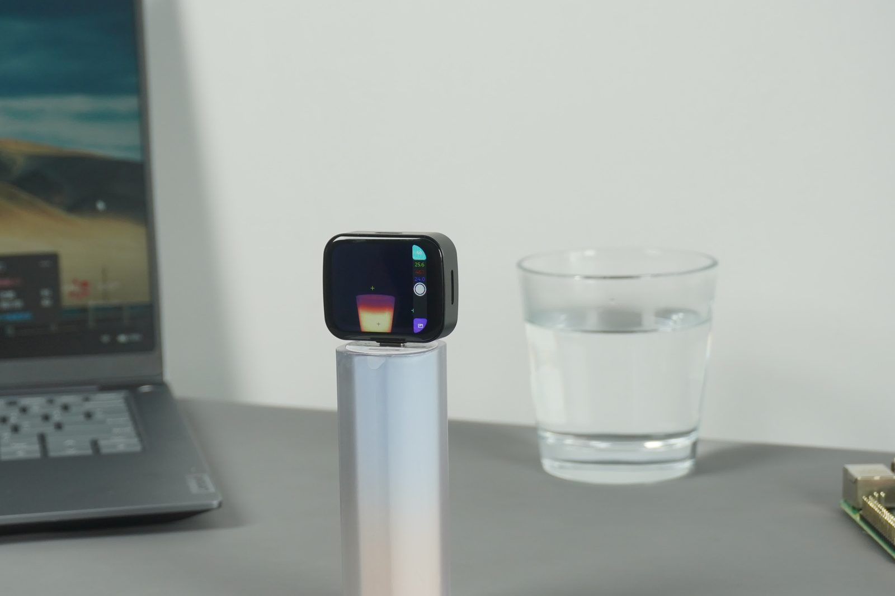

> 供电不足时，设备可能反复重启或闪屏。请使用稳定的 5 V 电源和质量好的数据线，见[常见问题](./FAQ.html#屏幕反复重启或闪烁)。

## 认识屏幕

屏幕主体是实时热成像画面，四周叠着几项信息，红色数字对应下表：

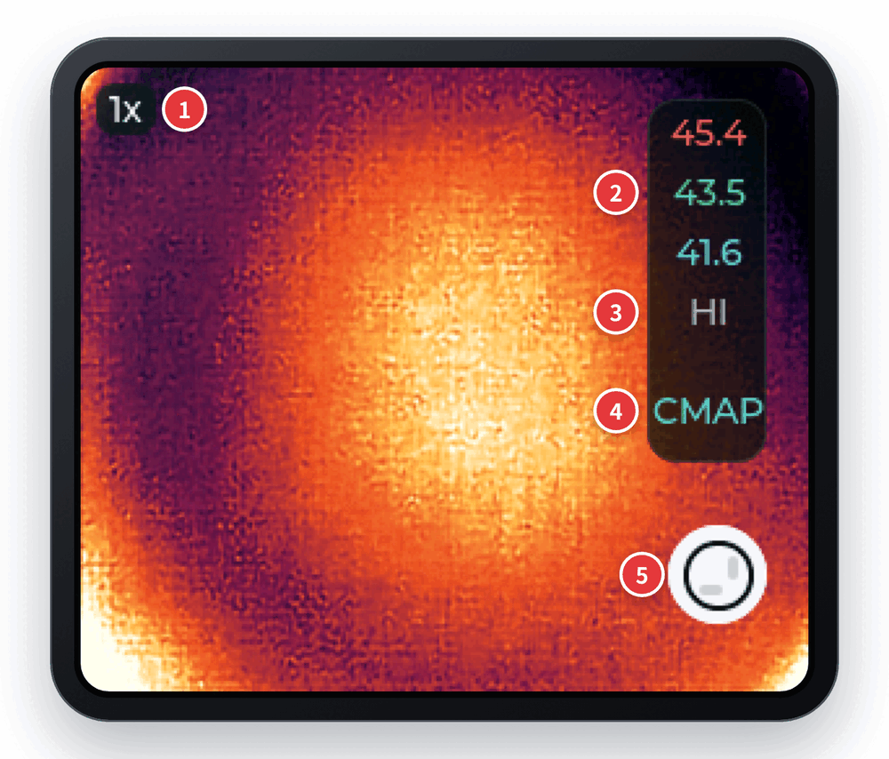

| 编号 | 名称 | 说明 |
| :---: | :--- | :--- |
| 1 | 缩放 | 当前缩放倍数，`1x` 或 `2x` |
| 2 | 温度 | 从上到下依次是画面最高温（红）、中心点温度（绿）、最低温（蓝），单位 ℃ |
| 3 | 增益档 | `HI` 为高增益档，`LO` 为低增益档，见[读温度](#读温度) |
| 4 | 伪彩 | 当前伪彩的简称，部分伪彩统一显示为 `CMAP`，完整名称可以在状态面板里查看 |
| 5 | 拍照 | 点一下保存当前画面 |

### 手势操作

屏幕上没有多余的按钮，常用操作都靠手势，红色数字对应下表：

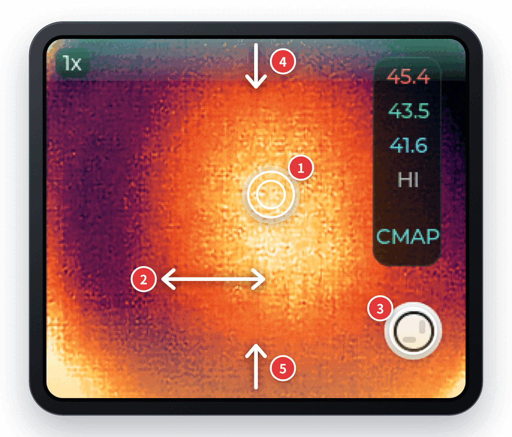

| 编号 | 手势 | 作用 |
| :---: | :--- | :--- |
| 1 | 双击画面 | 在 1x 和 2x 之间切换，2x 放大显示画面中心区域 |
| 2 | 在画面上左右滑动 | 切换到下一个或上一个伪彩 |
| 3 | 点拍照按钮 | 保存照片，画面闪一下白色并提示 `SAVED` |
| 4 | 从屏幕顶边往下拉 | 打开状态面板：第一次下拉显示常用开关，继续下拉显示完整状态；往上滑逐段收起 |
| 5 | 从屏幕底边往上滑 | 打开相册 |

> 顶部和底部的手势要从屏幕边缘开始滑，从画面中间开始滑会被当成切换伪彩。状态面板打开时，要先把它收起，才能从底边打开相册。

状态面板里可以开关屏幕超分、把界面旋转 180°、修改网段，还能看到固件版本和设备地址，详见[状态面板](./Advanced.html#状态面板)。

## 读温度

屏幕右侧的三个数字一直在实时更新：

- **最高温**（红）和**最低温**（蓝）：整个画面里最热和最冷的点。
- **中心温度**（绿）：画面正中间的温度。想测某个物体，把它对准画面中心即可。

T256S 有两个测温档位，会根据画面自动切换，屏幕上显示当前所在的档位：

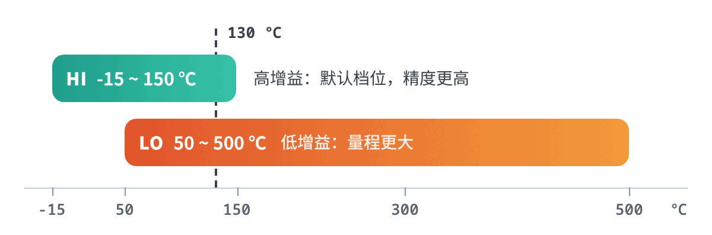

- **HI（高增益）**：默认档位，-15 ~ 150 ℃，精度更高。人体、电路板、室内环境这类日常目标都在这一档。
- **LO（低增益）**：50 ~ 500 ℃，量程更大。画面里超过 130 ℃ 的区域多于十分之一时自动切到这一档；画面几乎全部降到 110 ℃ 以下后，自动切回 HI。

测温精度为 ±2 ℃ 或读数的 ±2%。刚开机时读数会有一些漂移，等 2 分钟左右再测更准。测量光亮的金属表面时读数会明显偏低，原因和解决方法见[常见问题](./FAQ.html#测量的温度不准)。

## 切换伪彩

在画面上左右滑动即可切换伪彩，一共 20 种，每次开机默认是铁红。下图是同一个画面在 20 种伪彩下的效果，编号就是切换的顺序：

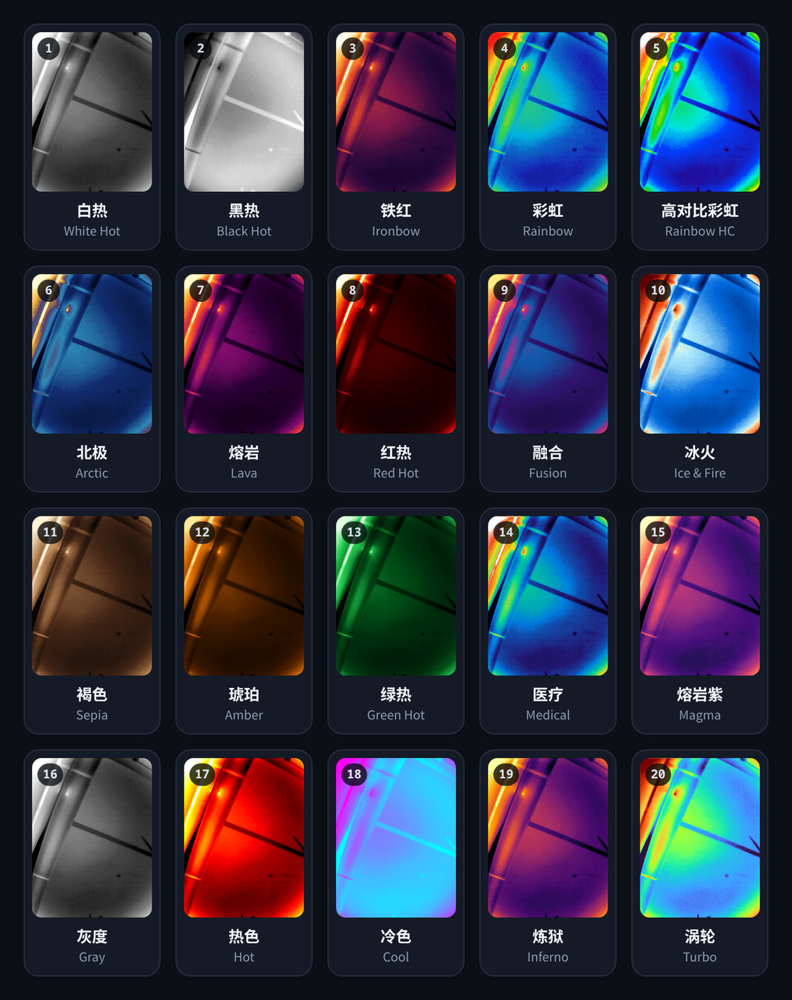

伪彩只改变颜色，不影响温度读数。几种常用的：

- **铁红**：越亮越热，冷热分明，适合大多数场景。
- **白热、黑热**：灰度显示，适合看物体的轮廓和细节。
- **彩虹、高对比彩虹**：颜色层次多，适合分辨细微的温差。

设备屏幕、UVC 摄像头和网页共用同一个伪彩设置，在屏幕上或网页上切换，其他地方的画面也会跟着变。

## 拍照和查看照片

- **拍照**：点屏幕上的拍照按钮，画面闪一下白色并提示 `SAVED`，照片就存进了设备。照片是 480 × 640 的 JPEG，带当前的伪彩，不含屏幕上叠加的温度数字。
- **看照片**：从屏幕底边往上滑打开相册，左右滑动翻看，屏幕上会显示当前是第几张、一共几张；往下滑回到实时画面。还没有照片时会提示 `GALLERY EMPTY`。
- **删照片**：在相册里长按当前照片，屏幕提示 `HOLD AGAIN TO DELETE`，再长按一次即删除。删除后无法恢复。

照片的文件名记录了拍摄时的温度，例如 `P1_T25.8_22.0_30.8.jpg` 表示第 1 张，中心 25.8 ℃，最低 22.0 ℃，最高 30.8 ℃。把 T256S 插到电脑上，就能从 U 盘里拷出这些照片，见下文的[拷出照片](#拷出照片)。

> ⚠️ T256S 插在电脑上、电脑正在使用它的 U 盘时，请先在电脑上安全弹出 U 盘，再在屏幕上拍照或删照片，否则两边看到的文件可能不一致。拍照和删除时不要突然断电。

## 连接手机或电脑

把 T256S 插到手机或电脑上（公头直插，或者用数据线接母口），屏幕照常工作，同时还会多出三样东西：

| 功能 | 用来做什么 | 怎么打开 |
| :--- | :--- | :--- |
| 网页 | 在浏览器里看画面、超分对比、多点测温、拍照录像 | 浏览器打开 `192.168.17.1` |
| UVC 摄像头 | 在相机应用、OBS、会议软件里使用画面 | 在软件的摄像头列表里选择 T256S |
| U 盘 | 拷出在屏幕上拍的照片 | 打开电脑上新出现的 U 盘 |

三项可以同时使用。只想在大屏上看画面的话，网页最省事，不用装任何软件。

### 用浏览器打开网页

> 网页需要固件 26.40.0 或更高版本。查看版本的方法见[查看固件版本](./Advanced.html#查看固件版本)。

1. 把 T256S 插到手机或电脑上，等几秒，让系统识别出新的网络：
   - **手机**：可能提示"网络无法访问互联网"，这是正常的。T256S 提供的是一个只连着你手机的本地网络，本来就不能上网。
   - **电脑**：会多出一块有线网卡，并自动获得 `192.168.17.x` 的地址。
2. 打开浏览器，在地址栏输入 `192.168.17.1`。部分安卓手机会弹出"登录到网络"之类的通知，点开它也会打开同一个网页（地址显示为 `ir.sipeed.com`）。
3. 几秒后应该能看到 **T256S 热成像** 页面和实时画面，状态栏右侧显示实际帧率。

> 安卓手机输入地址后打不开时，先打开飞行模式（如果 Wi-Fi 还开着，也关掉）再试，原因见[常见问题](./FAQ.html#浏览器打不开-192.168.17.1)。iPhone 不会自动弹出网页，在 Safari 里手动输入地址即可，仅支持 USB-C 接口的 iPhone。

下图是手机上的网页界面，红色数字对应下表：

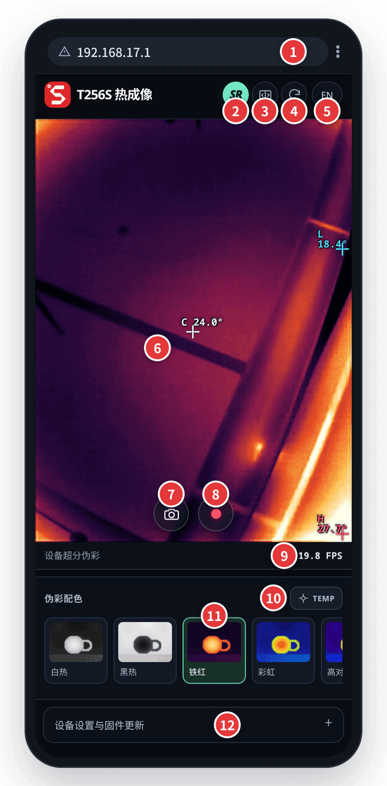

| 编号 | 名称 | 作用 |
| :---: | :--- | :--- |
| 1 | 地址栏 | 设备地址，默认是 `192.168.17.1` |
| 2 | 超分（SR） | 在设备超分画面和原生画面之间切换 |
| 3 | 对比 | 左右分屏对比超分画面和原生画面，见[超分对比](#超分对比) |
| 4 | 旋转 | 画面旋转 180° |
| 5 | 语言 | 在中文和英文界面之间切换 |
| 6 | 温度标注 | H 为最高温，L 为最低温，C 为中心点温度 |
| 7 | 拍照 | 把当前画面保存成 PNG 图片 |
| 8 | 录像 | 开始录像，再点一次停止并保存 |
| 9 | 状态栏 | 左边是当前画面模式，右边是实际帧率 |
| 10 | 多点测温（TEMP） | 进入多点测温模式，见[多点测温](#多点测温) |
| 11 | 伪彩配色 | 左右滑动选择配色，和设备屏幕同步 |
| 12 | 设备设置与固件更新 | 展开后查看固件版本、修改网段、更新固件；点页面标题也能打开 |

### 超分对比

点顶部的**对比**按钮，画面会被一条竖线分成两半：左边是设备超分画面，右边是原生画面。按住竖线左右拖动，可以直观看到超分的效果。再点一次对比按钮即可退出。

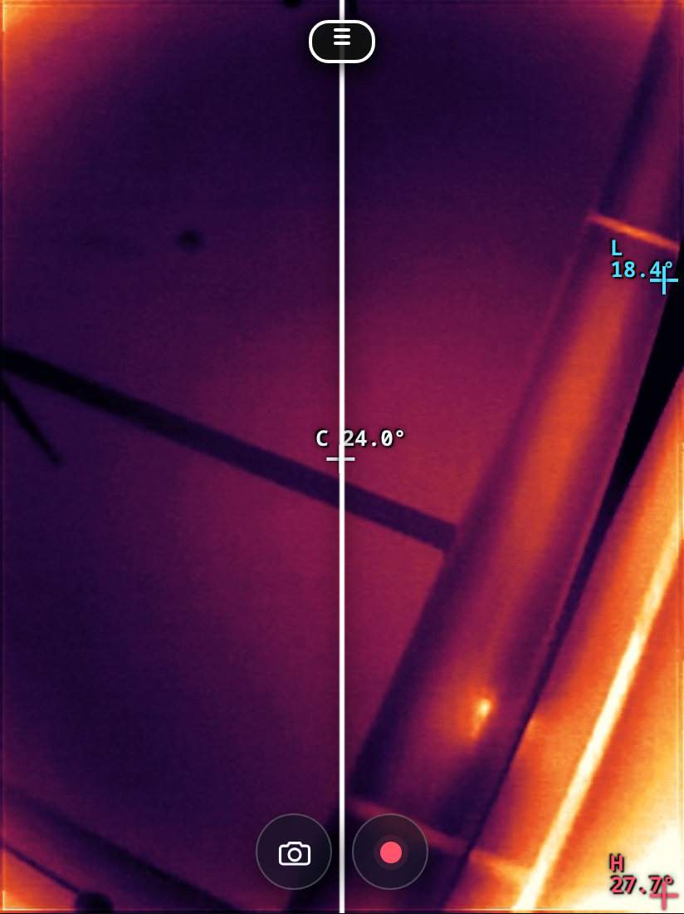

### 多点测温

点伪彩配色右侧的 **TEMP** 按钮，进入多点测温模式。这时网页直接读取每个像素的原始温度，点击画面上的任意位置就会添加一个测温点（M1、M2……），最多 12 个，温度实时刷新。在下方列表里可以删除单个测温点，点**清空**删除全部。再点一次 TEMP 退出。

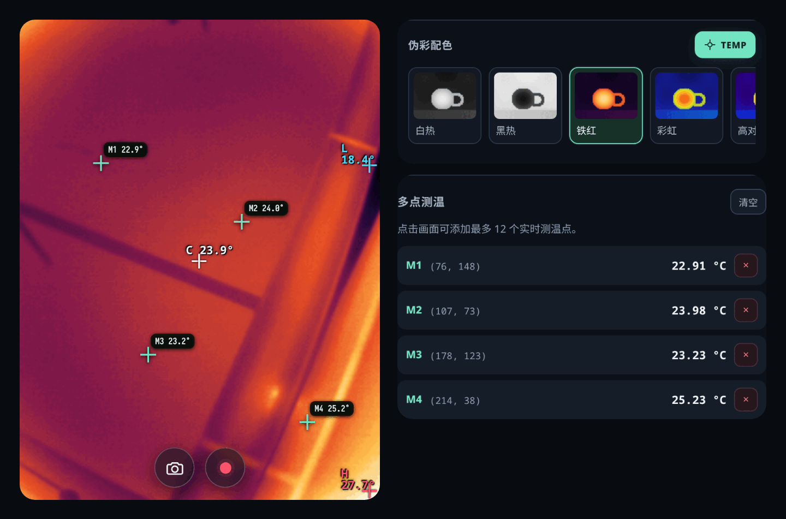

多点测温模式显示的是 256 × 192 的原生画面，列表里的坐标也基于原生画面。

### 网页拍照和录像

- **拍照**：点相机按钮，当前画面会保存成一张 PNG 图片，文件名以 `thermal-` 开头，后面是保存时间。
- **录像**：点红色圆点开始录像，状态栏显示"正在录像"；再点一次停止并保存为 `thermal-record.mp4`，部分浏览器保存为 `.webm`。

照片和录像由浏览器保存到手机或电脑的下载目录。保存的是画面本身（含伪彩和超分效果），**不含** H、L、C 等温度标注。需要温度数值时，以网页上的读数为准，或者用 [HTTP 接口](./API.md)读取。

### 当作 UVC 摄像头

T256S 是标准的 UVC 摄像头，电脑、安卓手机和 iPad 都能直接识别，不用装驱动。在软件的摄像头列表里，它一般显示为 **UVC Camera** 或 **Thermal Camera (UVC)**。摄像头输出的是 480 × 640 的竖幅超分画面，伪彩跟随设备当前的设置。

#### Windows

用系统自带的"相机"应用，或者 OBS Studio、VLC、PotPlayer 等软件，在摄像头列表里选择 T256S 即可。

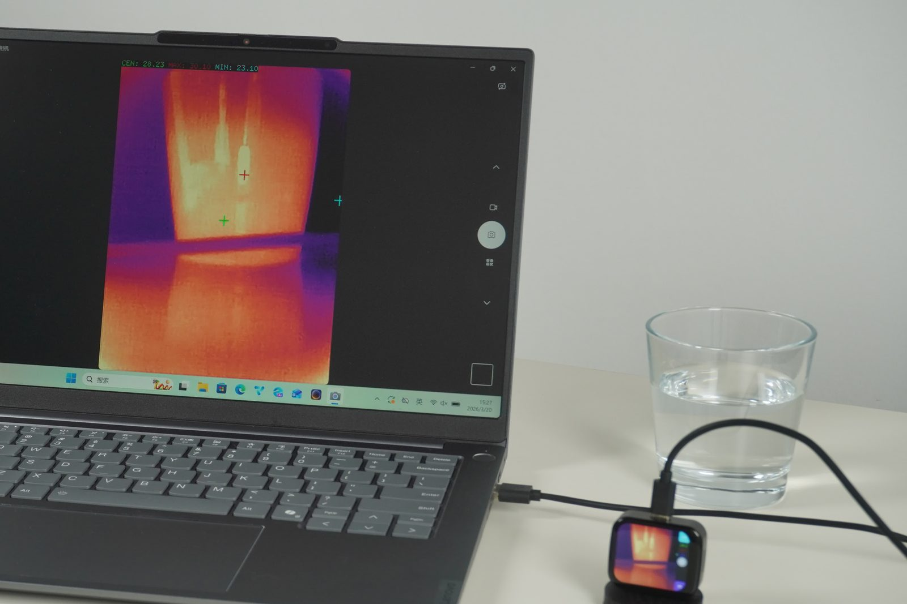

#### macOS

打开"Photo Booth"，在菜单栏的"摄像头"里选择 **UVC Camera**：

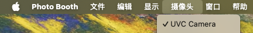

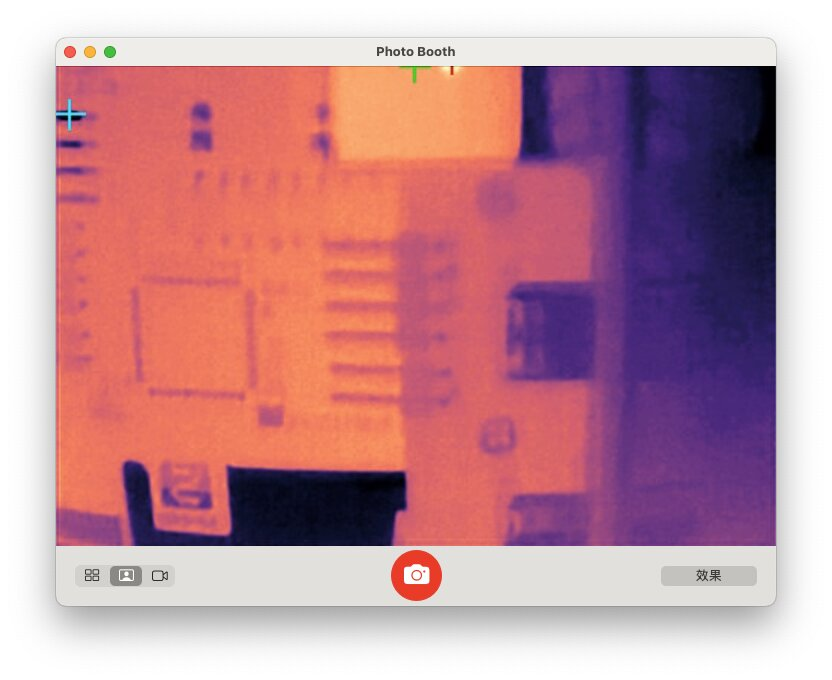

#### Linux 和树莓派

T256S 会出现在 `/dev/video*`，用 `guvcview`、`cheese` 或 `ffplay` 等软件打开即可：

```bash
# 找到 Thermal Camera (UVC) 对应的设备，例如 /dev/video0
v4l2-ctl --list-devices
# 打开画面（把 video0 换成上一步找到的设备）
ffplay -f v4l2 -input_format mjpeg /dev/video0
```

提示权限不足时，用 `sudo` 运行，或者把当前用户加入 `video` 组。

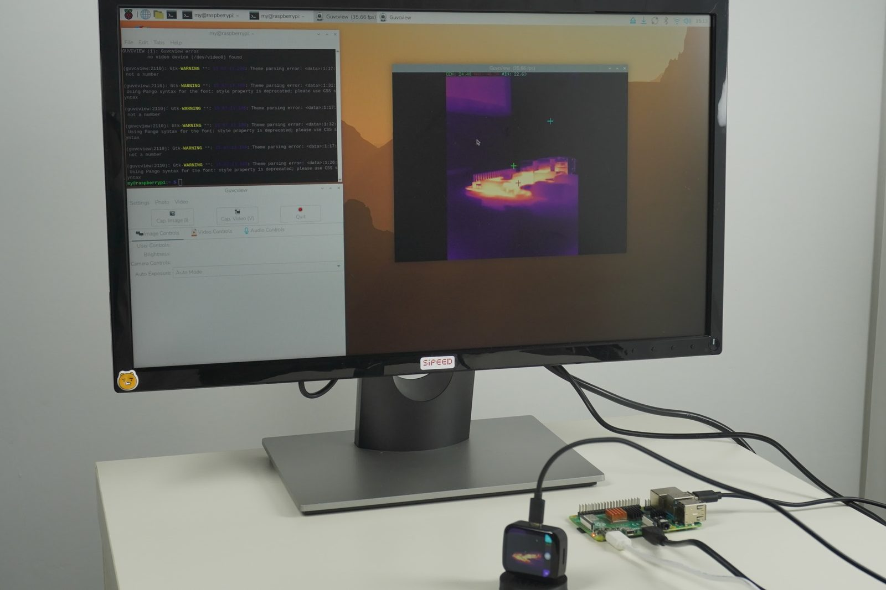

#### 安卓手机

1. 安装一个支持 UVC 的摄像头 App，例如"USB 摄像头"（USB Camera）这一类应用。
2. 把 T256S 插到手机上，App 请求访问 USB 设备时点"确定"，就能看到画面。
3. T256S 插在手机底部时，画面相对手机是倒过来的。在 App 里把画面旋转 180°，或者同时打开水平镜像和垂直镜像即可。

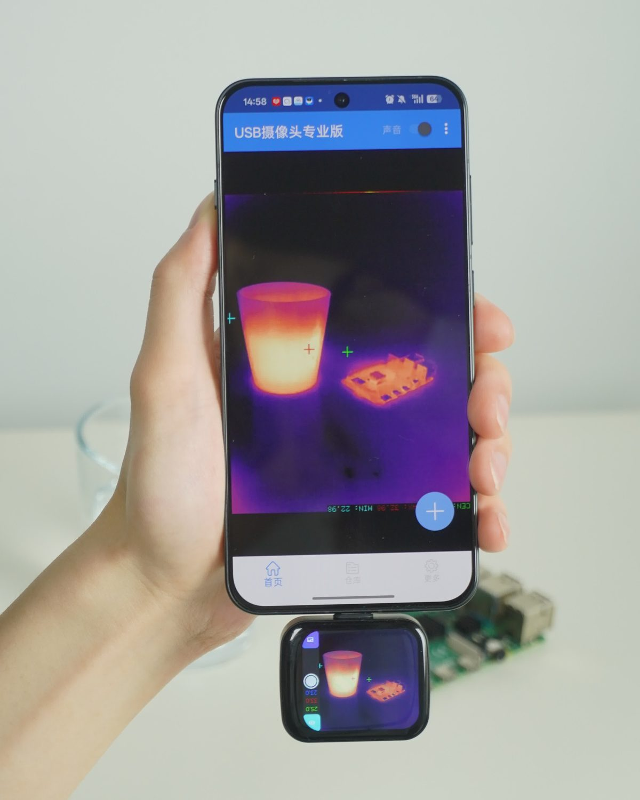

#### iPad 和 iPhone

- **iPad**：USB-C 接口的 iPad 可以用支持 UVC 的相机 App 看画面，例如 [CamX - USB Camera](https://apps.apple.com/cn/app/camx-usb-camera/id6453639083)。画面方向不对时，在 App 里旋转画面。
- **iPhone**：不支持 UVC 摄像头。USB-C 接口的 iPhone 可以改用网页，见[用浏览器打开网页](#用浏览器打开网页)。

### 拷出照片

插到电脑上后，电脑里会多出一个约 36 MB 的 U 盘，屏幕上拍的照片都在 `Gallery` 文件夹里，直接复制出来即可。

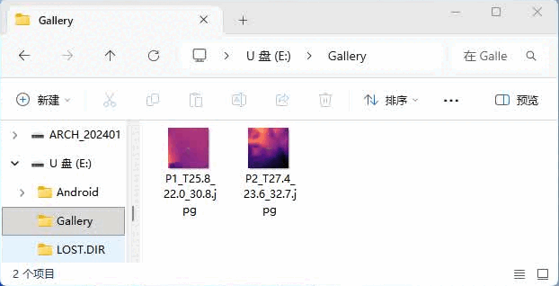

## 微距镜头

想看清电路板上的小元件，可以在热成像镜头前装上微距镜头：

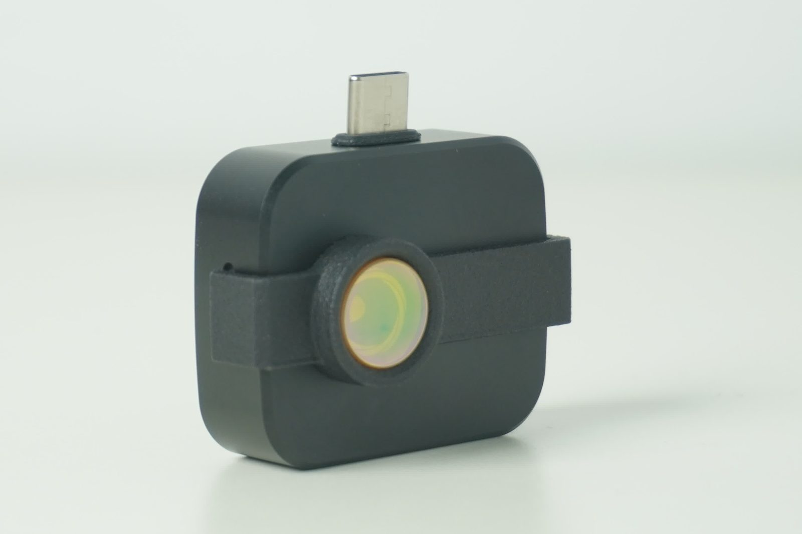

- **工作距离约 5 cm**：把 T256S 放在离目标约 5 cm 的位置，前后微调找到最清楚的位置。微距的景深很浅，需要一点耐心。
- 装上后可以看清 0402 封装贴片元件的发热情况。
- 微距下局部温差会被放大，风吹或手的热量都会影响画面，建议在室内无风的环境下使用。
- 装上微距镜头后，温度读数会有一定误差；需要准确读数时，取下微距镜头再测。
- 安装和取下时轻拿轻放，不要用力按压或划伤热成像镜头。

## 下一步

- 想查看和更新固件、同时接多台设备，或者从 UVC 读取原始温度：见[进阶使用与开发](./Advanced.md)。
- 想用程序读取温度和画面：见 [HTTP 接口](./API.md)。
- 想让 AI 工具读取温度并给出结论：见 [AI 接入](./AI_Control.md)。
- 遇到问题：见[常见问题](./FAQ.md)。
