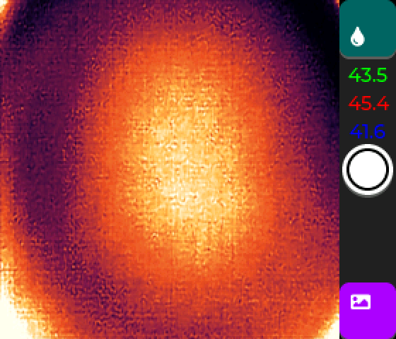
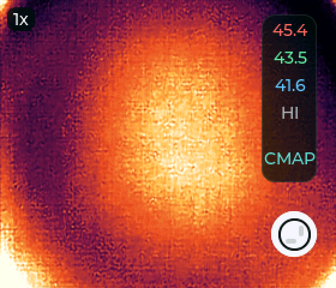
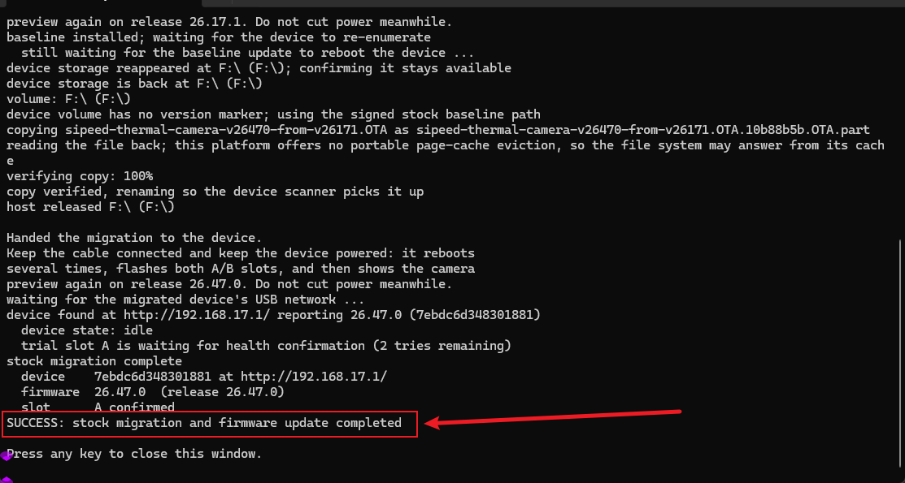
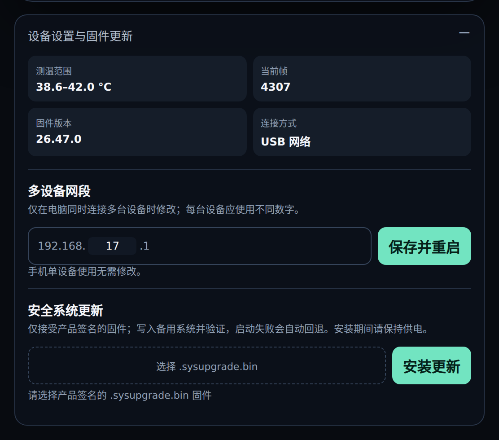

## 简介

T256s 的系统更新有两种方式，按当前版本选择：

+ 升级脚本：适用于 26.17.1 及之前的系统。脚本会把设备迁移到新的双系统布局，并升级到 26.47.0；
+ 网页升级：26.17.1 之后的系统，在设备网页里上传固件升级。

## 升级前先确认版本

查看版本的方式和系统版本有关。

### 26.17.1 及之前

长按机身拍摄按键，屏幕会显示当前版本信息，其中 `version=` 一行就是固件版本号：

### 26.17.1 之后

从屏幕顶部边缘向下滑动打开状态面板，面板里会有一行 `FW` 开头的版本信息，例如 `FW 26.47.0   192.168.17.1`；也可以展开设备网页底部的「设备设置与固件更新」，在「固件版本」一栏查看。

按下表选择升级方式：

| 当前版本 | 怎么做 |
| --- | --- |
| 26.17.1 及之前 | 运行升级脚本，脚本会升级到 26.47.0 |
| 26.17.1 之后 | 在网页里升级 |

## 方式一：运行升级脚本（26.17.1 及之前）

26.17.1 及之前的系统需要先运行升级脚本。脚本会检查设备状态、把设备迁移到新的双系统布局，并升级到 26.47.0。

1. 打开 [Sipeed 下载站](https://dl.sipeed.com/shareURL/ThermalCam/T256s/firmware)，下载 `T256S-v26470-stock-migration.zip`。
2. 解压压缩包。
3. 按包内的说明运行升级程序：Windows 双击 `.cmd` 文件，macOS 双击 `.command` 文件，Linux 运行可执行文件。
4. 运行期间保持相机与电脑的 USB 连接，不要拔线，也不要断电。
5. 脚本会自动完成升级，过程中设备会重启多次，屏幕黑屏属于正常现象，等待脚本结束即可。
6. 脚本窗口显示 `SUCCESS` 时表示升级完成，最后几行会给出设备号和升级后的固件版本：

7. 按上一节的方法确认版本号已经变化（截图中的设备为 26.47.0）。

> 升级会重建设备内部存储，设备里保存的照片会丢失。升级前先把需要的照片导出到电脑或手机。

> 脚本运行失败时，按提示重新运行一次即可。如果提示设备可能正在转换，不要重启设备，等待几分钟再检查。

## 方式二：网页升级（26.17.1 之后）

网页升级需要 26.17.1 之后；用网页查看实时画面、调用 HTTP 接口需要 26.40.0 及以上，见[快速上手](QS.html)。

1. 用 USB 线连接相机，浏览器打开 `http://192.168.17.1`。
2. 打开设备网页里的系统更新入口。入口在页面底部的「设备设置与固件更新」，26.40.0 上叫「安全系统更新」，其他版本的名称可能略有不同。

3. 选择下载好的固件包，点「安装更新」或页面上对应的上传按钮。
4. 页面显示上传和校验进度，完成后设备自动重启。新系统启动失败时，会自动回退到升级前的系统。
5. 重启完成后，在「固件版本」一栏确认版本。

> 网页只接受官方发布的固件包，不要上传来路不明的文件，也不要改文件名。

> 上传和安装期间保持供电和 USB 连接。设备重启并进入系统之前，不要拔线。

## 常见问题

### 看不到版本号

26.17.1 及之前的系统，长按拍摄按键即可查看；26.17.1 之后，从屏幕顶部边缘向下滑动打开状态面板查看。如果屏幕没有亮，先确认设备已经开机；仍然没有反应时，换一根数据线或充电器，确认供电是否正常。

### 网页里找不到升级入口

请检查：

+ 是否已经连接到设备网页，页面能否正常显示；
+ 是否展开了页面底部的设置区域；
+ 当前版本是否支持网页升级。26.17.1 及之前的系统需要先运行升级脚本。

### 网页升级提示固件不被接受

请检查：

+ 是否从下载站下载了对应型号、对应版本的固件包；
+ 文件是否完整，可以重新下载一次；
+ 是否改过文件名。网页会按文件名和内容做校验。

### 升级脚本运行失败

请检查：

+ 相机是否已经通过 USB 连接，并且在电脑上能看到设备磁盘；
+ 是否按包内说明运行了对应系统的程序；
+ 关闭可能正在占用设备磁盘的程序后重试；
+ 如果提示设备可能正在转换，不要重启，等待几分钟后再检查版本。

### 升级后黑屏

升级过程中设备会重启，黑屏一段时间属于正常现象，等待设备自动进入开机画面即可。如果长时间黑屏，保持供电继续等待；仍然无法开机时联系官方售后。

### 升级过程中断电了

立即重新上电，等待设备自动恢复。网页升级带有回退机制；脚本升级过程不具备断电保护，断电可能导致设备无法开机，无法开机时联系官方返修，不要自行拆机。

### 26.17.1 及之前能直接在网页里升级吗

不能。26.17.1 及之前的系统需要先运行升级脚本升级到 26.47.0，之后才能在网页里继续升级。

## 注意事项

+ 升级全程保持供电，使用稳定的 USB 口或电源；
+ 不要拔线、强制重启，或在升级中途关闭电脑；
+ 只使用下载站提供的对应型号固件，不要改名或自己重新打包；网页升级用的 `.sysupgrade.bin` 不要解压；
+ 升级会重建设备存储，升级前先导出需要的照片；
+ 升级完成后先确认版本号，再进行其他操作。

## 下一步

+ 升级到 26.47.0 后，可以用浏览器直接查看画面和温度，见[快速上手](QS.html)；
+ 想用程序读取温度，见 [HTTP API](API.html)。
