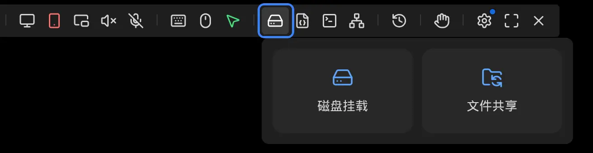
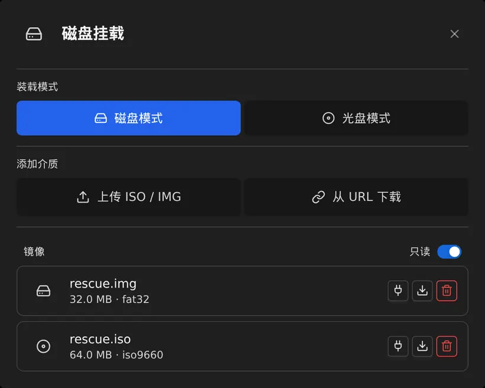
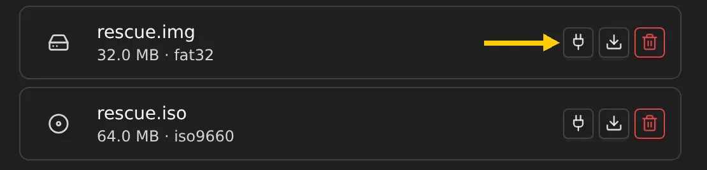
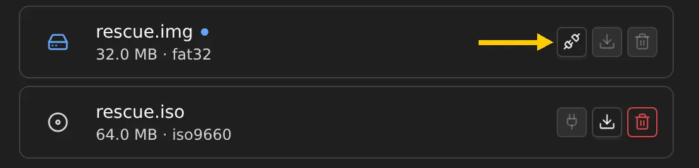
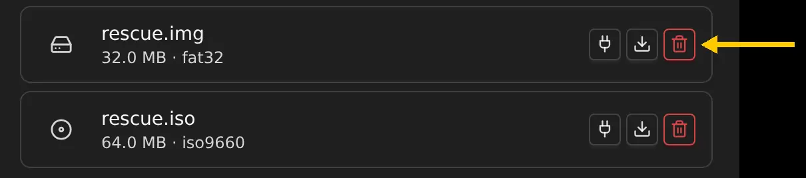
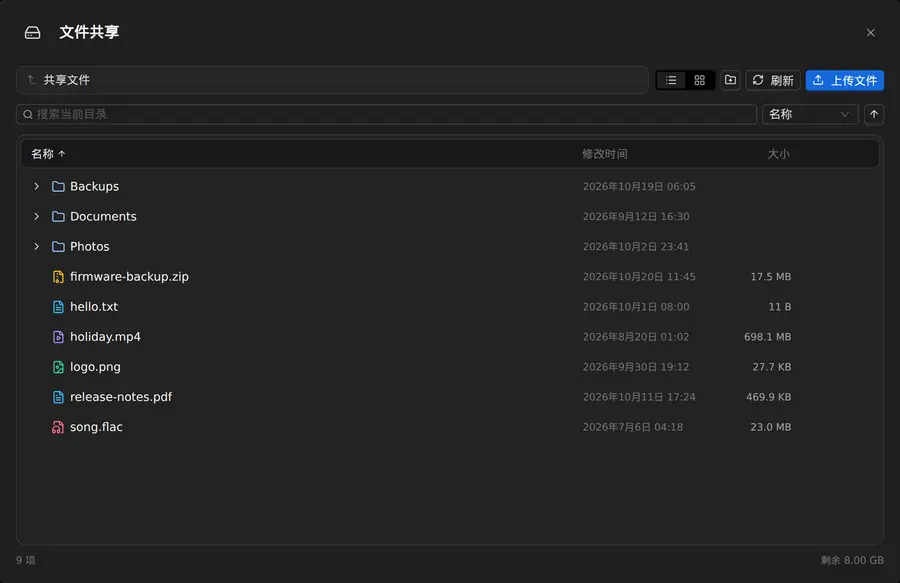

## 简介

NanoKVM 通过 HDMI 输入接口从被控设备采集画面，通过 USB-C 接口（PC-USB）向被控设备模拟键盘、鼠标、虚拟 U 盘和虚拟网卡。其中虚拟 U 盘有两种用法，入口都在悬浮栏的 `镜像挂载/文件共享`：

+ `磁盘挂载`：把一个 ISO 或 IMG 镜像交给被控设备，被控设备看到的是一个光驱或一块磁盘，适合安装系统、启动 PE 和修复系统；
+ `文件共享`：把 NanoKVM 上的数据分区交给被控设备，被控设备看到的是一块可移动磁盘，适合在两个方向传文件。

在网页控制端顶部的悬浮栏中点击硬盘图标，就能看到这两个选项：



## 工作原理

两种用法共用同一个 USB 存储设备：NanoKVM 把这台设备上的数据分区交给被控设备，数据分区里既可以存放镜像文件，也可以直接当作共享盘使用，因此同一时间只能提供一块介质。

```text
控制设备（浏览器）
|
| 上传 ISO / IMG、管理共享盘中的文件
v
NanoKVM
|
| 磁盘挂载：镜像文件（ISO / IMG）
| 文件共享：整个数据分区
|
| 通过 USB 大容量存储，同一时间只提供一块介质
v
被控设备
```

两种方式的区别：

+ `磁盘挂载` 直接使用数据分区中的镜像文件，不会复制镜像，也不额外占用空间；
+ `文件共享` 使用的是整块数据分区，不需要初始化，容量取决于数据分区的大小；
+ 共享盘交给被控设备时，本地存储变为只读，网页端只能浏览和下载；
+ 挂载镜像时会先收回共享盘；换用另一种方式前，先收回当前介质。

被控设备只能看到 NanoKVM 提供的那块磁盘或光驱，看不到 NanoKVM 自身的系统文件。

> `文件共享` 交给被控设备的是整块数据分区，里面的所有文件对连上的电脑都可见，不要在里面存放密码、密钥等敏感文件。

## 使用前准备

使用这两种功能前，请先确认：

+ NanoKVM 已连接被控设备：HDMI 接到被控设备的显示输出，USB-C（PC-USB）接到被控设备的 USB 口；
+ `设置 > 设备` 中的 `虚拟U盘` 已打开。该功能默认开启；
+ 没有开启 HID-Only 模式。HID-Only 会让 USB 只模拟键盘和鼠标，两种功能都不可用；
+ 当前没有正在进行的上传或下载。

## 磁盘挂载

### 添加镜像

在 `镜像挂载/文件共享` 中打开 `磁盘挂载`，在 `添加介质` 区域选择一种方式：

+ `上传 ISO / IMG`：把镜像文件拖入窗口，或点击选择文件，从控制设备上传；
+ `从 URL 下载`：填写镜像地址，由 NanoKVM 直接下载，下载过程中可以暂停、继续或取消；
+ `SCP`：把镜像上传到 NanoKVM 的 `/data` 目录；
+ 先在 `文件共享` 中把镜像上传到共享盘，镜像随后会出现在 `镜像` 列表中；
+ 把 NanoKVM 接到电脑上，`虚拟U盘` 打开时电脑会把它识别为一块可移动磁盘，可以直接把镜像复制进去。

上传和 URL 下载都可以填写可选的 SHA-256 校验值。填写后，只有校验一致的文件才会进入列表。

镜像会显示在 `镜像` 列表中，并标注文件大小和文件系统类型。



### 选择装载模式

装载模式决定被控设备把镜像识别成什么设备：

| 装载模式 | 被控设备看到 | 读写 | 支持的镜像 |
| --- | --- | --- | --- |
| `磁盘模式` | 一块磁盘 | 默认只读，关闭 `只读` 后可写 | ISO、IMG |
| `光盘模式` | 一个光驱 | 始终只读 | ISO、UDF |

装载模式只影响下一次装载。已经有镜像装载时，需要先弹出当前镜像才能切换模式。

### 装载镜像

1. 点镜像右侧的装载按钮（插头图标）；
2. 到被控设备上确认出现新的磁盘或光驱。



如果需要用这块介质启动，重启被控设备，在开机画面按启动菜单键（常见为 `F11`、`F12`、`ESC`），选择 NanoKVM 提供的磁盘或光驱。

### 弹出镜像

1. 先在被控设备的系统中安全弹出这块磁盘或光驱；
2. 回到网页，点镜像右侧的弹出按钮。



如果被控设备仍在使用介质，网页会提示强制收回。强制收回会让 USB 设备重新枚举，被控设备尚未写回的数据可能丢失，键盘、鼠标和虚拟网卡也会短暂断开。能安全弹出时不要强制收回。

### 删除镜像

不再需要的镜像可以点右侧的删除按钮删除，删除后文件不会进入回收站。



镜像正在被控设备上使用时删除按钮不可用。

## 文件共享

文件共享的用法是「先在网页里放文件，再交给被控设备取走」。共享盘就是设备上的数据分区，交给被控设备时本地存储是只读的，所以上传前要先关闭 `虚拟U盘` 开关。

### 上传文件

共享盘交给被控设备时，网页端只能浏览和下载，不能写入。上传前需要先把它收回：

1. 在 `设置 > 设备` 中关闭 `虚拟U盘` 开关；
2. 打开 `文件共享` 窗口，点 `上传文件`，或把文件拖入窗口；
3. 文件上传完成后，会出现在当前目录。

新建文件夹和删除文件同样要先关闭 `虚拟U盘` 开关；共享盘交给被控设备时，新建和删除按钮会变灰不可用。



### 交给被控设备

1. 确认要传的文件已经上传完成；
2. 在 `设置 > 设备` 中打开 `虚拟U盘` 开关；
3. 被控设备上出现可移动磁盘，进入磁盘即可取走文件；
4. 取完后关闭 `虚拟U盘` 开关收回共享盘，文件仍保留在数据分区中。

如果当前还挂着镜像，先在 `磁盘挂载` 中把它弹出。切换 `虚拟U盘` 开关会让 USB 重新枚举，被控设备的键盘和鼠标会短暂断开。

## 常见问题

### 被控设备中没有出现新的磁盘

请检查：

+ USB-C 是否已经连接到被控设备；
+ `设置 > 设备` 中的 `虚拟U盘` 是否已经启用；
+ 是否开启了 HID-Only 模式；
+ 用这块介质启动时，BIOS/UEFI 是否允许从 USB 启动。

### 装载按钮是灰色的

请检查：

+ 是否已经有镜像处于装载状态，需要先弹出当前镜像；
+ 是否正在上传或下载镜像，需要等待传输结束；
+ 光盘模式下，是否选了 ISO/UDF 以外的镜像。

### 添加介质的按钮是灰色的

共享盘正交给被控设备，本地存储暂时只读。先在 `设置 > 设备` 中关闭 `虚拟U盘` 开关，再上传镜像。

### 网页中无法上传文件

共享盘正交给被控设备，网页端只能浏览和下载。关闭 `虚拟U盘` 开关后，就可以上传、新建和删除文件。

### 上传的文件在被控设备上看不到

先确认上传已经完成，再检查 `设置 > 设备` 中的 `虚拟U盘` 开关是否已经打开。开关关闭时共享盘只留在 NanoKVM 上，被控设备看不到它。

### 被控设备写入的文件在网页中看不到

点一次刷新。被控设备可能还没有把数据写回磁盘，等待几秒后再刷新即可。

### 共享盘的容量有多大

共享盘就是设备上的数据分区，容量取决于设备存储空间的大小，网页端的 `文件共享` 窗口底部会显示剩余空间。

### 磁盘挂载和文件共享可以同时使用吗

不能。两种用法共用同一个 USB 存储设备，同一时间只能向被控设备提供一块介质。
