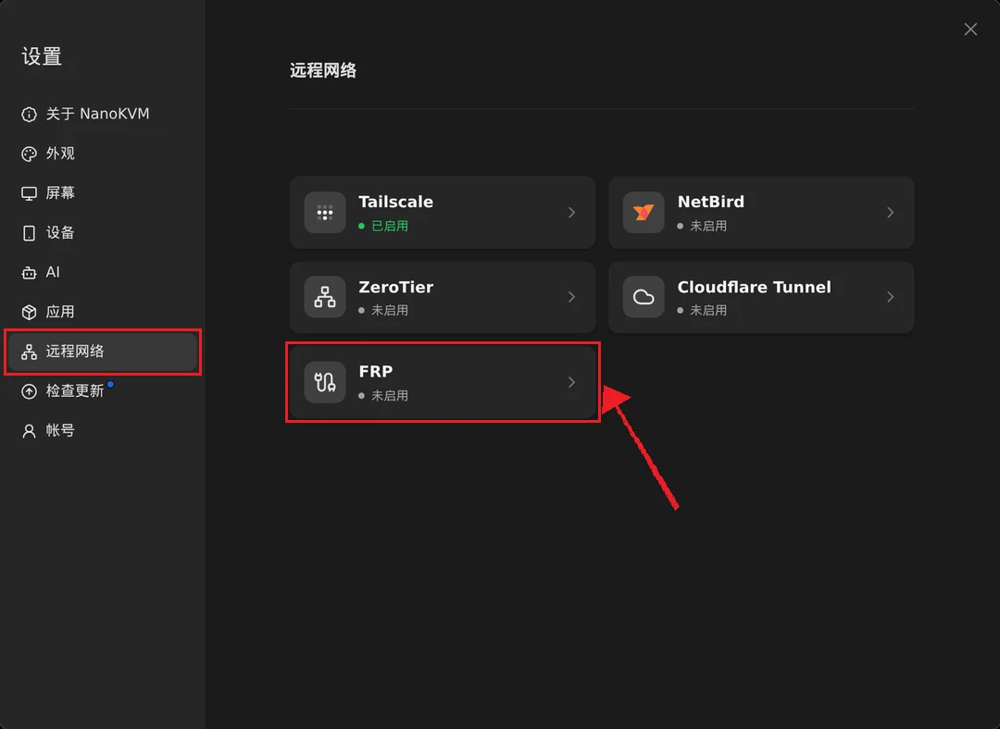
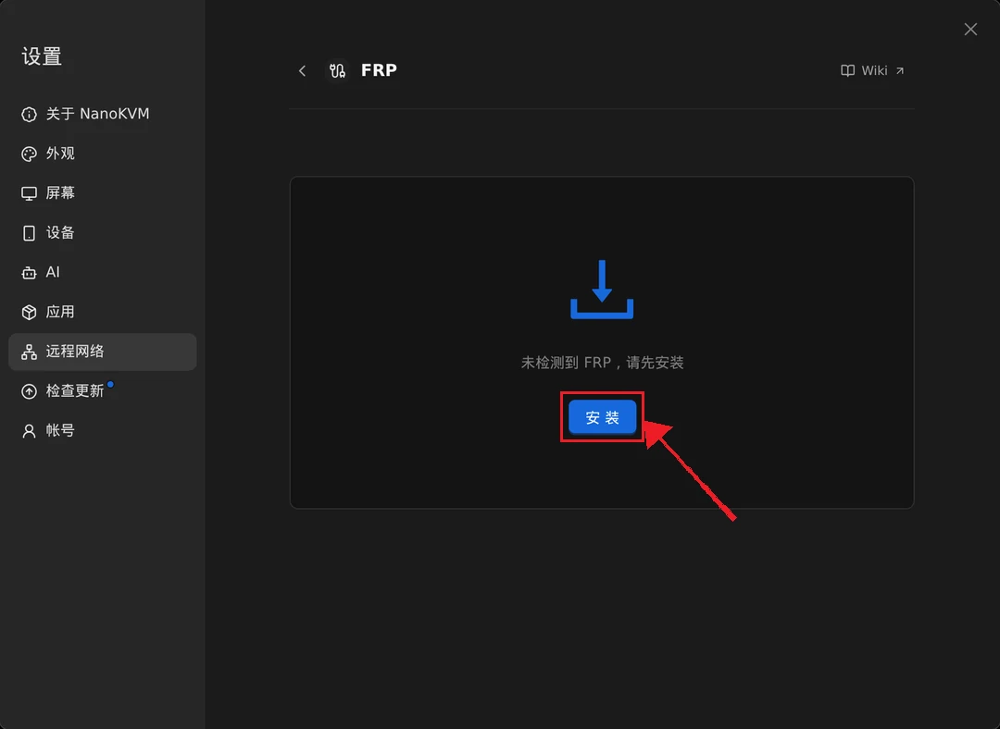
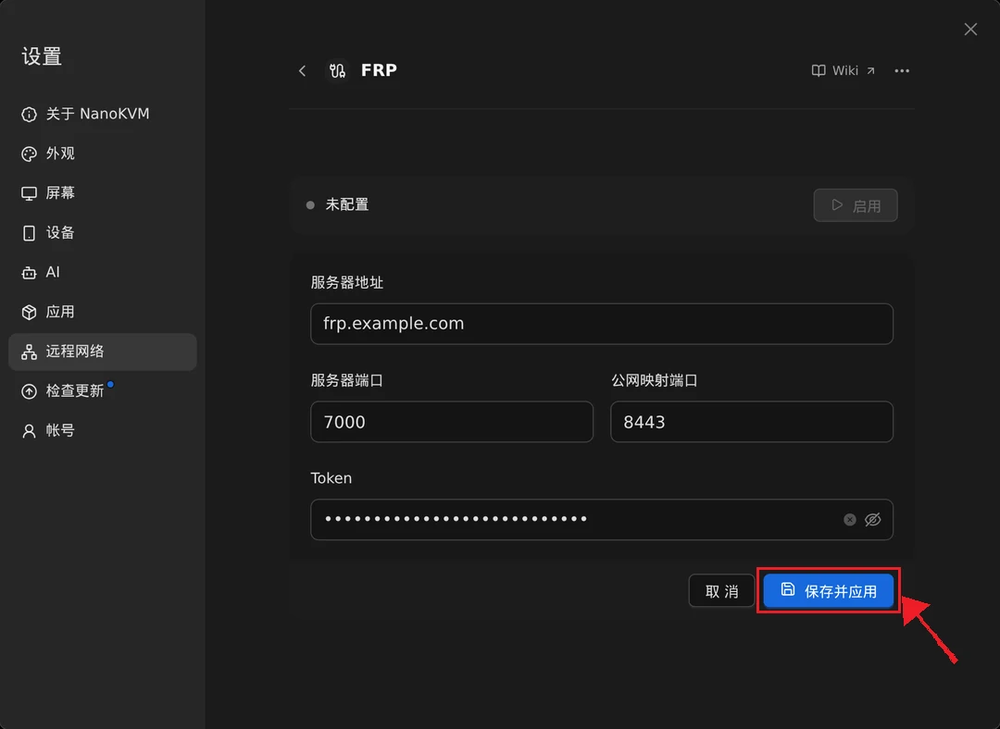
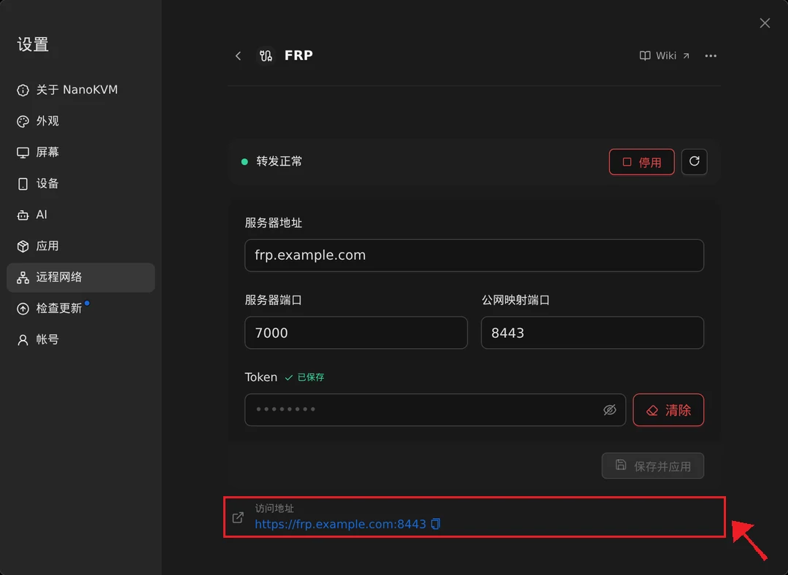

## frp 简介

frp 是一款内网穿透工具，可以把没有公网 IP 的 NanoKVM Go 转发到一台有公网 IP 的服务器上。配置完成后，你在外网打开服务器地址，就能像在局域网里一样访问 NanoKVM Go。

frp 由两个组件组成：

- `frps`：服务端，运行在你自己的公网服务器上；
- `frpc`：客户端，运行在 NanoKVM Go 上。

```text
远程电脑或手机
       |
       | 访问 https://frp.example.com:8443
       v
公网服务器（frps） <----- frpc 主动连接 ----- NanoKVM Go
```

NanoKVM Go 已经集成 FRP 客户端，安装、填写服务器信息、启用和停用都可以在网页控制端完成，不需要开启 SSH，也不需要手动下载程序。**只有公网服务器上的 `frps` 需要你自己安装**，步骤见下文。

> 公网服务器是需要你自己准备的一台 Linux 云服务器。NanoKVM Go 只负责运行客户端并主动连接它，设备所在的局域网不需要做端口映射。

> 将 NanoKVM Go 暴露到公网会增加被扫描、撞库和攻击的风险。请先为 NanoKVM Go 设置强密码，并为 frps 配置一个随机 Token。本文的基础示例转发的是 NanoKVM Go 自带的 HTTPS 服务，但设备证书通常是自签名证书，浏览器可能提示证书不受信任；有域名时可以配置可信证书，见下文「配置域名和 HTTPS（可选）」一节。如果不希望暴露公网端口，也可以改用 [Tailscale](tailscale.html)、[ZeroTier](zerotier.html)、[NetBird](netbird.html) 这类虚拟组网方案。

## 使用前准备

开始配置前，请准备：

- 一台具有公网 IPv4 地址的 Linux 服务器；
- 已连接互联网的 NanoKVM Go，且应用为最新版本（在 `设置` > `远程网络` 中能看到 `FRP` 卡片）；
- NanoKVM Go 可以访问 GitHub，安装客户端时需要从 GitHub 下载安装包；
- 公网服务器云安全组和系统防火墙的修改权限；
- 一个不容易被猜到的 frp 身份验证 Token。

本文使用以下示例参数：

| 项目 | 示例值 | 说明 |
| --- | --- | --- |
| 公网服务器地址 | `frp.example.com`（示例 IP：`203.0.113.10`） | 在 NanoKVM Go 中填写 |
| frps 通信端口 | `7000` | 客户端连接服务端使用 |
| 公网映射端口 | `8443` | 浏览器访问 NanoKVM Go 使用 |
| Token | `replace_with_a_strong_token` | 服务端与客户端必须完全一致 |

`203.0.113.10` 和 `frp.example.com` 都是文档示例，不能直接使用。没有域名时，在 NanoKVM Go 中直接填写公网服务器的 IP 即可。请将本文中的地址、端口和 Token 替换成你自己的实际参数。

## 在公网服务器上安装 frps

### 下载 frp

先查看服务器的 CPU 架构：

```bash
uname -m
```

打开 [frp Releases](https://github.com/fatedier/frp/releases)，选择与服务器架构匹配的 Linux 安装包。NanoKVM Go 内置的客户端是 frp `0.71.0`，**公网服务器请安装同一版本**；版本不一致时可能无法建立连接。

常见架构对应关系如下：

| `uname -m` 输出 | frp 安装包架构 |
| --- | --- |
| `x86_64` | `linux_amd64` |
| `aarch64`、`arm64` | `linux_arm64` |
| `armv7l` | `linux_arm_hf` |
| ARMv5 等较旧 ARM 设备 | `linux_arm` |
| `riscv64` | `linux_riscv64` |

可以在发布页面中直接下载 0.71.0：

- [frp 0.71.0 发布页面](https://github.com/fatedier/frp/releases/tag/v0.71.0)
- [Linux AMD64 安装包](https://github.com/fatedier/frp/releases/download/v0.71.0/frp_0.71.0_linux_amd64.tar.gz)
- [Linux ARM64 安装包](https://github.com/fatedier/frp/releases/download/v0.71.0/frp_0.71.0_linux_arm64.tar.gz)
- [Linux ARMv7 硬浮点安装包](https://github.com/fatedier/frp/releases/download/v0.71.0/frp_0.71.0_linux_arm_hf.tar.gz)
- [Linux RISC-V 64 安装包](https://github.com/fatedier/frp/releases/download/v0.71.0/frp_0.71.0_linux_riscv64.tar.gz)

大多数云服务器的架构为 `x86_64`。如果 `uname -m` 输出为 `x86_64`，执行以下命令下载并安装：

```bash
wget https://github.com/fatedier/frp/releases/download/v0.71.0/frp_0.71.0_linux_amd64.tar.gz
tar -xzf frp_0.71.0_linux_amd64.tar.gz
cd frp_0.71.0_linux_amd64
sudo install -m 755 frps /usr/local/bin/frps
```

`sudo install -m 755 frps /usr/local/bin/frps` 的作用是将当前目录下的 `frps` 程序复制到 `/usr/local/bin/frps`，并把权限设置为 `755`，也就是所有用户都可以执行，只有文件所有者可以修改。

如果服务器是其他架构，请下载表格中对应的安装包，并将命令中的压缩包名称和解压目录替换为实际名称。

确认 `frps` 可以运行：

```bash
/usr/local/bin/frps --version
```

### 创建 frps 配置

创建配置目录：

```bash
sudo mkdir -p /etc/frp
```

创建 `/etc/frp/frps.toml`：

```toml
bindPort = 7000

auth.method = "token"
auth.token = "replace_with_a_strong_token"
```

这里只需要两项配置：

- `bindPort`：`frps` 监听端口，客户端会连接这个端口；
- `auth.token`：客户端身份验证 Token，必须与 NanoKVM Go 里填写的完全一致。

> NanoKVM Go 的客户端固定使用 TCP 转发，把设备本机的 HTTPS 服务映射到公网端口，因此服务端**不需要**配置 `vhostHTTPPort` 或 `vhostHTTPSPort`。

请将 `auth.token` 替换为随机生成的强 Token。可以在公网服务器上使用以下命令生成：

```bash
openssl rand -hex 32
```

Token 只用于验证客户端，不能代替 NanoKVM Go 自身的登录密码，也不能代替浏览器访问时使用的 HTTPS 证书。

### 启动 frps

先在前台启动，以便直接观察日志：

```bash
sudo /usr/local/bin/frps -c /etc/frp/frps.toml
```

没有报错时，按 `Ctrl+C` 停止测试。前台运行方式适用于所有 Linux 系统，但关闭终端后 frps 也会停止，因此长期使用时还需要将其注册为系统服务。

#### 确认 init 系统

执行以下命令查看 PID 1 对应的程序：

```bash
ps -p 1 -o comm=
```

根据输出选择启动方式：

| 输出示例 | 启动方式 |
| --- | --- |
| `systemd` | 使用 systemd |
| 其他输出（如 `init`） | 使用当前发行版自带的 init 系统，参考下方 SysV init 一节 |

> 是否可以使用 systemd，应以 PID 1 是否为 `systemd` 为准。系统中存在 `systemctl` 命令，并不表示当前系统已经通过 systemd 启动。

#### 使用 systemd 启动

仅当 `ps -p 1 -o comm=` 输出为 `systemd` 时，才使用本节命令。

创建 `/etc/systemd/system/frps.service`：

```ini
[Unit]
Description=frp server
After=network-online.target
Wants=network-online.target

[Service]
Type=simple
ExecStart=/usr/local/bin/frps -c /etc/frp/frps.toml
Restart=on-failure
RestartSec=5s

[Install]
WantedBy=multi-user.target
```

加载服务并设置开机自启：

```bash
sudo systemctl daemon-reload
sudo systemctl enable --now frps
sudo systemctl status frps
```

如果状态为 `active (running)`，表示 frps 已经启动。使用以下命令查看实时日志：

```bash
sudo journalctl -u frps -f
```

#### 使用 SysV init 启动

如果系统使用 SysV init，并且存在 `start-stop-daemon` 命令，可以创建 `/etc/init.d/frps`：

```sh
#!/bin/sh

DAEMON=/usr/local/bin/frps
CONFIG=/etc/frp/frps.toml
PIDFILE=/var/run/frps.pid

case "$1" in
    start)
        if [ -f "$PIDFILE" ] && kill -0 "$(cat "$PIDFILE")" 2>/dev/null; then
            echo "frps is already running"
            exit 0
        fi
        echo "Starting frps"
        start-stop-daemon --start --background --make-pidfile \
            --pidfile "$PIDFILE" --exec "$DAEMON" -- -c "$CONFIG"
        ;;
    stop)
        echo "Stopping frps"
        start-stop-daemon --stop --pidfile "$PIDFILE" --retry TERM/5/KILL/5
        rm -f "$PIDFILE"
        ;;
    restart)
        "$0" stop
        "$0" start
        ;;
    status)
        if [ -f "$PIDFILE" ] && kill -0 "$(cat "$PIDFILE")" 2>/dev/null; then
            echo "frps is running"
        else
            echo "frps is not running"
            exit 1
        fi
        ;;
    *)
        echo "Usage: $0 {start|stop|restart|status}"
        exit 1
        ;;
esac
```

为脚本添加执行权限：

```bash
sudo chmod +x /etc/init.d/frps
```

在 Debian、Ubuntu 等使用 `update-rc.d` 的 SysV init 系统中，设置开机自启并启动服务：

```bash
sudo update-rc.d frps defaults
sudo service frps start
sudo service frps status
```

如果系统没有 `update-rc.d`，请使用当前发行版提供的 SysV init 服务管理命令。

#### 没有 systemd 的环境

如果出现以下错误：

```text
System has not been booted with systemd as init system (PID 1). Can't operate.
Failed to connect to bus: Host is down
```

说明当前环境不是通过 systemd 启动的，不能继续使用 `systemctl`。可以先使用前台命令测试 frps：

```bash
sudo /usr/local/bin/frps -c /etc/frp/frps.toml
```

如果需要长期运行，请根据当前发行版实际使用的 init 系统添加服务配置。

### 放行公网服务器端口

在云服务器安全组和系统防火墙中放行：

- `7000/tcp`：NanoKVM Go 上的 frpc 连接 frps；
- `8443/tcp`：远程浏览器访问 NanoKVM Go（本文示例的公网映射端口，可自行更换）。

不同 Linux 发行版使用的防火墙工具可能不同。先执行：

```bash
command -v ufw
command -v firewall-cmd
```

根据命令输出选择对应的小节。不要在没有安装相关工具的系统中直接执行命令。

#### 使用 UFW

如果 `command -v ufw` 输出了 UFW 的路径，执行：

```bash
sudo ufw allow 7000/tcp
sudo ufw allow 8443/tcp
sudo ufw status
```

如果终端提示 `ufw: command not found`，说明当前系统没有安装 UFW。UFW 不是运行 frps 的必要组件，请继续检查系统是否使用 firewalld、其他防火墙，或者只使用云服务器安全组。

#### 使用 firewalld

如果 `command -v firewall-cmd` 输出了 firewalld 的命令路径，执行：

```bash
sudo firewall-cmd --permanent --add-port=7000/tcp
sudo firewall-cmd --permanent --add-port=8443/tcp
sudo firewall-cmd --reload
sudo firewall-cmd --list-ports
```

#### 使用云服务器安全组

阿里云、华为云、腾讯云、AWS 等云服务器通常还有独立于 Linux 系统的安全组。即使服务器内部没有安装 UFW 或 firewalld，也必须在云服务器管理页面中添加入站规则：

| 协议 | 端口 | 来源 |
| --- | --- | --- |
| TCP | `7000` | NanoKVM Go 所在网络的公网 IP；无法固定时可临时使用任意来源进行测试 |
| TCP | `8443` | 需要访问 NanoKVM Go 的公网 IP；无法固定时可临时使用任意来源进行测试 |

测试完成后，建议将来源范围缩小到实际需要的 IP，不要长期允许所有公网地址访问。

确认 frps 正在监听 `7000` 端口：

```bash
sudo ss -lntp | grep ':7000'
```

> `8443` 端口需要在 NanoKVM Go 上的客户端成功连接并注册转发规则后才会出现，此时执行 `sudo ss -lntp | grep ':8443'` 可以看到 frps 已在监听。

## 在 NanoKVM Go 网页端配置 FRP

接下来的步骤都在浏览器中完成，不需要登录 SSH。登录 NanoKVM Go 网页控制端后，打开 `设置` > `远程网络`。

### 打开 FRP 设置

1. 登录 NanoKVM Go 网页控制端，点击顶部工具栏中的设置图标；
2. 在设置页面左侧选择 `远程网络`；
3. 点击 `FRP` 卡片。



### 安装 FRP 客户端

第一次进入时，页面提示 `未检测到 FRP，请先安装`。

1. 点击 `安装`；
2. 等待安装完成。安装包从 GitHub 下载，耗时取决于设备的网络情况。



安装完成后，页面出现服务器信息表单，状态显示 `未配置`。如果提示安装失败，先确认设备可以正常访问 GitHub、剩余存储空间充足，再重试。

### 填写服务器信息

按下表填写，全部填完后点击 `保存并应用`：

| 页面项 | 填写内容 | 说明 |
| --- | --- | --- |
| 服务器地址 | `frp.example.com` 或公网 IP | 只填域名或 IP，**不要带 `https://`，也不要带端口** |
| 服务器端口 | `7000` | 与 `frps.toml` 中的 `bindPort` 一致 |
| 公网映射端口 | `8443` | 外网访问时使用的端口，不能与服务器端口相同 |
| Token | `replace_with_a_strong_token` | 与 `frps.toml` 中的 `auth.token` 完全一致 |



几个容易填错的地方：

- 服务器地址填的是**公网服务器**的地址，不是 NanoKVM Go 自己的地址；
- 公网映射端口是你希望在外网使用的端口，需要在公网服务器上放行，并且不能被其他程序占用；
- 如果 `frps.toml` 里配置了 `auth.token`（推荐），Token 必须填写完全相同的值。

如果开启了双重验证，并且把 FRP 纳入保护范围，安装、保存和启停时需要再输入一次验证码。

### 启用转发

保存后状态变为 `已停用`，点击 `启用` 开始连接：

1. 点击 `启用`；
2. 状态短暂显示 `正在连接`；
3. 连接成功后状态变为 `转发正常`。

启用后客户端会以系统服务方式运行，并在 NanoKVM Go 重启后自动启动。需要断开时点击 `停用`，需要重连时点击状态右侧的重启按钮。

### 查看访问地址

启用成功后，页面底部会显示 `访问地址`，例如：

```text
https://frp.example.com:8443
```

点击地址右侧的复制按钮即可复制。这个地址就是外网访问 NanoKVM Go 的入口。



状态含义：

| 状态 | 含义 | 需要做什么 |
| --- | --- | --- |
| `未安装` | 还没有安装客户端 | 点击 `安装` |
| `未配置` | 已安装，但没有保存服务器信息 | 填写并保存表单 |
| `已停用` | 配置已保存，客户端未运行 | 点击 `启用` |
| `正在连接` | 已启动，正在与 frps 建立连接 | 等待，通常几秒内完成 |
| `转发正常` | 已连接，转发规则已生效 | 可以从外网访问 |
| `连接异常` | 连接失败或转发规则启动失败 | 见[常见问题](#常见问题) |

## 从外网访问 NanoKVM Go

为了确认访问流量确实经过公网，请将电脑或手机切换到其他网络，例如手机热点或移动数据网络，然后：

1. 在浏览器中打开 `https://frp.example.com:8443`，即页面上的访问地址；
2. 使用 NanoKVM Go 的账号和密码登录；
3. 测试远程画面、键盘、鼠标和电源控制；
4. 刷新页面，确认视频和控制功能仍能正常工作。

TCP 转发会原样传递 HTTPS 和 WebSocket 连接，通常不需要额外配置 WebSocket。首次访问时，浏览器可能提示证书不受信任，因为设备使用的是自签名证书，确认访问的是自己的设备后可以继续。

如果页面能打开，但画面一直连不上，在 `设置` > `屏幕` > `视频模式` 中把视频模式改为 `H.264 Direct` 或 `H.265 Direct` 后再试。

## 配置域名和 HTTPS（可选）

访问地址直接使用公网服务器的 IP 和端口时，浏览器会提示证书不受信任。如果有可用域名，可以将域名解析到 frps 服务器，并使用 Nginx 或 Caddy 提供可信 HTTPS 反向代理，这样就不用带端口访问了。

以 Nginx 为例，让 Nginx 监听 `443`，再把请求转发到 frp 暴露在服务器本机的 `8443` 端口：

```nginx
server {
    listen 443 ssl;
    server_name kvm.example.com;

    ssl_certificate /path/to/fullchain.pem;
    ssl_certificate_key /path/to/privkey.pem;

    location / {
        proxy_pass https://127.0.0.1:8443;
        proxy_http_version 1.1;
        proxy_ssl_verify off;
        proxy_set_header Host $host;
        proxy_set_header X-Real-IP $remote_addr;
        proxy_set_header X-Forwarded-For $proxy_add_x_forwarded_for;
        proxy_set_header X-Forwarded-Proto $scheme;
        proxy_set_header Upgrade $http_upgrade;
        proxy_set_header Connection "upgrade";
        proxy_read_timeout 3600s;
    }
}
```

配置步骤概括如下：

1. 将域名的 A 记录指向 frps 服务器公网 IP；
2. 在服务器上安装 Nginx 或 Caddy；
3. 为域名申请 TLS 证书；
4. 将 HTTPS 请求反向代理到 `https://127.0.0.1:8443`（与页面上填写的公网映射端口一致）；
5. 在安全组和防火墙中放行 `443/tcp`；
6. 确认 `https://kvm.example.com` 可以访问后，关闭公网入站的 `8443/tcp`。

> `proxy_pass` 使用 `https://`，是因为 NanoKVM Go 自身提供的是 HTTPS 服务；`proxy_ssl_verify off` 用于忽略设备自签名证书的校验。

## 修改配置、停用和卸载

### 修改服务器信息

在 FRP 页面直接修改 `服务器地址`、`服务器端口`、`公网映射端口`，然后点击 `保存并应用`。如果当前处于启用状态，客户端会自动重启并使用新配置；如果新配置连不上，页面会提示错误，并尽量恢复到修改前的配置。

Token 保存后不会回显。需要更换时，直接在 Token 输入框中输入新值再保存；点击 `清除` 会停用服务并删除已保存的 Token（其他配置保留）。

### 停用

点击状态行右侧的 `停用`，客户端会停止运行并取消开机自启，配置仍然保留。需要恢复时重新点击 `启用`。

> 停用会立即中断正在通过 FRP 连接的会话。

### 卸载

点击 FRP 页面右上角的 `⋯`（更多）按钮，选择 `卸载 FRP`，确认后客户端程序和开机自启服务会被移除。

卸载**不会**删除已保存的配置，重新安装后可以继续使用原有设置。如果需要连配置一起清除，请联系售后处理。

公网服务器上的 `frps` 需要手动卸载：先停止并删除服务，再删除程序和配置。

```bash
sudo systemctl disable --now frps
sudo rm -f /etc/systemd/system/frps.service
sudo systemctl daemon-reload
sudo rm -f /usr/local/bin/frps
sudo rm -f /etc/frp/frps.toml
```

如果公网服务器使用 SysV init，改用：

```bash
sudo service frps stop
sudo update-rc.d -f frps remove
sudo rm -f /etc/init.d/frps
```

最后在安全组和防火墙中删除 `7000/tcp`、`8443/tcp` 的放行规则。

## 常见问题

### `设置` > `远程网络` 里没有 FRP 卡片

先确认 NanoKVM Go 的应用版本是否为最新版本，更新后重新打开 `设置` > `远程网络`。

### 点击安装后提示安装失败

安装包从 GitHub 下载。确认设备可以访问 GitHub、剩余存储空间充足，然后重试。

### 状态一直是 `正在连接` 或 `连接异常`

依次检查：

- `服务器地址` 是否只填了域名或 IP，没有带 `https://` 和端口；
- `服务器端口` 是否与 `frps.toml` 中的 `bindPort` 一致；
- frps 是否正在运行，`7000/tcp` 是否已在云安全组和系统防火墙中放行；
- 两边的 Token 是否完全一致；
- 公网服务器和 NanoKVM Go 是否能正常访问互联网。

连接失败时客户端会自动重试，修改配置并重新保存通常就能恢复。也可以在公网服务器上查看 frps 日志：使用 systemd 时执行 `sudo journalctl -u frps -n 50`；其他 init 系统可以让 frps 在前台运行，直接查看输出。

### 状态是 `转发正常`，但外网打不开页面

检查：

- `公网映射端口` 是否已在云安全组和系统防火墙中放行；
- 该端口是否已被其他程序占用。公网服务器上可以执行 `sudo ss -lntp | grep ':8443'` 确认；
- 浏览器使用的是 `https://`，而不是 `http://`；
- 访问的是公网服务器的地址，不是局域网地址。

### 页面能打开，但画面一直连不上

在 `设置` > `屏幕` > `视频模式` 中改为 `H.264 Direct` 或 `H.265 Direct` 后再试。WebRTC 视频需要单独建立点对点连接，经过端口转发时通常无法建立。

### 重启 NanoKVM Go 后 FRP 没有自动恢复

FRP 只有在 `启用` 状态下才会开机自启。打开 `设置` > `远程网络` > `FRP`，确认状态不是 `已停用`；如果是，点击 `启用` 即可。

### 忘记 Token 了怎么办

Token 保存后不会显示，页面上只显示 `已保存`。在公网服务器上查看 `frps.toml` 中的 `auth.token`，重新填入 NanoKVM Go 保存即可；也可以两边同时换成一个新的随机 Token。

### 公网映射端口为什么不能和服务器端口相同

公网映射端口是 frps 在公网服务器上额外监听的端口，和 frps 自己的监听端口冲突时会启动失败，因此页面不允许两者相同。例如服务器端口是 `7000`，公网映射端口请使用 `8443` 等其他端口。

### 会不会影响局域网访问

不会。FRP 只影响外网访问，局域网内仍然可以直接用设备原来的地址访问。

## 安全建议

- 为 NanoKVM Go 设置独立的强密码，并开启双重验证；
- 使用随机生成的强 Token，不要使用本文示例值；
- 不要对公网开放 frps Dashboard（本文配置未开启）；
- 仅开放实际需要的端口，并尽可能通过防火墙限制来源 IP；
- 有域名时，配置可信 HTTPS 反向代理，并在配置完成后关闭公网映射端口的直接访问；
- 定期更新 NanoKVM Go 应用、frp 和公网服务器系统；
- 不再使用时，请在页面中停用或卸载 FRP，并关闭公网端口。

## 下一步

- 不想自建服务器，可以参考 [Tailscale](tailscale.html)、[ZeroTier](zerotier.html)、[NetBird](netbird.html) 或 [Sipeed 远程网络](sipeed_remote_network.html)；
- 有 Cloudflare 账号和域名时，可以改用 [Cloudflare Tunnel](cloudflare_tunnel.html)；
- 只想让局域网地址固定下来，参考 [静态 IP](static_ip.html)；
- 遇到其他问题，查看 [NanoKVM Go 常见问题](../faq.html)。

## 参考资料

- [frp 官方文档](https://gofrp.org/zh-cn/)
- [frp GitHub 仓库](https://github.com/fatedier/frp)
- [frp Releases](https://github.com/fatedier/frp/releases)
