## NetBird 简介

NetBird 是一款基于 WireGuard 的开源异地组网工具。它可以把 NanoKVM Go 和你的电脑、手机加入同一个虚拟网络，即使设备没有公网 IP、路由器也没有做端口映射，也能从外网访问 NanoKVM Go。

NanoKVM Go 已经集成 NetBird 客户端，安装、启用和登录都可以在网页控制端完成，不需要开启 SSH，也不需要手动下载程序。

加入网络后，NanoKVM Go 会获得一个 `100.x.x.x` 格式的 NetBird IP。访问端安装 NetBird 客户端并登录同一账号后，在浏览器中打开这个地址即可。

```text
NanoKVM Go ── NetBird 虚拟网络 ── 外网电脑或手机
```

> NanoKVM Go 的 NetBird 集成只把 NanoKVM Go 自己加入虚拟网络，不会把设备所在局域网的其他设备或网段带进来。

## 与其他远程网络方式的区别

NetBird 和 [Tailscale](tailscale.html)、[Sipeed 远程网络](sipeed_remote_network.html) 属于同一类方案：靠虚拟组网打通两端，不需要公网服务器。区别在控制服务器和账号体系：

| 方式 | 控制服务器 | 需要账号 | 访问端客户端 |
| --- | --- | --- | --- |
| NetBird | NetBird Cloud | NetBird 账号 | NetBird |
| Tailscale | Tailscale | Tailscale 账号 | Tailscale |
| Sipeed 远程网络 | Sipeed | 不需要 | Tailscale |

[frp](frp.html) 和 [Cloudflare Tunnel](cloudflare_tunnel.html) 属于内网穿透，需要公网服务器或域名；[静态 IP](static_ip.html) 只固定局域网地址，不能从外网访问。没有公网服务器时，优先考虑 NetBird 这类组网方案。

> 目前 NanoKVM Go 内置的 NetBird 固定连接 NetBird Cloud（管理服务器 `api.netbird.io`），暂不支持填写自建的 NetBird 管理服务器地址。

## 使用前准备

开始配置前，请确认：

- NanoKVM Go 已连接互联网；
- 可以在局域网内正常访问 NanoKVM Go 网页控制端；
- NanoKVM Go 的系统和应用已更新至最新版本；
- NanoKVM Go 可以访问 GitHub，安装 NetBird 客户端时需要下载安装包；
- 用于外网访问的电脑或手机可以安装 NetBird 客户端；
- 用于登录的浏览器可以访问 `app.netbird.io`；
- 有一个可用的 NetBird 账号。免费版最多 5 个用户、100 台设备，个人使用足够，额度以 [NetBird 定价页](https://netbird.io/pricing) 为准。

> 如果 `设置` > `远程网络` 中没有 NetBird，请先更新 NanoKVM Go 的应用。

## 注册并登录 NetBird 账号

如果已经有 NetBird 账号，可以跳过本节。

1. 打开 [NetBird 控制台](https://app.netbird.io/)，点击 `Get Started`；
2. 选择 Google、GitHub 或邮箱等登录方式，完成注册和首次登录。

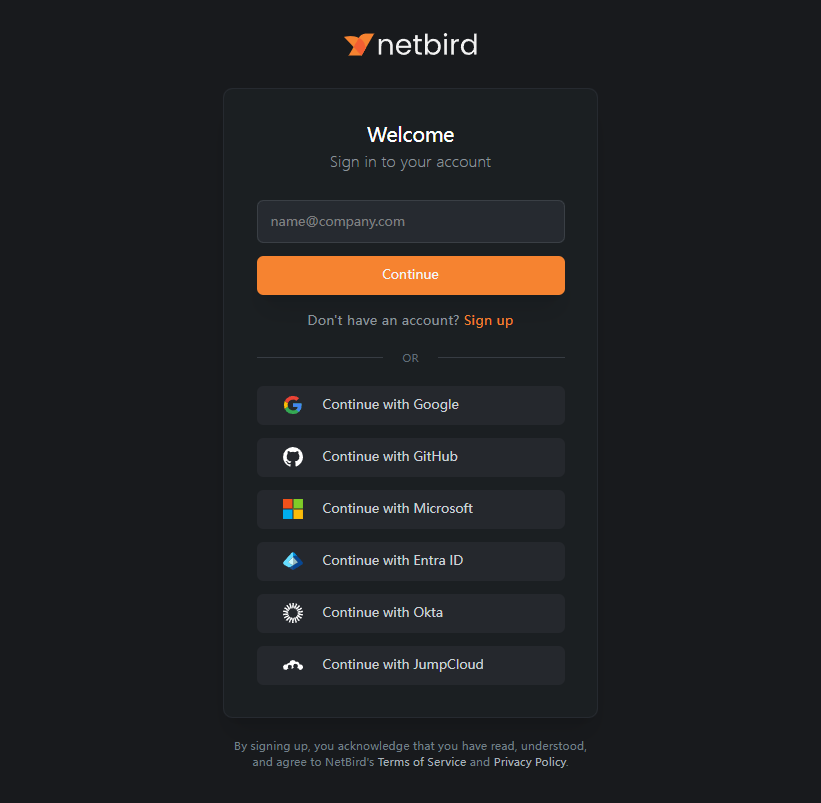

3. 按页面提示完成初始引导，进入控制台；
4. 打开左侧的 `Peers` 页面，确认可以看到设备列表。

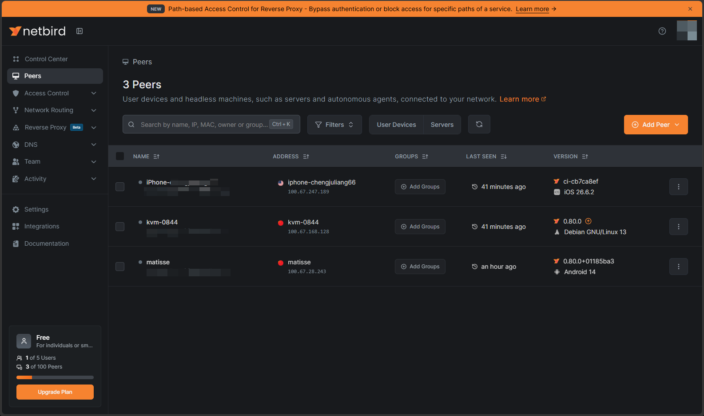

此时列表里还没有 NanoKVM Go，它会在后面的登录步骤中自动加入。

## 在 NanoKVM Go 上安装并启用 NetBird

### 打开 NetBird 设置

1. 登录 NanoKVM Go 网页控制端，点击顶部工具栏中的设置图标；
2. 在设置页面左侧选择 `远程网络`，然后点击 `NetBird` 卡片。

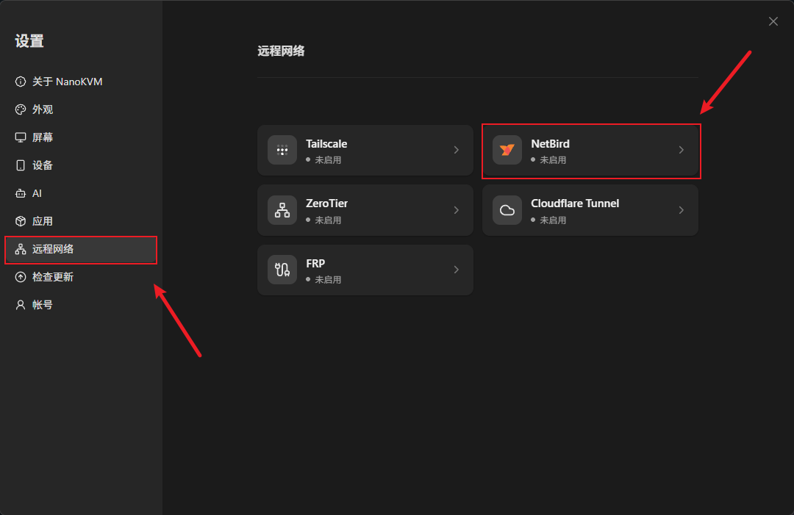

进入 NetBird 页面后，页面提示 `未检测到 NetBird，请先安装`。

### 安装 NetBird 客户端

1. 点击 `安装`；
2. 等待安装完成。页面显示 `正在安装`，安装包从 GitHub 下载，耗时取决于设备的网络情况。

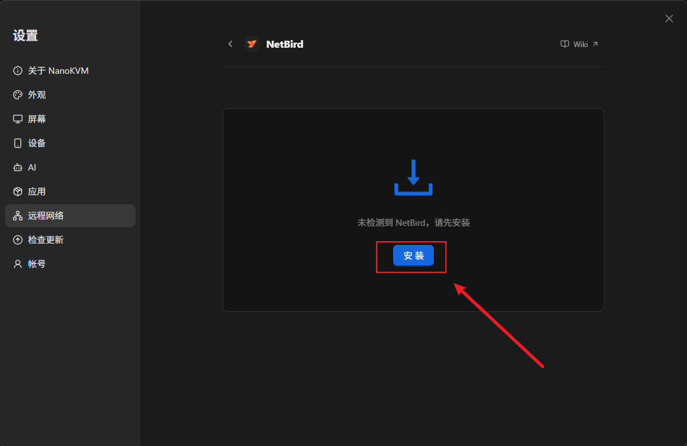

安装完成后，状态变为 `已停用`。如果提示安装失败，先确认设备可以正常访问 GitHub，再重试。

### 启用 NetBird

1. 点击 `启用`；
2. 等待状态从 `已停用` 变为 `未登录`。

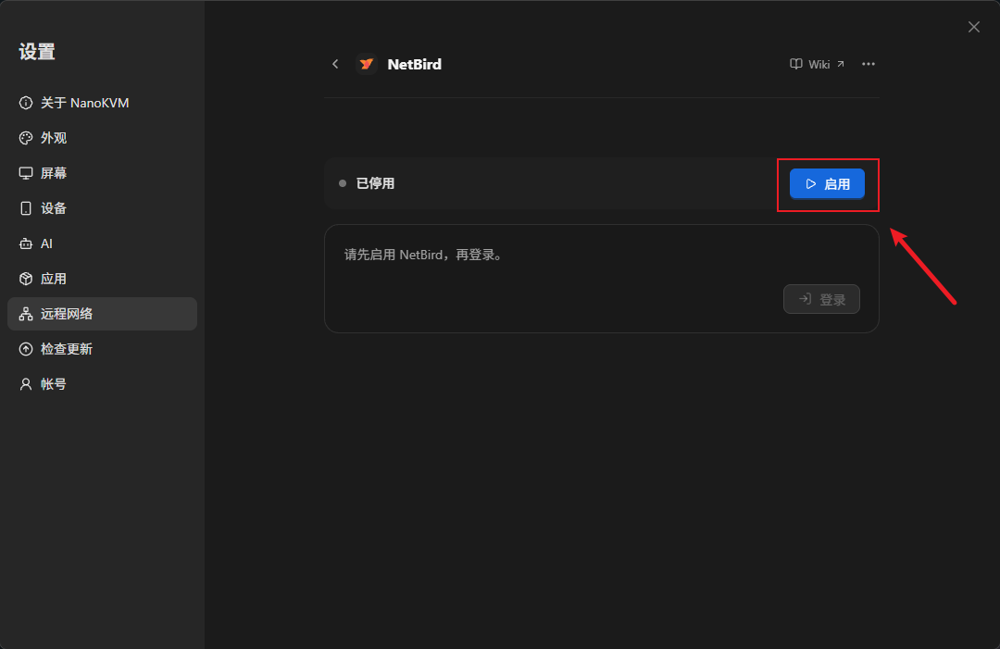

页面显示 `未登录`，说明客户端已经运行，但还没有绑定 NetBird 账号。

## 登录并绑定设备

1. 在 `未登录` 卡片中点击 `登录`。

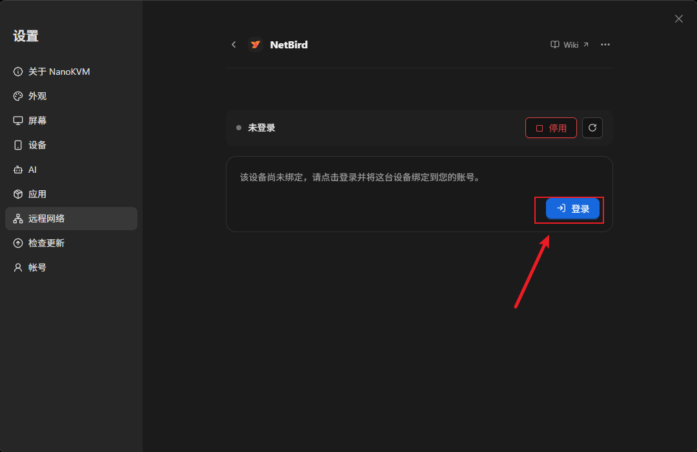

2. 页面进入 `等待登录授权`，并显示一个 `验证码` 和 `打开 NetBird 完成登录` 链接。

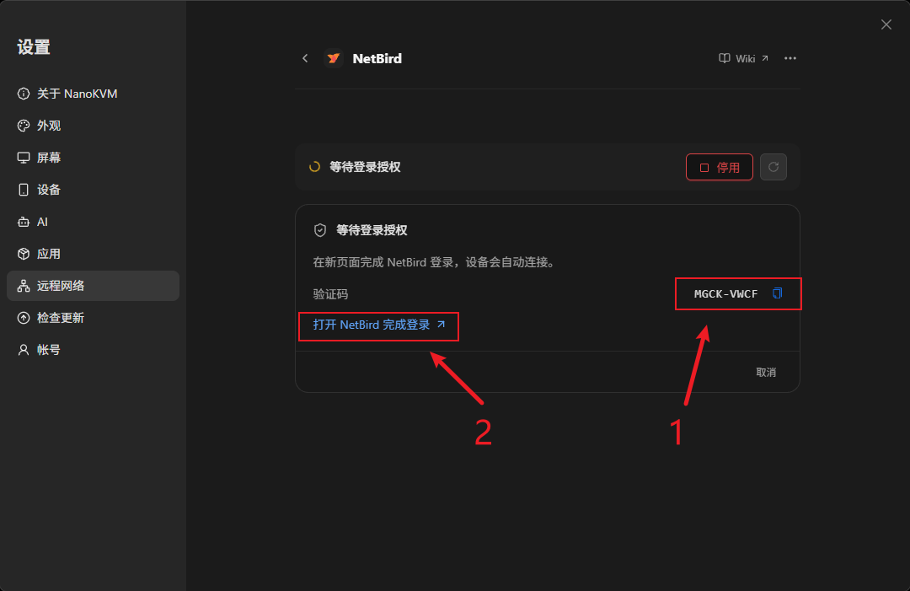

3. 点击 `打开 NetBird 完成登录`，浏览器会打开 NetBird 的授权页面；
4. 使用前面的 NetBird 账号登录。如果页面要求输入验证码，填入 NanoKVM Go 页面显示的验证码，然后确认授权。

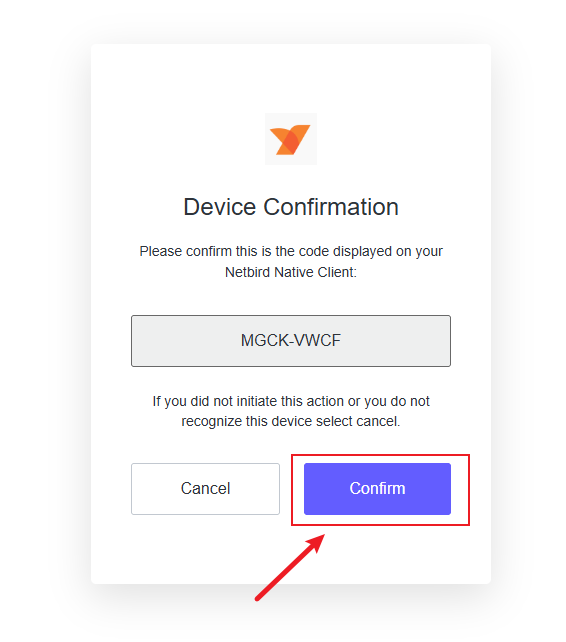

5. 回到 NanoKVM Go 页面，等待状态自动变为 `已连接`。页面会显示设备名称、`NetBird IP` 和 `访问地址`。

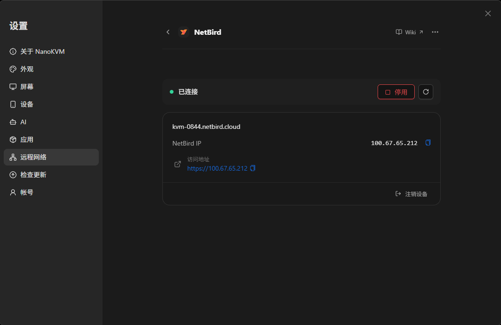

`NetBird IP` 就是 NanoKVM Go 在虚拟网络中的地址，`访问地址` 是带协议的完整地址，例如 `https://100.x.x.x`。

> NanoKVM Go 等待登录授权的时间为 10 分钟。超时后页面提示 `登录授权已过期`，重新点击 `登录` 获取新的验证码即可。

### 确认设备已上线

打开 NetBird 控制台的 `Peers` 页面，找到 NanoKVM Go 对应的设备。设备名称前有一个绿色小圆点，表示设备在线。

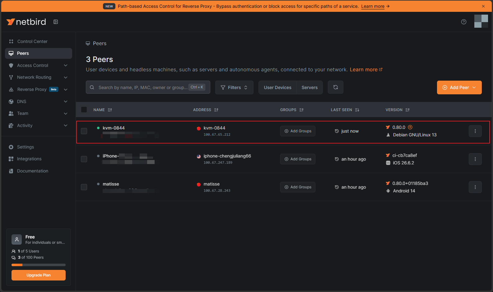

设备名称通常是 NanoKVM Go 的 NetBird 域名，可以结合 `NetBird IP` 确认是哪一台。

## 在访问端安装 NetBird 客户端

在需要远程访问 NanoKVM Go 的电脑或手机上安装 NetBird 客户端：

| 平台 | 安装方式 |
| --- | --- |
| Windows | 参考 [NetBird Windows 安装指南](https://docs.netbird.io/get-started/install/windows) |
| macOS | 参考 [NetBird macOS 安装指南](https://docs.netbird.io/get-started/install/macos) |
| Linux | 参考 [NetBird Linux 安装指南](https://docs.netbird.io/get-started/install/linux) |
| Android | 从 [Google Play](https://play.google.com/store/apps/details?id=io.netbird.client) 安装 |
| iOS / iPadOS | 从 [App Store](https://apps.apple.com/app/id6469329339) 安装 |

安装完成后：

1. 启动 NetBird 客户端，点击 `Connect`，手机端打开连接开关；
2. 使用与 NanoKVM Go 相同的 NetBird 账号登录；
3. 手机端首次连接时允许客户端创建 VPN 连接；
4. 确认客户端状态为已连接。

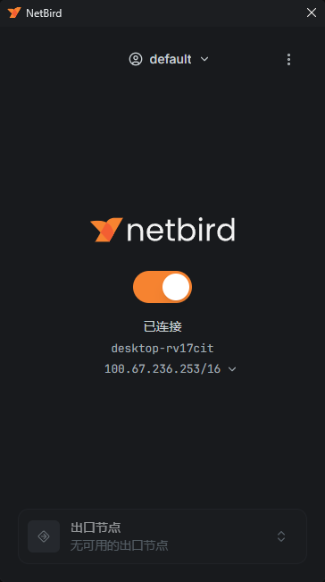

> 如果访问端使用其他账号，需要先被邀请加入同一个 NetBird 网络，并被访问策略允许访问 NanoKVM Go。

## 从外网访问 NanoKVM Go

为避免测到的其实是局域网直连，建议先断开访问端当前的 Wi-Fi，改用手机热点或移动网络。

1. 确认访问端的 NetBird 客户端处于已连接状态。例如下图中，访问端 `DESKTOP-RV17CIT` 要连接 `kvm-0844`，两台设备名称前的小绿点都需要亮起。

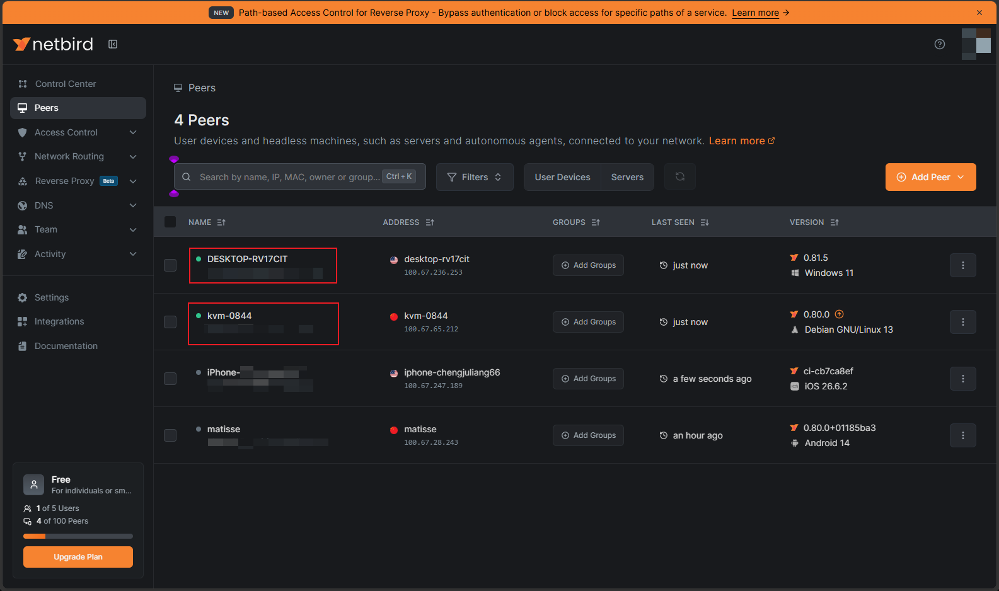

2. 在 `DESKTOP-RV17CIT` 的浏览器地址栏输入 NanoKVM Go 页面显示的 `访问地址`，例如 `https://100.x.x.x`；
3. 如果浏览器提示证书不受信任，按浏览器提示选择继续访问（Chrome / Edge 在 `高级` 中）。NanoKVM Go 使用自签名证书，这个提示正常；
4. 打开 NanoKVM Go 登录页面并完成登录；
5. 测试远程画面、键鼠控制和电源控制等功能。

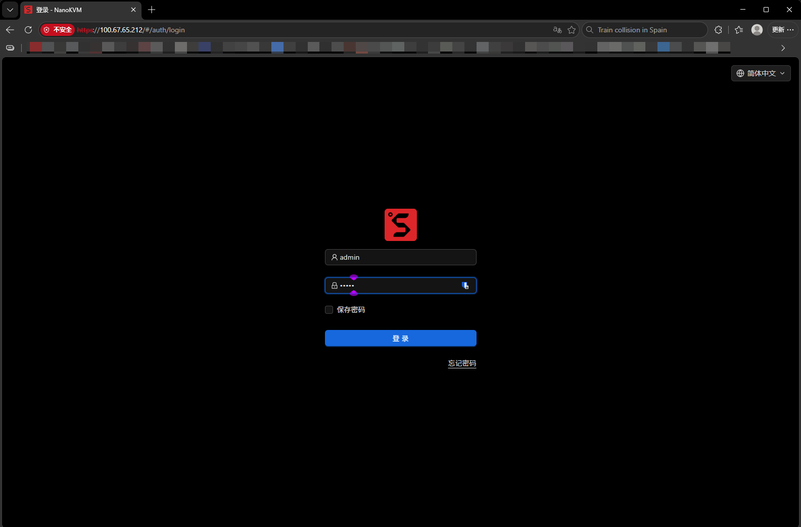

> 如果页面打不开，先确认访问端客户端已连接、两端在同一个 NetBird 网络，并且 `Peers` 中 NanoKVM Go 显示在线（名称前的小绿点亮起）。

## 日常使用与安全建议

- 为 NanoKVM Go 设置强密码，并保留设备自身的登录认证；
- 为 NetBird 账号启用 MFA；
- NetBird 的默认策略允许网络内所有设备互访，多人使用时建议在 `Access Control` 中只放行需要的设备和端口；
- 不要为了 NetBird 在路由器上额外开放 NanoKVM Go 的端口；
- 定期检查 `Peers` 列表，移除不再使用的设备；
- 不需要远程访问时，可以在 NetBird 页面点击 `停用`；设备报废或转手时点击 `注销设备`，把它从 NetBird 网络中移除；
- 定期更新 NanoKVM Go 的应用和访问端的 NetBird 客户端。

## 常见问题

### 设置页面中没有 NetBird 选项？

先检查 NanoKVM Go 的应用是否为最新版本，更新后重新打开 `设置` > `远程网络`。

### 安装失败怎么办？

安装包从 GitHub 下载，失败通常与网络或存储空间有关。确认设备可以访问 GitHub、剩余空间充足后重试。

### 提示“检测到其他方式安装的 NetBird”？

设备上已经存在通过软件包或安装脚本安装的 NetBird。请先卸载它，包括 `netbird` 服务和程序，再回到页面重新安装。

### 提示“TUN 设备不可用”？

NetBird 需要 `/dev/net/tun` 虚拟网卡。请先确认系统和应用已更新到最新版本；仍然提示时联系售后。

### 登录授权过期了？

NanoKVM Go 等待授权的时间为 10 分钟。超时后重新点击 `登录` 获取新的验证码即可。

### 显示已连接，但浏览器打不开？

依次确认：访问端客户端处于已连接状态；两端登录的是同一个 NetBird 账号；`Peers` 中 NanoKVM Go 在线；访问策略允许两端通信。必要时在访问端 `ping` 一下 NanoKVM Go 的 `NetBird IP`。

### 能通过 NetBird 访问 NanoKVM Go 所在局域网的其他设备吗？

不能。内置集成只把 NanoKVM Go 自己加入虚拟网络，没有开启子网路由和 DNS。

### 可以连接自建的 NetBird 服务器吗？

目前不支持。NanoKVM Go 的 NetBird 集成固定使用 NetBird Cloud。

### 卸载 NetBird 后需要重新登录吗？

卸载会停止并移除客户端，但会保留设备身份和配置。重新安装并启用后一般可以直接继续使用；如果页面显示 `未登录`，重新登录即可。

## 下一步

- 想在设备之间使用 Tailscale 网络，或不想注册 NetBird 账号，可以参考 [Tailscale](tailscale.html) 和 [Sipeed 远程网络](sipeed_remote_network.html)；
- 有公网服务器或自有域名时，可以参考 [frp](frp.html) 和 [Cloudflare Tunnel](cloudflare_tunnel.html)；
- 只希望局域网地址固定，参考 [静态 IP](static_ip.html)；
- 遇到其他问题，查看 [NanoKVM Go 常见问题](../faq.html)。
