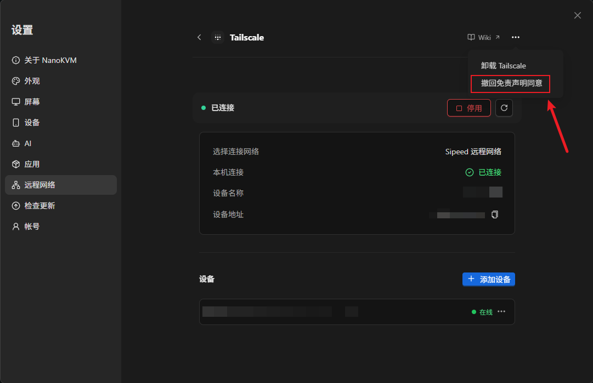

# Sipeed 远程网络免责声明

最后更新：2026-10-29

## 条款内容

> 在 NanoKVM Go 或者 NanoKVM Go+ 设备上，点击 **✓** 等同于下方声明中的“同意并启用”；点击 **✕** 表示不同意。本页面仅用于展示声明，同意状态由设备记录。

启用 Sipeed 远程网络后，本设备会向 Sipeed 服务器发送请求，并提供设备标识、设备名称、虚拟网络 IP 地址等连接信息，用于设备注册、身份验证、连接协调和网络管理。

远程访问依赖网络环境、设备配置及相关服务，可能出现延迟、中断或暂时不可用。请自行评估使用风险，并保留必要的备用访问方式。

请仅在您拥有或已获得授权的设备与网络上使用本服务，并妥善保管登录凭据和配对码，谨慎授予他人访问权限。

点击“同意并启用”即表示您已阅读并理解本声明，同意为提供远程连接而进行上述通信和信息处理。同意状态将保存在本设备上，后续启用无需重复确认。

## 撤回同意

您可在已连接页面右上角菜单中撤回同意。撤回后会退出 Sipeed 远程网络，并请求删除对应的云端网络及用户；删除后，该网络中的其他设备也将无法继续通过此网络访问。再次启用时需重新同意。

