# ZeroTier

## ZeroTier 简介

ZeroTier 是一款虚拟组网工具。它可以把 NanoKVM Go 和你的电脑、手机加入同一个虚拟网络，即使设备没有公网 IP、路由器也没有做端口映射，也能从外网访问 NanoKVM Go。

NanoKVM Go 已经集成 ZeroTier 客户端，安装、启用和加入网络都可以在网页控制端完成，不需要开启 SSH，也不需要手动下载程序。

加入网络后，NanoKVM Go 会获得 ZeroTier 分配的虚拟 IP。访问端安装 ZeroTier 客户端并加入同一个网络后，在浏览器中打开这个地址即可。

```text
NanoKVM Go ── ZeroTier 虚拟网络 ── 外网电脑或手机
```

> NanoKVM Go 的 ZeroTier 集成不会自动把设备所在局域网共享给其他成员；能否访问局域网中的其他设备，取决于 ZeroTier 网络是否配置了对应的 Managed Route。

## 与其他远程网络方式的区别

ZeroTier 和 [Tailscale](tailscale.html)、[NetBird](netbird.html)、[Sipeed 远程网络](sipeed_remote_network.html) 一样，属于虚拟组网方案，不需要公网服务器。区别主要在网络的加入和授权方式：

| 方式 | 网络标识 | 设备授权 | 访问端客户端 |
| --- | --- | --- | --- |
| ZeroTier | 16 位十六进制 Network ID | 在 ZeroTier Central 授权 Node ID | ZeroTier |
| NetBird | NetBird 账号 | 登录同一账号 | NetBird |
| Tailscale | Tailscale 账号 / Tailnet | 登录同一账号 | Tailscale |
| Sipeed 远程网络 | Sipeed 配对码 | 6 位认领码 + 3 位核对 | Tailscale |

ZeroTier 不需要在 NanoKVM Go 上登录账号，但需要先在 ZeroTier Central 创建网络，并在 Central 中授权 NanoKVM Go 的 Node ID。

[frp](frp.html) 和 [Cloudflare Tunnel](cloudflare_tunnel.html) 属于内网穿透，需要公网服务器或域名；[静态 IP](static_ip.html) 只固定局域网地址，不能从外网访问。

> 页面不提供自建 ZeroTier 控制器或自定义 Planet 的配置入口，请使用 ZeroTier Central 上的网络。

## 使用前准备

开始配置前，请确认：

- NanoKVM Go 已连接互联网；
- 可以在局域网内正常访问 NanoKVM Go 网页控制端；
- NanoKVM Go 的系统和应用已更新至最新版本；
- NanoKVM Go 可以访问 `download.zerotier.com`，安装 ZeroTier 客户端时需要下载安装包；
- 有一个 ZeroTier 账号，并已经在 ZeroTier Central 创建了网络；
- 知道要加入的 16 位十六进制 Network ID；
- 用于外网访问的电脑或手机可以安装 ZeroTier 客户端。

> 如果 `设置` > `远程网络` 中没有 ZeroTier，请先更新 NanoKVM Go 的应用。

## 创建 ZeroTier 网络

如果已经有可用的 ZeroTier 网络，可以跳过本节，直接记下 Network ID。

1. 打开 [ZeroTier Central](https://central.zerotier.com/) 后登录。

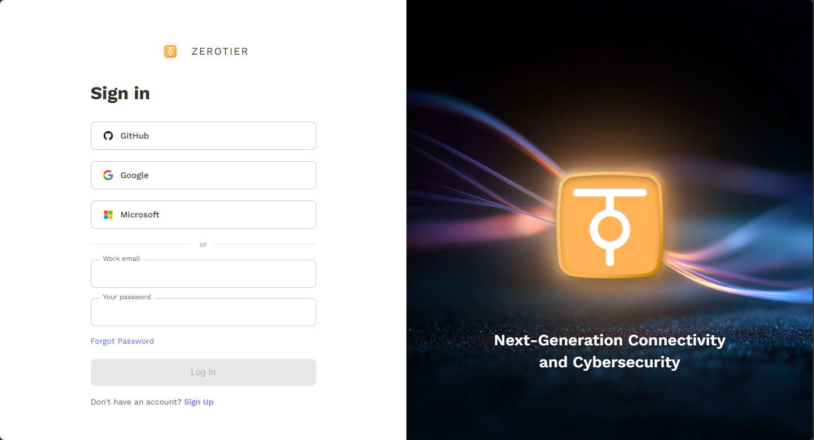

2. 按照网页的引导，创建一个网络（`Create A Network`）；

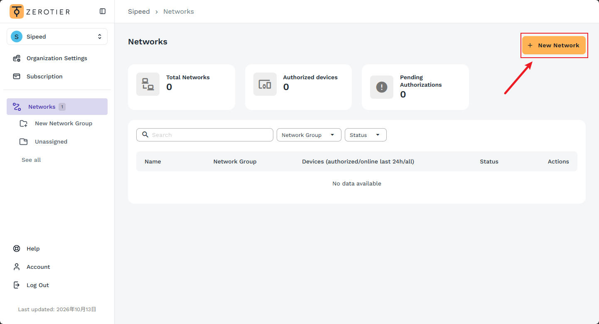

3. 找到 `Network ID`，它是一串 16 位十六进制字符，记下 Network ID，后面要在 NanoKVM Go 上填写；

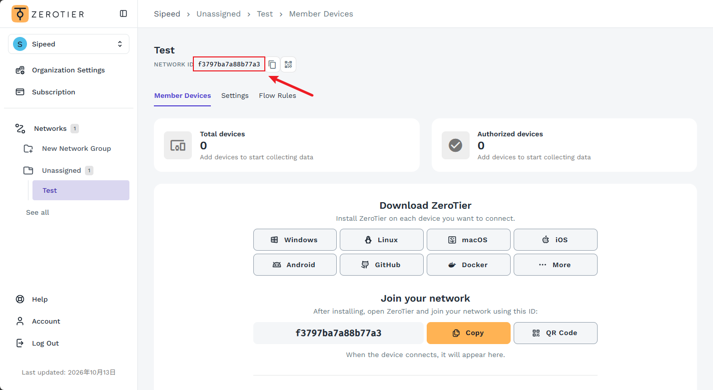

## 在 NanoKVM Go 上安装并启用 ZeroTier

### 打开 ZeroTier 设置

1. 登录 NanoKVM Go 网页控制端，点击顶部工具栏中的设置图标；
2. 在设置页面左侧选择 `远程网络`，然后点击 `ZeroTier` 卡片。

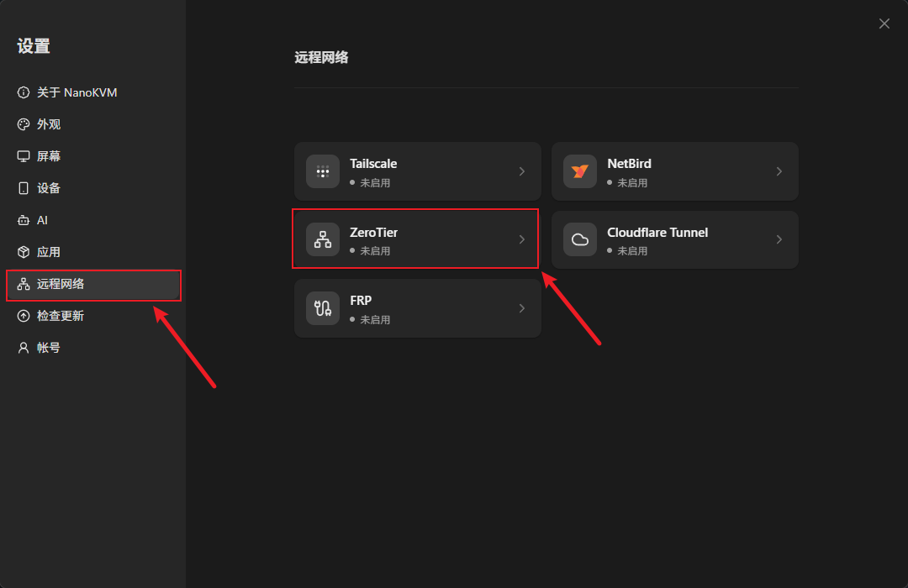

进入 ZeroTier 页面后，页面提示 `未检测到 ZeroTier，请先安装`。

### 安装 ZeroTier 客户端

1. 点击 `安装`；

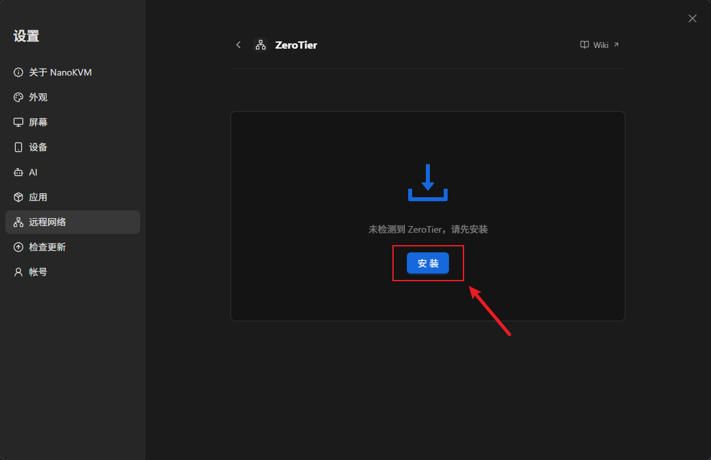

2. 等待安装完成。页面显示 `正在安装`，安装包从 ZeroTier 官方站点下载，耗时取决于设备的网络情况。

安装完成后，状态变为 `已停用`。如果提示安装失败，先确认设备可以正常访问 `download.zerotier.com`，再重试。

### 启用 ZeroTier

1. 点击 `启用`；

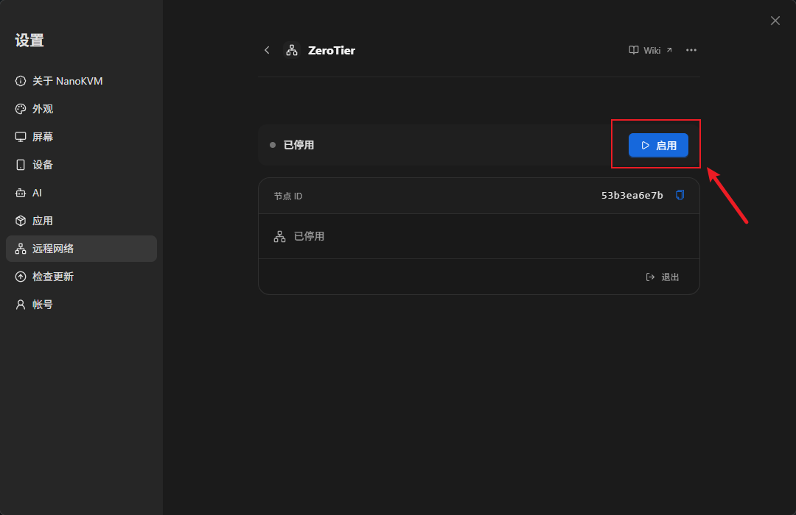

2. 等待状态从 `已停用` 变为 `尚未加入网络`。

页面显示 `尚未加入网络`，说明客户端已经运行，但还没有加入任何 ZeroTier 网络。

## 加入网络并授权设备

1. 在 `网络 ID` 中填入 16 位十六进制 Network ID，例如 `e5cd7a9e1c9473c8`，然后点击 `加入`；

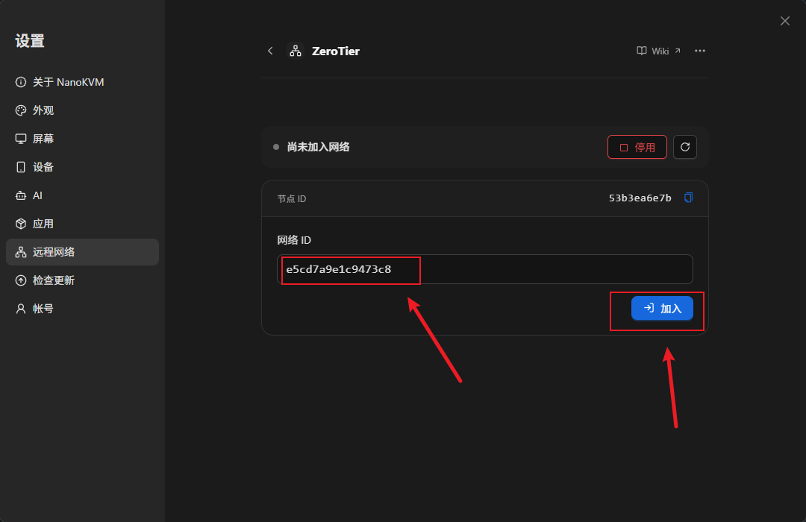

2. 页面进入 `等待网络授权`，并显示本机的 `节点 ID`（10 位十六进制字符）；

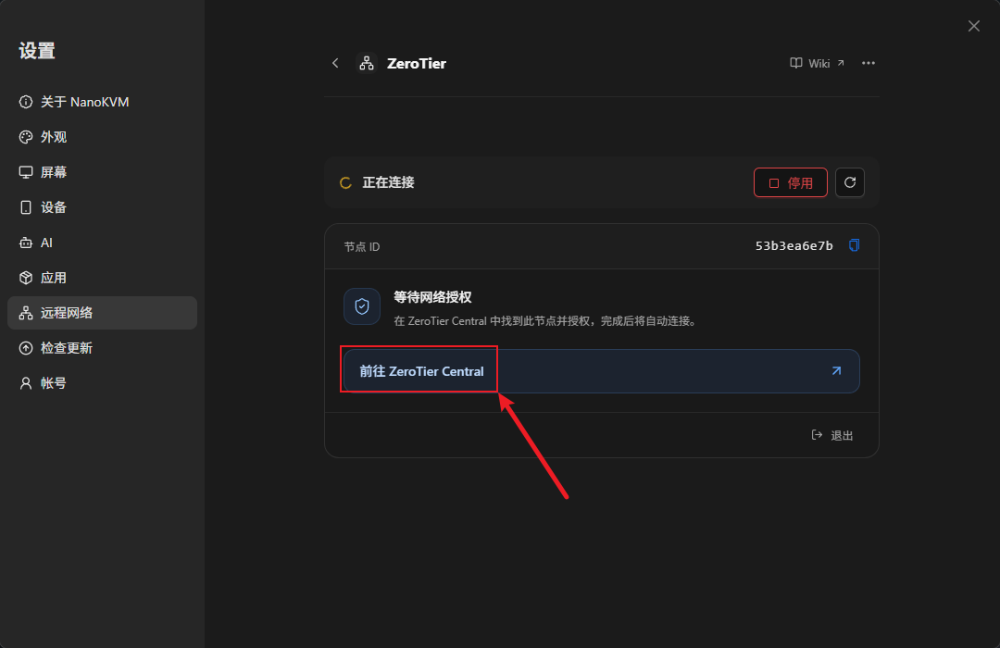

3. 点击 `前往 ZeroTier Central`，同意一下加入网络的授权。

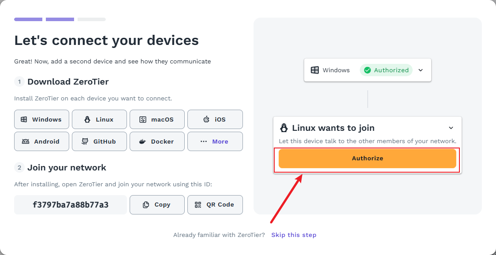

4. 回到 NanoKVM Go 页面，等待状态自动变为 `已连接`；

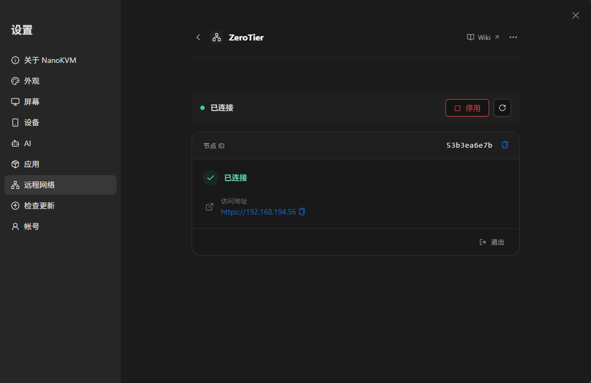

5. 页面会显示 `访问地址`，例如 `https://10.x.x.x` 或 `https://192.168.x.x`，以 ZeroTier 实际分配的地址为准。

> 如果状态是 `尚未授权或授权已撤销`，回到 ZeroTier Central 检查该节点的授权；如果提示 `网络不存在`，检查 Network ID 是否填写正确。

## 在访问端安装 ZeroTier 客户端

在需要远程访问 NanoKVM Go 的电脑或手机上安装 ZeroTier 客户端：

| 平台 | 安装方式 |
| --- | --- |
| Windows | 从 [ZeroTier 下载页](https://www.zerotier.com/download/) 下载安装 |
| macOS | 从 [ZeroTier 下载页](https://www.zerotier.com/download/) 下载安装 |
| Linux | 参考 [ZeroTier 下载页](https://www.zerotier.com/download/) 的安装说明 |
| Android | 从 [Google Play](https://play.google.com/store/apps/details?id=com.zerotier.one) 安装 |
| iOS / iPadOS | 从 [App Store](https://apps.apple.com/app/zerotier/id1450921335) 安装 |

安装完成后：

1. 启动 ZeroTier 客户端，使用 `Join Network` 加入与 NanoKVM Go 相同的 Network ID；

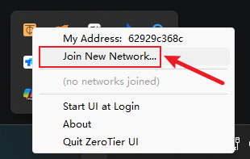

2. 在 ZeroTier Central 的 `Members` 中授权这台访问端；

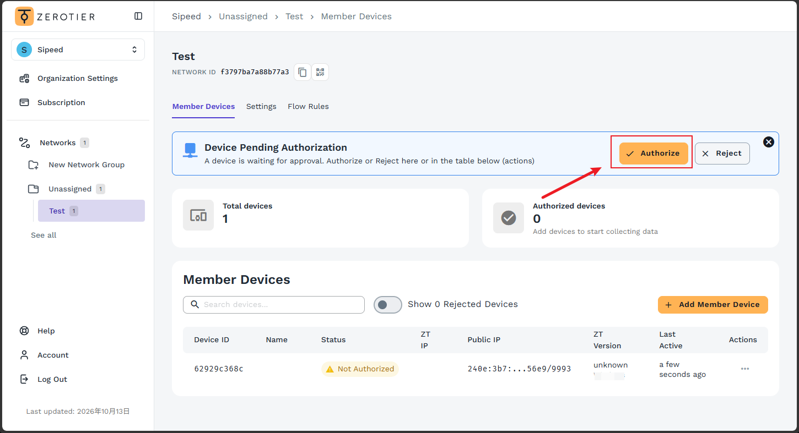

3. 确认客户端状态为已连接。

> 访问端和 NanoKVM Go 必须加入同一个 ZeroTier 网络，并且都被网络允许访问。

## 从外网访问 NanoKVM Go

为避免测到的其实是局域网直连，建议先断开访问端当前的 Wi-Fi，改用手机热点或移动网络。

1. 确认访问端的 ZeroTier 客户端已经连接；

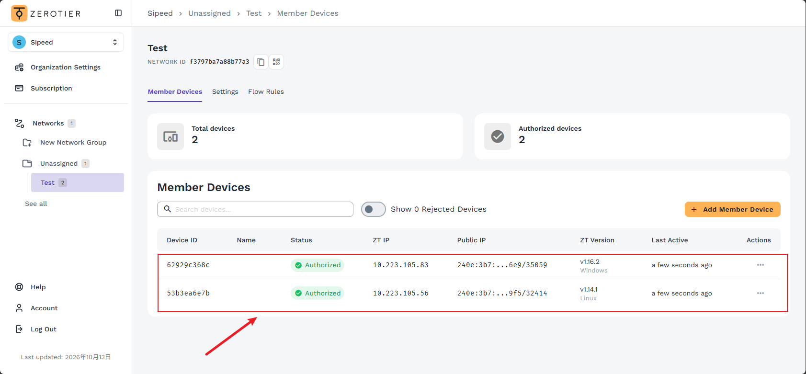

2. 在浏览器地址栏输入 NanoKVM Go 页面显示的 `访问地址`，例如 `https://10.x.x.x`；
3. 如果浏览器提示证书不受信任，按浏览器提示继续访问。NanoKVM Go 使用自签名证书，这个提示正常；
4. 打开 NanoKVM Go 登录页面并完成登录；
5. 测试远程画面、键鼠控制和电源控制等功能。

> 如果页面打不开，先确认访问端已加入同一网络并通过授权，NanoKVM Go 页面显示 `已连接`，并且访问地址是当前有效的分配地址。

## 管理已加入的网络

- 已加入的网络会显示在 ZeroTier 卡片中，包含网络状态和访问地址；
- 点击 `退出` 可以离开当前网络，通过该网络访问的会话会断开；
- 卸载 ZeroTier 会停止并移除客户端，但会保留节点身份和网络成员关系，重新安装后可以继续使用。

## 日常使用与安全建议

- 为 NanoKVM Go 设置强密码，并保留设备自身的登录认证；
- 为 ZeroTier 账号启用 MFA；
- 使用 `Private` 网络，只授权自己信任的节点；
- 定期检查 ZeroTier Central 的 `Members` 列表，移除不再使用的节点；
- 不要为了 ZeroTier 在路由器上额外开放 NanoKVM Go 的端口；
- 不需要远程访问时，可以在 ZeroTier 页面点击 `停用`，或在 Central 中撤销授权；
- 定期更新 NanoKVM Go 的应用和访问端的 ZeroTier 客户端。

## 常见问题

### 设置页面中没有 ZeroTier 选项？

先检查 NanoKVM Go 的应用是否为最新版本，更新后重新打开 `设置` > `远程网络`。

### 安装失败怎么办？

安装包从 `download.zerotier.com` 下载，失败通常与网络或存储空间有关。确认设备可以访问该站点、剩余空间充足后重试。

### 设备上已经安装过 ZeroTier，页面安装失败？

内置安装不会覆盖系统中已有的 ZeroTier。请先卸载通过软件包或其他方式安装的 ZeroTier，再回到页面重新安装。

### 提示 Network ID 无效？

Network ID 必须是 16 位十六进制字符，且不能全为零。请从 ZeroTier Central 的网络设置中重新复制。

### 提示“网络不存在”？

检查 Network ID 是否填写正确，以及该网络是否属于当前登录的 ZeroTier 账号。

### 提示“等待分配地址”？

ZeroTier 网络还没有给设备分配地址。检查网络的 IPv4 自动分配设置，或等待网络下发配置。

### 显示已连接，但浏览器打不开？

依次确认：访问端和 NanoKVM Go 在同一个网络；两端都已授权；NanoKVM Go 页面显示 `已连接`；访问地址与当前分配地址一致。必要时在访问端 `ping` 一下该地址。

### 能通过 ZeroTier 访问 NanoKVM Go 所在局域网的其他设备吗？

不会自动可以。NanoKVM Go 只把自己加入虚拟网络，不会自动把本机局域网共享出去；如果网络配置了 Managed Route，能否访问取决于具体路由和授权。

### 可以连接自建的 ZeroTier 控制器吗？

目前页面没有自建控制器或自定义 Planet 的配置入口，请使用 ZeroTier Central 上的网络。

### 卸载 ZeroTier 后需要重新加入网络吗？

卸载会停止并移除客户端，但会保留节点身份和网络成员关系。重新安装并启用后，通常可以继续使用原来的网络；如果页面显示异常，重新加入一次即可。

## 下一步

- 想在设备之间使用 Tailscale 网络，或不想注册 ZeroTier 账号，可以参考 [Tailscale](tailscale.html) 和 [Sipeed 远程网络](sipeed_remote_network.html)；
- 有公网服务器或自有域名时，可以参考 [frp](frp.html) 和 [Cloudflare Tunnel](cloudflare_tunnel.html)；
- 只希望局域网地址固定，参考 [静态 IP](static_ip.html)；
- 遇到其他问题，查看 [NanoKVM Go 常见问题](../faq.html)。
