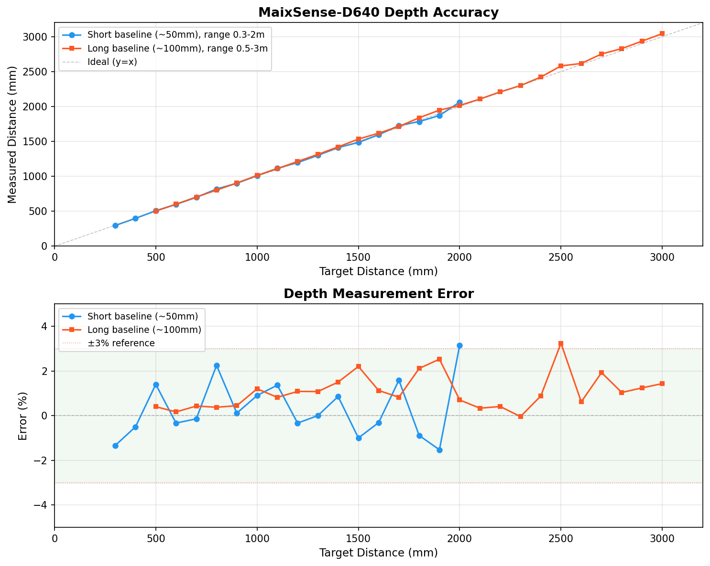

# 测量精度

## 测试条件

- 镜头：70° FOV，双通滤波片
- 传感器：SC035HGS 黑白全局快门
- 目标：漫反射平面（避免镜面反光）
- 方法：对准已知距离目标，读取中心区域深度均值

## 精度曲线

## 短基线版 (~50mm)

有效范围：**0.3m ~ 2.0m**

| 目标距离 (mm) | 测量值 (mm) | 误差 |
| :---: | :---: | :---: |
| 300 | 296 | -1.33% |
| 400 | 398 | -0.50% |
| 500 | 507 | +1.40% |
| 600 | 598 | -0.33% |
| 700 | 699 | -0.14% |
| 800 | 818 | +2.25% |
| 900 | 901 | +0.11% |
| 1000 | 1009 | +0.90% |
| 1100 | 1115 | +1.36% |
| 1200 | 1196 | -0.33% |
| 1300 | 1300 | +0.00% |
| 1400 | 1412 | +0.86% |
| 1500 | 1485 | -1.00% |
| 1600 | 1595 | -0.31% |
| 1700 | 1727 | +1.59% |
| 1800 | 1784 | -0.89% |
| 1900 | 1871 | -1.53% |
| 2000 | 2063 | +3.15% |

**统计：** 平均绝对误差 1.00%，最大误差 3.15%（2000mm 处）

## 长基线版 (~100mm)

有效范围：**0.5m ~ 3.0m**

| 目标距离 (mm) | 测量值 (mm) | 误差 |
| :---: | :---: | :---: |
| 500 | 502 | +0.40% |
| 600 | 601 | +0.17% |
| 700 | 703 | +0.43% |
| 800 | 803 | +0.38% |
| 900 | 904 | +0.44% |
| 1000 | 1012 | +1.20% |
| 1100 | 1109 | +0.82% |
| 1200 | 1213 | +1.08% |
| 1300 | 1314 | +1.08% |
| 1400 | 1421 | +1.50% |
| 1500 | 1533 | +2.20% |
| 1600 | 1618 | +1.12% |
| 1700 | 1714 | +0.82% |
| 1800 | 1838 | +2.11% |
| 1900 | 1948 | +2.53% |
| 2000 | 2014 | +0.70% |
| 2100 | 2107 | +0.33% |
| 2200 | 2209 | +0.41% |
| 2300 | 2299 | -0.04% |
| 2400 | 2421 | +0.88% |
| 2500 | 2581 | +3.24% |
| 2600 | 2616 | +0.62% |
| 2700 | 2752 | +1.93% |
| 2800 | 2829 | +1.04% |
| 2900 | 2936 | +1.24% |
| 3000 | 3043 | +1.43% |

**统计：** 平均绝对误差 1.08%，最大误差 3.24%（2500mm 处）

## 精度特性

- 两个版本在有效范围内误差均 **≤3%**，典型 **~1%**
- 误差随距离增大略有增长（双目视差精度与距离的平方成反比）
- 长基线版在远距离更稳定（3m 处误差 1.43%），短基线版近距离更精细（0.3m 可测）
- 镜面反光表面会显著降低精度，建议使用漫反射目标测试
- 深度值的 Z 轴噪声（帧间抖动）通常 ≤1%，可通过空间滤波和时间平均进一步降低
