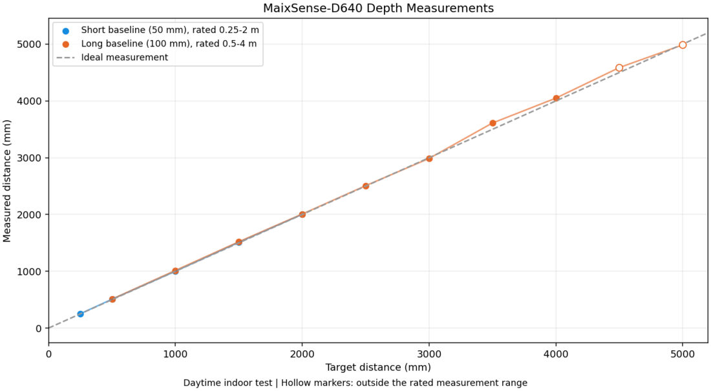

> 以下为特定测试条件下的测量记录。模型或固件更新、环境变化都可能影响结果，本文数据不代表所有场景的精度保证。

## 测试条件

- 环境：白天室内测试
- 镜头：对角 70°（水平 57°、垂直 43°）
- 成像方式：双目黑白全局快门
- 目标：白色哑光平板，避免镜面反光
- 方法：把平板放在已知距离，读取画面中心区域的平均深度

## 精度曲线

曲线展示目标距离与实测距离的对应关系。越接近参考虚线，测量值越接近目标距离。各测点的相对误差见下表。

## 短基线版（50 mm）

有效测量范围：**0.25～2.0 m**。

| 目标距离 (mm) | 测量值 (mm) | 相对误差 |
| :---: | :---: | :---: |
| 250 | 252 | 0.80% |
| 500 | 508 | 1.60% |
| 1000 | 1000.5 | 0.05% |
| 1500 | 1510 | 0.67% |
| 2000 | 2002.6 | 0.13% |

**有效范围内统计：** 所列 5 个测试点的平均相对误差（取绝对值）约 0.65%。

## 长基线版（100 mm）

有效测量范围：**0.5～4.0 m**。表中同时保留范围外的测试点，便于评估量程边缘表现。

| 目标距离 (mm) | 测量值 (mm) | 相对误差 |
| :---: | :---: | :---: |
| 500 | 509 | 1.80% |
| 1000 | 1015 | 1.50% |
| 1500 | 1520 | 1.33% |
| 2000 | 2008 | 0.40% |
| 2500 | 2507 | 0.28% |
| 3000 | 2987 | -0.43% |
| 3500 | 3611 | 3.17% |
| 4000 | 4049 | 1.23% |
| 4500 | 4587 | 1.93% |
| 5000 | 4987 | -0.26% |

**有效范围内统计：** 所列 8 个测试点的平均相对误差（取绝对值）约 1.27%。

## 如何理解这些数据

相对误差 =（测量值 − 目标距离）÷ 目标距离 × 100%。正值表示测量偏远，负值表示测量偏近。

平均相对误差（取绝对值）是各测点相对误差取绝对值后的平均值，避免正负误差相互抵消。仅统计有效测量范围内的测点。

以上数据为白天室内、白色哑光平板条件下的测试结果。实际相对误差受光照、目标材质、纹理及距离影响，可能在 ±5% 范围内浮动。

长基线的 4.5 m、5.0 m 数据为量程外参考，不计入有效测量范围内的统计。

## 下一步

- 连接相机：[快速上手](./quick-start.md)
- 调整显示、曝光与滤波：[上位机软件指南](./gui.md)
- 了解版本与规格：[简介](./maixsense-d640.md)
