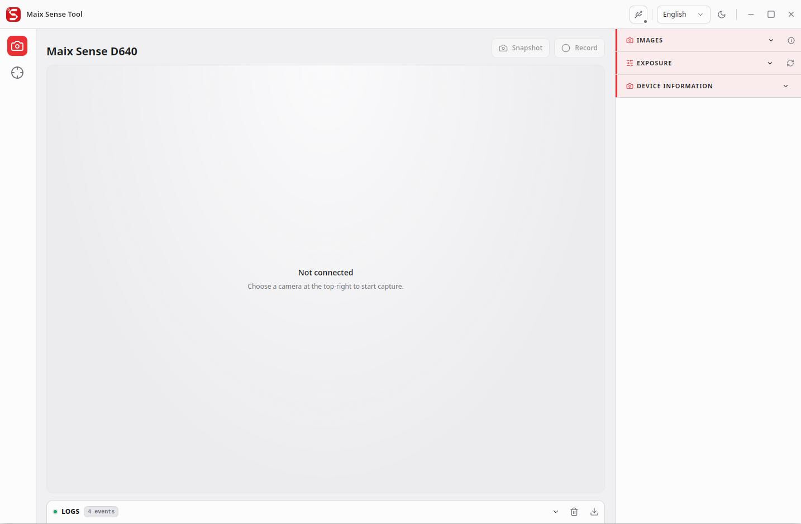
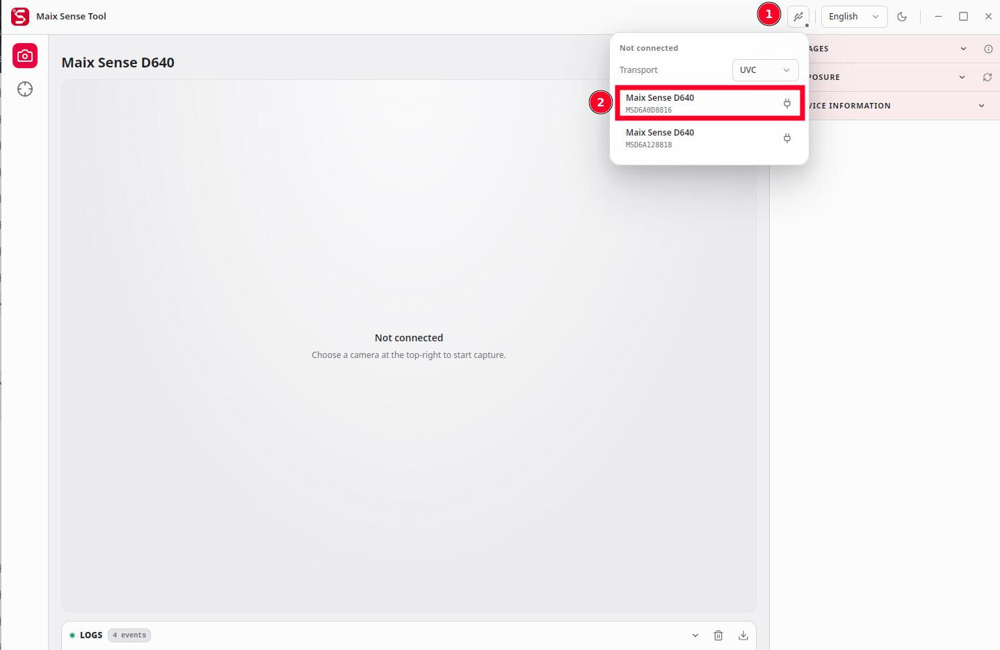
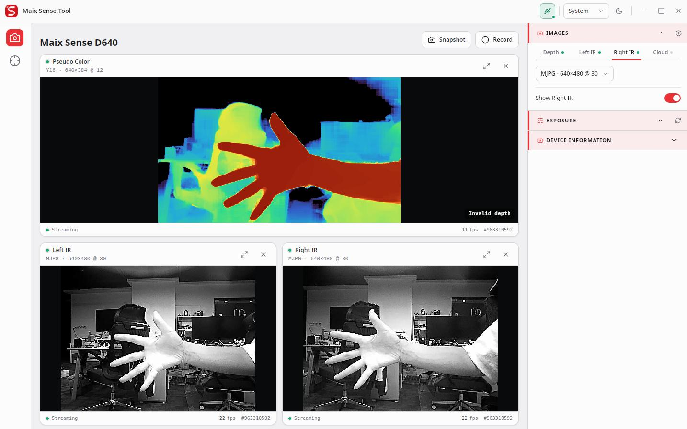
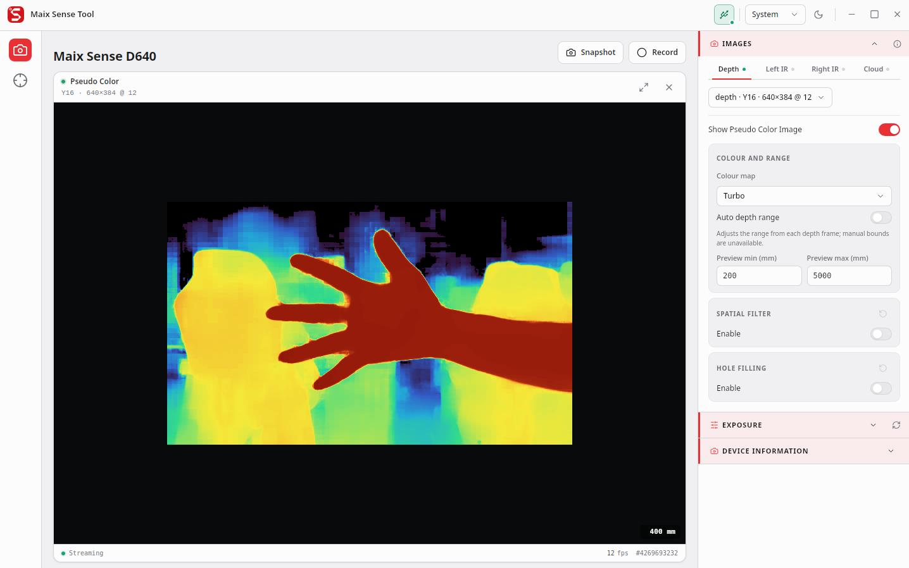
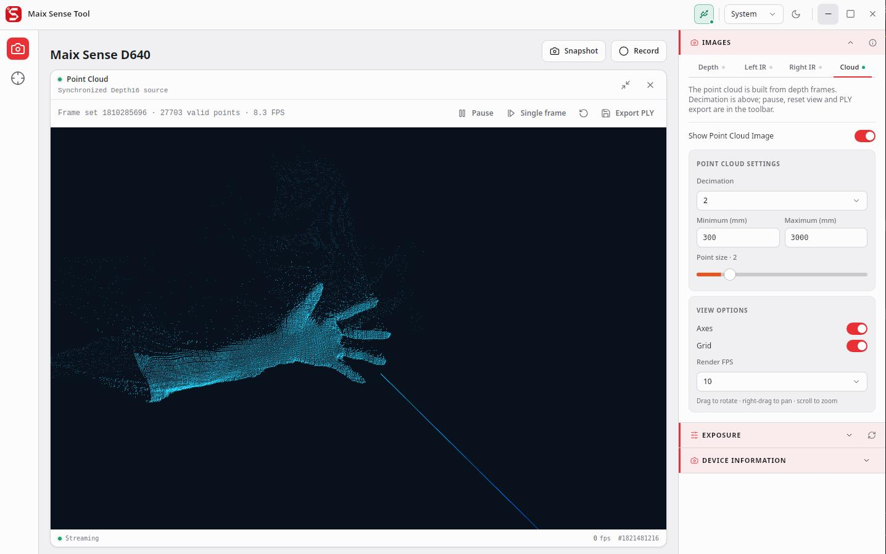
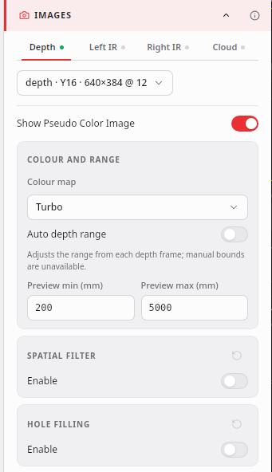
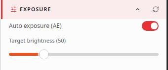
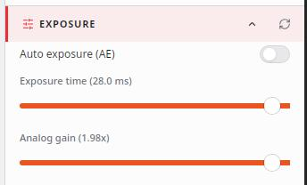
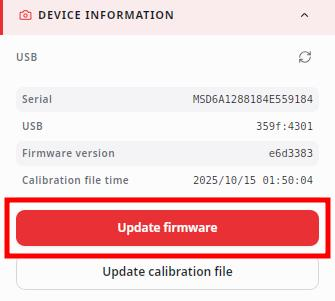
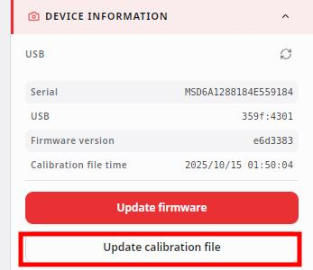

**MaixSense Tool** 是 MaixSense D640 的电脑端配套软件，支持查看深度与双目图像、点击测距、浏览三维点云和保存同步图像，方便你快速体验相机功能，并为算法开发采集数据。

## 下载与安装

最新版 MaixSense Tool 下载（x86-64）

[Windows](https://cdn.sipeed.com/maixsense/d640/latest/maixsense_d640_gui_windows_x86_64.exe)
[Linux AppImage](https://cdn.sipeed.com/maixsense/d640/latest/maixsense_d640_gui_linux_x86_64.AppImage)
[Linux deb](https://cdn.sipeed.com/maixsense/d640/latest/maixsense_d640_gui_linux_x86_64.deb)
[Linux rpm](https://cdn.sipeed.com/maixsense/d640/latest/maixsense_d640_gui_linux_x86_64.rpm)

MaixSense Tool 界面如下：

## 连接设备

1. 将设备通过 USB 数据线连接到电脑。等待模组正面的红外灯亮起时，表示设备已启动。
2. 打开 MaixSense Tool，点击界面右上角的连接图标，将连接方式选为 **UVC**，选择对应的 `MaixSense D640` 设备。

Linux 首次使用需配置设备访问权限，方法见[快速上手](./quick-start.html#Linux-访问权限)。设备未出现时，见[常见问题](./faq.md)。各系统的功能支持以软件发行说明为准。

## 选择画面

支持同时显示`深度图`、`左红外`、`右红外`画面。点击右侧界面的`深度图`、`左红外`、`右红外`，在子窗口中打开显示按钮，即可看到画面。

- 深度图会被渲染为伪彩图，用颜色表示远近。
- 左右红外图是相机拍摄的灰度画面，可以在右侧界面的`曝光控制`中关闭`自动曝光`后手动调整`曝光时间`和`增益`。

## 测量距离

1. 在原始深度模式下，点击右侧`深度图` → `显示伪彩图`。
2. 点击画面中任意位置，在画面右下角会读出该位置的距离，单位为毫米，再次点击可替换读数。

## 查看和导出点云

点云是表示物体表面的三维点集合。软件使用深度图和相机内参（设备内置，用户无需配置）生成点云，可用于观察形状并导出保存。

1. 点击右侧`点云图` → `显示点云图`，即可查看点云图。
2. 点击窗口上的`导出 PLY`图标，并选择保存`ply`文件。

> 提示：
> 1. 点云图的操作方法为鼠标左键拖动旋转、右键拖动平移、滚轮缩放。
> 2. 导出的点云单位为米，坐标方向为 X 向右、Y 向下、Z 向前，点云需要可用的设备内参和完整同步深度帧。若不可用，请查看界面提示与[常见问题](./faq.md)。

## 抓图与录制

### 保存同步快照

1. 点击主界面上方的`抓图`图标。
2. 选择保存目录并确认，等待保存即可。
3. 每次抓图保存同一次采集的深度图和左右红外图，方便后续对照分析。

> 说明：
> 原始深度模式下，`depth_color.png` 为可直接查看的伪彩图，`depth.png` 和 `depth.pgm` 保存 16 位毫米深度；左右红外图分别为 `left_ir.jpg`、`right_ir.jpg`，采集信息保存在 `metadata.json` 中。设备伪彩模式仅保存对应的预览图像和采集信息，不包含原始毫米深度，不能用于测距。

### 录制数据

1. 点击`录制`图标，选择文件保存位置并确认。开始后，界面会显示录制时长和已写入帧组数。
2. 点击`停止录制`图标，等待保存完成提示生成 `.mcap` 文件。

## 调整伪彩画面

点击右侧`深度图` → `显示伪彩图`后，即可调整以下选项。

### 调整颜色与显示范围

1. 在`颜色与范围`中点击`伪彩色`，选择 Turbo、Viridis 或 Magma 配色。
2. 开启`自适应深度范围`，软件会根据当前深度画面自动调整颜色对应的距离范围。
3. 如需固定范围，关闭`自适应深度范围`，再设置`预览最小值（mm）`和`预览最大值（mm）`，最小值应小于最大值。显示范围用于调整颜色与距离的对应关系，不会影响设备的实际测量范围。

### 平滑画面与填补空洞

1. 展开`空间滤波`并开启`启用`，可减小相邻像素之间的深度波动；按需要调整`预览空间滤波差值（mm）`。
2. 展开`空洞填充`并开启`启用`，可填补部分无效深度区域；按需要调整`空洞填充半径（px）`和`空洞填充最大差值（mm）`。
3. 观察目标边缘和细节；如需恢复某项滤波的默认参数，点击该项旁的重置图标，也可关闭该项查看原始效果。
4. 滤波主要用于改善画面平滑度和完整性，不代表测量精度提高。建议从默认参数开始调整，避免过度平滑造成边缘细节丢失。

## 曝光控制

### 自动曝光

开启自动曝光时，可以通过设置目标亮度来调整自动曝光的亮度。

### 手动曝光

关闭自动曝光时，可以根据实际亮度需求手动调节曝光时间和增益。需要注意，当增益设置过大导致图像噪点增多时，会直接影响测量效果。

## 更新固件

升级前请下载[最新固件包](https://cdn.sipeed.com/maixsense/d640/latest/maixsense_d640_firmware.tar.gz)。

1. 点击`设备信息` → `更新固件`。
2. 选择固件包并确认。
3. 更新期间保持供电和 USB 连接，等待操作完成和设备重新连接。

固件更新包不包含相机标定数据。设备未提供 USB 更新接口时，按随包升级说明处理，或向技术支持提供软件版本和设备信息。

## 更新标定文件

> 一般情况下无需关注标定文件。

每台相机的标定数据独立，日常使用无需更换。仅在收到与当前设备匹配的标定包时执行：

1. 点击`设备信息` → `更新标定文件`。
2. 选择标定文件压缩包并确认。
3. 上传期间保持供电和 USB 连接，等待操作完成和设备重新连接。

## 下一步

- 理解测量条件与误差：[测量精度](./accuracy.md)
- 用代码处理深度与点云：[SDK 开发指南](./sdk.md)
- 排查设备和画面问题：[常见问题](./faq.md)
