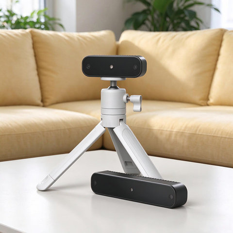
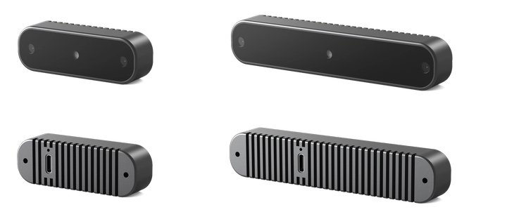
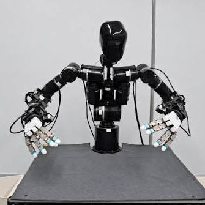
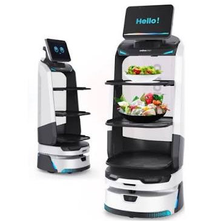
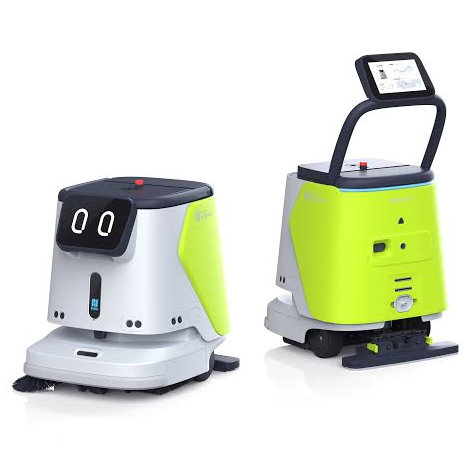
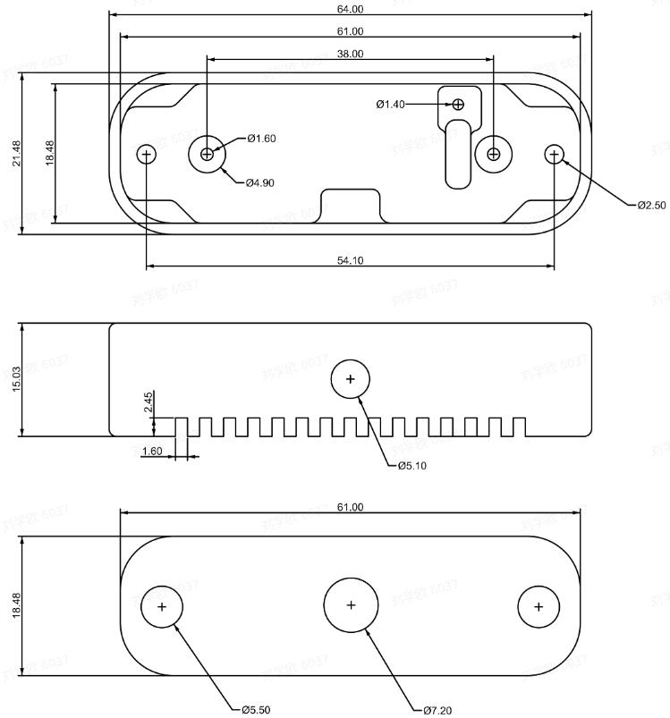
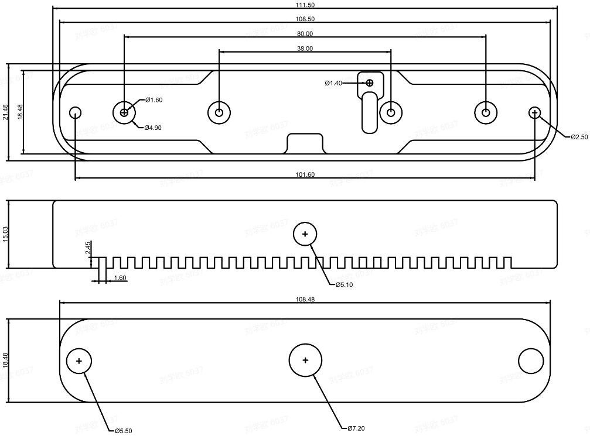
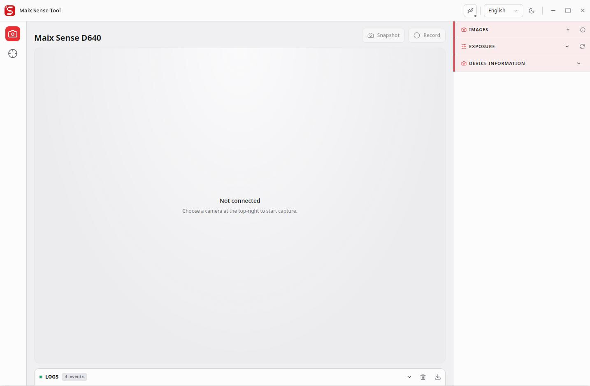
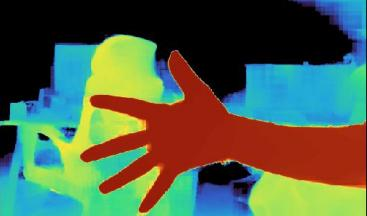

**MaixSense D640** 是 Sipeed 推出的双目立体深度相机模组，采用双目全局快门成像，在相机内部实时计算并通过 UVC 输出深度图与双目图像。适用于需要空间感知、桌面测距和机器人视觉等场景。

## 产品特点

- **内置深度计算**：相机实时计算深度，通过 UVC 提供深度图和双目图像，电脑端可直接采集。
- **两种基线可选**：按工作距离选择短基线（50 mm）或长基线（100 mm）。
- **全局快门双目**：左右灰度图与深度组成同步帧组，方便采集和离线算法分析。
- **快捷预览与三维点云**：支持浏览器快速预览深度图与红外画面，桌面软件支持像素测距、点云预览与三维点云文件（PLY）导出。
- **数据采集工具齐全**：支持同步抓图、深度数据录制与回放（MCAP），提供 C/C++ SDK 和 ROS 2 主机驱动，方便双目应用开发与机器人系统集成。

## 硬件选型

MaixSense D640 提供 50 mm 和 100 mm 两种基线版本，可按目标距离选择：

| 硬件 | 有效测量范围 | 应用场景 |
| :--- | :--- | :--- |
| 短基线版（50 mm） | 0.25～2.0 m | 机器人腕部安装，近距离感知、桌面测距 |
| 长基线版（100 mm） | 0.5～4.0 m | 机器人头部安装，扫地机、除草机或服务机器人中远距离感知 |

应用场景：

<table width="100%">
  <tr>
    <td width="25%"></td>
    <td width="25%"></td>
    <td width="25%"></td>
    <td width="25%"></td>
  </tr>
</table>

## 参数规格

| 参数 | 规格 |
| :--- | :--- |
| 主控芯片 | 双核处理器，集成 NPU，算力 2.4 TOPS |
| 图像传感器 | 双目全局快门图像传感器，单目分辨率 640 × 480 像素 |
| 光学滤光 | 650 nm / 850 nm 双波段带通滤光片 |
| 深度图分辨率 | 640 × 384 像素 |
| 深度图帧率 | 12 fps |
| 红外图像帧率 | 30 fps |
| 基线 | 短基线：50 mm，长基线：100 mm |
| 测量范围 | 短基线：0.25～2.0 m，长基线：0.5～4.0 m |
| 视场角（FOV） | 水平 57° × 垂直 43°，对角 70° |
| 数据接口 | USB 2.0，Type-C 连接器 |
| 供电规格 | 5 V DC，供电电流 ≥ 0.5 A |
| 尺寸 | 短基线：64 x 21.48 x 15.03 mm 长基线：111.5 x 21.48 x 15.03 mm |
| 重量 | 短基线：35 g 长基线：60 g |

**短基线**：

**长基线**：

## 软件功能与入口

首次使用请先按[快速上手](./quick-start.md)连接设备，再用上位机（MaixSense Tool）查看画面、测距或录制深度数据。也可以打开[D640 在线预览](https://maixsense.sipeed.com/d640)在浏览器中查看单路视频。需要编程集成时使用 SDK。

| 软件 | 主要功能与入口 |
| :--- | :--- |
| 在线预览 | 单路伪彩或红外视频预览与录制，使用方法见 [快速上手](./quick-start.html#打开在线预览) |
| 上位机 | 支持 Windows / Linux / macOS 等平台，用于测距、点云、同步抓图、深度数据录制（MCAP）及设备更新，使用方法见 [上位机软件指南](./gui.md) |
| SDK | C/C++ 采集、帧组同步、滤波与点云，见 [SDK 开发指南](./sdk.md) |
| ROS2 | 查看图像和点云、保存与录制机器人传感器数据，见 [ROS2 使用指南](./ros2.md) |
| Agent | 通过对话采集图像、保存文件并检查结果，见 [Agent 使用指南](./ai_agent.md) |

## 输出图像与用途

相机可输出原始深度、伪彩预览和左右红外图像。需要测距或生成点云时选择原始深度；只看远近关系时，可选择设备生成的伪彩预览。

| 图像类型 | 数据格式 | 分辨率 | 帧率 | 用途 |
| :--- | :--- | :--- | :--- | :--- |
| 原始深度图 | Z16/Y16 | 640×384 | 12 fps | 像素值为毫米距离，用于测距和生成点云      像素值单位为 mm，直接按灰度显示时整体偏暗属于正常现象。 |
| 伪彩预览图 | MJPEG | 640×384 | 12 fps | 用颜色表示远近，仅供预览，不用于测距    |
| 左红外图 | MJPEG | 640×480 | 30 fps | 左相机的灰度画面    |
| 右红外图 | MJPEG | 640×480 | 30 fps | 右相机的灰度画面    |

原始深度图与设备生成的伪彩预览图不能同时启用。上位机和 ROS2 可根据原始深度在电脑端生成伪彩显示，不受这项设备流限制。

## 下一步

第一次使用请从 [快速上手](./quick-start.md) 开始，开发集成请阅读 [SDK](./sdk.md)。
