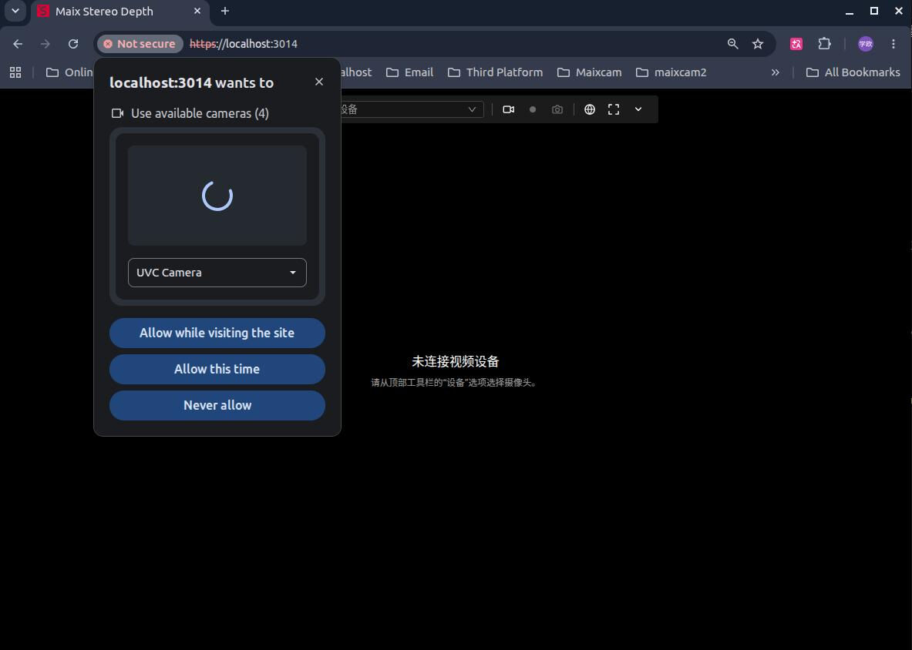
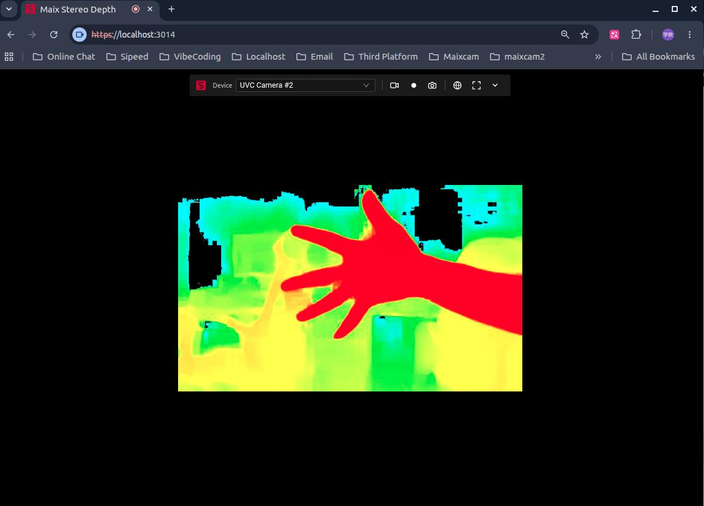
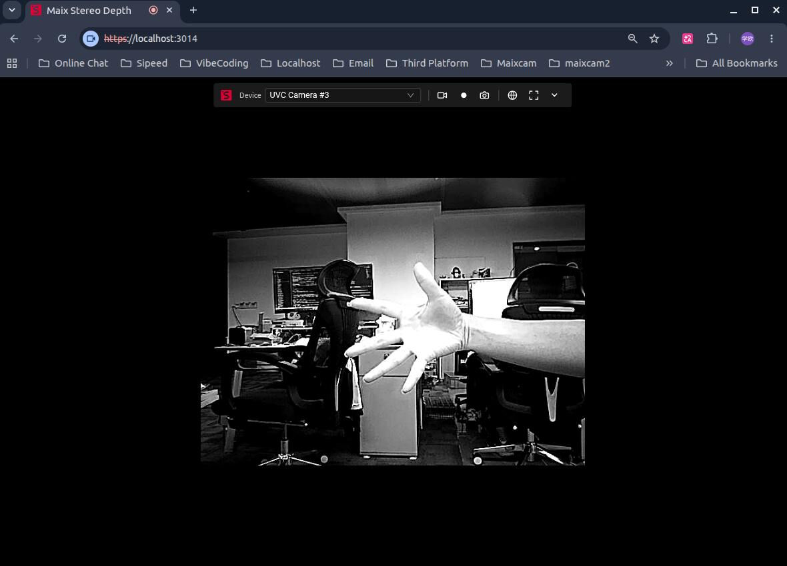

## 准备设备

准备好设备、一根 USB 2.0 Type-C 数据线和一台带浏览器的电脑。

## 连接设备

1. 将设备通过 USB 线连接到电脑。
2. 等待设备启动，正面的红外灯亮起时说明设备已启动。

## Linux 访问权限

Linux 用户首次连接时，先完成本节设置。Windows 和 macOS 用户可继续查看“打开在线预览”。权限配置适用于网页预览、上位机、SDK 和 ROS2，不需要为每个工具分别配置。

### 配置设备访问规则

```bash
# 允许当前桌面会话和 video 组访问设备的 USB、视频接口
sudo tee /etc/udev/rules.d/99-maixsense-d640.rules >/dev/null <<'EOF'
SUBSYSTEM=="usb", ATTR{idVendor}=="359f", ATTR{idProduct}=="4301", GROUP="video", MODE="0660", TAG+="uaccess"
SUBSYSTEM=="video4linux", ATTRS{idVendor}=="359f", ATTRS{idProduct}=="4301", GROUP="video", MODE="0660", TAG+="uaccess"
EOF
# 重新加载并应用规则
sudo udevadm control --reload-rules
sudo udevadm trigger
```

执行后重新插拔设备。

### 查询和配置用户分组

通过终端或 SSH 使用设备时，检查当前用户是否属于 video 组：

```bash
# 查询当前会话所属的用户组
id -nG
```

如果输出中没有 video，执行：

```bash
# 将当前用户加入 video 组
sudo usermod -aG video "$USER"
```

退出并重新登录，让分组设置生效。SSH 用户需要断开连接后重新登录。随后再次执行 id -nG，确认输出包含 video。

### 检查权限是否生效

```bash
# 再次确认当前会话包含 video 组
id -nG
# 查看视频节点的所属组和访问权限，可能同时包含电脑自带的摄像头
find /dev -maxdepth 1 -name 'video*' -exec ls -l {} +
```

设备的视频节点应允许 video 组读写，权限通常显示为 crw-rw----，带访问控制列表时可能显示一个加号。只看到设备名称不代表已有访问权限，还要确认当前会话分组已更新。

如果没有视频节点，先检查数据线、USB 连接和设备启动状态。完成后重新打开网页预览或采集工具。浏览器仍会单独询问是否允许访问摄像头，按后面的步骤授权即可。

## 打开在线预览

在线预览适合快速查看彩色深度画面（伪彩）和左右相机的灰度画面（红外），无需安装桌面应用。需要毫米测距、点云或同步采集数据时，请使用[上位机](./gui.md)或 [SDK](./sdk.md)。

1. 打开 [在线预览](https://maixsense.sipeed.com/d640)。
2. 浏览器提示摄像头访问权限时，选择“允许”。



3. 在顶部设备入口选择 UVC Camera 对应的视频输入，确认出现实时画面。



同一相机可能显示多个视频输入，列表中的 `#1`、`#2` 等编号只用于区分输入，不固定代表伪彩或左/右红外，逐个切换确认即可。网页每次只打开一路视频。

## 预览与保存

- **伪彩预览**：用颜色表示远近，仅供预览，不用于测距。颜色对应固定的 200～5000 mm 范围，不代表该区间内都有有效测量结果。
- **红外预览**：选择对应的视频输入，可以查看单路灰度画面。

  

- **画面操作**：点击顶部工具栏的“视频 → 旋转”可按 0～360° 旋转画面，“视频 → 缩放”可按 1～2 倍缩放，点击全屏图标可以全屏查看。
- **本地保存**：点击顶部工具栏的截图图标，保存当前显示画面为图片。
- **本地录制**：录制当前显示画面，生成浏览器可播放的 WebM 视频（不含声音）。录制中切换设备会先结束当前文件。

> **注意：**
> 在线预览不读取原始 16 位毫米深度，不提供像素测距、点云或三路同步采集。WebM 保存的是显示画面，不能替代上位机的深度数据或 MCAP 同步录制。

## 下一步

- 测距、点云、抓图与固件更新：[上位机软件指南](./gui.md)
- 在自己的程序里读取数据：[SDK 开发指南](./sdk.md)
- 连接或画面异常：[常见问题](./faq.md)
