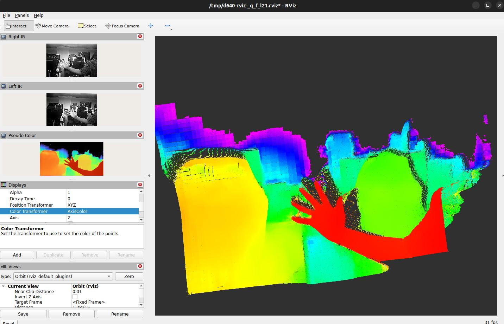

ROS2 是用于构建机器人应用程序的工具包，可以把相机、机器人底盘、机械臂和算法程序连接起来，常见应用场景有：

- **移动机器人避障**：根据深度图或点云判断前方障碍物，为减速、停止和绕行提供依据。
- **室内导航与巡检**：结合地图和定位结果规划路线，让机器人到达目标位置或依次巡检多个地点。
- **环境建图**：把相机观测与机器人运动信息结合，建立周围环境的地图。
- **机械臂作业**：利用物体的空间位置和周围障碍物信息，辅助抓取定位与避碰规划。

本页介绍如何连接设备、查看图像与点云，以及保存和录制数据。导航、建图和机械臂作业需要另行配置对应的机器人程序。

第一次使用，请依次完成[准备环境](#准备环境)、[连接设备](#连接设备)和[首次使用](#首次使用)。完成后，日常只需加载环境并启动查看器。

## 准备环境

### 确认 ROS2 发行版本

运行以下命令确认系统为 Ubuntu，通过 `VERSION_ID` 查看系统版本，例如 `22.04`。

```bash
cat /etc/os-release
```

找到系统对应的 ROS2      发行版本

| Ubuntu | ROS 2 发行版 | 官方安装说明 |
| --- | --- | --- |
| 22.04 (Jammy) | Humble | [Humble](https://docs.ros.org/en/humble/Installation/Ubuntu-Install-Debs.html) |
| 24.04 (Noble) | Jazzy | [Jazzy](https://docs.ros.org/en/jazzy/Installation/Ubuntu-Install-Debs.html) |

### 检查 UTF-8 环境

```bash
locale
```

输出中的 LANG/LC_* 使用 UTF-8 即可，中文 `zh_CN.UTF-8` 也可以，不需要改成英文。仅当系统没有 UTF-8 环境时，执行下面的配置，然后重新检查 locale：

```bash
sudo apt update
sudo apt install locales
sudo locale-gen en_US en_US.UTF-8
sudo update-locale LC_ALL=en_US.UTF-8 LANG=en_US.UTF-8
export LANG=en_US.UTF-8
export LC_ALL=en_US.UTF-8
locale
```

### 添加 ROS2 官方软件源

如果还未配置 ROS 2 官方软件源，先启用 Ubuntu 的 Universe 仓库：

```bash
sudo apt update
sudo apt install software-properties-common curl python3
sudo add-apt-repository universe
```

安装 ROS2 官方软件源配置包。下载失败时请先检查网络，再重新执行。

<style>
.ros-tabs { display: flex; flex-wrap: wrap; margin: 1em 0; }
.ros-tabs > input { position: absolute; opacity: 0; width: 1px; height: 1px; }
.ros-tabs > label { padding: .55em 1.3em; cursor: pointer; border-bottom: 2px solid transparent; }
.ros-tabs > input:checked + label { color: #d33; border-bottom-color: currentColor; font-weight: bold; }
.ros-tabs > input:focus-visible + label { outline: 2px solid currentColor; outline-offset: -2px; }
.ros-tabs > .ros-tab-panel { display: none; width: 100%; min-width: 0; }
.ros-tabs > .ros-tab-panel pre { margin-top: 0; }
.ros-tabs > input.ros-tab-first:checked ~ .ros-panel-first,
.ros-tabs > input.ros-tab-second:checked ~ .ros-panel-second { display: block; }
</style>

<div class="ros-tabs" role="group" aria-label="按 Ubuntu 版本选择 ROS 2 发行版">
<input class="ros-tab-first" type="radio" name="ros-repo" id="ros-repo-first" checked><label for="ros-repo-first">Humble</label>
<input class="ros-tab-second" type="radio" name="ros-repo" id="ros-repo-second"><label for="ros-repo-second">Jazzy</label>
<div class="ros-tab-panel ros-panel-first"><pre><code class="language-bash"># 查询 ROS 官方软件源配置包的最新版本
ROS_APT_SOURCE_VERSION=&quot;$(curl -fsSL https://api.github.com/repos/ros-infrastructure/ros-apt-source/releases/latest | python3 -c &#x27;import json, sys; print(json.load(sys.stdin)[&quot;tag_name&quot;])&#x27;)&quot; &amp;&amp;
  curl -fL --retry 3 -o /tmp/ros2-apt-source.deb \
    &quot;https://github.com/ros-infrastructure/ros-apt-source/releases/download/${ROS_APT_SOURCE_VERSION}/ros2-apt-source_${ROS_APT_SOURCE_VERSION}.jammy_all.deb&quot; &amp;&amp;
  sudo dpkg -i /tmp/ros2-apt-source.deb</code></pre></div>
<div class="ros-tab-panel ros-panel-second"><pre><code class="language-bash"># 查询 ROS 官方软件源配置包的最新版本
ROS_APT_SOURCE_VERSION=&quot;$(curl -fsSL https://api.github.com/repos/ros-infrastructure/ros-apt-source/releases/latest | python3 -c &#x27;import json, sys; print(json.load(sys.stdin)[&quot;tag_name&quot;])&#x27;)&quot; &amp;&amp;
  curl -fL --retry 3 -o /tmp/ros2-apt-source.deb \
    &quot;https://github.com/ros-infrastructure/ros-apt-source/releases/download/${ROS_APT_SOURCE_VERSION}/ros2-apt-source_${ROS_APT_SOURCE_VERSION}.noble_all.deb&quot; &amp;&amp;
  sudo dpkg -i /tmp/ros2-apt-source.deb</code></pre></div>
</div>

### 安装 ROS2 和依赖软件

刷新软件包列表，然后安装对应发行版的 ROS 2 Desktop（含 RViz）：

```bash
sudo apt update
```

<div class="ros-tabs" role="group" aria-label="按 Ubuntu 版本选择 ROS 2 发行版">
<input class="ros-tab-first" type="radio" name="ros-install" id="ros-install-first" checked><label for="ros-install-first">Humble</label>
<input class="ros-tab-second" type="radio" name="ros-install" id="ros-install-second"><label for="ros-install-second">Jazzy</label>
<div class="ros-tab-panel ros-panel-first"><pre><code class="language-bash">sudo apt install ros-humble-desktop</code></pre></div>
<div class="ros-tab-panel ros-panel-second"><pre><code class="language-bash">sudo apt install ros-jazzy-desktop</code></pre></div>
</div>

安装 SDK 构建和运行依赖。这些命令适用于两个发行版：

```bash
sudo apt install ros-dev-tools \
  build-essential cmake ninja-build pkg-config \
  libopencv-dev zlib1g-dev python3-colcon-common-extensions \
  python3-catkin-pkg python3-yaml python3-rosdep
```

### 加载环境并检查安装

先查看当前终端使用的命令解释器：

```bash
ps -p $$ -o comm=
```

按输出选择 Bash 或 Zsh 标签，只执行当前 Ubuntu 版本对应的那一行：

<div class="ros-tabs" role="group" aria-label="选择当前终端的 Shell">
<input class="ros-tab-first" type="radio" name="ros-base-shell" id="ros-base-shell-bash" checked><label for="ros-base-shell-bash">Bash</label>
<input class="ros-tab-second" type="radio" name="ros-base-shell" id="ros-base-shell-zsh"><label for="ros-base-shell-zsh">Zsh</label>
<div class="ros-tab-panel ros-panel-first"><pre><code class="language-bash"># Ubuntu 22.04 执行这一行
source /opt/ros/humble/setup.bash
# Ubuntu 24.04 执行这一行
source /opt/ros/jazzy/setup.bash</code></pre></div>
<div class="ros-tab-panel ros-panel-second"><pre><code class="language-zsh"># Ubuntu 22.04 执行这一行
source /opt/ros/humble/setup.zsh
# Ubuntu 24.04 执行这一行
source /opt/ros/jazzy/setup.zsh</code></pre></div>
</div>

加载后检查：

```bash
# 确认 ROS2 版本，Ubuntu 22.04 应输出 humble，Ubuntu 24.04 应输出 jazzy
echo "$ROS_DISTRO"
# 查看命令帮助，确认 ros2 可以使用
ros2 --help
```

若提示 ros2 找不到，先确认对应的 source 命令没有报错。新开终端后需要重新加载环境，或在后文按自己的 Shell 配置自动加载。

### 获取 SDK 并安装其依赖

下载并解压[最新 SDK 源码包](https://cdn.sipeed.com/maixsense/d640/latest/maixsense_d640_sdk_source.tar.gz)，确认其中包含 `scripts/setup-ros2.sh` 和 `ros2` 文件夹。然后在源码目录执行下面的命令。

```bash
# 进入 SDK 根目录
cd maixsense_d640_sdk
./scripts/setup-ros2.sh --help
# 首次使用时初始化，已初始化可跳过
sudo rosdep init
# 更新依赖索引
rosdep update
# 根据 SDK 清单安装 ROS 依赖
rosdep install --from-paths ros2 --ignore-src -r -y --rosdistro "$ROS_DISTRO"
```

使用 Jazzy 或其他发行版时，请确认脚本帮助中包含 `--rosdistro`。如果帮助中没有该选项，请获取包含发行版选择功能的新版 SDK。

依赖安装完成后，继续连接设备。后面的构建、查看和录制步骤不需要重复安装这些软件。

## 连接设备

将设备通过 USB 连接到电脑。如果是 Linux 系统，请参考[快速上手](./quick-start.html#Linux-访问权限)配置访问权限。

## 首次使用

### 构建设备工具

环境准备完成后，在 SDK 根目录执行：

```bash
./scripts/setup-ros2.sh
```

脚本会编译并安装 D640 SDK 和 ROS 2 驱动。已加载 ROS 2 环境时沿用当前发行版，否则按 Ubuntu 版本选择（22.04 → Humble，24.04 → Jazzy）。要指定其他已安装的发行版，请在新终端加上 `--rosdistro <发行版>`。

默认安装到 `~/.local/maixsense-d640-ros2/<发行版>/`，例如 `humble/` 或 `jazzy/`。可用 `--prefix` 自定义安装目录。首次安装、更新源码或切换发行版时构建一次，日常使用只需加载对应的环境文件。

### 加载 ROS2 环境到终端

在每个新终端中，选择 Bash 或 Zsh，只执行所用发行版对应的一行。使用较早的 SDK 或自定义安装目录时，以构建完成后打印的路径为准。

<div class="ros-tabs" role="group" aria-label="选择当前终端的 Shell">
<input class="ros-tab-first" type="radio" name="ros-device-shell" id="ros-device-shell-bash" checked><label for="ros-device-shell-bash">Bash</label>
<input class="ros-tab-second" type="radio" name="ros-device-shell" id="ros-device-shell-zsh"><label for="ros-device-shell-zsh">Zsh</label>
<div class="ros-tab-panel ros-panel-first"><pre><code class="language-bash"># Humble
source &quot;$HOME/.local/maixsense-d640-ros2/humble/env.bash&quot;
# Jazzy
source &quot;$HOME/.local/maixsense-d640-ros2/jazzy/env.bash&quot;</code></pre></div>
<div class="ros-tab-panel ros-panel-second"><pre><code class="language-zsh"># Humble
source &quot;$HOME/.local/maixsense-d640-ros2/humble/env.zsh&quot;
# Jazzy
source &quot;$HOME/.local/maixsense-d640-ros2/jazzy/env.zsh&quot;</code></pre></div>
</div>

把对应的 source 命令加入 `~/.bashrc`（Bash）或 `~/.zshrc`（Zsh），此后新终端就会自动加载MaixSense D640的ROS2环境。

### 检查是否可以启动

```bash
# 检查环境和连接，不开始采集
ros2 run maixsense_d640_driver maixsense_d640 doctor
```

### 查看图像与点云

在有桌面的 Ubuntu 电脑上执行：

```bash
# 启动相机采集程序和 RViz 图形查看器
ros2 run maixsense_d640_driver maixsense_d640 view
```

首次启动可能需要等待较长时间。请等待终端出现 `ready`，并确认图像和点云持续更新。若一直显示 `waiting for camera`，先检查 USB 连接和[访问权限](./quick-start.html#Linux-访问权限)。



伪彩图用颜色表示距离，不是真实彩色照片。点云表示物体的空间形状。将鼠标移到三维点云区域操作：

- 旋转：按住左键拖动。
- 平移：按住中键拖动。
- 缩放：滚动滚轮。

点云默认按前方深度着色，颜色范围会随画面自动调整。如果只有白点，展开左侧 **Depth PointCloud**，将 **Color Transformer** 设为 **AxisColor**、**Axis** 设为 **Z**，取消 **Use Fixed Frame**。

结束时在启动终端按 **Ctrl+C**。同一设备只运行一份采集程序，切换模式前先停止上一份。

## 日常使用

### 切换查看内容

加载环境后，选择一条命令执行：

```bash
# 查看深度图和三维点云
ros2 run maixsense_d640_driver maixsense_d640 view

# 只看左右红外图
ros2 run maixsense_d640_driver maixsense_d640 view --preset ir

# 只看设备输出的深度伪彩图，此模式不输出深度和点云
ros2 run maixsense_d640_driver maixsense_d640 view --preset pseudo
```

### 在 RViz 中添加画面

1. 在左侧 **Displays** 面板点击 **Add → By topic**。
2. 展开想看的话题，选择下表中的显示类型，点击 **OK**。
3. 确认新增显示项已勾选，并能看到持续更新的数据。

“Topic”就是设备输出数据的通道，默认名称如下：

| 内容 | Topic | 选择的显示类型 |
| :--- | :--- | :--- |
| 深度伪彩图 | `/stereo/pseudo_color/image_raw` | Image |
| 原始深度图 | `/stereo/depth/image_raw` | Image |
| 左红外图 | `/stereo/left/image_raw` | Image |
| 右红外图 | `/stereo/right/image_raw` | Image |
| 三维点云 | `/stereo/points2` | PointCloud2 |


### 选择设备

`msd-enumerate` 是前面的安装脚本一并安装的 SDK 查询工具，加载环境后即可使用。连接多台设备时，通过序列号指定设备：

```bash
# 查看当前设备，找到输出中 serial= 后面的完整序列号
msd-enumerate
# 用实际序列号替换 YOUR_SERIAL，再启动目标设备
ros2 run maixsense_d640_driver maixsense_d640 view --serial YOUR_SERIAL
```

### 查看运行状态

保持采集程序运行，在另一个已加载环境的终端执行下方命令可以检查连接状态和序列号，确认查询的是目标设备。话题出现在列表中，不代表已经收到图像。

```bash
ros2 run maixsense_d640_driver maixsense_d640 status
```

### 保存图像和点云

1. 使用默认 view 命令启动，确认图像和点云持续更新。
2. 在另一个已加载环境的终端执行：

   ```bash
   # 设置保存目录，保存在运行相机程序的电脑上
   mkdir -p "$HOME/d640-captures"
   ros2 param set /stereo/camera save_directory "$HOME/d640-captures"
   # 保存最近的图像和点云
   ros2 run maixsense_d640_driver maixsense_d640 save --kind both
   ```

3. 按命令返回的路径检查文件。默认深度采集保存的是原始深度和已开启的红外图，不包含 RViz 画面截图或主机生成的伪彩图。只保存图像时，将 `both` 改为 `images`，只保存点云时改为 `cloud`

### 录制数据

录制前先运行 view 或 start，确认设备正在输出数据。录制保存的是 ROS 消息，不是 MP4 视频。

1. 保持采集程序运行，在另一个已加载环境的终端执行：

   ```bash
   # 录制到当前目录下的新文件夹，目录名不能与已有录制重复
   ros2 run maixsense_d640_driver maixsense_d640 record --output ./d640-bag
   ```

2. 在录制终端按 **Ctrl+C** 结束录制，相机继续采集。
3. 检查录制结果：

   ```bash
   # 查看录制的话题、时长及消息数量
   ros2 bag info ./d640-bag
   ```
4. 确认录制结果中有所需的话题，且消息数量不为 0。
5. 回放前先停止实机采集，避免实时数据与录制数据混在一起。执行：

   ```bash
   ros2 bag play ./d640-bag
   ```

回放不会自动打开窗口。另开已加载环境的终端运行 `rviz2`，按[在 RViz 中添加画面](#在-RViz-中添加画面)选择录制的话题。点云的 **Global Options → Fixed Frame** 默认填 `depth_optical_frame`，显示为空时将话题的 **Reliability Policy** 设为 **Best Effort**。回放时不要运行 view，它会再次启动相机。

### 不打开图形窗口采集

通过 SSH 操作或无需看图时，使用 start 替代 view：

```bash
ros2 run maixsense_d640_driver maixsense_d640 start
```

保存、查询和录制仍在另一个已加载环境的终端执行。结束采集时，在启动终端按 **Ctrl+C**。

## 下一步

- 编写自己的数据处理程序，见 [SDK 开发指南](./sdk.md)及 SDK 内的 `ros2/README.zh-CN.md`。
- 设备连接和访问权限问题，见[快速上手](./quick-start.html)。
