# 简介

MaixSense 是 Sipeed 的成像感知产品线，把人眼看不到的信息变成一张图：物体有多远、表面有多热、声音从哪里来、内部长什么样。
多数产品插上 USB 就能用，并开放数据接口，方便接进你自己的项目。

## 产品一览

| 成像方式 | 能看到什么 | 型号 | 状态 |
| :--- | :--- | :--- | :--- |
| ToF 深度 | 每个像素到物体的距离 | [MS-A010](./maixsense-a010/maixsense-a010.md)、[MS-A075V](./maixsense-a075v/maixsense-a075v.md) | 在售 |
| 双目深度 | 每个像素到物体的距离 | [MS-D640](./maixsense-d640/maixsense-d640.md) | 即将发布 |
| 红外热成像 | 物体表面的温度 | [MS-T256S](../ThermalCam/T256s/Intro.md)、[MS-T160](../ThermalCam/T160/Introduction.md) | MS-T256S 在售，MS-T160 即将发布 |
| 声场成像 | 声音从哪里发出 | — | 研发中 |
| X 光成像 | 物体内部的结构 | [NanoXray](https://sipeed.com/nanoxray) | 产品定义中，征集意见 |

声场成像和 X 光成像是正在开发的新方向，产品发布后会在这里补充文档。

## ToF 深度相机

ToF（Time of Flight，飞行时间）相机主动发出红外光，测量光从物体反射回来所用的时间，直接得到每个像素的距离，在暗处也能工作。

- **MS-A010**：BL702 + 炬佑 100×100 ToF 模组，极致性价比，自带 LCD 屏实时预览。
- **MS-A075V**：RGB + ToF 3D 摄像机模组，Linux 免驱即插即用。

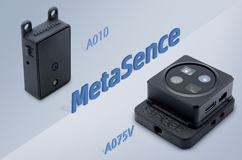

购买方式：[淘宝链接](https://item.taobao.com/item.htm?id=684566484141)

|                                                | 
MS-A010
 | 
MS-A075V
 |
| :--------------------------------------------- | :----------------------------------------------- | :------------------------------------------------ |
|                                                | 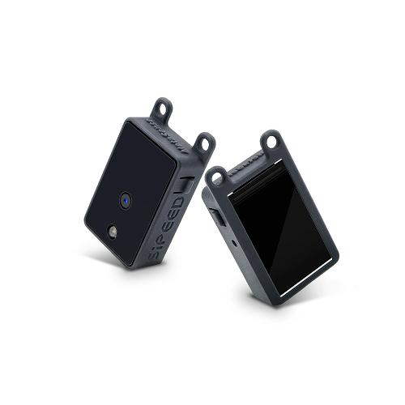               | 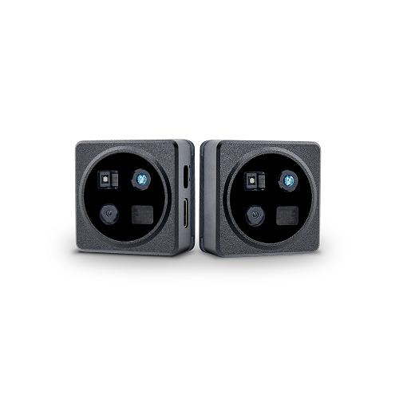                    |
| 接口                                           | 1.25mm 串口连接器 \*1 Type-C USB2.0 \*1       | 1.25mm 串口连接器 \*1  Type-C USB2.0 \*1       |
| 分辨率                                         | TOF：100x100@30fps                               | RGB：1600x1200@30fps TOF：320x240@60fps        |
| 视场角                                         | RGB：无 TOF：70°(H) * 60°(V)                  | RGB：120° TOF：55°(H)*72°(H)                   |
| 
TOF 像素尺寸
 |                                                  | 15um                                              |
| 激光发射器                                     | 940nm VCSEL                                      | 940nm,3W                                          |
| 测量范围                                       | 0.2-2.5m                                         | 0.15-1.5m                                         |
| 测量精度                                       | &lt;=1%/cm                                       | &lt;=1%/cm                                        |

### 案例：远中近物体实拍

高精度的映射物品摆放距离的差异，点云图可直观感受到更真实的可视化。
<html>
  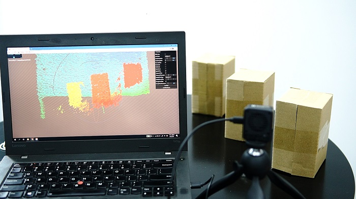
  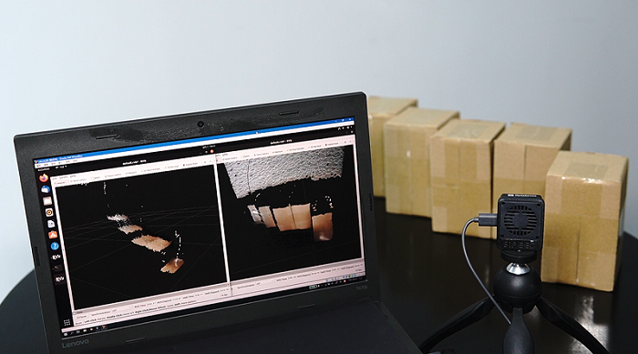
</html>

### 案例：人流统计

可实时监控人流，进行高精度、大分辨率的统计。
<html>
  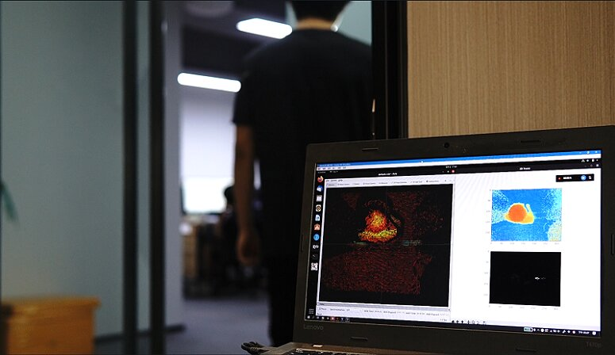
  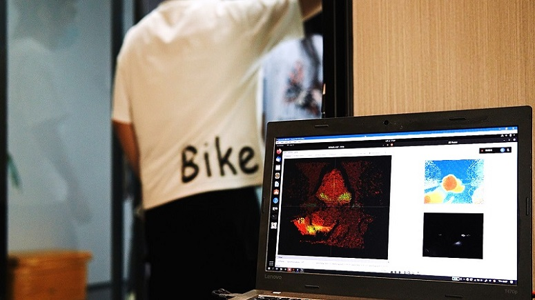
</html>

### 案例：小车避障

可搭载于小车移动并判断画面是否有障碍物，模组自带 LCD 屏幕精准显示距离并做出反应规避障碍物。
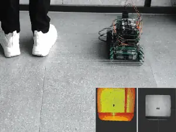

### 案例：键盘灯跟随

实现超酷炫的键盘灯跟随，实时跟踪手部的位置，再根据手部的位置映射键盘灯。

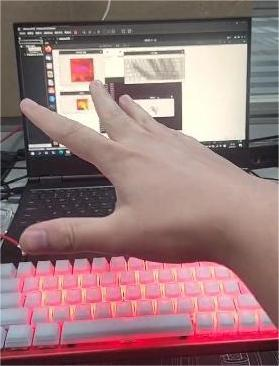

### 案例：体积测量

通过 SDK 获取到的模组内参数后，计算粗略点云并累加总体积，达到体积测量的效果。

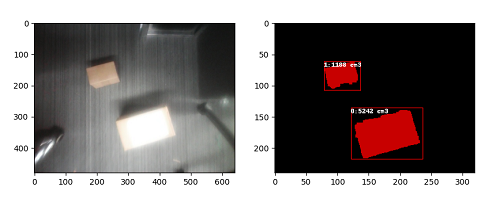

### 案例：外接 MCU
MS-A010 拥有强大的兼容性，基于串口协议的数据传输。
可外接 K210 bit 这样的单片机开发板或树莓派之类的 linux 开发板来进行二次开发。

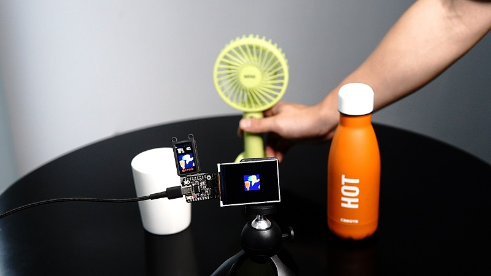

### 案例：接入 ROS1 + ROS2

双支持 ROS 系统，开放 ROS1+ROS2 接入功能包，可快速获得深度数据及深度图。
<html>
  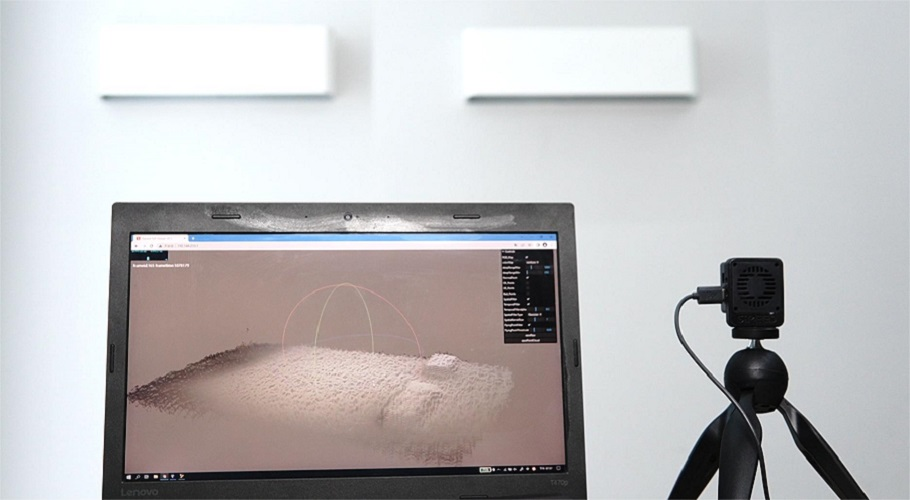
  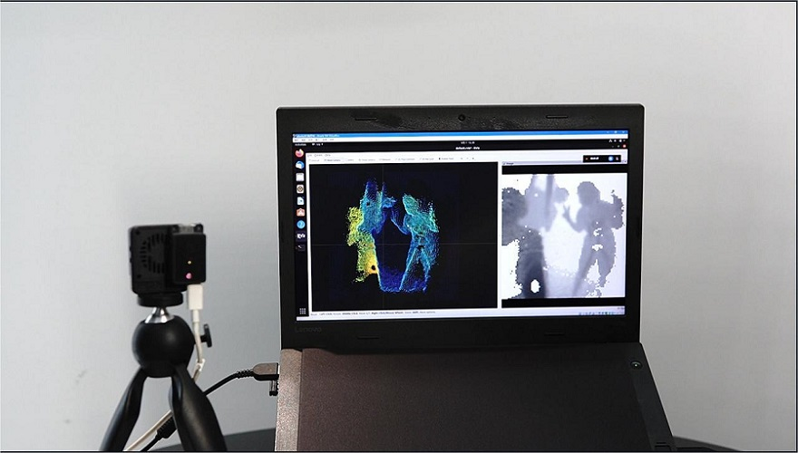
</html>

### 快速了解 ToF 技术

1. TOF: 是一种距离测量的方法，通过测量发射器和反射器之间的超声波/微波/光等信号的“飞行时间”来计算两者之间的距离。 可以实现TOF测距的是TOF传感器。 最常用的是红外线或激光测距。
2. 物体之间的距离存在差异。 该模块通过捕获的深度值的差异来显示冷色和暖色。冷暖色随着距离的映射而变化，距离越近色调呈暖调（橘红）而越远色调呈冷调（蓝色）。
<html>
  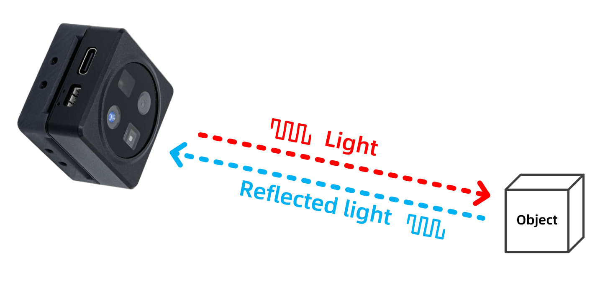
  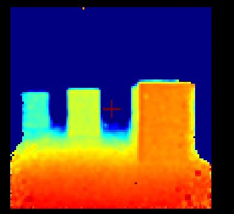
</html>

## 双目深度相机

双目相机像人的双眼一样，用左右两颗图像传感器同时拍摄，再根据同一物体在两幅图中的位置差算出距离。

**MS-D640** 基于爱芯元智 AX620Q，搭载两颗全局快门传感器，由 NPU 实时输出 640×384 深度图（12 fps）。它走标准 UVC 协议，Windows、Linux、macOS 免驱即用。提供两个基线版本：

| | 短基线版（约 50 mm） | 长基线版（约 100 mm） |
| :--- | :--- | :--- |
| 有效测量范围 | 0.3 ~ 2.0 m | 0.5 ~ 3.0 m |
| 适合场景 | 近距离精密测量、桌面级 | 中远距离、机器人导航 |

详细资料见 [MS-D640 文档](./maixsense-d640/maixsense-d640.md)。

## 红外热成像

所有物体都会发出红外辐射，温度越高辐射越强。热成像相机把这种辐射拍成图像，并换算出每个像素的温度，常用于排查电路板发热、设备巡检和建筑漏热检查。

| | MS-T256S | MS-T160 |
| :--- | :--- | :--- |
| 外观 | 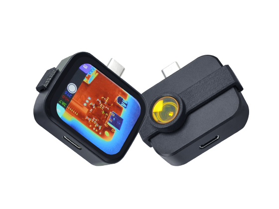 | 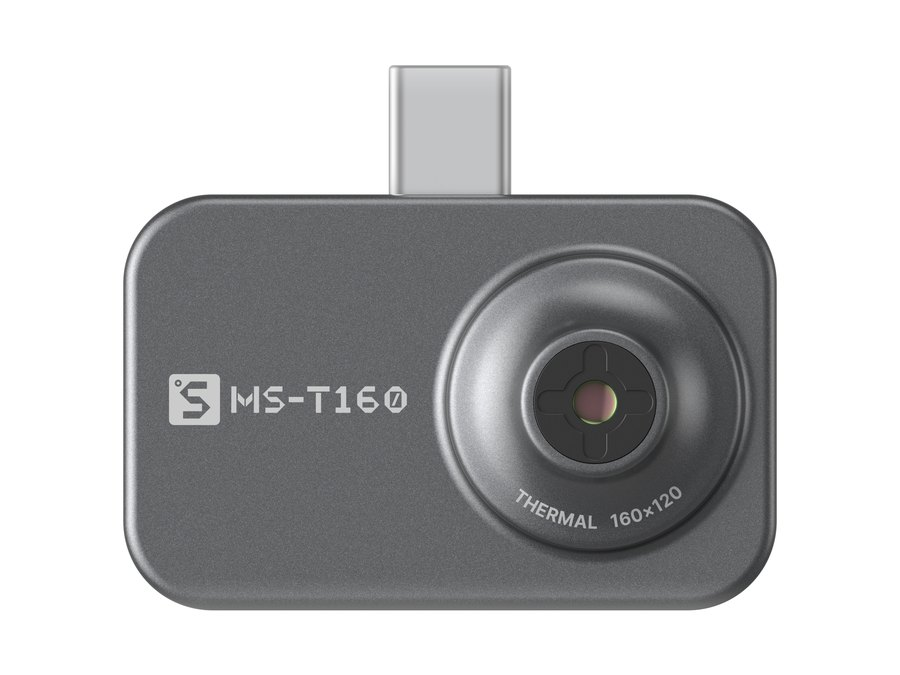 |
| 热成像分辨率 | 256 × 192 | 160 × 120 |
| AI 超分 | 设备本地超分，输出 640 × 480 | 浏览器本地超分，输出 480 × 360 |
| 屏幕 | 1.69 英寸触摸屏，可脱离电脑单独使用 | 无，用手机或电脑浏览器查看 |
| 连接方式 | UVC 免驱摄像头，另提供 HTTP 接口 | USB 网卡 + 设备自带网页，免驱 |
| 文档 | [MS-T256S 文档](../ThermalCam/T256s/Intro.md) | [MS-T160 文档](../ThermalCam/T160/Introduction.md) |

## 更多资料

- ToF MS-A010：[文档](./maixsense-a010/maixsense-a010.md)
- ToF MS-A075V：[文档](./maixsense-a075v/maixsense-a075v.md)
- StereoCam MS-D640：[文档](./maixsense-d640/maixsense-d640.md)
- Thermal MS-T256S：[文档](../ThermalCam/T256s/Intro.md)
- Thermal MS-T160：[文档](../ThermalCam/T160/Introduction.md)
