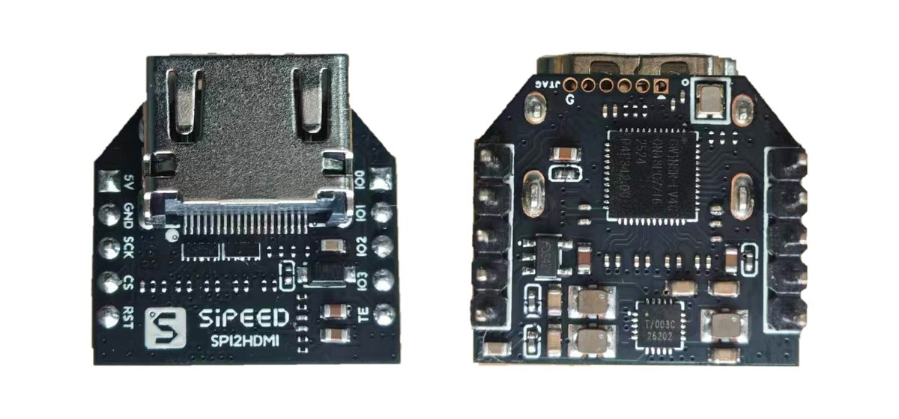
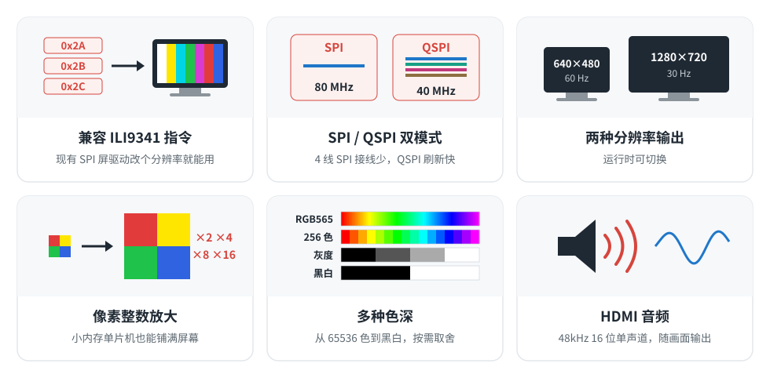
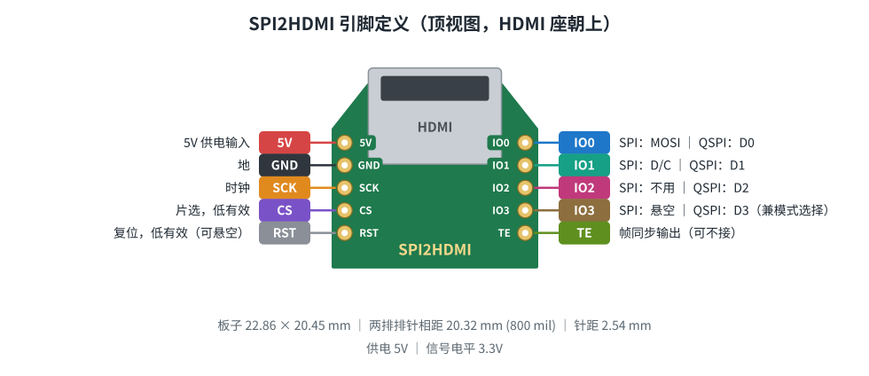
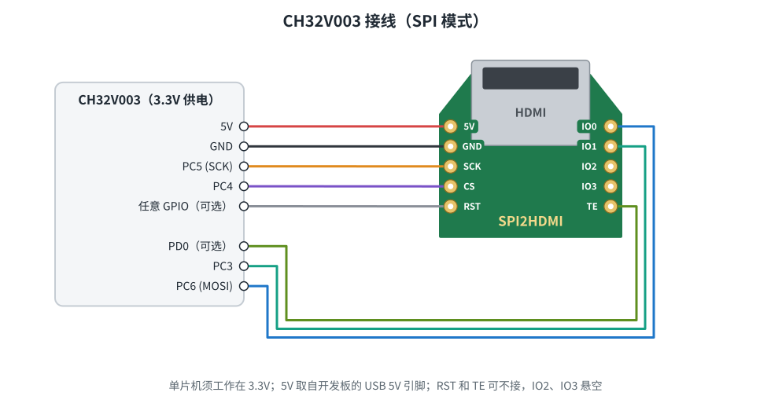
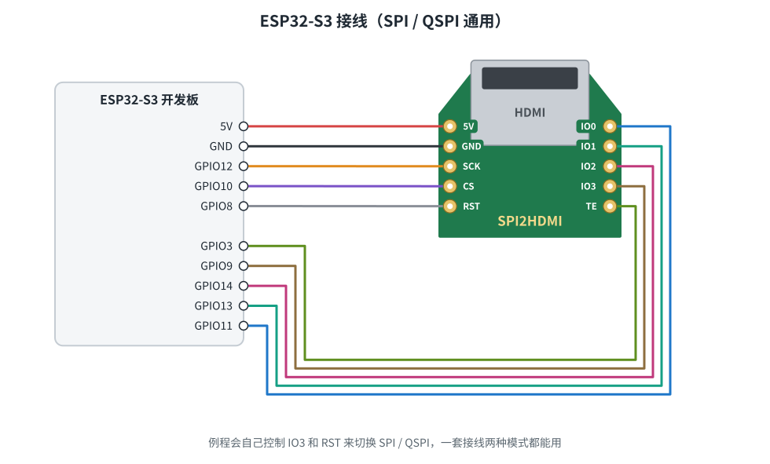
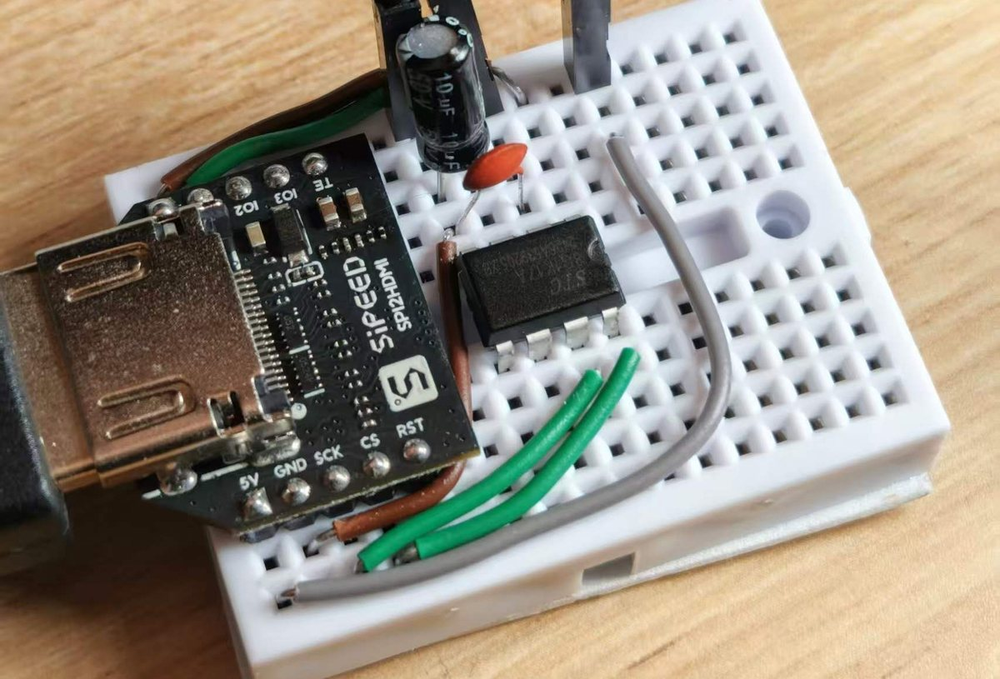
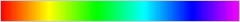

不甘心单片机的画面只能挤在一块小小的 SPI 屏上？想上大屏，却只会驱动 SPI 屏？

**Sipeed SPI2HDMI 模块让任何带 SPI 的单片机都能把画面打到 HDMI 显示器和电视上。** 它的指令兼容最常见的 ILI9341 SPI 屏：你怎么驱动 SPI 屏，就怎么驱动 HDMI。手里现成的屏幕驱动改一下分辨率就能用，一块邮票大小的模块，几根线，小单片机也能玩转大屏幕！

<div style="display:flex;flex-wrap:wrap;gap:8px;">
<video src="./assets/DCIM/demo-stc8.mp4" autoplay loop muted playsinline style="width:calc(50% - 4px);"></video>
<video src="./assets/DCIM/demo-arcade-dino.mp4" autoplay loop muted playsinline style="width:calc(50% - 4px);"></video>
<video src="./assets/DCIM/demo-esp32-nes.mp4" autoplay loop muted playsinline style="width:calc(50% - 4px);"></video>
<video src="./assets/DCIM/demo-esp32-lvgl.mp4" autoplay loop muted playsinline style="width:calc(50% - 4px);"></video>
</div>

> 左上：STC8G1K17A（8 脚 51 单片机）驱动的全彩动画 ｜ 右上：CH32V004 上的小恐龙游戏
> 左下：ESP32-S3 运行 NES 模拟器 ｜ 右下：ESP32-S3 运行 LVGL 基准测试



## 特性



## 规格

| 项目 | 参数 |
|---|---|
| 供电 | 5V，约 0.1A |
| 信号电平 | 3.3V |
| 主机接口 | SPI：模式 0，高位在前，最高 80MHz；QSPI：最高 40MHz |
| 视频输出 | HDMI，640×480@60Hz 或 1280×720@30Hz |
| 显存 | 8MB |
| 尺寸 | 22.86 × 20.45 mm，两排 1×5 排针（2.54mm 针距，排距 20.32mm (800mil)，可直插面包板） |

## 引脚



简单说：SPI 模式只需要接 **5V、GND、SCK、CS、IO0、IO1** 六根线，其余悬空。

## 快速上手

### 先看彩条

只给模块接 5V 和 GND，HDMI 接显示器，上电后屏幕应显示 8 条竖彩条（白黄青绿紫红蓝黑）。看到彩条说明模块、线材和显示器都没问题。

### 接线

CH32V003 这类小单片机用 SPI 模式：



ESP32-S3 可以把十根线都接上，SPI 和 QSPI 都能用：



8 脚的 51 单片机也一样，面包板上插几根跳线就能点亮大屏，具体接法见 [`stc8` 例程](https://github.com/sipeed/SPI2HDMI_demo/tree/main/stc8)：



### 烧录例程

例程都在 GitHub：[sipeed/SPI2HDMI_demo](https://github.com/sipeed/SPI2HDMI_demo)

| 平台 | 例程 | 烧录后应看到 |
|---|---|---|
| STC8G1K17A（8 脚 51） | [`stc8`](https://github.com/sipeed/SPI2HDMI_demo/tree/main/stc8) | 640×480 全屏的 16 色动画，三个场景轮流播放 |
| CH32V003 / V004 | [`ch32/demo`](https://github.com/sipeed/SPI2HDMI_demo/tree/main/ch32) | Bad Apple、生命游戏、分形轮流播放 |
| CH32V004 | [`ch32/arcade`](https://github.com/sipeed/SPI2HDMI_demo/tree/main/ch32/arcade) | 八项游戏菜单（需要支持 720p30 的显示器） |
| ESP32-S3 | [`esp32s3`](https://github.com/sipeed/SPI2HDMI_demo/tree/main/esp32s3) | 彩条；在串口里输入命令可切换模式、分辨率和测试图 |
| ESP32-S3 | [`esp32s3/retro-go`](https://github.com/sipeed/SPI2HDMI_demo/tree/main/esp32s3#retro-go) | retro-go 模拟器合集：NES、Game Boy、Doom 等，画面和声音都走 HDMI（ROM 需自备） |
| 其他单片机 | [`common/spi2hdmi.h`](https://github.com/sipeed/SPI2HDMI_demo/blob/main/common/spi2hdmi.h) | 单头文件驱动，填三个回调函数即可 |

### 画你自己的内容

和 ILI9341 一样，三步：选色深、设窗口、写像素。

```c
#include "spi2hdmi.h"

spi2hdmi_t lcd;
spi2hdmi_hal_t hal = { my_spi_write, my_set_dc, my_set_cs };   // 你的三个底层函数

s2h_init(&lcd, &hal);
s2h_set_format(&lcd, S2H_FMT_RGB565);
s2h_set_scale(&lcd, S2H_SCALE_2X);              // 放大 2 倍，画布变成 320×240
s2h_fill565(&lcd, 0, 0, 319, 239, 0x001F);      // 整屏刷成蓝色
```

已经在用 TFT_eSPI、LVGL 等库时，按 ILI9341 配置驱动，把分辨率改成当前画布大小即可。

## SPI 与 QSPI 模式

模块在 **RST 释放的瞬间**读取 IO3 的电平来决定工作模式，之后保持不变，直到下一次复位：

| IO3 在复位释放时 | 模式 | 引脚用法 |
|---|---|---|
| 悬空或低电平 | SPI | IO0 = MOSI，IO1 = D/C |
| 高电平（保持 1ms 以上） | QSPI | IO0~IO3 = D0~D3，不再使用 D/C |

所以用 SPI 时 IO3 不接就行。用 QSPI 时，让单片机先把 IO3 拉高、给 RST 一个低脉冲，再把 IO3 交还给 QSPI 外设。QSPI 的帧格式与 SH8601、AXS15231B 等屏相同，ESP-IDF 下可直接使用仓库里的 [`esp_lcd_spi2hdmi`](https://github.com/sipeed/SPI2HDMI_demo/tree/main/esp32s3) 组件。

> ⚠️ **关于高速时钟**：SPI 80MHz、QSPI 40MHz 对杜邦线和面包板来说已经偏高。如果画面抖动、出现噪点或花屏，请缩短连线、让地线紧挨 SCK，或者先把时钟降到 20~40MHz。

## 分辨率与放大

画布大小 = 输出分辨率 ÷ 放大倍数。画布越小，单片机每帧要发的数据越少。

| 输出模式 | 放大倍数（`0x88` 的参数） | 画布大小 |
|---|---|---|
| 640×480@60Hz | 1× / 2× / 4× / 8× / 16×（0~4） | 640×480 / 320×240 / 160×120 / 80×60 / 40×30 |
| 1280×720@30Hz | 2× / 4× / 8× / 16×（0~3） | 640×360 / 320×180 / 160×90 / 80×45 |

切换输出模式（`0x8B`）时画面会黑一下，显存内容保留。部分电脑显示器不支持 720p30，电视一般都支持。

## 指令

ILI9341 兼容指令：

| 指令 | 名称 | 参数 | 说明 |
|---|---|---|---|
| `0x2A` | CASET | x0、x1（各 2 字节，高字节在前） | 列窗口 |
| `0x2B` | PASET | y0、y1 | 行窗口 |
| `0x2C` | RAMWR | 像素数据 | 从窗口左上角开始写，自动换行 |
| `0x3C` | RAMWRC | 像素数据 | 从上次停下的位置接着写 |
| `0x3A` | COLMOD | 1 字节 | 色深，见下表 |
| `0x36` | MADCTL | 1 字节 | 只有 BGR 位有效，不支持旋转 |
| `0x20` / `0x21` | INVOFF / INVON | 无 | 反色关 / 开 |
| `0x28` / `0x29` | DISPOFF / DISPON | 无 | 黑屏 / 恢复显示 |
| `0x01` | SWRESET | 无 | 恢复默认设置，不清除画面 |

其余 ILI9341 指令会被安全忽略。扩展指令：

| 指令 | 参数 | 说明 |
|---|---|---|
| `0x88` | 1 字节 | 放大倍数，见上一节 |
| `0x8B` | 0 或 1 | 输出模式：0 = 640×480@60，1 = 1280×720@30 |
| `0x89` | R、G、B | 灰度和黑白格式的基底颜色（"最亮"时显示的颜色），默认白色 |
| `0x8A` | 16 字节（RGB332） | 16 色模式的调色板 |
| `0x8E` | 音频数据 | 48kHz、16 位、单声道、低字节在前的 PCM，随 HDMI 输出 |

色深（`0x3A` 的参数）：

| 参数 | 格式 | 每像素 | 颜色示意 |
|---|---|---|---|
| `0x55` | RGB565（默认） | 2 字节，高字节在前 |  |
| `0x32` | RGB332，256 色 | 1 字节 |  |
| `0x24` | 16 色调色板 | 半字节 |  |
| `0x14` | 4 位灰度，可着色 | 半字节 |  |
| `0x12` | 2 位灰度，可着色 | 1/4 字节 |  |
| `0x11` | 黑白，可着色 | 1/8 字节 |  |

灰度和黑白格式可以用 `0x89` 指定基底颜色，画面就从黑渐变到这个颜色，而不是到白色。例如把 4 位灰度设成琥珀色 ，或把 2 位灰度设成绿色 ，很适合做复古终端、单色屏风格的界面。

不足一字节的格式，窗口的起始列和宽度要对齐到整字节（例如黑白模式是 8 的倍数）。

## 性能与选型

整屏刷新的帧率取决于每帧字节数和总线速率。下表是**按总线速率计算的上限**，实际还要减去单片机准备数据的时间；帧率不会超过输出刷新率（60 或 30）。

| 画布与色深 | 每帧字节 | SPI 24MHz | SPI 40MHz | SPI 80MHz | QSPI 40MHz |
|---|---:|---:|---:|---:|---:|
| 640×480 RGB565 | 614,400 | 4.9 | 8.1 | 16 | 32 |
| 640×480 RGB332 | 307,200 | 9.8 | 16 | 32 | 60 |
| 640×480 黑白 | 38,400 | 60 | 60 | 60 | 60 |
| 320×240 RGB565 | 153,600 | 19 | 32 | 60 | 60 |
| 320×240 RGB332 | 76,800 | 39 | 60 | 60 | 60 |
| 160×120 RGB565 | 38,400 | 60 | 60 | 60 | 60 |
| 640×360 RGB565（720p） | 460,800 | 6.5 | 10 | 21 | 30 |
| 320×180 RGB565（720p） | 115,200 | 26 | 30 | 30 | 30 |

实测参考（ESP32-S3，640×480 RGB565 整屏）：SPI 80MHz 约 69ms 一帧，QSPI 40MHz 约 39ms 一帧。只更新画面中变化的区域时，帧率会高得多。

怎么选平台：

| 你的单片机 | 建议用法 |
|---|---|
| 小内存 MCU（CH32V003 等，SPI 20MHz 左右） | SPI 模式；160×120 或更小的画布，或用黑白 / 16 色格式跑高分辨率；只刷变化的区域 |
| 带 DMA 的 32 位 MCU（SPI 40~80MHz） | SPI 模式；320×240 RGB565 可以整屏 30~60 帧，适合 LVGL 界面 |
| 支持 QSPI 的 MCU（ESP32-S3 等） | QSPI 模式；640×480 RGB565 整屏刷新、模拟器、视频播放 |

## 复位与 TE

- **RST**：低电平复位，内部已上拉，可以不接。复位后恢复默认设置并重新读取 IO3；显存内容不会被清除。
- **TE**：帧同步输出，在每帧的消隐期间为高电平（640×480 时约 1.4ms，720p 时约 1.3ms）。在 TE 上升沿开始写数据可以减轻画面撕裂，不需要时可以不接。

## 常见问题

### 屏幕没有信号或一直黑屏

先只接电源和 HDMI 看彩条。没有彩条时，检查 5V 供电是否充足、HDMI 线是否插好，再换一台显示器试试。

### 有彩条，但单片机写不上画面

检查 SCK、CS、IO0、IO1 四根线和共地；确认 SPI 是模式 0、高位在前；确认 IO3 在上电时没有被拉高（拉高会进入 QSPI 模式）。

### 画面抖动、有噪点或错位

多半是时钟太快或连线太长，见上面[关于高速时钟](#SPI-与-QSPI-模式)的提醒。

### 切到 720p 后显示器提示不支持

1280×720@30Hz 不是所有电脑显示器都支持，换电视或改回 640×480。

### 能接 5V 电平的单片机吗

模块的信号脚是 3.3V 电平，5V IO 的单片机需要在信号线上加电平转换。现在常见的单片机基本都是 3.3V，可以直接连接。

### 能读回显存或屏幕 ID 吗

不能，模块只接收数据。画面旋转也需要在单片机一侧完成。

## 相关链接

- 例程代码：[github.com/sipeed/SPI2HDMI_demo](https://github.com/sipeed/SPI2HDMI_demo)
- 购买：敬请期待
